# Лекция 6. Глобализация: линейный поиск, доверительная область и сопряжённые градиенты

**Курс:** Вычислительная оптимизация · **Часть II. Безусловная оптимизация и ньютоновские методы** · Лекция 6 из 16 · 14 октября 2026

**Материалы:** [конспект-ноутбук с кодом демонстраций](lecture06.ipynb) · [демо-ноутбук](demo06.ipynb) · [семинар: глобализация в CasADi и IPOPT](seminar06.ipynb) · [разбор упражнений](exercises06.ipynb) · [интерактивная страница «Армихо, Вольфе, доверительная область, CG»](https://claude.ai/artifact/KniuVJGw3XPZvWVeDtBpwE)

В конспекте-ноутбуке три демонстрации стоят прямо в тексте: «Демо (a)» — линейный поиск — после раздела 2, «Демо (b)» — доверительная область — после раздела 3, «Демо (c)» — сопряжённые градиенты — после раздела 4. Задачи-крючки и биография цепи — только в `demo06.ipynb` (части (0) и (d)).

---

## Пять шагов — и двадцать три миллиарда

Возьмите функцию $f(x)=x\arctan x-\tfrac12\ln(1+x^2)$: гладкую, **строго выпуклую**, с единственным минимумом в нуле. Запустите из $x_0=2$ метод Ньютона:

$$
2\ \to\ -3.54\ \to\ 13.95\ \to\ -279\ \to\ 1.2\cdot10^{5}\ \to\ -2.3\cdot10^{10}.
$$

Пять шагов — и точка улетела на 23 миллиарда. Тот же Ньютон, которому разрешили укорачивать шаг по правилу Армихо, приходит в минимум за **5 итераций**.

**Почему так.** $f'(x)=\arctan x$, $f''(x)=\dfrac{1}{1+x^2}>0$. Шаг Ньютона — вершина параболы-модели $m_k(p)=f(x_k)+f'(x_k)\,p+\tfrac12f''(x_k)\,p^2$:

$$
x_{k+1}=x_k-\frac{f'(x_k)}{f''(x_k)}=x_k-(1+x_k^2)\arctan x_k .
$$

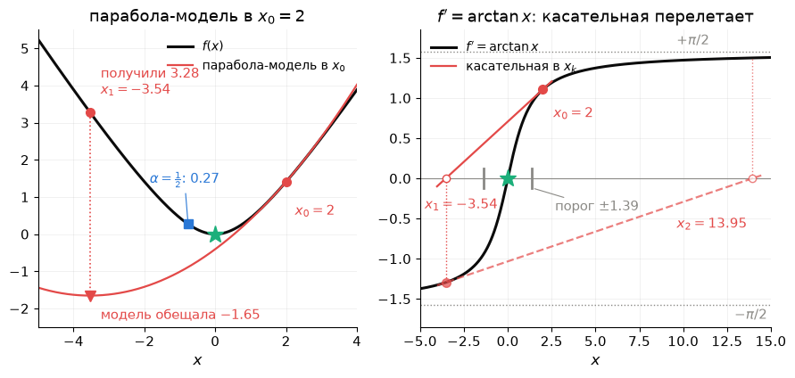

*Слева: парабола-модель в $x_0=2$ обещает в вершине $x_1=-3.54$ значение $-1.65$, а на самом деле там $f=3.28$ — хуже, чем было ($1.41$); половина шага (синий квадрат) даёт $0.27$. Справа: тот же метод как Ньютон для уравнения $f'(x)=\arctan x=0$ — касательная к почти горизонтальной кривой пересекает ось всё дальше.*

| $k$ | чистый Ньютон, $x_k$ | с Армихо, $x_k$ | $\alpha_k$ |
|---|---|---|---|
| 0 | $2$ | $2$ | — |
| 1 | $-3.54$ | $-0.77$ | $\tfrac12$ |
| 2 | $13.95$ | $0.27$ | $1$ |
| 3 | $-279$ | $-0.013$ | $1$ |
| 4 | $1.2\cdot10^{5}$ | $1.6\cdot10^{-6}$ | $1$ |
| 5 | $-2.3\cdot10^{10}$ | $3\cdot10^{-18}$ | $1$ |

- **Направление всегда верное:** $f''>0$, и шаг $-(1+x^2)\arctan x$ имеет знак, противоположный $x$, — всегда к нулю.
- **Длину парабола врёт:** $f''\to0$ вдали от нуля, парабола с крошечной кривизной очень широка, и её вершина лежит далеко за минимумом; касательная к полке $\pm\pi/2$ пересекает ось далеко.
- **Ошибка возводится в квадрат — и растёт:** при $\lvert x_k\rvert\gg1$ шаг $\approx\tfrac{\pi}{2}x_k^2$, то есть $\lvert x_{k+1}\rvert\approx\tfrac{\pi}{2}x_k^2$ — та же формула, что у квадратичной сходимости $\lvert e_{k+1}\rvert\le C\lvert e_k\rvert^2$, только $C\lvert e_k\rvert>1$. Чистый Ньютон сходится лишь из $\lvert x_0\rvert<1.39$: с порога шаг переносит ровно в $-x_0$.

Армихо отверг полный шаг ($3.28>1.41$) и принял половину ($0.27$); дальше точка внутри порога, и шаги полные. **Модель назначает направление, длину шага проверяет функция** — в этом вся лекция.

### Ещё два крючка

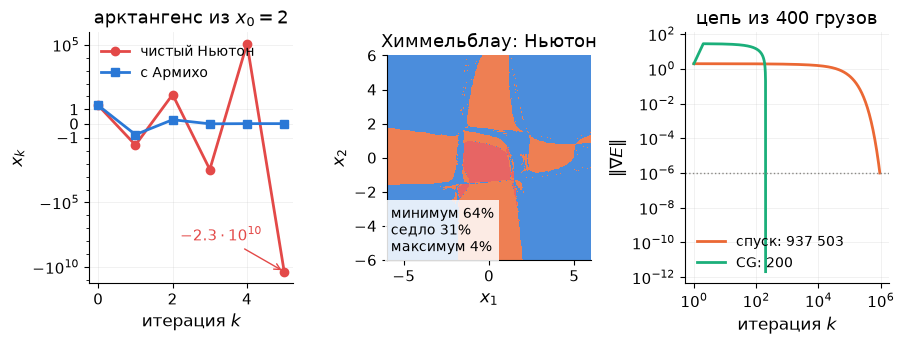

- **Химмельблау:** из $36\,\%$ стартов чистый Ньютон приходит не в минимум, а в седло или в максимум. Метод доверительной области из тех же стартов — **в минимум из $100\,\%$**.
- **Цепь из $400$ грузов** ($800$ переменных): градиентный спуск — $937\,503$ итерации, метод сопряжённых градиентов — **$200$**. Итерация у обоих стоит одинаково: одно умножение матрицы на вектор.

### Проблема и три ответа

Ньютон, BFGS и Гаусс–Ньютон — методы *локальные*: быстрые рядом с решением и слепые вдали от него, потому что квадратичная модель честна лишь в окрестности точки. Сегодняшняя тема — **глобализация** (*globalization*): как заставить метод сходиться из любого старта, не потеряв скорость вблизи решения.

**Зачем это вам.** Каждый солвер устроен как «локальный двигатель + глобализация»: SciPy, IPOPT, MATLAB, Ceres, PyTorch. Пока всё работает, глобализации не видно; когда ломается, в логе появляются `alpha_pr = 0.125`, `lg(rg) = 2.0`, «Desired error not necessarily achieved due to precision loss» — и без сегодняшней лекции эти строки ничего не говорят.

**Главный герой лекции — доверие к модели.** Насколько верить $m_k(p)$ и как решать это автоматически — три ответа:

1. **Линейный поиск** (*line search*): направление — из модели, длина шага — по самой функции (раздел 2).
2. **Доверительная область** (*trust region*): сначала радиус, в котором модели верим, потом шаг; радиус настраивается сам (раздел 3).
3. **Сопряжённые градиенты** (*conjugate gradients*, CG): почти ньютоновская скорость, когда матрицу $n\times n$ не построить и не обратить (раздел 4).

## 1. Повторение: что мы уже умеем

Лекция начинается с десяти минут повторения: сегодняшние методы — надстройка над всем, что было в лекциях 1–5.

### 1.1. Пять лекций на одной странице

| Лекция | Главная мысль | Число, которое стоит помнить | Где |
|---|---|---|---|
| 1 | Задача = переменные + цель + ограничения; классы LP, QP, выпуклые, NLP; численно решить = найти точку с заданной точностью | цепь: первая сквозная задача | Л1, §3, §6, §7.3 |
| 2 | Выпуклая задача: локальный минимум = глобальный; проверка — гессиан $\succeq0$ | — | Л2, §4, §6 |
| 3 | С ограничениями в решении антиградиент уравновешен нормалями активных ограничений; множители — силы и цены (ККТ) | цепь на полу: множители = силы реакции | Л3, §4–8 |
| 4 | Без ограничений: $\nabla f=0$, $\nabla^2f\succeq0$; спуск сходится линейно, итераций $\sim\kappa$ | Розенброк: $13\,756$ итераций, $\kappa=2508$; цепь $N=40$: $10\,575$ | Л4, §2–5 |
| 5 | Один рецепт «линеаризуй и реши» — Ньютон, BFGS, Гаусс–Ньютон; квадратичная и сверхлинейная сходимость вблизи решения; Армихо и сдвиг $\tau I$ вдали | Розенброк: Ньютон $7$, с Армихо $22$, BFGS $34$; цепь: Ньютон $1$, BFGS с точным шагом $20$ | Л5, §2–6 |

### 1.2. Одна формула и что в ней уже заполнено

Все методы части II — это

$$
\boxed{\;x_{k+1}=x_k+\alpha_kp_k,\qquad p_k=-B_k^{-1}\nabla f(x_k)\;}
$$

**Направление** $p_k$ задаёт матрица кривизны $B_k$: что метод знает о функции. **Длину** задаёт $\alpha_k$. Лекция 4 научилась выбирать $\alpha_k$ для спуска ($B_k=I$), лекция 5 — выбирать $B_k$: гессиан, BFGS, $J^\top J$, $J^\top J+\lambda I$.

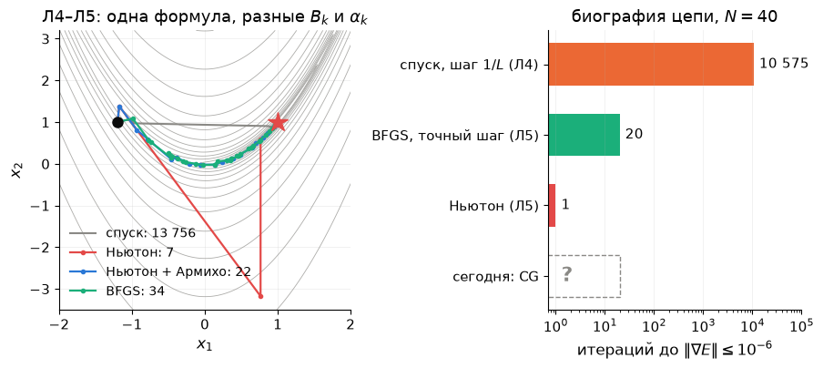

| Метод | $B_k$ | $\alpha_k$ | Скорость вблизи решения | Розенброк из $(-1.2,1)$ |
|---|---|---|---|---|
| градиентный спуск (Л4) | $I$ | backtracking | линейная, множитель $\approx1-1/\kappa$ | $13\,756$ |
| Ньютон (Л5) | $\nabla^2f(x_k)$ | $1$ | квадратичная | $7$ (с выбросом до $(0.76,-3.18)$) |
| Ньютон + Армихо (Л5) | $\nabla^2f$ или $\nabla^2f+\tau I$ | Армихо | квадратичная | $22$ |
| BFGS (Л5) | из секущего уравнения | Армихо | сверхлинейная | $34$ |
| Левенберг–Марквардт (Л5) | $J^\top J+\lambda_kI$ | $1$, а $\lambda_k$ — по $\rho$ | почти квадратичная | синус: $7$ вычислений $r$ |

Две колонки остались открытыми: **почему** правило Армихо гарантирует сходимость (и гарантирует ли) и **что делать**, когда $B_k$ нельзя ни построить, ни обратить. Это и есть сегодняшняя лекция.

### 1.3. Блиц: шесть вопросов

Ответ — одной фразой; если не получается, ссылка ведёт туда, где он есть.

1. Чем выпуклая задача приятнее невыпуклой?
2. Что в точке минимума с ограничениями уравновешивает антиградиент?
3. Почему спуск на Розенброке делает $13\,756$ итераций?
4. Когда шаг Ньютона ведёт *вверх* по функции?
5. Что измеряет секущее уравнение $B_{k+1}s_k=y_k$?
6. Что Гаусс–Ньютон отбрасывает от гессиана и зачем Левенберг–Марквардт добавляет $\lambda I$?

Ответы

1. Любой локальный минимум глобален, а условие $\nabla f=0$ — не только необходимое, но и достаточное (Л2, §6–7).
2. Нормали активных ограничений с неотрицательными множителями — «силы реакции» (Л3, §4–5).
3. Число обусловленности гессиана у решения $\kappa=2508$: зигзаг поперёк узкой долины, итераций $\sim\kappa\ln(1/\varepsilon)$ (Л4, §5).
4. Когда гессиан индефинитен: модель — седло, и решение $\nabla^2f\,p=-g$ — её седловая точка (Л5, §3.4).
5. Кривизну вдоль сделанного шага — по разности градиентов, без вторых производных (Л5, §4.2).
6. Отбрасывает $\sum_ir_i\nabla^2r_i$ — дорогую половину гессиана; $\lambda I$ укорачивает шаг там, где линейная модель невязок врёт (Л5, §5.2–5.3).

### 1.4. Что сегодня

Линейный поиск: правило Армихо, условия Вольфе, теорема о глобальной сходимости и куда она ведёт — в минимум или в седло (раздел 2) → доверительная область: отношение $\rho$, точка Коши, dogleg, Левенберг–Марквардт как частный случай (3) → сопряжённые градиенты: Ньютон без матрицы, CG внутри Ньютона (4) → что из этого видно в SciPy и в логе IPOPT (5). Семинар — за ноутбуком: глобализация в CasADi и IPOPT (раздел 8).

## 2. Линейный поиск: длину шага проверяет функция

**Тезис простыми словами.** Модель хорошо знает, *куда* идти, но плохо — *на сколько*. Поэтому направление $p_k$ берём из модели, а длину $\alpha$ подбираем, глядя на настоящую функцию вдоль этого направления.

**Аналогия.** Строитель принёс смету: «уроним $f$ на 10 единиц». Вы принимаете работу, только если реально сделано *хотя бы небольшую долю* обещанного. Не сделано — смету урезают вдвое и проверяют снова. Это правило Армихо. Условие Вольфе добавляет второй пункт: не принимать работу, сделанную «на полшага», когда до цели ещё далеко.

### 2.1. Функция одной переменной $\varphi(\alpha)$

Зафиксируем точку $x_k$ и направление спуска $p_k$ ($g_k^\top p_k<0$). Всё, что происходит вдоль луча, — функция одной переменной:

$$
\varphi(\alpha)=f(x_k+\alpha p_k),\qquad \varphi(0)=f(x_k),\qquad \varphi'(0)=g_k^\top p_k<0 .
$$

$\varphi'(0)$ — это обещание линейной модели: на единицу длины шага функция должна падать на $\lvert g_k^\top p_k\rvert$.

**Пример — тот самый выброс с картинки повторения.** Розенброк, точка $x_1=(-1.175,\,1.381)$ — первая итерация Ньютона из $(-1.2,1)$. Шаг Ньютона $p_1=(1.94,\,-4.56)$ длиной $4.95$ ведёт в $(0.76,\,-3.18)$, где $f=1412$ — в $300$ раз больше, чем $\varphi(0)=4.73$. А при $\alpha\approx0.11$ функция падает до $4.06$. Модель угадала направление и катастрофически ошиблась с длиной.

### 2.2. Правило Армихо: зачем нужна добавка $c_1$

**Правило Армихо** (*Armijo*, 1966):

$$
\varphi(\alpha)\le\varphi(0)+c_1\,\alpha\,\varphi'(0),\qquad 0<c_1<1,\quad\text{обычно } c_1=10^{-4}.
$$

Справа — прямая, проведённая из $\varphi(0)$ с наклоном в $c_1$ раз положе касательной. Принимаем шаг, если график $\varphi$ лежит под этой прямой.

Зачем $c_1$, если можно просто требовать «стало меньше»? Возьмём $f(x)=x^2$ и направление спуска $p_k=-f'(x_k)=-2x_k$. Длину шага выберем *нарочно плохо*: $\alpha=\tfrac12$ привела бы в минимум за один шаг (это шаг Ньютона), $\alpha=1$ — в зеркальную точку $-x_k$, где $f$ та же. Берём $\alpha_k$ чуть меньше единицы, так что $x_{k+1}=-x_k\cdot\dfrac{1+2^{-k-1}}{1+2^{-k}}$: из $x_0=2$ получаем $-1.5,\ 1.25,\ -1.125,\dots$, то есть $x_k=(-1)^k(1+2^{-k})$. Каждый шаг уменьшает $f$, и правило «стало меньше» принимает их все, но точки прыгают через нуль и сходятся к $\pm1$, где $f'=\pm2\ne0$. Уменьшение $f_k-f_{k+1}\approx2^{-k}$ всё мельче обещания касательной $\alpha_k\lvert\varphi'(0)\rvert\approx4$. Правило Армихо требует долю $c_1$ от обещания, фиксированные $\approx4c_1$, и при $c_1=10^{-4}$ отвергает такие шаги с $k=12$; backtracking делит $\alpha$ пополам, и точка оказывается у нуля. Дело не в методе, Ньютон решил бы $x^2$ за шаг, а в правиле приёмки: любое правило, пропускающее эти шаги, не даст теоремы §2.5 (упражнение 6.1).

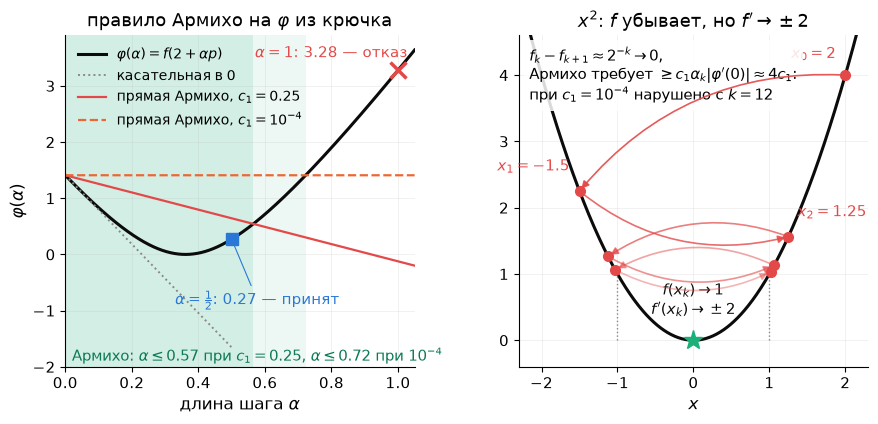

*Слева: $\varphi(\alpha)$ вдоль шага Ньютона из $x_0=2$ на арктангенсе из крючка — $\alpha=1$ выше прямой Армихо, $\alpha=\tfrac12$ под ней; при обычном $c_1=10^{-4}$ прямая почти горизонтальна. Справа: на $x^2$ точки прыгают через нуль, $f$ убывает к $1$, но каждое уменьшение $\approx2^{-k}$ всё меньше требования $c_1\alpha_k\lvert\varphi'(0)\rvert\approx4c_1$ — с $k=12$ правило Армихо нарушено.*

### 2.3. Backtracking: шаг не слишком длинный и не слишком короткий

Процедура: $\alpha=1$; пока Армихо не выполнено, $\alpha\leftarrow\alpha/2$.

- **Цикл конечен.** При малых $\alpha$ функция идёт почти по касательной, а требуем мы лишь долю $c_1<1$ от её наклона.
- **Шаг не слишком короткий.** По лемме о спуске $\varphi(\alpha)\le\varphi(0)+\alpha\varphi'(0)+\tfrac L2\alpha^2\lVert p\rVert^2$, где $L$ — константа Липшица градиента. Значит, Армихо выполнено для всех $\alpha\le\bar\alpha=2(1-c_1)\lvert\varphi'(0)\rvert/(L\lVert p\rVert^2)$, и деление пополам остановится на $\alpha\ge\min(1,\bar\alpha/2)$. Это неравенство — ключ к теореме §2.5.

На Розенброке из $x_1$ backtracking пробует $\alpha=1$ ($f=1412$), $\tfrac12$, $\tfrac14$ — отказ, $\tfrac18$ — принято: Армихо выполнено при всех $\alpha\le0.176$. Это вторая итерация демпфированного Ньютона. **Тот же шаг $0.125$ на той же итерации делает IPOPT** (столбец `alpha_pr` его лога, семинар). На арктангенсе из введения backtracking пробует $\alpha=1$ ($f=3.28$) — отказ, $\tfrac12$ ($f=0.27$) — принято; дальше все $\alpha=1$.

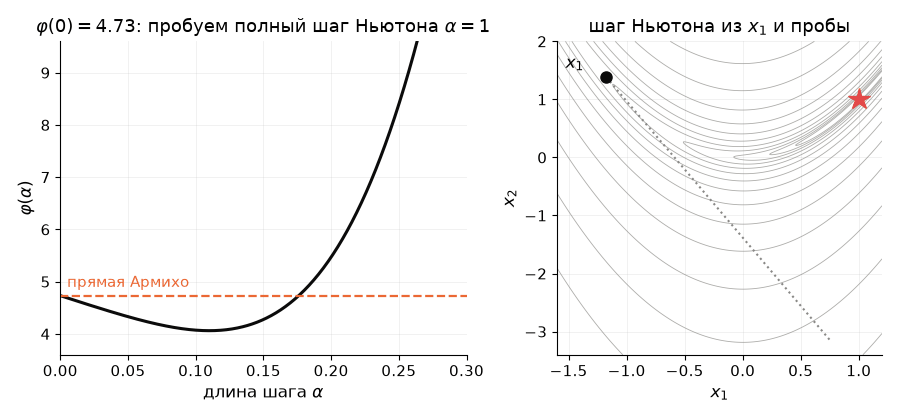

*Анимация: слева $\varphi(\alpha)$ и прямая Армихо, кандидаты $1,\tfrac12,\tfrac14$ отвергнуты, $\tfrac18$ принят; справа те же точки на линиях уровня Розенброка — длинный шаг Ньютона урезан до восьмой части.*

### 2.4. Условия Вольфе: шаг должен быть достаточно длинным

Армихо отсекает слишком длинные шаги. Сверху длина не ограничена, а снизу её держит только backtracking, стартующий с $\alpha=1$. Метод, который выбирает шаг иначе (экстраполирует, интерполирует), может принять бесполезно короткий шаг. **Условие кривизны Вольфе** (*Wolfe*, 1969) это запрещает:

$$
\varphi'(\alpha)\ge c_2\,\varphi'(0),\qquad c_1<c_2<1 .
$$

Наклон в новой точке должен стать *заметно положе*: на крутом склоне, где ещё есть куда спускаться, останавливаться нельзя. **Сильные условия Вольфе** требуют ещё и не перескакивать далеко за минимум $\varphi$: $\lvert\varphi'(\alpha)\rvert\le c_2\lvert\varphi'(0)\rvert$. Стандартные значения: $c_1=10^{-4}$; $c_2=0.9$ для Ньютона и квази-Ньютона, $c_2=0.1$–$0.4$ для нелинейного CG.

**Вопрос залу.** На графике $\varphi(\alpha)$ для Розенброка в $x_1$ три кандидата: $\alpha=0.02$, $\alpha=0.125$, $\alpha=0.25$. Какие проходят Армихо? Какие — Вольфе?

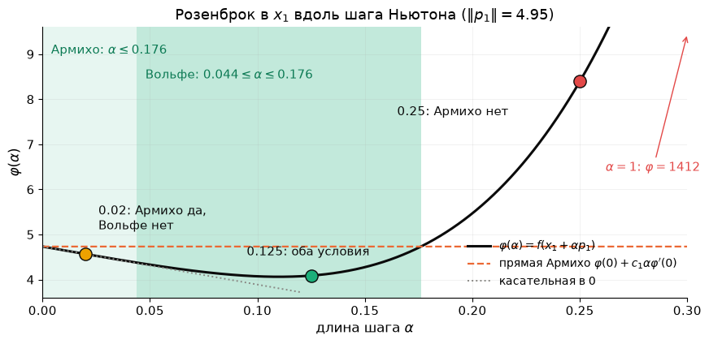

Покрутить руками — сцена «Армихо и Вольфе» на [интерактивной странице](https://claude.ai/artifact/KniuVJGw3XPZvWVeDtBpwE): ползунки $c_1$, $c_2$ и $\alpha$, кнопка backtracking.

*Ответ на картинке:*
- $\alpha=0.02$ проходит Армихо, но не Вольфе: склон ещё крутой;
- $\alpha=0.125$ проходит оба условия;
- $\alpha=0.25$ не проходит Армихо: перелёт.

Допустимые шаги: по Армихо $\alpha\le0.176$, по Вольфе $0.044\le\alpha\le0.176$.

**Зачем Вольфе квази-Ньютону.** BFGS сохраняет $H_k\succ0$, только если $s_k^\top y_k>0$. Условие кривизны гарантирует это в одну строку:

$$
s_k^\top y_k=\alpha\,\big(\nabla f(x_{k+1})-\nabla f(x_k)\big)^\top p_k\ge\alpha\,(c_2-1)\,g_k^\top p_k>0 .
$$

Проверка на Химмельблау, $400$ случайных стартов: с одним Армихо в $72$ запусках ($18\,\%$) встречаются шаги с $s^\top y\le0$ — всего $179$ таких шагов, и обновление BFGS приходится пропускать. С Вольфе — **ни одного**: так обещает формула выше.

**Честный разбор цепи (упражнение 11.9).** На прошлой лекции BFGS с одним Армихо не сошёлся на цепи $N=40$ за $10\,000$ итераций, и виноватым назначили отсутствие условия Вольфе. Проверим.

| Гипотеза | Проверка | Вывод |
|---|---|---|
| виновато отсутствие Вольфе | энергия цепи — выпуклая квадратичная, $s^\top y=s^\top Hs>0$ при любом шаге; с сильным Вольфе тот же BFGS застревает так же | нет |
| виноват масштаб $H_0=I$ | первое направление $-g$ в сотни раз длиннее разумного шага; пары $(s,y)$ получаются крошечными, обновление пропускается — матрица не учится | да |
| лекарство: $H_0\leftarrow\dfrac{s^\top y}{y^\top y}I$ после первого шага | $27$ итераций при $N=40$ ($17$ при $N=20$, $47$ при $N=80$), с Армихо и с Вольфе одинаково; L-BFGS делает это на каждой итерации | работает |
| предел — округление | при $\lVert g\rVert\approx\sqrt{2\lambda_{\max}\varepsilon\lvert E\rvert}\approx1.3\cdot10^{-6}$ разность $E$ тонет в округлении — поиск не отличает «лучше» от «хуже», SciPy пишет «precision loss» (упражнение 6.10) | точный шаг и CG не сравнивают $f$ и доходят |

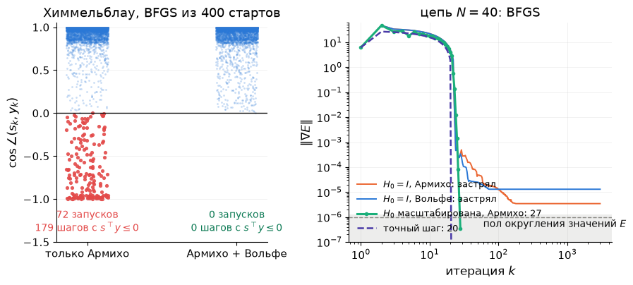

**Реальный кейс.** SciPy `minimize(method="BFGS")` использует сильные условия Вольфе ($c_1=10^{-4}$, $c_2=0.9$), `"CG"` — $c_2=0.4$. В PyTorch `torch.optim.LBFGS` по умолчанию идёт **без** линейного поиска, с постоянным `lr`; сильный Вольфе включает аргумент `line_search_fn="strong_wolfe"`.

### 2.5. Теорема о глобальной сходимости

**Теорема** (глобальная сходимость линейного поиска с backtracking по Армихо; Диль, *Globalization Strategies*; Nocedal & Wright, теорема 3.2 Зойтендейка). Пусть:
- $f$ ограничена снизу;
- $\nabla f$ липшицев с константой $L$;
- направления $p_k=-B_k^{-1}g_k$, где собственные числа симметричных $B_k$ лежат в $[m_B,\,M_B]$, $m_B>0$;
- $\alpha_k$ выбирается backtracking по Армихо от $\alpha=1$.

Тогда $\lVert\nabla f(x_k)\rVert\to0$ **из любого старта**.

**Доказательство в четыре строки** (идея: «каждый шаг съедает кусок $\lVert g\rVert^2$, а съесть можно лишь конечное»):

1. Направление — спуск, и не вырожденное: $\lvert g^\top p\rvert=g^\top B^{-1}g\ge\lVert g\rVert^2/M_B$, $\lVert p\rVert\le\lVert g\rVert/m_B$.
2. Шаг не мельчает: по §2.3 $\alpha_k\ge\min\big(1,\,(1-c_1)\lvert g^\top p\rvert/(L\lVert p\rVert^2)\big)\ge\min\big(1,\,(1-c_1)m_B^2/(LM_B)\big)=:\alpha_{\min}>0$.
3. Убывание за шаг: $f_k-f_{k+1}\ge c_1\alpha_k\lvert g_k^\top p_k\rvert\ge\dfrac{c_1\alpha_{\min}}{M_B}\lVert g_k\rVert^2$.
4. Складываем по $k$: $\sum_k\lVert g_k\rVert^2\le\dfrac{M_B\,(f_0-\inf f)}{c_1\alpha_{\min}}<\infty$, значит $\lVert g_k\rVert\to0$. $\blacksquare$

**Что это значит для методов.**
- Градиентный спуск ($B=I$) — частный случай: сходится глобально.
- Арктангенс из крючка: Армихо держит итерации в множестве уровня $\{f\le f(2)\}=[-2,2]$, где $m_B=\tfrac15$, $M_B=L=1$, — Ньютон с Армихо сходится из любого старта, чистый ($\alpha_k\equiv1$) — только из $\lvert x_0\rvert<1.39$.
- Для Ньютона $m_B>0$ — **требование** держать $B_k\succ0$: сдвиг $B_k=\nabla^2f+\tau I$ — не косметика, а условие теоремы.
- Для BFGS глобальная сходимость на выпуклых задачах доказана с условиями Вольфе (Пауэлл, 1976; Nocedal & Wright, теорема 6.5).

**«Глобальная сходимость» ≠ «глобальный минимум».** Теорема гарантирует $\nabla f\to0$, то есть *стационарную точку*. Какую именно — зависит от того, как метод обходится с отрицательной кривизной. Химмельблау, сетка $300\times300$ стартов на $[-6,6]^2$:

| Метод | Минимумы | Сёдла | Максимум |
|---|---|---|---|
| чистый Ньютон | $64\,\%$ | $31\,\%$ | $4\,\%$ |
| Ньютон + Армихо, сдвиг $\tau I$ только при $g^\top p\ge0$ (как в ДЗ 3) | $79\,\%$ | $20\,\%$ | $0\,\%$ |
| Ньютон + Армихо, сдвиг всегда при $\lambda_{\min}\le0$ («модифицированный Ньютон», как в IPOPT) | $100\,\%$ | $0\,\%$ | $0\,\%$ |
| доверительная область (раздел 3) | $100\,\%$ | $0\,\%$ | $0\,\%$ |

Максимум исчез с появлением линейного поиска: спуск не может прийти туда, откуда всё ведёт вниз. Сёдла остались: если сдвигать гессиан лишь тогда, когда направление перестаёт быть спуском, рядом с седлом Ньютон честно в него сходится.

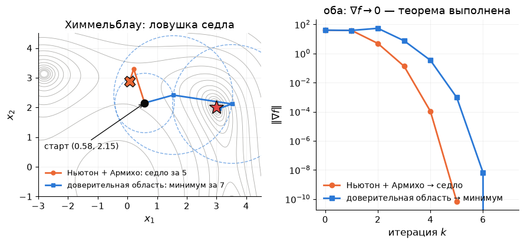

Старт $(0.58,\,2.15)$: Ньютон с Армихо за $5$ итераций приходит в седло $(0.09,\,2.88)$, и $\lVert\nabla f\rVert\to0$ — теорема выполнена! Доверительная область из той же точки за $7$ итераций приходит в минимум $(3,2)$, IPOPT — тоже за $7$.

**Аналогия.** Вода всегда стекает вниз и где-нибудь остановится — в низине или на перевале, если стоит ровно на гребне. Но в океан она не обязана попасть: глобальная сходимость — про «остановится», а не про «в самую глубокую точку».

**Реальный кейс.** Симулятор SPICE решает уравнения Кирхгофа с экспонентами диодов методом Ньютона: ток растёт как $e^{V/V_T}$, $V_T\approx26$ мВ, и лишний вольт в шаге — множитель $e^{38}\approx3\cdot10^{16}$. Поэтому SPICE ограничивает шаг по напряжению на p-n-переходе (*voltage limiting*) — та же глобализация, только вместо Армихо физически разумный предел шага.

## 3. Доверительная область: сначала радиус, потом шаг

**Тезис простыми словами.** Линейный поиск выбирает направление, а потом длину. Доверительная область делает наоборот: сначала решает, **в каком радиусе $\Delta$ модели можно верить**, и ищет лучшую точку модели внутри этого шара. Радиус настраивается сам — по тому, насколько модель угадала.

**Аналогия.** Кредитный лимит. Банк (алгоритм) выдаёт модели лимит доверия $\Delta$. Модель обещала уменьшить $f$ на 10, а принесла 9 — лимит удваивают. Принесла 1 — урезают вчетверо. Принесла рост $f$ — сделку отменяют и снова урезают лимит.

### 3.1. Подзадача и отношение $\rho$

На каждой итерации:

$$
\min_p\ m_k(p)=f_k+g_k^\top p+\tfrac12p^\top B_kp\qquad\text{при}\qquad\lVert p\rVert\le\Delta_k,
$$

$$
\rho_k=\frac{f(x_k)-f(x_k+p_k)}{m_k(0)-m_k(p_k)}=\frac{\text{фактическое уменьшение}}{\text{обещанное моделью}} .
$$

| $\rho_k$ | Модель | Шаг | Радиус |
|---|---|---|---|
| $\rho_k<\tfrac14$ | врёт | принять, только если $\rho_k>\eta$ | $\Delta/4$ |
| $\tfrac14\le\rho_k\le\tfrac34$ | терпима | принять | не менять |
| $\rho_k>\tfrac34$, шаг на границе | хороша и упёрлась в лимит | принять | $\min(2\Delta,\Delta_{\max})$ |

У нас $\eta=0.1$, $\Delta_0=1$, $\Delta_{\max}=10$ (Nocedal & Wright, алгоритм 4.1). Знаменатель всегда положителен: $p=0$ допустим, поэтому лучшая точка модели не хуже нуля.

**Вопрос залу.** Модель обещала уменьшить $f$ на $10$.
- Фактически $f$ уменьшилась на $12$. Чему равно $\rho$ и что делать с $\Delta$?
- А если $f$ выросла на $3$?

*Ответ:*
- $\rho=1.2$: шаг принимаем; если он лежал на границе, радиус удваиваем. Функция оказалась даже лучше модели.
- $\rho=-0.3$: шаг отвергаем, $\Delta\leftarrow\Delta/4$, решаем подзадачу заново из той же точки.

### 3.2. Вы уже пользовались доверительной областью

Левенберг–Марквардт — это доверительная область для Гаусса–Ньютона: та же $\rho$, те же правила, только вместо $\Delta$ подкручивается $\lambda$. Связь точная.

**Теорема (Moré–Sorensen, 1983).** $p^\ast$ решает подзадачу доверительной области тогда и только тогда, когда для некоторого $\lambda\ge0$:

$$
(B+\lambda I)\,p^\ast=-g,\qquad \lambda\,\big(\Delta-\lVert p^\ast\rVert\big)=0,\qquad B+\lambda I\succeq0 .
$$

Читаем:
- $\lambda$ — множитель Лагранжа ограничения $\lVert p\rVert\le\Delta$;
- шаг внутри шара ($\lambda=0$) — обычный шаг Ньютона;
- шаг на границе — Ньютон со сдвигом $\lambda I$, ровно как у Левенберга–Марквардта и как $\tau I$ у демпфированного Ньютона;
- маленький $\Delta$ ↔ большой $\lambda$ ↔ короткий шаг почти против градиента.

Три лекарства — сдвиг $\tau I$, сдвиг $\lambda I$ и укороченный шаг — оказались одним и тем же объектом.

### 3.3. Как вычислить шаг: точка Коши, dogleg, точное решение

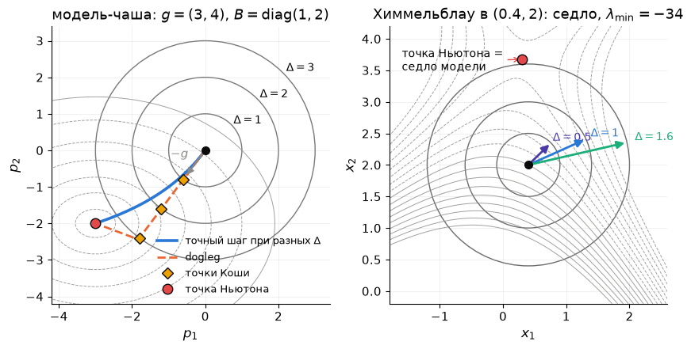

Слева на картинке — модельная задача $g=(3,4)$, $B=\operatorname{diag}(1,2)$: точка Ньютона $(-3,-2)$ лежит на расстоянии $3.61$, а при $\Delta=1$ точка Коши — $(-0.6,-0.8)$.

**Точка Коши** — минимум модели вдоль антиградиента внутри шара:

$$
p_C=-\tau\,\frac{\Delta}{\lVert g\rVert}\,g,\qquad
\tau=\begin{cases}1,& g^\top Bg\le0,\\ \min\!\Big(\dfrac{\lVert g\rVert^3}{\Delta\,g^\top Bg},\,1\Big),& g^\top Bg>0 .\end{cases}
$$

Это один шаг спуска с точной длиной, обрезанный шаром. Она гарантирует уменьшение модели $m(0)-m(p_C)\ge\tfrac12\lVert g\rVert\min(\Delta,\lVert g\rVert/\lVert B\rVert)$. А теорема о глобальной сходимости доверительной области требует от шага **лишь не меньше доли этого уменьшения** (Nocedal & Wright, теоремы 4.5–4.6). Любой шаг лучше точки Коши — законный.

**Только точка Коши — это спуск в маскировке:** на Розенброке $14\,110$ итераций. Сходится, но со скоростью спуска.

**Dogleg** (Powell, 1970) — ломаная из нуля в минимум модели вдоль $-g$, оттуда в точку Ньютона $p_B=-B^{-1}g$. Шаг — пересечение ломаной с границей шара (или сама $p_B$, если она внутри). Нужна $B\succ0$. На Розенброке — **24 итерации**, отвергнуто 3 шага.

**Точное решение** — $\lambda$ по теореме Moré–Sorensen ищется одномерным уравнением $\lVert(B+\lambda I)^{-1}g\rVert=\Delta$. При $n$ до нескольких тысяч это разложение $B$ на каждой итерации; на Розенброке — **25 итераций**.

**Отрицательная кривизна не страшна.** Если $B$ индефинитна, модель — седло. Безусловного минимума у неё нет, а в шаре минимум есть всегда (шар компактен). Точный шаг уходит на границу вдоль направления отрицательной кривизны — прочь от седла. Отсюда $100\,\%$ минимумов на Химмельблау без всякого сдвига $\tau I$.

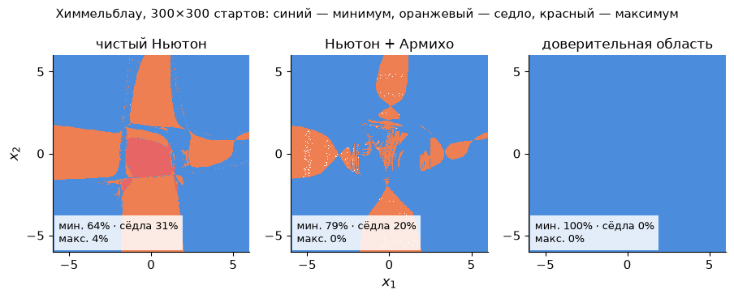

### 3.4. Доверительная область на Розенброке

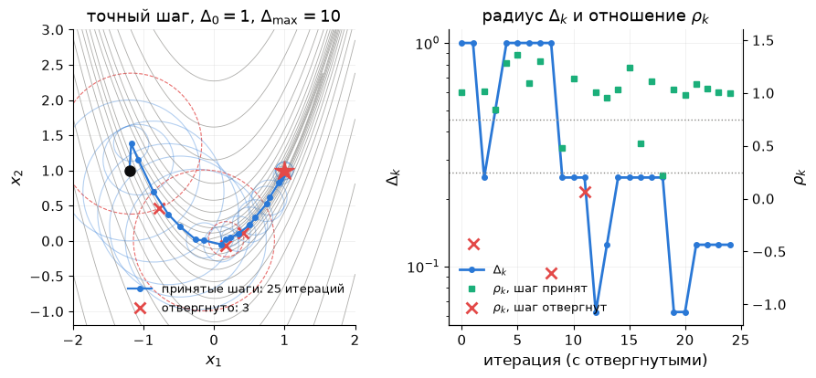

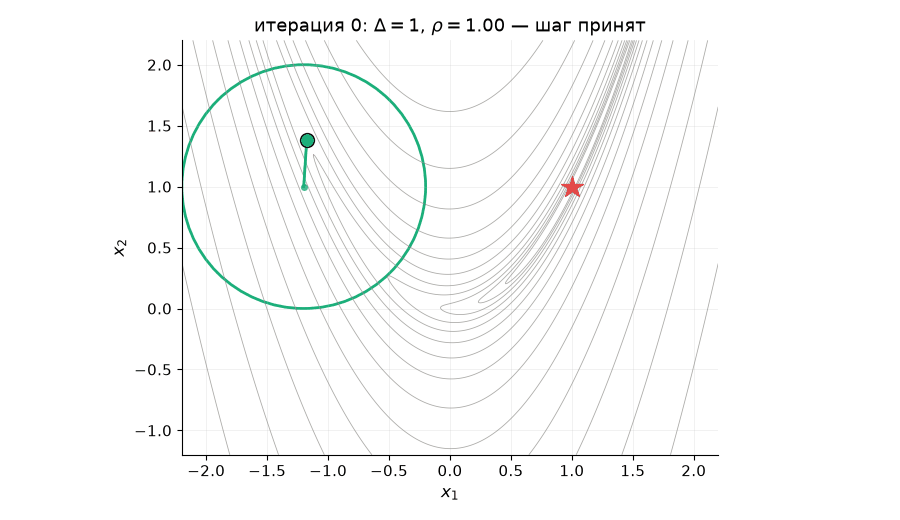

*Анимация: круг доверия $\Delta_k$ вокруг текущей точки. После шагов с плохим $\rho$ он сжимается, на прямом участке долины — растёт. В заголовке кадра — номер итерации, $\Delta_k$ и $\rho_k$.*

Из $(-1.2,1)$:
- первый шаг Ньютона лежит внутри шара и принимается;
- во второй итерации шаг Ньютона длиной $4.95$ (тот самый выброс) обрезан до границы $\Delta=1$ — и всё равно $\rho=-0.43$: функция выросла, шаг отвергнут, $\Delta$ уменьшен вчетверо;
- дальше метод идёт по долине, радиус дышит;
- у решения шаги снова чисто ньютоновские.

Итого: $25$ итераций, из них $3$ пробных шага отвергнуты, ни одного подъёма по $f$. Покрутить руками — сцена «Доверительная область» на [интерактивной странице](https://claude.ai/artifact/KniuVJGw3XPZvWVeDtBpwE): клик задаёт старт, переключатель «точный / dogleg / точка Коши», снизу — подзадача в текущей точке.

**Линейный поиск или доверительная область?**

| | Линейный поиск | Доверительная область |
|---|---|---|
| сначала выбирается | направление | радиус |
| отрицательная кривизна | нужен сдвиг $\tau I$ | обрабатывается сама |
| неудачный шаг | укорачиваем вдоль того же луча | решаем подзадачу заново: шаг меняет и длину, и направление |
| цена итерации | одна система + несколько $f$ | подзадача (дороже), обычно одно $f$ |
| где | SciPy `BFGS`, `L-BFGS-B`, `Newton-CG`; IPOPT; PyTorch `LBFGS` | SciPy `trust-*`, `least_squares`; MATLAB `fsolve`; Ceres |

**Реальный кейс.** Google Ceres Solver решает задачи совмещения снимков и восстановления 3D-сцен из фотографий (*bundle adjustment*) с миллионами невязок. Внутри — доверительная область: Левенберг–Марквардт или dogleg на выбор. `scipy.optimize.least_squares` по умолчанию использует `method="trf"` — доверительную область, отражённую от границ. MATLAB `fsolve` по умолчанию — `"trust-region-dogleg"`.

## 4. Сопряжённые градиенты: Ньютон без матрицы

**Тезис простыми словами.** На квадратичной задаче спуск теряет время на зигзаг: каждый новый шаг портит то, что сделал предыдущий. Метод сопряжённых градиентов выбирает направления, которые **не портят друг друга**. Тогда каждое направление «закрывается» за один шаг навсегда, и на $n$ переменных хватает не больше $n$ шагов. За итерацию — одно умножение матрицы на вектор и $O(n)$ памяти.

**Аналогия.** Смеситель с двумя кранами — горячим и холодным. Покрутили горячий, чтобы стало теплее, — изменился и напор; поправили напор — сбилась температура. Это зигзаг спуска. Однорычажный смеситель: вверх-вниз — напор, влево-вправо — температура, ручки «не мешают» друг другу. Выставили одну, потом другую — готово за два движения. Сопряжённые направления — это такие ручки для квадратичной функции.

### 4.1. Сопряжённость и конечность

Квадратичная задача $f(x)=\tfrac12x^\top Ax-b^\top x$, $A\succ0$ — то же самое, что система $Ax=b$. Направления $d_0,d_1,\dots$ называются **$A$-сопряжёнными**, если $d_i^\top Ad_j=0$ при $i\ne j$. В координатах по сопряжённым направлениям $f$ распадается в сумму независимых одномерных парабол. Минимизируя по очереди вдоль $d_0,d_1,\dots$ (точный шаг), мы ни разу не портим сделанного: после $k$ шагов $x_k$ — минимум $f$ на всём подпространстве $x_0+\operatorname{span}\{d_0,\dots,d_{k-1}\}$.

**Следствие:** не больше $n$ итераций, а точнее — не больше числа **различных собственных чисел** $A$, «задетых» начальной ошибкой.

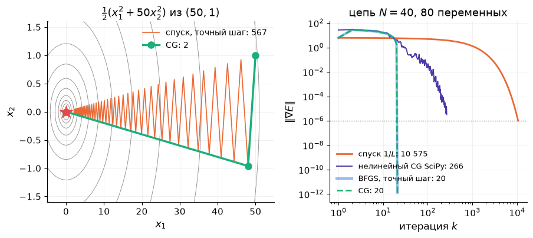

На эллипсе $\tfrac12(x_1^2+50x_2^2)$ из $(50,1)$: спуск с точным шагом — **567** итераций зигзагом, CG — **2**. Два собственных числа — два шага.

### 4.2. Алгоритм в пять строк

$r_0=Ax_0-b$ (это градиент), $d_0=-r_0$; затем для $k=0,1,\dots$

$$
\alpha_k=\frac{r_k^\top r_k}{d_k^\top Ad_k},\quad
x_{k+1}=x_k+\alpha_kd_k,\quad
r_{k+1}=r_k+\alpha_kAd_k,\quad
\beta_{k+1}=\frac{r_{k+1}^\top r_{k+1}}{r_k^\top r_k},\quad
d_{k+1}=-r_{k+1}+\beta_{k+1}d_k .
$$

- Новое направление — антиградиент плюс доля старого: **память об одном шаге**. Этого хватает для сопряжённости со *всеми* прошлыми направлениями.
- Матрица нужна только как операция $v\mapsto Av$: её можно не хранить.
- Скорость даже без конечности: $\lVert e_k\rVert_A\le2\Big(\dfrac{\sqrt\kappa-1}{\sqrt\kappa+1}\Big)^k\lVert e_0\rVert_A$ — итераций $\sim\sqrt\kappa$, а не $\sim\kappa$, как у спуска (как и было обещано).
- Авторы — Hestenes и Stiefel, 1952. Метод придуман для систем линейных уравнений и до сих пор — главный способ решать большие разреженные системы с $A\succ0$.

**Мини-задание.** Предскажите число итераций CG до $\lVert\nabla E\rVert\le10^{-6}$ на цепи $N=40$ (80 переменных). А при $N=400$ (800 переменных)?

Ответ

$20$ и $200$ — ровно $N/2$. У цепи горизонтальные координаты в старте (прямая между концами) уже точные, ошибка в них нулевая. Вертикальная ошибка симметрична относительно середины и задевает только $N/2$ симметричных собственных векторов. Столько различных «задетых» собственных чисел — столько и итераций (упражнение 6.9). Для сравнения: спуск — $10\,575$ и $937\,503$, $\kappa=681$ и $65\,170$. BFGS с точным шагом на квадратичной даёт **те же** $20$ итераций — на квадратичной функции с точным шагом он совпадает с CG.

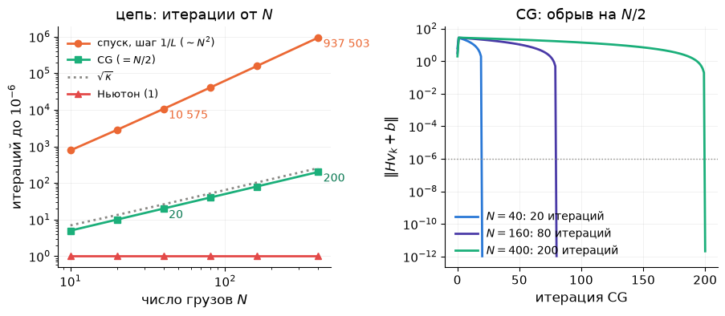

Покрутить руками — сцена «CG против спуска» на [интерактивной странице](https://claude.ai/artifact/KniuVJGw3XPZvWVeDtBpwE): ползунок $\kappa$ для эллипса и ползунок итерации $k$ для цепи (видно, как CG опускает провис от концов к середине).

**Биография цепи** (одна и та же задача, останов $\lVert\nabla E\rVert\le10^-6$):

| Лекция | Метод | $N=40$ | $N=400$ | Цена итерации |
|---|---|---|---|---|
| 4 | спуск, шаг $1/L$ | $10\,575$ | $937\,503$ | $Av$ |
| 5 | BFGS, точный шаг | $20$ | — | матрица $n\times n$ в памяти |
| 5 | Ньютон | $1$ | $1$ | решение системы $n\times n$ |
| **6** | **CG** | $\mathbf{20}$ | $\mathbf{200}$ | $Av$ — как у спуска |

### 4.3. CG внутри Ньютона: Newton-CG и Стейхауг

Для неквадратичной $f$ есть два способа использовать CG.

**Нелинейный CG** (Fletcher–Reeves, 1964; Polak–Ribière, 1969): та же формула, $r_k\to\nabla f(x_k)$, $\beta$ по градиентам, длина — линейным поиском по сильному Вольфе. На Розенброке SciPy `method="CG"` — $37$ итераций и $80$ вычислений $f$. На цепи — $266$ итераций вместо $20$: неточный поиск разрушает сопряжённость. Для квадратичной задачи всегда берите линейный CG.

**Newton-CG** (*truncated Newton*, неточный Ньютон):

1. систему Ньютона $\nabla^2f(x_k)\,p=-g_k$ решаем CG, а не точно;
2. CG останавливаем рано — при невязке $\le\eta_k\lVert g_k\rVert$, $\eta_k=\min(0.5,\sqrt{\lVert g_k\rVert})$, или при отрицательной кривизне $d^\top\nabla^2f\,d\le0$; вдали от решения хватает нескольких внутренних итераций, у решения $\eta_k\to0$ и шаг становится ньютоновским;
3. от гессиана нужны **только произведения $\nabla^2f\,v$** — их даёт алгоритмическое дифференцирование, не строя матрицу; в CasADi это одна строка `ca.jtimes(ca.gradient(f, x), x, v)`.

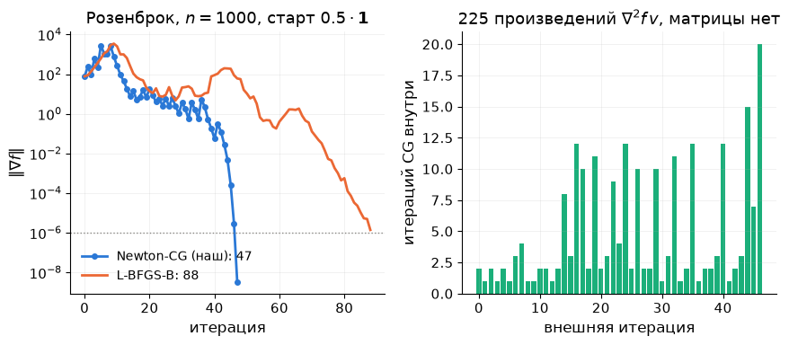

Розенброк в $1000$ переменных (`scipy.optimize.rosen`), старт $x_0=0.5\cdot\mathbf1$; матрица $1000\times1000$ — миллион чисел — **ни разу не построена**:

| Метод | Итераций | Произведений $\nabla^2f\,v$ |
|---|---|---|
| наш Newton-CG | $47$ | $225$ |
| SciPy `Newton-CG`, `hessp=rosen_hess_prod` | $54$ | $291$ |
| SciPy `L-BFGS-B` (`ftol=0`) | $88$ | — |

По умолчанию SciPy останавливает `L-BFGS-B` раньше — по относительному уменьшению $f$, на $78$-й итерации при $\lVert\nabla f\rVert\approx10^{-3}$.

**CG Стейхауга** (Steihaug, 1983) — тот же CG внутри доверительной области: стоп на отрицательной кривизне *или* при выходе на границу шара. Это SciPy `trust-ncg`: на Розенброке $29$ итераций, на цепи $N=40$ — $13$.

**Реальный кейс.** Библиотека LIBLINEAR, внутри scikit-learn, обучает логистическую регрессию на миллионах признаков методом TRON: доверительная область + CG Стейхауга, гессиан только в виде произведений на вектор (Lin, Weng, Keerthi, 2008). В scikit-learn есть и `LogisticRegression(solver="newton-cg")` — Newton-CG с линейным поиском.

## 5. Что это даёт численно

- **Какой метод SciPy как глобализован.**

  | `minimize(method=…)` | Направление | Глобализация | Розенброк из $(-1.2,1)$ |
  |---|---|---|---|
  | `"BFGS"` | квази-Ньютон | сильный Вольфе, $c_2=0.9$ | $33$ итерации, $40$ вычислений $f$ |
  | `"L-BFGS-B"` | L-BFGS (память 10) | линейный поиск (Moré–Thuente) | $37$ (с `ftol=0`) |
  | `"CG"` | нелинейный CG (Polak–Ribière) | сильный Вольфе, $c_2=0.4$ | $37$ / $80$ |
  | `"Newton-CG"` | Ньютон, CG внутри | линейный поиск по Вольфе | $85$ |
  | `"trust-exact"` | Ньютон | доверительная область, точный шаг | $25$ |
  | `"dogleg"` | Ньютон | доверительная область, dogleg ($B\succ0$) | $24$ |
  | `"trust-ncg"` / `"trust-krylov"` | Ньютон, CG внутри | доверительная область, Стейхауг / Ланцош | $29$ / $38$ |

  Останов везде — $10^{-6}$, но по-разному: `BFGS` и `CG` — `gtol` в max-норме градиента, `trust-*` — в евклидовой, `Newton-CG` — по длине шага (`xtol=1e-8`), `L-BFGS-B` по умолчанию ещё и по относительному уменьшению $f$ (`ftol`) — без `ftol=0` он остановился бы на $36$-й итерации при $\lVert\nabla f\rVert=6\cdot10^{-5}$. Сравнивая солверы, всегда смотрите, *по какому критерию* они остановились.

  Есть гессиан и $n$ до тысяч — `trust-exact`. Гессиана нет — `BFGS`, при больших $n$ — `L-BFGS-B`. Есть произведения $\nabla^2f\,v$ при больших $n$ — `trust-ncg` или `Newton-CG`.
- **Лог IPOPT читается теперь построчно** (семинар):
  - `alpha_pr` — принятая длина шага: $1$ — полный ньютоновский шаг, $0.125$ — три деления пополам;
  - `ls` — число попыток линейного поиска;
  - `lg(rg)` — $\log_{10}$ сдвига гессиана, нашего $\tau$; прочерк — сдвига не было.

  На Розенброке IPOPT делает $21$ итерацию, а `alpha_pr` бывает $0.125$, $0.25$ и дважды $0.5$ — и первые двенадцать длин шага в точности совпадают с нашим Ньютоном с Армихо: $1,\ 0.125,\ 1,\ 1,\ 1,\ 0.25,\ 1,\ 1,\ 1,\ 0.5,\ 1,\ 1$. На Химмельблау из $(0.58,2.15)$ сдвиг на первых двух итерациях равен $100$ и $33$ — и метод приходит в минимум $(3,2)$, а не в седло. Со всех $625$ стартов сетки $25\times25$ IPOPT приходит в минимумы.
- **«Desired error not necessarily achieved due to precision loss»** — линейный поиск больше не различает значения $f$ (§2.4). Перед тем как поднимать `maxiter`, проверьте, не просите ли вы точности ниже $\sqrt{\lambda_{\max}\varepsilon\lvert f\rvert}$.
- **ДЗ 3** (срок 21 октября): ваш Ньютон с Армихо и BFGS — ровно методы раздела 2. Сегодняшняя лекция объясняет, почему они сходятся из любого старта и куда именно.

## 6. Итоги лекции

1. **Глобализация** — способ сделать локальный метод сходящимся из любого старта без потери скорости у решения. Сам метод (Ньютон, BFGS, Гаусс–Ньютон) не меняется — меняется то, *насколько далеко мы верим его модели* (введение, раздел 1).
2. **Линейный поиск:**
   - Армихо требует уменьшения, соразмерного обещанию: доля $c_1$ от $\alpha\,g^\top p$;
   - backtracking даёт шаг не длиннее и не короче нужного;
   - Вольфе запрещает слишком короткие шаги и гарантирует $s^\top y>0$ для BFGS.

   Арктангенс из введения: чистый Ньютон из $x_0=2$ за пять шагов — в $-2.3\cdot10^{10}$, с Армихо за пять итераций — в минимум; разница — одно деление шага пополам. На Химмельблау с одним Армихо в $18\,\%$ запусков BFGS встречаются шаги с $s^\top y\le0$, с Вольфе — ни одного. На цепи BFGS спасает не Вольфе, а масштабирование $H_0$: $27$ итераций (раздел 2).
3. **Теорема о глобальной сходимости:** при $B_k$ с собственными числами в $[m_B,M_B]$ и backtracking по Армихо $\nabla f(x_k)\to0$ из любого старта. Это сходимость к *стационарной* точке. Ньютон со сдвигом только при подъёме приходит в седло из $20\,\%$ стартов Химмельблау, модифицированный Ньютон и доверительная область — из $0\,\%$ (раздел 2.5).
4. **Доверительная область:** сначала радиус $\Delta$, потом шаг. $\rho$ — отношение фактического уменьшения к обещанному — сам двигает $\Delta$. Решение подзадачи — $(B+\lambda I)p=-g$: Левенберг–Марквардт и сдвиг $\tau I$ — частные случаи. Точка Коши гарантирует сходимость ($14\,110$ итераций на Розенброке), dogleg и точный шаг — скорость ($24$ и $25$) (раздел 3).
5. **Сопряжённые градиенты:** направления, не портящие друг друга. На квадратичной не больше числа различных собственных чисел шагов, иначе $\sim\sqrt\kappa$; одно $Av$ за итерацию. Цепь: $10\,575\to20$, при $N=400$ — $937\,503\to200$. Внутри Ньютона (Newton-CG, Стейхауг) CG даёт шаг Ньютона без матрицы: Розенброк в $1000$ переменных за $47$ итераций (раздел 4).

## 7. Что дальше

**Лекция 7** (21.10) — производные: конечные разности и их U-кривая ошибки, алгоритмическое дифференцирование вперёд и назад, CasADi всерьёз. В том числе — почему произведение $\nabla^2f\,v$ для Newton-CG стоит как несколько градиентов. **Лекция 8** — ограничения-равенства: множители Лагранжа возвращаются уже как алгоритм. Слияние линейного поиска с ограничениями — merit-функции и фильтры — в лекции 13 (SQP).

**ДЗ 3** — срок 21 октября: спуск, Ньютон, BFGS и Гаусс–Ньютон своими руками ([карточка](../../homeworks/hw03.md)).

**Литература к лекции.**
- Diehl, *Lecture Notes on Numerical Optimization*, глава *Globalization Strategies*: Armijo backtracking, Wolfe, global convergence, trust region, Cauchy point.
- Nocedal & Wright:
  - гл. 3 — §3.1 условия Вольфе, §3.2 теорема Зойтендейка, §3.5 алгоритмы линейного поиска;
  - гл. 4 — доверительная область: §4.1 точка Коши и dogleg, §4.3 точное решение;
  - гл. 5 — сопряжённые градиенты;
  - §7.1 — Newton-CG и Стейхауг.
- Boyd & Vandenberghe, §9.2 — backtracking.
- Поляк, «Введение в оптимизацию», гл. 1 и 3 — выбор шага, метод сопряжённых градиентов.

## 8. Семинар: глобализация в CasADi и IPOPT

Весь семинар — за ноутбуком [`seminar06.ipynb`](seminar06.ipynb) (~30 минут). Нужен пакет CasADi: `uv sync --group casadi`; в Colab первая ячейка ставит его сама. Основы CasADi — семинар лекции 4 (Л4, §11.1).

| Мин | Часть |
|-----|------|
| 10 | **Часть 1 — CasADi как источник производных.** $f$, $\nabla f$, $\nabla^2f$ Розенброка и Химмельблау одной строкой; `jtimes` — произведение гессиана на вектор без матрицы; свой метод доверительной области на этих производных: $25$ итераций на Розенброке; из ловушки $(0.58,2.15)$ — в минимум $(3,2)$, а Ньютон с Армихо — в седло |
| 12 | **Часть 2 — глобализация внутри IPOPT.** `stats()["iterations"]`: `alpha_pr` на Розенброке — $0.125$ на второй итерации, как у нашего демпфированного Ньютона; `regularization_size` на Химмельблау — $100$ и $33$, наш $\tau$; лог IPOPT построчно; `hessian_approximation="limited-memory"` — L-BFGS внутри IPOPT: $47$ итераций вместо $21$ |
| 8 | **Часть 3 — соревнование.** Из трудного старта Химмельблау с наименьшим числом вычислений $f$ — любым методом: свой, SciPy или IPOPT |

Дома: 6.0–6.5, 6.7, 6.9, 6.10; 6.6 и 6.8 — повторение семинара. Затем демонстрации (a)–(d) в `demo06.ipynb` и интерактивная страница.

## 9. Упражнения

Для разбора на занятии и самостоятельно. У каждой задачи курсивом — её суть одной фразой. Подробный разбор с проверкой кодом — ноутбук [`exercises06.ipynb`](exercises06.ipynb), краткие ответы — [`exercises06.md`](exercises06.md).

**6.0. Разминка — счёт руками.** Шесть пунктов по минуте. *Суть: Армихо, Вольфе, $\rho$, точка Коши и CG — на бумаге.*

- (а) $f(x)=x^2$, $x=1$, $p=-2$, $c_1=\tfrac12$. При каких $\alpha$ выполнено Армихо? Какой шаг даст backtracking от $\alpha=1$?
- (б) Там же, $c_2=0.9$: при каких $\alpha$ выполнено условие кривизны Вольфе? Сильное?
- (в) Модель обещала уменьшение $4$, фактически $f$ выросла на $1$. Чему равно $\rho$? Что происходит с шагом и с $\Delta$?
- (г) $g=(1,0)$, $B=\operatorname{diag}(1,10)$, $\Delta=0.5$. Найдите точку Коши. Изменится ли ответ при $\Delta=2$?
- (д) Сколько итераций CG нужно для $A=\operatorname{diag}(1,1,5,5,5)$ из любого старта? А для $A=\operatorname{diag}(1,2,3,4,5)$?
- (е) Повторение Л5: $B=\operatorname{diag}(1,-4)$, $g=(1,1)$. Шаг $-B^{-1}g$ — спуск? При каком наименьшем $\tau$ матрица $B+\tau I\succ0$?

**6.1. Зачем $c_1$** (обещание Л4 §4.5). *Суть: «просто уменьшение» не гарантирует сходимости.*

- (а) Для $f=x^2$ и $x_k=(-1)^k(1+2^{-k})$ проверьте, что $f(x_{k+1})<f(x_k)$, но $f'(x_k)\not\to0$.
- (б) Какие $\alpha_k$ и направления порождают эту последовательность? Покажите, что правило Армихо с любым $c_1>0$ нарушается при больших $k$.

**6.2. Вольфе и BFGS** (домашняя). *Суть: условие кривизны — это ровно то, что нужно для $s^\top y>0$.*

- (а) Выведите $s_k^\top y_k\ge(1-c_2)\,\alpha_k\lvert g_k^\top p_k\rvert$ из условия кривизны.
- (б) Покажите, что для ограниченной снизу гладкой $f$ шаг, удовлетворяющий условиям Вольфе, существует (рисунок $\varphi$ и прямой Армихо; Nocedal & Wright, лемма 3.1).
- (в) Почему для нелинейного CG берут $c_2=0.1$–$0.4$, а для BFGS — $0.9$?

**6.3. Глобальная сходимость** (домашняя). *Суть: каждый шаг съедает кусок $\lVert g\rVert^2$, а съесть можно лишь конечное.*

- (а) Восстановите все неравенства доказательства §2.5: оценку $\alpha\ge\min(1,\bar\alpha/2)$ из леммы о спуске и оценки через $m_B$, $M_B$.
- (б) Где доказательство ломается, если $m_B\to0$ (гессиан почти вырожден)? Если $B_k$ индефинитна?
- (в) Сформулируйте вывод для спуска ($B=I$): что теорема говорит о спуске на Розенброке?

**6.4. Сломайте Ньютона: сходимость в седло** (с кодом). *Суть: глобальная сходимость — к стационарной точке, а не к минимуму.*

- (а) Запустите Ньютон с Армихо из `l6helpers.py` (сдвиг только при $g^\top p\ge0$) на Химмельблау из $(0.58,2.15)$. Куда пришёл метод? Посчитайте собственные числа гессиана в этой точке.
- (б) Найдите ещё два старта, приводящих в другие сёдла.
- (в) Замените правило сдвига на «всегда при $\lambda_{\min}\le10^{-3}$». Куда теперь приходят те же старты? Почему седло перестало притягивать?

**6.5. Точка Коши** (с кодом). *Суть: точка Коши даёт сходимость, но скорость спуска.*

- (а) Выведите формулу для $\tau$ из §3.3: минимизируйте $m(-t\,g)$ по $t$ при $t\lVert g\rVert\le\Delta$.
- (б) Запустите `trust_region(..., step="cauchy")` на Розенброке. Сравните число итераций ($14\,110$) с dogleg ($24$) и спуском с backtracking ($13\,756$, Л4). Почему числа точки Коши и спуска так близки?

**6.6. Dogleg руками** (на семинаре). *Суть: ломаная Пауэлла — компромисс между точкой Коши и точкой Ньютона.*

- (а) $g=(4,2)$, $B=\operatorname{diag}(2,1)$. Найдите $p_U$, $p_B$ и шаг dogleg при $\Delta=1,\ 2.6,\ 3$.
- (б) Нарисуйте эллипсы модели, ломаную и окружности. Где шаг совпадает с точкой Ньютона?

**6.7. Левенберг–Марквардт = доверительная область** (повторение Л5 §5.3). *Суть: $\lambda$ и $\Delta$ — две ручки одного механизма.*

- (а) Для $J^\top J=\operatorname{diag}(1,100)$, $J^\top r=(1,1)$ найдите шаг ЛМ при $\lambda=0,\ 1,\ 10,\ 100$ и его длину. Какому $\Delta$ соответствует каждый $\lambda$?
- (б) Покажите, что $\lVert p(\lambda)\rVert$ монотонно убывает по $\lambda$. Почему поэтому «уменьшить $\Delta$» и «увеличить $\lambda$» — одно и то же?

**6.8. CG руками на эллипсе** (на семинаре). *Суть: два шага — и точный минимум.*

- (а) $A=\operatorname{diag}(1,50)$, $b=0$, $x_0=(50,1)$. Выполните две итерации CG по формулам §4.2 и убедитесь, что $x_2=0$.
- (б) Проверьте сопряжённость $d_1^\top Ad_0=0$ и ортогональность невязок $r_1^\top r_0=0$.
- (в) Сравните с двумя шагами спуска с точным шагом (Л4, §4.4): где он окажется?

**6.9. Почему на цепи $N/2$** (с кодом). *Суть: CG сходится за число «задетых» собственных чисел.*

- (а) Разложите начальную ошибку цепи $e_0=v_0-v^\ast$ по собственным векторам гессиана. Сколько компонент больше $10^{-12}$ при $N=40$?
- (б) Объясните: почему горизонтальная часть ошибки нулевая, а вертикальная задевает только симметричные собственные векторы?
- (в) Сдвиньте старт несимметрично ($v_0+0.1\cdot$ случайный вектор). Сколько итераций CG теперь?

**6.10. Цепь, BFGS и предел точности** (с кодом). *Суть: ниже $\sqrt{\lambda_{\max}\varepsilon\lvert f\rvert}$ значения функции не различают «лучше» и «хуже», а плохой масштаб $H_0$ портит BFGS сильнее, чем отсутствие Вольфе.*

- (а) Запустите `minimize(method="BFGS")` на цепи $N=20$ с `gtol=1e-6`. Что пишет SciPy и чему равна $\lVert\nabla E\rVert$ в конце?
- (б) Оцените $\sqrt{2\lambda_{\max}\varepsilon\lvert E^\ast\rvert}$ для цепи и сравните с полученным.
- (в) Почему точный шаг и CG доходят до $10^{-6}$, а методы с линейным поиском — нет?
- (г) Масштабируйте $H_0\leftarrow\frac{s^\top y}{y^\top y}I$ после первого шага (`bfgs(..., scale_H0=True)` из `l6helpers.py`). Сколько теперь итераций при $N=10,20,40,80$? Почему масштабирование важнее условия Вольфе именно на цепи?

## Вопросы для самопроверки

1. Что такое глобализация и чем «глобальная сходимость» отличается от «сходимости к глобальному минимуму»? Приведите пример с числами.
2. Запишите правило Армихо и условие Вольфе через $\varphi(\alpha)$. Что означает каждое и почему $c_1$ берут маленьким, а $c_2$ для BFGS — большим?
3. Почему backtracking не даёт слишком коротких шагов? Какое неравенство это гарантирует?
4. Сформулируйте теорему о глобальной сходимости линейного поиска. Какое условие на $B_k$ в ней главное и как его обеспечить для Ньютона?
5. Как устроен шаг доверительной области: подзадача, $\rho$, правила для $\Delta$? Что делает метод при $\rho<0$?
6. Как связаны $\lambda$ Левенберга–Марквардта, сдвиг $\tau I$ и радиус $\Delta$? Сформулируйте условия Moré–Sorensen.
7. Что такое точка Коши и dogleg? Почему метод только с точкой Коши сходится, но медленно?
8. Что такое $A$-сопряжённые направления, почему CG сходится не более чем за $n$ шагов и почему на цепи $N=40$ — за $20$? Что нужно от матрицы и сколько стоит итерация?
