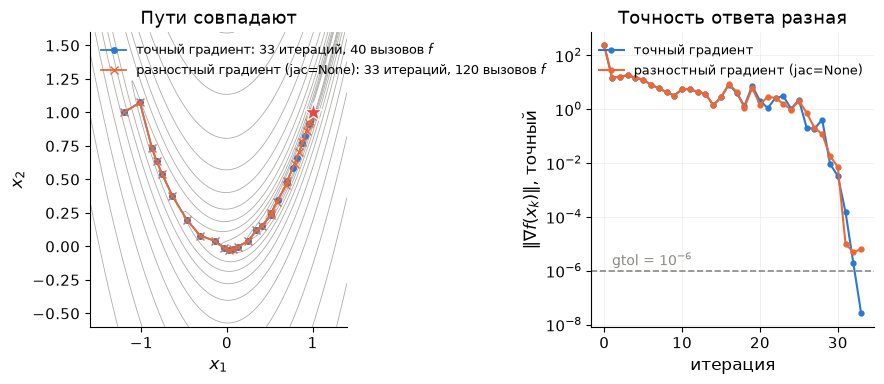
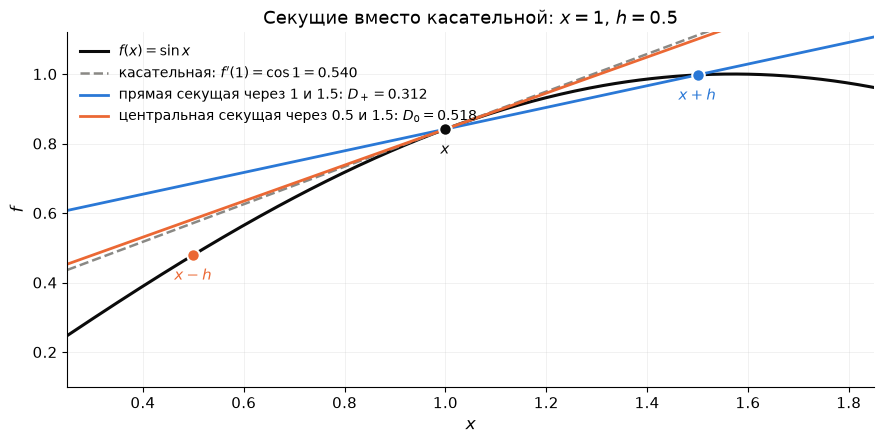
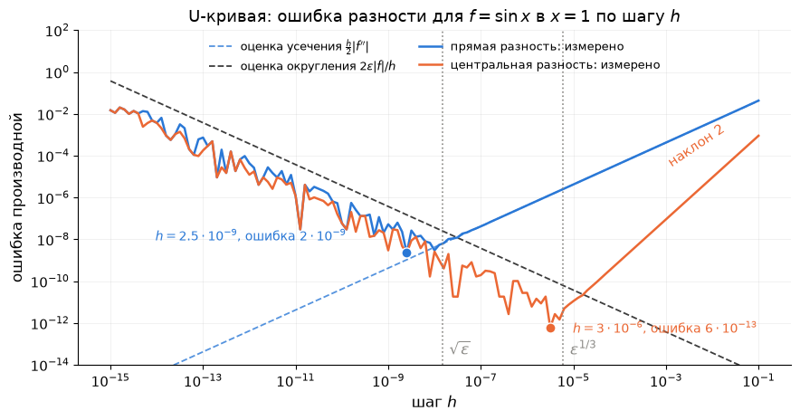
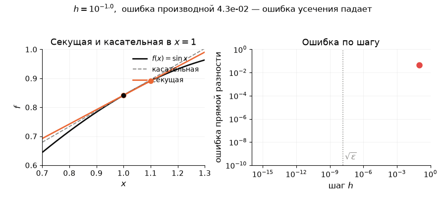
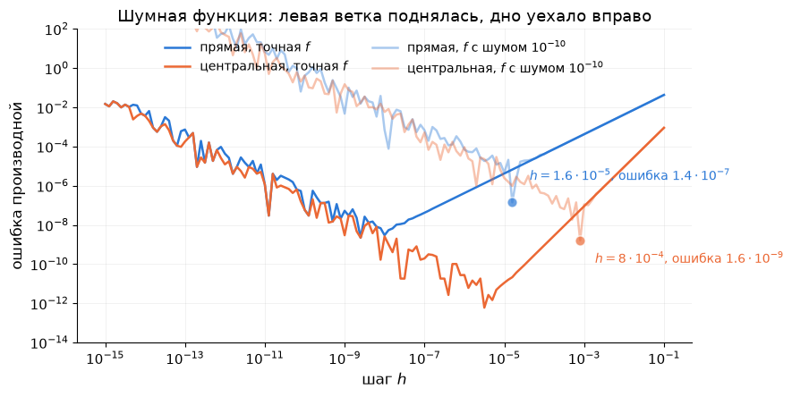
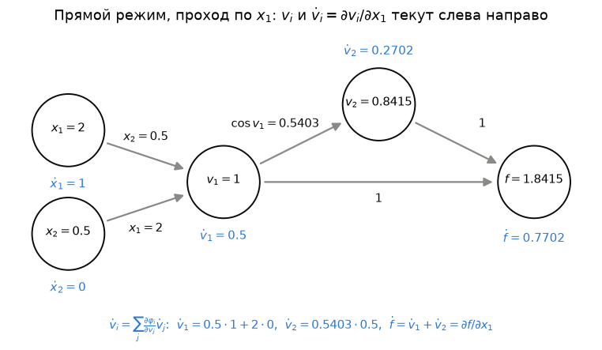
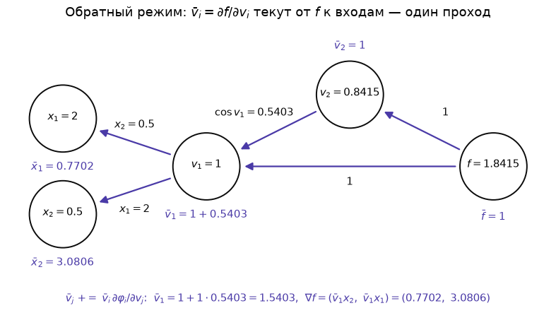
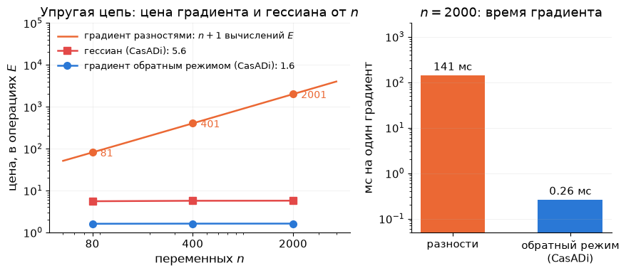
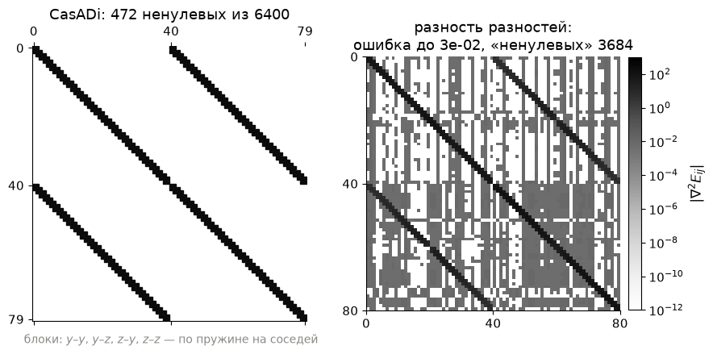

# Лекция 7. Производные: конечные разности и алгоритмическое дифференцирование

**Курс:** Вычислительная оптимизация · **Часть II. Безусловная оптимизация и ньютоновские методы** · Лекция 7 из 16 · 21 октября 2026

**Материалы:** [конспект-ноутбук с кодом демонстраций](lecture07.ipynb) · [демо-ноутбук](demo07.ipynb) · [разбор упражнений](exercises07.ipynb)

В конспекте-ноутбуке три демонстрации стоят прямо в тексте: «Демо (a)» — конечные разности — после раздела 2, «Демо (b)» — прямой и обратный режим своими руками — после раздела 4, «Демо (c)» — CasADi на цепи — после раздела 5. Задачи введения и подробности — только в `demo07.ipynb` (части (0) и (e)).

---

## Сколько стоит градиент

В ДЗ 3 вы писали якобиан синуса руками: три столбца производных. В ДЗ 4 гессиан упругой цепи дан готовым: $80\times80$, на каждую пружину — блок $2\times2$ с $\dfrac{DL}{d^3}$ внутри; формулы на страницу. Одна опечатка — и Ньютон идёт не туда, а узнаете вы об этом по странной картинке через час.

Можно не писать производные вовсе, а брать разности значений функции: $\partial_if\approx\dfrac{f(x+he_i)-f(x)}{h}$. Цену производной будем мерить в вычислениях самой функции. На цепи с $n=80$ переменными градиент разностями стоит $81$ вычисление энергии; гессиан по такому градиенту — $6561$ вычисление, и верных знаков в нём четыре. Точность градиента — восемь знаков из шестнадцати.

А можно отдать программу, которая считает энергию, инструменту CasADi. Он вернёт градиент ценой **$1.6$ вычисления энергии** — не $81$, а полтора, — и точный до последнего бита; гессиан — за $5.5$ вычислений, с готовой разреженностью. При $n=2000$ числа те же: $1.6$ и $5.7$. Цена точного градиента **не зависит от числа переменных**.

Это не фокус CasADi, а алгоритм, которому тридцать лет. На нём же стоит обучение нейросетей: у GPT-3 $175$ миллиардов параметров, градиент разностями стоил бы $175$ миллиардов прогонов сети, а обратный проход (*backpropagation*) — примерно два прогона. Сегодня вы увидите этот алгоритм на функции из трёх операций и посчитаете его руками.

**Зачем это вам.** Все методы части II требуют $\nabla f$, Ньютон — ещё и $\nabla^2f$, Гаусс–Ньютон — якобиан. Пока $f$ была формулой в две строки, производные писались руками. Когда $f$ — программа на сто строк (модель, симулятор, нейросеть), остаются два пути: разности или алгоритмическое дифференцирование. Лекция о том, чего стоит каждый.

**Три вопроса лекции:**

1. Насколько точна конечная разность и какой шаг $h$ брать?
2. Как получить точный градиент за две-три цены $f$ при любом $n$?
3. Что CasADi делает за нас — и чего не делает?

## 1. Зачем методам производные

Все методы части II — одна формула:

$$
\boxed{\;x_{k+1}=x_k-\alpha_k\,B_k^{-1}\nabla f(x_k)\;}
$$

Всё, что здесь стоит, кроме длины шага $\alpha_k$, — производные: градиент $\nabla f(x_k)$ и матрица кривизны $B_k$. Спуску (Л4) нужен только градиент; Ньютону (Л5) — градиент и гессиан $\nabla^2f$; BFGS — градиент, гессиан он собирает сам; Гауссу–Ньютону — якобиан невязок; линейному поиску (Л6) — ещё и значения $f$ в пробных точках. Чем точнее производные, тем точнее ответ. Вот что бывает, когда градиент взят разностями:



*BFGS из лекции 5 на Розенброке (`scipy.optimize.minimize`, `method="BFGS"`, `gtol=1e-6`): с точным градиентом и с градиентом, который SciPy взял разностями сам (`jac=None`). Пути совпадают, итераций у обоих $33$. Но функция вызвана $120$ раз вместо $40$, а ответ отстоит от $(1,1)$ на $10^{-5}$ вместо $10^{-9}$: разностный градиент ошибается на $\sim10^{-5}$, и солвер остановился, поверив ему. Откуда берётся эта ошибка — раздел 2.*

**Что сегодня.** Конечные разности: что это, две ошибки, U-кривая и цена (раздел 2) → программа как список операций, прямой режим: производная по одной переменной за одну цену $f$ (3) → обратный режим: весь градиент за один проход (4) → CasADi: граф операций, разреженность, что он не умеет (5) → что передавать солверу (6).

## 2. Конечные разности: производная из двух значений функции

**Главная мысль.** Производная — это предел отношения приращений при $h\to0$. Компьютер предел взять не может, но может взять маленькое конечное $h$: так получается *конечная разность* — простейший способ получить производную от программы, не зная её формулы. Платить приходится точностью: у разности две ошибки, и лучше половины знаков она не даёт.

### 2.1. Прямая и центральная разность

По определению производной

$$
f'(x)=\lim_{h\to0}\frac{f(x+h)-f(x)}{h}.
$$

Возьмём вместо предела конечное $h$:

$$
D_+(h)=\frac{f(x+h)-f(x)}{h}\qquad\text{— прямая разность.}
$$

Слово «разность» — потому что в числителе разность двух значений функции; «конечная» — потому что $h$ конечно, а не бесконечно мало; «прямая» — потому что шаг делается вперёд от $x$. Геометрически $D_+(h)$ — наклон **секущей** через точки $(x,f(x))$ и $(x+h,f(x+h))$, а производная — наклон **касательной** в $x$. Чем меньше $h$, тем ближе секущая к касательной.

Шагнуть можно и в обе стороны от $x$, симметрично:

$$
D_0(h)=\frac{f(x+h)-f(x-h)}{2h}\qquad\text{— центральная разность:}
$$

наклон секущей через $x-h$ и $x+h$. Для функции многих переменных $f(x_1,\dots,x_n)$ те же формулы дают частную производную $\partial f/\partial x_i$, если сдвигать только $i$-ю координату: $f(x+he_i)$, где $e_i$ — единичный вектор вдоль $i$-й оси; градиент — $n$ таких разностей.



*$f(x)=\sin x$, $x=1$, шаг нарочно большой, $h=0.5$. Касательная — точная производная $\cos1=0.540$. Прямая секущая через $1$ и $1.5$ даёт $0.312$; центральная, через $0.5$ и $1.5$, — $0.518$: она ближе, потому что отклонения секущей слева и справа от $x$ гасят друг друга.*

### 2.2. Опыт: уменьшаем $h$

Возьмём $f(x)=\sin x$ в точке $x=1$, где ответ известен: $f'(1)=\cos1=0.5403023\ldots$ Считаем прямую разность на компьютере:

| $h$ | $D_+(h)$ | ошибка $\lvert D_+(h)-\cos1\rvert$ |
|---|---|---|
| $10^{-1}$ | $0.49736$ | $4\cdot10^{-2}$ |
| $10^{-4}$ | $0.54026$ | $4\cdot10^{-5}$ |
| $10^{-8}$ | $0.540302303$ | $3\cdot10^{-9}$ |
| $10^{-12}$ | $0.54035$ | $4\cdot10^{-5}$ |

До $h=10^{-8}$ ошибка убывает вместе с $h$ — этого и ждёшь от определения производной. Но при $h=10^{-12}$ она снова $4\cdot10^{-5}$, а при $h=10^{-15}$ — уже $0.01$. У ошибки два источника, и они тянут в разные стороны.

### 2.3. Ошибка усечения: формула неточна при конечном $h$

Разложим $f(x+h)$ по формуле Тейлора: $f(x+h)=f(x)+hf'(x)+\tfrac{h^2}{2}f''(x)+\dots$ Подставим в $D_+(h)$:

$$
D_+(h)=f'(x)+\underbrace{\tfrac h2f''(x)+\dots}_{\text{ошибка усечения}}
$$

Разность отличается от производной примерно на $\tfrac h2\lvert f''(x)\rvert$: мы **усекли** — оборвали — ряд Тейлора после линейного члена, отсюда название. Эта ошибка растёт вместе с $h$ и от компьютера не зависит. Проверка по таблице: для $\sin x$ в точке $1$ $\lvert f''\rvert=\sin1=0.84$, при $h=0.1$ формула даёт $0.042$ — в таблице $0.043$.

### 2.4. Ошибка округления: компьютер хранит 16 знаков

Число с плавающей точкой хранится с относительной точностью $\varepsilon\approx2.2\cdot10^{-16}$ — это **машинная точность**, примерно $16$ десятичных знаков. Посмотрим на числитель разности при $h=10^{-12}$:

$$
f(1)=0.84147098480\mathbf{78965},\qquad f(1+10^{-12})=0.84147098480\mathbf{84369}.
$$

Первые одиннадцать знаков после запятой одинаковы и при вычитании пропадают; остаётся $5.404\cdot10^{-13}$, и верных знаков в нём три. Делим на $h=10^{-12}$ — относительная ошибка $10^{-4}$ переходит в производную: это и есть $4\cdot10^{-5}$ из таблицы. В общем виде: каждое значение $f$ известно с ошибкой до $\varepsilon\lvert f\rvert$, разность двух — до $2\varepsilon\lvert f\rvert$, после деления на $h$

$$
\text{ошибка округления}\approx\frac{2\varepsilon\lvert f(x)\rvert}{h}.
$$

Она **растёт при уменьшении $h$**: чем ближе точки, тем меньше знаков остаётся после вычитания.

### 2.5. Суммарная ошибка и U-кривая

Две ошибки складываются:

$$
\text{ошибка}(h)\approx\underbrace{\tfrac h2\lvert f''\rvert}_{\text{усечение: растёт с }h}+\underbrace{\tfrac{2\varepsilon\lvert f\rvert}{h}}_{\text{округление: растёт при }h\to0}.
$$

Минимум суммы — там, где слагаемые равны:

$$
h^\ast=2\sqrt{\frac{\varepsilon\lvert f\rvert}{\lvert f''\rvert}}\sim\sqrt\varepsilon\approx1.5\cdot10^{-8},\qquad
\text{ошибка}(h^\ast)\approx2\sqrt{\varepsilon\lvert f\rvert\lvert f''\rvert}\sim\sqrt\varepsilon\approx10^{-8}.
$$

**Половина знаков из шестнадцати** — лучше прямая разность не даёт, какой $h$ ни возьми. Для $\sin x$ в $1$ оценка даёт $h^\ast=3\cdot10^{-8}$ и ошибку до $2.5\cdot10^{-8}$; на опыте лучшая точка — $h=2.5\cdot10^{-9}$ с ошибкой $2\cdot10^{-9}$: оценка округления наихудшая, обычно ошибки отдельных операций частично гасят друг друга.



*Та же таблица для всех $h$ сразу, обе оси логарифмические: U-кривая. Пунктирные прямые — две оценки из формулы: усечение (наклон $1$) и округление (наклон $-1$); измеренная ошибка идёт вдоль большей из них, а дно — где они пересекаются, около $\sqrt\varepsilon$. Оранжевая кривая — центральная разность из §2.6: её ветка усечения круче (наклон $2$), поэтому дно ниже и правее.*



*Анимация: $h$ уменьшается, секущая слева приближается к касательной, ошибка справа падает — до $h\approx10^{-8}$. Дальше секущая на глаз та же, а ошибка растёт: разность двух почти равных чисел теряет знаки.*

### 2.6. Центральная разность: вдвое дороже, на три знака точнее

Разложим по Тейлору обе точки: $f(x\pm h)=f(x)\pm hf'(x)+\tfrac{h^2}{2}f''(x)\pm\tfrac{h^3}{6}f'''(x)+\dots$ При вычитании члены с чётными степенями $h$ сокращаются:

$$
D_0(h)=f'(x)+\tfrac{h^2}{6}f'''(x)+\dots
$$

Ошибка усечения стала $\sim h^2$ вместо $\sim h$; ошибка округления та же, $\sim\varepsilon\lvert f\rvert/h$. Повторим приём §2.5 — приравняем слагаемые:

$$
\tfrac{h^2}{6}\lvert f'''\rvert=\frac{2\varepsilon\lvert f\rvert}{h}
\quad\Longrightarrow\quad
h^3=\frac{12\varepsilon\lvert f\rvert}{\lvert f'''\rvert}
\quad\Longrightarrow\quad
h^\ast\sim\varepsilon^{1/3}\approx6\cdot10^{-6}.
$$

Степень $1/3$ берётся из этого равенства: усечение растёт как $h^2$, округление падает как $1/h$, и $h^2\sim\varepsilon/h$ — то же, что $h^3\sim\varepsilon$. Подставим $h^\ast$ в любое из слагаемых: ошибка $\sim\varepsilon/h^\ast\sim\varepsilon/\varepsilon^{1/3}=\varepsilon^{2/3}\approx4\cdot10^{-11}$. Сравните с §2.5: там $h\sim\varepsilon/h$ давало $h^2\sim\varepsilon$ и $\sqrt\varepsilon$. Для $\sin x$ в $1$: лучший $h=3\cdot10^{-6}$, ошибка $6\cdot10^{-13}$ — двенадцать знаков вместо девяти, но два вычисления $f$ на каждую компоненту градиента вместо одного.

### 2.7. Цена и точность

Цена — число вычислений функции $f$; $n$ — число переменных. Три объекта, которые нужны методам:

- **градиент** $\nabla f\in\mathbb R^n$ — $n$ разностей, по одной на координату;
- **якобиан** вектора невязок (Гаусс–Ньютон, Л5). Там $f=\tfrac12\lVert r\rVert^2$, и программа считает $f$ в два шага: сначала вектор невязок $r(x)\in\mathbb R^m$ — все $m$ чисел за один проход (в Л5 это одна модель на $60$ точках данных), потом сумму квадратов. Поэтому одно вычисление $f$ и одно вычисление $r$ — один и тот же проход, и цену якобиана меряем в вычислениях $r$. Сам якобиан — матрица $m\times n$ с элементами $J_{ij}=\partial r_i/\partial x_j$: $m$ строк по числу невязок, $n$ столбцов по числу переменных. Один вызов $r(x+he_j)$ возвращает вектор из $m$ чисел — сразу **весь $j$-й столбец** $\dfrac{r(x+he_j)-r(x)}{h}$; $n$ столбцов плюс $r(x)$ — $n+1$ вычислений $r$, а не $m(n+1)$;
- **гессиан** $\nabla^2f$ — матрица $n\times n$, её $j$-й столбец — разность градиентов $\dfrac{\nabla f(x+he_j)-\nabla f(x)}{h}$. Если градиента нет и он сам разностный, это разность от разности: ошибка градиента $\sim\sqrt\varepsilon$ делится на $h$, баланс $\tfrac h2\lvert f'''\rvert=\sqrt\varepsilon/h$ даёт $h\sim\varepsilon^{1/4}$ и ошибку $\sim\varepsilon^{1/4}\approx10^{-4}$ — четыре знака. Цена — $n+1$ градиентов по $n+1$ вычислений каждый.

| Что считаем | Цена | Лучшая ошибка |
|---|---|---|
| градиент прямой разностью | $n+1$ вычислений $f$ | $\sim\sqrt\varepsilon\approx10^{-8}$ |
| градиент центральной разностью | $2n$ вычислений $f$ | $\sim\varepsilon^{2/3}\approx10^{-11}$ |
| якобиан $m\times n$ | $n+1$ вычислений $r$ (столько же $f$) | как у градиента |
| гессиан $n\times n$ по разностному градиенту | $(n+1)^2$ вычислений $f$; цепь, $n=80$: $6561$ | $\sim\varepsilon^{1/4}\approx10^{-4}$ |

При $n=2000$ (цепь из $1000$ грузиков) один градиент разностями — $2001$ вычисление энергии, около $150$ мс. CasADi отдаёт точный градиент за доли миллисекунды: его алгоритм получает все $2000$ компонент за один проход ценой $1.6$ вычисления энергии — почему, раздел 4, замер — раздел 5; скомпилированный код вместо Python добавляет ещё немного.

### 2.8. Что это значит для методов

**Разности — это нормально**, когда $f$ дёшева, $n$ невелико и точности ответа $10^{-5}$ хватает. Так устроено большинство вызовов `scipy.optimize.minimize` в мире: без аргумента `jac` SciPy молча берёт прямые разности с шагом $1.49\cdot10^{-8}$ — это $\sqrt\varepsilon$, параметр `eps`; `jac="3-point"` — центральные, `jac="cs"` — мнимый трюк из упражнения 7.4. На картинке раздела 1 — цена: $120$ вызовов $f$ вместо $40$ и точка на $10^{-5}$ от решения.

**Разности ломаются**, когда:

- нужен гессиан — $n^2$ вычислений и четыре знака точности;
- $n$ велико — $2000$ переменных, $2000$ вычислений на градиент;
- $f$ сама посчитана неточно.

**Вопрос залу.** Внутри $f$ работает итерационный солвер, и $f$ известна с относительной точностью $10^{-10}$, а не $10^{-16}$. Какой $h$ брать для прямой разности и какой точности градиента ждать?

<details>
<summary>Ответ</summary>

В формуле округления $\varepsilon$ заменяется на $10^{-10}$: $h^\ast\sim\sqrt{10^{-10}}=10^{-5}$, точность $\sim10^{-5}$ — пять знаков вместо восьми. На картинке дно U уехало вправо и вверх.



</details>

Проверять ваш собственный градиент разностями — другое дело: IPOPT делает это по опции `derivative_test`, печатая строку «No errors detected by derivative checker», когда аналитический и разностный градиент совпадают до $10^{-4}$. Для этого точности разностей хватает всегда.

## 3. Алгоритмическое дифференцирование вперёд

**Главная мысль.** Компьютер считает $f$ по строкам, и в каждой строке одна операция с известной производной: $\times$, $\sin$, $+$. Продифференцируем каждую строку — получится вторая программа, которая считает производную. Никакого $h$: ошибка только от округления самих операций, $\sim10^{-16}$. Это *алгоритмическое дифференцирование* (АД).

### 3.1. Программа

Возьмём $f(x_1,x_2)=x_1x_2+\sin(x_1x_2)$. Компьютер считает её в три строки:

$$
v_1=x_1x_2,\qquad v_2=\sin v_1,\qquad f=v_1+v_2 .
$$

В точке $(2,\,0.5)$: $v_1=1$, $v_2=\sin1=0.8415$, $f=1.8415$. Величина $v_1$ используется дважды — в $v_2$ и в $f$; это пригодится.

### 3.2. Продифференцированная программа

Рядом с каждой строкой запишем её производную по $x_1$. Точка — сокращение: $\dot v=\partial v/\partial x_1$. Для входов $\dot x_1=\partial x_1/\partial x_1=1$ и $\dot x_2=\partial x_2/\partial x_1=0$; дальше каждая строка дифференцируется по правилу своей операции, а производные аргументов берутся из строк выше.

| Программа | Её производная по $x_1$ |
|---|---|
| $x_1=2,\quad x_2=0.5$ | $\dot x_1=1,\quad \dot x_2=0$ |
| $v_1=x_1x_2=1$ | $\dot v_1=\dot x_1\,x_2+x_1\,\dot x_2=1\cdot0.5+2\cdot0=0.5$ |
| $v_2=\sin v_1=0.8415$ | $\dot v_2=\cos v_1\cdot\dot v_1=0.5403\cdot0.5=0.2702$ |
| $f=v_1+v_2=1.8415$ | $\dot f=\dot v_1+\dot v_2=0.5+0.2702=0.7702$ |

Правая колонка — тоже программа. Запустили её — получили $\partial f/\partial x_1=0.7702$; проверка по формуле $x_2(1+\cos x_1x_2)=0.5\cdot1.5403$ — совпало точно. То же на графе вычислений: стрелка $v_j\to v_i$ означает «$v_i$ вычислена из $v_j$», на стрелке — производная операции по этому аргументу.



*Прямой режим: значения (сверху) и их производные по $x_1$ (снизу) текут по стрелкам слева направо; $\dot f$ собирается из $\dot v_1$ по двум путям — напрямую и через $\sin$.*

Для $\partial f/\partial x_2$ — та же правая колонка со стартом $\dot x_1=0$, $\dot x_2=1$: $\dot v_1=2$, $\dot v_2=1.0806$, $\dot f=3.0806$. Два запуска — весь градиент $(0.7702,\ 3.0806)$. Старт $\dot x_1=\dot x_2=1$ даёт $3.8508$ — сумму, то есть производную по направлению $(1,1)$; в общем виде старт $\dot x=d$ даёт $\nabla f^\top d$ — так CasADi `jtimes` считает $J(x)\,d$, не собирая якобиан. Для строки с несколькими аргументами правило то же, что в строке $v_1$, — сумма по аргументам:

$$
\dot v_i=\sum_{j:\ v_j\to v_i}\frac{\partial\varphi_i}{\partial v_j}\,\dot v_j .
$$

### 3.3. Цена

В правой колонке столько же строк, сколько в левой, и по одной-две операции на строку: в примере $6$ операций на $3$ исходных, то есть один проход вместе со значениями стоит около трёх вычислений $f$ — при любом $n$ и любой длине программы (точная оценка для любой программы — не больше $2.5$: Griewank & Walther, *Evaluating Derivatives*, 2008). Но один проход — одна компонента: весь градиент из $n$ компонент — $n$ проходов, как и разности, только точно.

## 4. Обратный режим: весь градиент за один проход

**Главная мысль.** Прямой режим считал, как меняется каждая строка программы при изменении $x_1$: $\dot v=\partial v/\partial x_1$. Обратный считает, как меняется $f$ при изменении каждой строки: $\bar v=\partial f/\partial v$ («$v$ с чертой»). Для входов это $\partial f/\partial x_1$ и $\partial f/\partial x_2$ — весь градиент. Считается это снизу вверх: $\bar f=1$, и каждая строка раздаёт своим аргументам долю чувствительности.

### 4.1. Та же программа снизу вверх — правило сложной функции

$f$ зависит от $v_1$ двумя путями — напрямую и через $v_2=\sin v_1$, — а от $x_1$ и $x_2$ только через $v_1$. По правилу сложной функции:

$$
\frac{\partial f}{\partial x_1}=\Big(\underbrace{\frac{\partial f}{\partial v_1}}_{\text{напрямую}}+\frac{\partial f}{\partial v_2}\cdot\frac{\partial v_2}{\partial v_1}\Big)\cdot\frac{\partial v_1}{\partial x_1},
\qquad
\frac{\partial f}{\partial x_2}=\Big(\frac{\partial f}{\partial v_1}+\frac{\partial f}{\partial v_2}\cdot\frac{\partial v_2}{\partial v_1}\Big)\cdot\frac{\partial v_1}{\partial x_2}.
$$

Скобка в обеих формулах одна и та же — это $\bar v_1$, чувствительность $f$ к $v_1$ по всем путям; два пути — два слагаемых. Обратный режим считает такие скобки один раз, от последней строки программы к первой, и для каждого входа домножает на последний множитель:

| Строка программы | Сложная производная | Число |
|---|---|---|
| $f=v_1+v_2$ | $\bar v_2=\dfrac{\partial f}{\partial v_2}=1,\qquad \dfrac{\partial f}{\partial v_1}=1$ напрямую | $\bar v_2=1$ |
| $v_2=\sin v_1$ | $\bar v_1=\dfrac{\partial f}{\partial v_1}+\bar v_2\cdot\dfrac{\partial v_2}{\partial v_1}=1+1\cdot\cos v_1$ | $\bar v_1=1.5403$ |
| $v_1=x_1x_2$ | $\bar x_1=\bar v_1\cdot\dfrac{\partial v_1}{\partial x_1}=\bar v_1\,x_2,\qquad \bar x_2=\bar v_1\cdot\dfrac{\partial v_1}{\partial x_2}=\bar v_1\,x_1$ | $0.7702,\quad 3.0806$ |

Внизу таблицы — обе компоненты: $\nabla f(2,0.5)=(0.7702,\ 3.0806)$, те же, что два запуска вперёд, за один проход. То же на графе:



*Обратный режим: те же производные на стрелках, но чувствительность течёт от $f$ к входам. В $v_1$ сходятся две доли — $1$ напрямую и $0.5403$ через $\sin$. Внизу графа — обе компоненты градиента.*

Перед обратным проходом нужен обычный прямой: значения $v_1$, $x_1$, $x_2$ должны быть сохранены — из них берутся $\cos v_1$ и множители последней строки. Правило для любой строки одно — каждому аргументу прибавить долю; у величины с двумя потребителями, как $v_1$, доли складываются — это и есть сумма в скобке:

$$
\bar v_j\mathrel{+}=\bar v_i\,\frac{\partial\varphi_i}{\partial v_j}\qquad\text{для каждого аргумента }v_j\text{ строки }v_i .
$$

| | Прямой режим | Обратный режим |
|---|---|---|
| вопрос | как меняется каждая $v$ при изменении входа: $\dot v$ | как меняется $f$ при изменении каждой $v$: $\bar v$ |
| один проход даёт | одну производную по направлению | весь градиент |
| память | как у $f$ | все $v_i$ прямого прохода |

### 4.2. Цена

**Главное.** Один обратный проход даёт все производные $\partial f/\partial x_1,\dots,\partial f/\partial x_n$ сразу — сколько бы ни было переменных $n$. Прямому режиму для того же нужно $n$ проходов, по одному на переменную. А стоит обратный проход столько же, сколько прямой: одна-две операции на строку программы ($5$ в примере), то есть несколько вычислений $f$; для любой программы — не больше $4$ (та же книга Griewank & Walther), это называют *принципом дешёвого градиента*. Плата — память: все значения строк прямого прохода нужно хранить до обратного; у нейросети это гигабайты.

### 4.3. Где какой режим

Прямой режим за один проход даёт производные **всех выходов по одному входу**; обратный — **одного выхода по всем входам**. У целевой функции выход один, а входов $n$, поэтому её градиент считают обратным режимом: один проход вместо $n$. Так устроены `ca.gradient`, градиент для IPOPT и обучение нейросетей — PyTorch `loss.backward()` и есть обратный проход по графу слоёв, у GPT-3 $175$ миллиардов входов и один выход. Прямой режим нужен в двух случаях.

**Случай 1 — выходов много, входов мало: якобиан.** Невязки из Л5: $3$ параметра на входе, $60$ невязок на выходе, якобиан $60\times3$ — строка $i$ отвечает невязке $r_i$, столбец $j$ — параметру $x_j$. Прямой режим: $3$ прохода, каждый даёт столбец — как все $60$ невязок отзываются на один параметр. Обратный: $60$ проходов, по строке на каждую невязку. Три прохода вместо шестидесяти. То же для любой модели с немногими параметрами и многими выходами — например, траектория симулятора по параметрам (лекция 15). В общем случае при $n$ входах и $m$ выходах — $n$ проходов вперёд или $m$ назад, выбирают меньшее; CasADi `jacobian` выбирает сам.

**Случай 2 — нужна не матрица, а её произведение на вектор.** $J(x)\,d$ — один прямой проход со стартом $\dot x=d$ (§3.2), сама матрица не собирается: CasADi `jtimes`, JAX `jvp`. Главный пример — **гессиан на вектор** $\nabla^2f\,d$ для метода Ньютона при большом $n$: программа обратного прохода вычисляет $\nabla f$; прямой режим по направлению $d$, применённый к этой программе, даёт $\nabla^2f\,d$ за один проход. Так работают `hessp` в SciPy (`Newton-CG`, `trust-ncg`) и IPOPT — матрица $n\times n$ не нужна.

| Режим | Один проход даёт | Где используется |
|---|---|---|
| прямой | все выходы по одному входу — столбец якобиана; при старте $d$ — $J\,d$ | якобиан при малом числе входов (Л5: $3$ прохода вместо $60$); $\nabla^2f\,d$ для Ньютона (`hessp`, IPOPT); `jtimes`, `jvp` |
| обратный | один выход по всем входам — строка якобиана; для $f$ это $\nabla f$ | градиент целевой функции при любом $n$ (`gradient`, IPOPT); обучение нейросетей (`loss.backward()`) |

**Мини-задание (2 минуты).** Для $f=x_1x_2+\sin(x_1x_2)$ в точке $(1,\,\pi)$ пройдите обратный режим руками: чему равны $\bar v_1$ и $\nabla f$? *(Ответ — в разборе упражнения 7.3.)*

## 5. CasADi: граф операций и разреженность

**Главная мысль.** CasADi не вычисляет функцию, а **записывает её граф операций**, когда вы пишете выражение от символьной переменной (`SX.sym`), и применяет к графу оба режима АД: `gradient` — обратный, `jtimes` — прямой, `hessian` — один по другому. Разреженность производных он находит по самому графу, без вычислений.

На семинарах 4 и 6 вы это уже вызывали; теперь понятно, что внутри. Энергия упругой цепи из ДЗ 4 — цикл по пружинам в пять строк:

```python
v = ca.SX.sym("v", 2 * N)                              # (y_1..y_N, z_1..z_N)
y = ca.vertcat(-2.0, v[:N], 2.0); z = ca.vertcat(1.0, v[N:], 1.0)
E = 0
for j in range(N + 1):                                 # пружина j между грузиками j и j+1
    d = ca.sqrt((y[j+1] - y[j])**2 + (z[j+1] - z[j])**2)
    E += 0.5 * D * (d - L)**2
E += m * g * ca.sum1(z[1:-1])
G = ca.Function("G", [v], [ca.gradient(E, v)])           # обратный режим — за одну строку
H = ca.Function("H", [v], [ca.hessian(E, v)[0]])
```

`Function` компилирует граф в список операций, и у него есть счётчик `n_instructions()` — число операций, честная мера цены:

| $N$ грузиков ($n=2N$) | операций в $E$ | в $\nabla E$ | в $\nabla^2E$ | ненулевых в $\nabla^2E$ |
|---|---|---|---|---|
| $40$ | $537$ | $860$ ($\times1.6$) | $2968$ ($\times5.5$) | $472$ из $6400$ — $7\,\%$ |
| $200$ | $2617$ | $4220$ ($\times1.6$) | $14\,836$ ($\times5.7$) | $1.5\,\%$ |
| $1000$ | $13\,017$ | $21\,020$ ($\times1.6$) | $74\,168$ ($\times5.7$) | $0.3\,\%$ |

Градиент CasADi совпадает с градиентом, выписанным руками, с точностью $9\cdot10^{-16}$; разностный ошибается на $10^{-6}$.

Та же таблица картинкой, вместе с разностями, — это §3.3 и §4.2 на опыте:



*Слева — цена градиента и гессиана цепи в единицах числа операций самой энергии: разности растут линейно с $n$, обратный режим — горизонталь $1.6$ при $n=80$, $400$ и $2000$. Справа — время одного градиента при $n=2000$: сотни миллисекунд против долей миллисекунды.*

Выигрыш здесь даёт не CasADi сам по себе, а обратный режим: его цена — константа (§4.2), а у разностей — $n+1$ вычислений энергии (§2.7). CasADi — инструмент, который выполняет обратный режим по графу и честно считает операции; то же сделали бы PyTorch или JAX. Полный гессиан стоит всего $5.5$ цены энергии, хотя это $n$ проходов «вперёд по обратному» (§4.3), — потому что CasADi видит по графу, какие элементы гессиана заведомо нулевые, и считает только остальные:



*Слева — гессиан энергии цепи $80\times80$ из CasADi: каждая пружина связывает двух соседей, отсюда четыре трёхдиагональные ленты и $7\,\%$ ненулевых; CasADi знает это заранее и считает только их. Справа — тот же гессиан как разность разностного градиента ($6561$ вычисление энергии): ленты видны, но ошибка доходит до $3\cdot10^{-2}$ при элементах до $139$ — те самые четыре знака из §2.7, — а из $5928$ нулей больше половины стали «ненулевыми».*

**Чего CasADi не делает.**

- Не дифференцирует код с ветвлением по данным: `if x > 0` в Python выполнится один раз при построении графа; нужен `ca.if_else`.
- Не понимает `numpy` внутри выражения: `np.sin(x)` от символьного `x` — ошибка; нужен `ca.sin`.
- Граф растёт с числом операций: цепь из $1000$ грузиков — $13$ тысяч операций и доли секунды на построение, миллион операций — минуты и гигабайты; для таких задач есть `MX` — граф из матричных операций и вызовов функций, а не из скаляров.

**Реальный кейс.** CasADi — слой производных в acados и `do-mpc` (MPC в реальном времени) и в задачах оптимального управления лекции 15. Что даёт точный гессиан солверу: IPOPT на упругой цепи из прямой — $24$ итерации с `hessian_approximation = "exact"` (гессиан от CasADi) против $232$ с `"limited-memory"` (L-BFGS внутри IPOPT) — тот же ответ $E^\ast=-44.5388$, но в десять раз дольше.

## 6. Что это даёт численно

Что передавать `scipy.optimize.minimize`:

| Аргумент | Что это | Когда |
|---|---|---|
| `jac=None` | прямые разности, шаг $1.49\cdot10^{-8}$ | $f$ дёшева, $n\le100$, точность $10^{-5}$ устраивает |
| `jac=grad` | ваш градиент: руками или `ca.Function` | всегда, когда он есть |
| `hess=hess` или `hessp=` | гессиан или его действие на вектор | Ньютон (`trust-exact`, `Newton-CG`); `hessp` — когда $n$ велико |

Три правила на практике:

1. **Проверяйте градиент разностями** один раз, центральной разностью с $h\approx10^{-6}$: относительное расхождение больше $10^{-5}$ — ошибка в формуле, не в разности. ДЗ 4 так проверяет гессиан; IPOPT — `derivative_test`.
2. **Разности от шумной $f$** — не градиент, а шум: $f$ с точностью $10^{-10}$ даёт градиент с точностью $10^{-5}$ в худшем случае и теряет два-три знака на опыте (§2.8).
3. **Если $f$ — ваша программа, отдайте её АД:** CasADi для задач с матрицами и солверами, PyTorch или JAX — для нейросетей. Производная будет точной, а цена градиента — три-четыре вычисления функции при любом $n$.

## 7. Итоги лекции

1. Конечная разность — наклон секущей вместо касательной; у неё две ошибки — усечения $\sim h$ и округления $\sim\varepsilon/h$; лучший шаг $h\sim\sqrt\varepsilon\approx10^{-8}$, лучшая точность $\sim10^{-8}$; центральная разность — $h\sim\varepsilon^{1/3}$, точность $\sim10^{-11}$, вдвое дороже (§2).
2. Градиент разностями стоит $n$ вычислений $f$, гессиан — $n^2$ и четыре знака; SciPy без `jac` делает именно это (§2.7–2.8).
3. Программа — список элементарных операций; прямой режим АД несёт $\dot v_i$ и даёт точную производную по одной переменной (направлению) за $\le2.5$ цены $f$ (§3).
4. Обратный режим несёт $\bar v_i=\partial f/\partial v_i$ от выхода к входам и даёт весь градиент за один проход, $\le4$ цены $f$ при любом $n$; плата — память; backpropagation — это он (§4).
5. CasADi записывает граф операций, применяет оба режима и находит разреженность: градиент цепи за $1.6$ цены энергии, гессиан за $5.5$; точный гессиан экономит IPOPT десять раз по итерациям (§5).

## 8. Что дальше

**Лекция 8** (28.10) — ограничения-равенства: множители Лагранжа, LICQ, условия второго порядка — часть III. **Лекция 9** — алгоритмы для равенств: Ньютон–Лагранж и обобщённый Гаусс–Ньютон; якобианы ограничений в них — из CasADi.

**ДЗ 4** выдано сегодня, срок 4 ноября ([карточка](../../homeworks/hw04.md)): линейный поиск и доверительная область из лекции 6 и задача 3 — U-кривая и градиент CasADi из этой лекции.

**Литература к лекции.**
- Diehl, *Lecture Notes on Numerical Optimization*, глава *Calculating Derivatives*: конечные разности, прямой и обратный режим АД, цена.
- Nocedal & Wright, гл. 8: §8.1 — конечные разности и выбор шага, §8.2 — алгоритмическое дифференцирование, прямой и обратный режимы.
- Griewank & Walther, *Evaluating Derivatives* (2008) — принцип дешёвого градиента и оценки $2.5$ и $4$.
- Документация CasADi, раздел *Derivatives*: `jacobian`, `gradient`, `hessian`, `jtimes`, разреженность.

## 9. Упражнения

Разбор с проверкой кодом — [`exercises07.ipynb`](exercises07.ipynb), краткие ответы — [`exercises07.md`](exercises07.md). Все задачи домашние.

**7.0. Разминка — счёт руками.** Три пункта по минуте. *Суть: две ошибки и счёт проходов — на бумаге.*

- (а) $f(x)=e^x$ в $x=0$, прямая разность. Оцените ошибку при $h=10^{-4}$ и при $h=10^{-12}$ по формулам §2.1 — и скажите, какая из двух ошибок главная в каждом случае.
- (б) Якобиан $3\times1000$: сколько проходов нужно прямому режиму, сколько обратному? А для якобиана $1000\times3$?
- (в) Сколько проходов «назад по прямому» нужно на полный гессиан $n\times n$ без учёта разреженности?

**7.1. U-кривая своими руками** (с кодом). *Суть: наклоны веток — это показатели степени $h$ и $1/h$.*

- (а) Постройте U-кривые прямой и центральной разности для $\partial f/\partial x_1$ Розенброка в $(-1.2,1)$ (точное значение $-215.6$), $h$ от $10^{-15}$ до $10^{-1}$. Найдите лучшие $h$ и ошибки; оцените наклоны веток в логарифмических осях. Почему ошибка в минимуме здесь $\sim10^{-6}$, а у $\sin x$ в лекции — $\sim10^{-9}$?
- (б) Повторите для квадратичной $3x^2+x$ в $x=1$ с центральной разностью. Почему у U-кривой осталась одна ветка?

**7.2. Прямой режим руками.** *Суть: $\dot v$ течёт вместе с $v$.*

$f(x_1,x_2)=e^{x_1}x_2+x_1^2$ в точке $(0,1)$. Запишите программу из четырёх операций ($v_1=e^{x_1}$, $v_2=v_1x_2$, $v_3=x_1^2$, $f=v_2+v_3$) и выполните прямой режим по направлению $d=(1,1)$ (§3.2): все $\dot v_i$ и $\dot f$. Проверьте по формуле $\nabla f^\top d$.

**7.3. Обратный режим руками** (с кодом). *Суть: доли чувствительности складываются там, где у величины два потребителя.*

- (а) Та же функция и точка, что в 7.2: выполните обратный проход, получите $\bar x_1$, $\bar x_2$ и сверьте с $\nabla f$.
- (б) Мини-задание лекции: $f=x_1x_2+\sin(x_1x_2)$ в $(1,\pi)$ — $\bar v_1$ и $\nabla f$. Проверьте обе функции через `ca.gradient`.

**7.4. Мнимый трюк** (для желающих). *Суть: вычитания нет — нет и ошибки округления.*

Для вещественно-аналитической $f$ верно $f(x+ih)=f(x)+ihf'(x)-\tfrac{h^2}{2}f''(x)-\dots$, откуда $f'(x)\approx\operatorname{Im}f(x+ih)/h$ с ошибкой усечения $\sim h^2$ и **без вычитания**. Проверьте на Розенброке в $(-1.2,1)$ при $h=10^{-20}$ (ожидается ошибка $\sim10^{-14}$ при производной $-215.6$). Почему трюк не работает для $\lvert x\rvert$ и для функций с `if x > 0`?

**7.5. Разреженность и гессиан на вектор** (с кодом). *Суть: гессиан цепи — ленты, и CasADi это знает.*

Для упругой цепи с $N=10,\ 40,\ 160$ грузиками постройте через CasADi энергию, гессиан и произведение $\nabla^2E\,d$ как `jtimes(gradient(E, v), v, d)`. Для каждого $N$ выпишите `n_instructions()` энергии, гессиана и произведения и долю ненулевых элементов гессиана. Почему доля падает с $N$, а цена произведения на вектор остаётся $\approx3.3$ цены $E$?

## Вопросы для самопроверки

1. Почему ошибка прямой разности не может быть меньше $\sim\sqrt\varepsilon$, какой бы $h$ вы ни взяли?
2. Чем центральная разность точнее прямой и чем за это платят?
3. Что такое $\dot v_i$ и что такое $\bar v_i$; какой из них считается вместе с $v_i$, а какой — после?
4. Почему обратный режим даёт весь градиент за один проход, а прямой — нет?
5. Где спрятана плата за дешёвый градиент?
6. Что сделает CasADi со строкой `if x > 0:` внутри функции от `SX.sym`?
