# Лекция 8. Ограничения-равенства: множители Лагранжа, LICQ и условия второго порядка

**Курс:** Вычислительная оптимизация · **Часть III. Ограничения-равенства** · Лекция 8 из 16 · 4 ноября 2026

**Материалы:** [конспект-ноутбук с кодом демонстраций](lecture08.ipynb) · [демо-ноутбук](demo08.ipynb) · [разбор упражнений](exercises08.ipynb)

В конспекте-ноутбуке три демо стоят после своих разделов: (a) — после §2, (b) — после §3, (c) — после §5.

---

## Введение

### Задача 1. Ближайшая точка окружности

Найдём на единичной окружности точку, ближайшую к $a=(2,1)$:

$$
\min_{x\in\mathbb R^2}\ f(x)=\tfrac12\lVert x-a\rVert^2\qquad\text{при}\qquad g(x)=\tfrac12\big(x_1^2+x_2^2-1\big)=0 .
$$

Ответ виден глазами: это точка на луче к $a$, то есть $x^\ast=a/\lVert a\rVert=(0.894,\ 0.447)$.

Получим его условием касания из лекции 3. Почему градиенты должны быть параллельны:

- в минимуме сдвиг вдоль окружности не уменьшает $f$, поэтому линия уровня $f$ касается окружности;
- у касающихся кривых в точке касания общая нормаль;
- нормаль к линии уровня $f$ — это $\nabla f$, нормаль к окружности $g=0$ — это $\nabla g$.

Значит, $\nabla f=\lambda\nabla g$ для некоторого числа $\lambda$. Строгий вывод — в §2.

Здесь $\nabla f=x-a=(x_1-2,\ x_2-1)$ и $\nabla g=x=(x_1,\ x_2)$. Запишем равенство $\nabla f=\lambda\nabla g$ по компонентам и добавим само ограничение:

$$
x_1-2=\lambda x_1,\qquad x_2-1=\lambda x_2,\qquad x_1^2+x_2^2=1 .
$$

Первые два уравнения — две компоненты равенства градиентов, третье — ограничение. Три уравнения, три неизвестных: $x_1$, $x_2$, $\lambda$. У системы **два** решения:

| Точка $x$ | $\lambda$ | $f(x)$ |
|---|---|---|
| $(0.894,\ 0.447)$ | $-1.236$ | $0.764$ |
| $(-0.894,\ -0.447)$ | $3.236$ | $5.236$ |

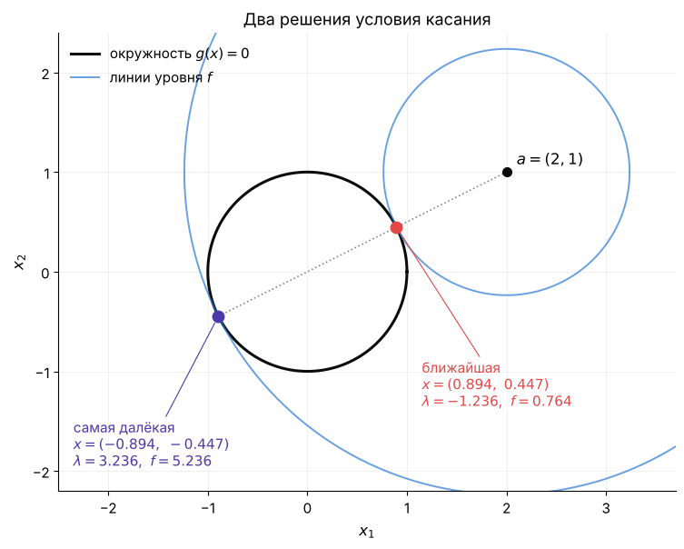

*Первое решение — ближайшая точка, второе — самая далёкая. Линия уровня $f$ касается окружности в обеих.*

**Условие касания находит кандидатов, но не говорит, где минимум.** Гессиан $\nabla^2f=I$ одинаков в обеих точках и тоже не помогает.

### Задача 2. Цепь на жёстких стержнях

Возьмём цепь из лекций 1 и 4–7, но короткую: три груза по 1 кг между опорами $(-2,1)$ и $(2,1)$. Пружины заменим жёсткими стержнями длины $\ell=1.25$ м. Цепь висит так, чтобы её потенциальная энергия была наименьшей:

$$
\min\ f=w\,(z_1+z_2+z_3)\qquad\text{при}\qquad g_j=(y_{j+1}-y_j)^2+(z_{j+1}-z_j)^2-\ell^2=0,\quad j=0,1,2,3 .
$$

Здесь $(y_i,z_i)$ — координаты груза $i$, а $w=9.81$ Н — его вес. Опоры — точки с номерами $0$ и $4$. Стержень $j$ соединяет точки $j$ и $j+1$. Равенство $g_j=0$ говорит: длина стержня $j$ равна $\ell$.

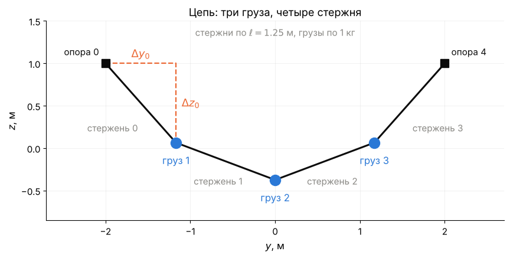

*У стержня $j$ проекции $\Delta y_j=y_{j+1}-y_j$ и $\Delta z_j=z_{j+1}-z_j$. Поэтому $g_j=\Delta y_j^2+\Delta z_j^2-\ell^2$.*

Ограничений четыре, и у каждого свой множитель. Условие касания для них выведем в §2:

$$
\nabla f=\lambda_0\nabla g_0+\lambda_1\nabla g_1+\lambda_2\nabla g_2+\lambda_3\nabla g_3 .
$$

Это равенство векторов из шести чисел — по одному на каждую координату $y_1,z_1,y_2,z_2,y_3,z_3$. Возьмём компоненту по $y_1$:

- слева $\partial f/\partial y_1=0$: функция $f$ зависит только от высот;
- справа от $y_1$ зависят только $g_0$ и $g_1$ — стержни груза 1. Их производные: $\partial g_0/\partial y_1=2(y_1-y_0)$ и $\partial g_1/\partial y_1=-2(y_2-y_1)$.

Получаем первое уравнение:

$$
0=2\lambda_0\,(y_1-y_0)-2\lambda_1\,(y_2-y_1) .
$$

По $z_1$ всё так же, только слева $\partial f/\partial z_1=w$. У остальных грузов — то же с их стержнями. Шесть уравнений условия касания:

$$
\begin{aligned}
\text{груз 1:}\quad 0&=2\lambda_0\Delta y_0-2\lambda_1\Delta y_1, & w&=2\lambda_0\Delta z_0-2\lambda_1\Delta z_1,\\
\text{груз 2:}\quad 0&=2\lambda_1\Delta y_1-2\lambda_2\Delta y_2, & w&=2\lambda_1\Delta z_1-2\lambda_2\Delta z_2,\\
\text{груз 3:}\quad 0&=2\lambda_2\Delta y_2-2\lambda_3\Delta y_3, & w&=2\lambda_2\Delta z_2-2\lambda_3\Delta z_3 .
\end{aligned}
$$

Добавим четыре ограничения $\Delta y_j^2+\Delta z_j^2=\ell^2$. Получится 10 уравнений на 10 неизвестных: 6 координат и 4 множителя.

**Что значат эти уравнения.** У груза 1 справа стоят векторы $2\lambda_0(\Delta y_0,\ \Delta z_0)$ и $-2\lambda_1(\Delta y_1,\ \Delta z_1)$. Первый направлен вдоль стержня 0, второй — вдоль стержня 1. Их сумма равна $(0,\ w)$ и уравновешивает вес груза. **Это равновесие груза: множители Лагранжа задают силы, с которыми стержни держат грузы.** Решение системы и силы в ньютонах — в §5.

### Зачем это вам

Почти все задачи частей III и IV — с ограничениями. Метод Ньютона–Лагранжа (лекция 9) и солвер IPOPT решают одну и ту же систему уравнений. Сегодня мы её выведем и научимся проверять её решение.

**Главная тема лекции — касательное пространство.** Это направления, вдоль которых можно двигаться, не нарушая ограничений.

**Три вопроса лекции:**

1. Как записать условие минимума, если есть ограничения-равенства?
2. Когда это условие не работает?
3. Как отличить минимум от максимума?

**План:**

- §1 — что мы уже знаем;
- §2 — условие первого порядка и функция Лагранжа;
- §3 — условие LICQ и что делать, если оно нарушено;
- §4 — условие второго порядка;
- §5 — множители как силы и цены;
- §6 — что возвращают солверы.

## 1. Повторение: что знаем и чего нет

**Главная мысль.** Без ограничений в минимуме $\nabla f=0$. С ограничением $\nabla f\neq0$, но в лекции 3 он оказался перпендикулярен кривой.

Вспомним лекцию 3 (§6): прямоугольник наибольшей площади, вписанный в единичный круг. Пусть его вершины — $(\pm x_1,\ \pm x_2)$, где $x_1,x_2>0$. Тогда:

- вершины лежат на окружности: $x_1^2+x_2^2=1$;
- стороны равны $2x_1$ и $2x_2$, площадь — $4x_1x_2$;
- наибольшая площадь — то же, что наименьшее значение $-4x_1x_2$.

$$
\min\ f(x)=-4x_1x_2\qquad\text{при}\qquad g(x)=x_1^2+x_2^2-1=0 .
$$

Градиенты:

$$
\nabla f=(-4x_2,\ -4x_1),\qquad\nabla g=(2x_1,\ 2x_2) .
$$

В решении $x^\ast=(0.707,\ 0.707)$ они равны $\nabla f=(-2.83,\ -2.83)$ и $\nabla g=(1.41,\ 1.41)$. Значит, $\nabla f=-2\,\nabla g$, то есть $\lambda=-2$.

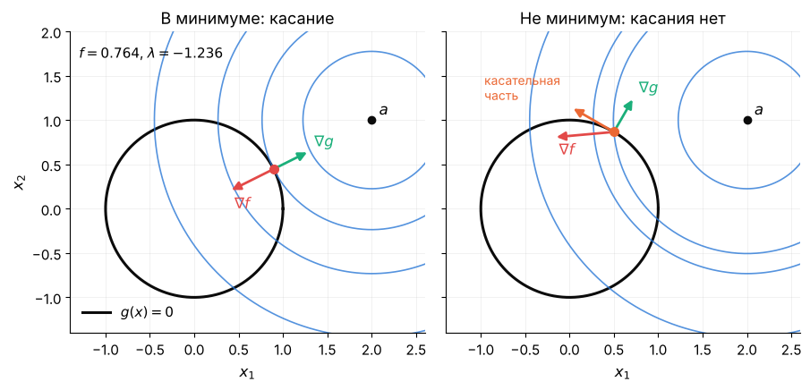

*Вписан квадрат. Линия уровня $f$ касается окружности, и $\nabla f$ направлен против $\nabla g$.*

Это правило мы видели на картинке, без вывода и для одного ограничения. Сравним с тем, что знаем о задачах без ограничений из лекции 4:

| | Без ограничений (Л4) | С равенствами (Л3) |
|---|---|---|
| Первый порядок | $\nabla f=0$ | $\nabla f=\lambda\nabla g$ |
| Когда верно | всегда | ? |
| Второй порядок | $\nabla^2f\succ0$ | ? |

В правом столбце два вопроса, и ещё один скрыт в первой строке: что делать, если ограничений несколько. Это три вопроса лекции.

## 2. Условие первого порядка

**Главная мысль.** С ограничением двигаться можно только вдоль него. В минимуме производная $f$ вдоль такого движения равна нулю. Поэтому у $\nabla f$ нет касательной части.

### 2.1. Одно ограничение: окружность

Вернёмся к задаче 1:

$$
\min\ f(x)=\tfrac12\lVert x-a\rVert^2\qquad\text{при}\qquad g(x)=\tfrac12\big(x_1^2+x_2^2-1\big)=0,\qquad a=(2,1) .
$$

Точку окружности запишем через угол: $x(t)=(\cos t,\ \sin t)$. Скорость точки при движении по окружности:

$$
x'(t)=(-\sin t,\ \cos t)=(-x_2,\ x_1)=p .
$$

Вектор $p$ — **касательное направление**. Он перпендикулярен радиусу: $x^\top p=0$.

Как меняется $f$ при движении по окружности? По правилу дифференцирования сложной функции

$$
\frac{d}{dt}f\big(x(t)\big)=\nabla f(x)^\top p .
$$

Если это число не ноль, $f$ меняется при движении по окружности: в одну сторону растёт, в обратную уменьшается. Значит, точка не минимум.

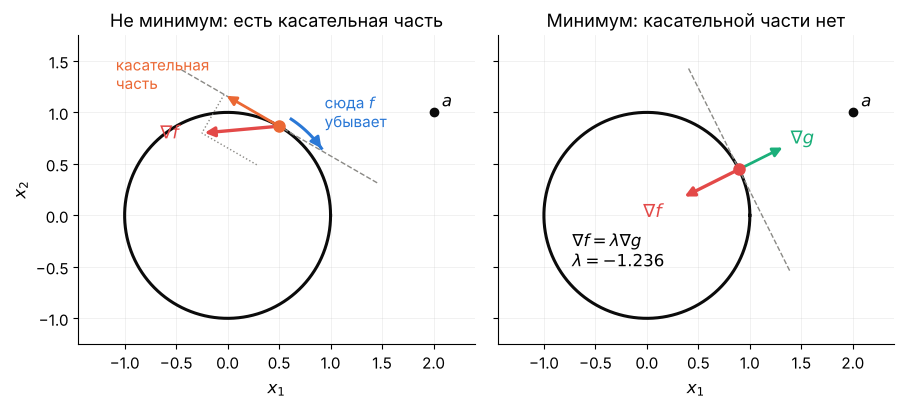

*Слева у $\nabla f$ есть касательная часть: двигаясь против неё по окружности, уменьшаем $f$. Справа касательной части нет — это минимум.*

В минимуме $\nabla f^\top p=0$. Значит, $\nabla f$ лежит на нормали к окружности, то есть параллелен $\nabla g=x$:

$$
\nabla f=\lambda\nabla g\quad\Longleftrightarrow\quad x-a=\lambda x .
$$

Это и есть система из введения.

### 2.2. Два ограничения: окружность в пространстве

Поднимем точку $a$ над плоскостью: $a=(2,1,1)$. Ищем ближайшую к ней точку той же окружности. В пространстве окружность задают **два** равенства:

$$
g_1(x)=\tfrac12\big(x_1^2+x_2^2+x_3^2-1\big)=0\ \ \text{(сфера)},\qquad g_2(x)=x_3=0\ \ \text{(плоскость)} .
$$

Сфера и плоскость пересекаются по окружности. Двигаться можно только вдоль неё. Такое направление $p\in\mathbb R^3$ перпендикулярно **обоим** градиентам:

$$
\nabla g_1^\top p=0,\qquad\nabla g_2^\top p=0 .
$$

Запишем оба условия одной матрицей. **Якобиан** ограничений $J$ — матрица, строки которой — градиенты ограничений:

$$
J=\begin{pmatrix}\nabla g_1^\top\\ \nabla g_2^\top\end{pmatrix}=\begin{pmatrix}x_1&x_2&x_3\\ 0&0&1\end{pmatrix},\qquad Jp=0 .
$$

Все $p$ с $Jp=0$ образуют **касательное пространство** $T$. Здесь это прямая, касательная к окружности.

В минимуме $\nabla f$ перпендикулярен $T$. Векторы, перпендикулярные $T$, — это комбинации строк $J$. Поэтому

$$
\nabla f=\lambda_1\nabla g_1+\lambda_2\nabla g_2=J^\top\lambda .
$$

Проверим числами. Ответ — та же точка $x^\ast=(0.894,\ 0.447,\ 0)$. В ней

$$
\nabla f=x^\ast-a=(-1.106,\ -0.553,\ -1),\qquad\lambda_1=-1.236,\qquad\lambda_2=-1 .
$$

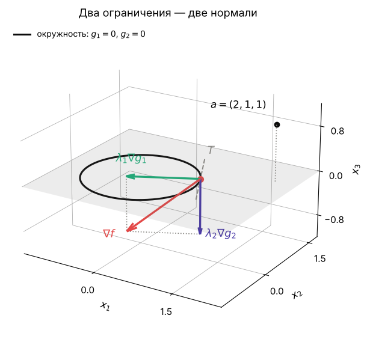

*Красный $\nabla f$ — сумма двух нормалей: зелёная $\lambda_1\nabla g_1$ лежит в плоскости, фиолетовая $\lambda_2\nabla g_2$ смотрит вниз.*

Множитель $\lambda_1$ тот же, что на плоскости. Новый множитель $\lambda_2=-1$ — вклад плоскости: третья компонента $\nabla f$ равна $-1$.

### 2.3. Общий случай: функция Лагранжа

Пусть переменных $n$, а ограничений $m$. Задача:

$$
\min_x\ f(x)\qquad\text{при}\qquad g(x)=0 .
$$

*Размеры:* $x\in\mathbb R^n$, $f(x)$ — число, $g(x)\in\mathbb R^m$.

Как в §2.2, в минимуме $\nabla f$ — комбинация градиентов ограничений:

$$
\nabla f(x)=J(x)^\top\lambda .
$$

*Размеры:* $\nabla f\in\mathbb R^n$; якобиан $J$ — матрица $m\times n$, её строка $j$ — это $\nabla g_j^\top$; $\lambda\in\mathbb R^m$ — **множители Лагранжа** (*Lagrange multipliers*), по одному на ограничение.

Условие удобно записать через **функцию Лагранжа**:

$$
L(x,\lambda)=f(x)-\lambda^\top g(x),\qquad\nabla_xL=\nabla f-J^\top\lambda .
$$

*Размеры:* $L$ — число, $\nabla_xL\in\mathbb R^n$. Знак минус — как в лекции 3.

Условие первого порядка вместе с самими ограничениями:

$$
\boxed{\ \nabla_xL(x,\lambda)=0,\qquad g(x)=0\ }
$$

*Размеры:* $n$ уравнений и ещё $m$ уравнений. Неизвестных столько же: $n$ координат $x$ и $m$ множителей $\lambda$.

| Задача | $n$ | $m$ | Уравнений $n+m$ |
|---|---|---|---|
| задача 1: окружность | $2$ | $1$ | $3$ |
| §2.2: окружность в пространстве | $3$ | $2$ | $5$ |
| задача 2: цепь | $6$ | $4$ | $10$ |

В лекции 9 мы будем решать эту систему методом Ньютона.

## 3. LICQ

**Главная мысль.** Формула $T=\{p:\ Jp=0\}$ верно описывает направления движения, только если градиенты ограничений линейно независимы. Иначе она даёт направления, по которым двигаться нельзя, и условие касания в минимуме может не выполняться. Независимость градиентов называется LICQ.

### 3.1. Пример: плоскость касается сферы

Вернёмся к окружности из §2.2 и поднимем плоскость на высоту $c$:

$$
\min\ \tfrac12\lVert x-a\rVert^2\qquad\text{при}\qquad g_1(x)=\tfrac12\big(\lVert x\rVert^2-1\big)=0,\quad g_2(x)=x_3-c=0,\qquad a=(2,1,1) .
$$

При $c<1$ плоскость режет сферу по окружности. Нормали $\nabla g_1$ и $\nabla g_2$ не параллельны, и всё как в §2.2.

При $c=1$ плоскость касается сферы в точке $(0,0,1)$. Других допустимых точек нет, поэтому минимум — она. Нормали в ней параллельны:

$$
\nabla g_1=(0,\ 0,\ 1),\qquad\nabla g_2=(0,\ 0,\ 1) .
$$

- Система $Jp=0$ сводится к одному уравнению $p_3=0$. Формула объявляет касательным пространством всю горизонтальную плоскость. Но двигаться из точки некуда: **касательного пространства у множества нет.**
- Градиент $\nabla f=(-2,\ -1,\ 0)$ горизонтален, а $J^\top\lambda=(0,\ 0,\ \lambda_1+\lambda_2)$ вертикален. **Равенство $\nabla f=J^\top\lambda$ не выполняется ни при каких $\lambda$.**

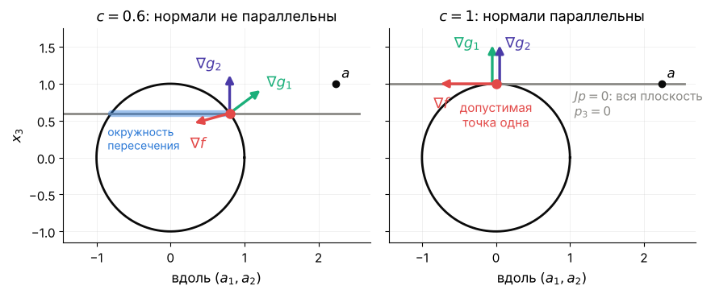

*Вид сбоку: сфера — окружность, плоскость — прямая. Слева $c=0.6$, нормали не параллельны. Справа $c=1$: нормали совпали, а $\nabla f$ горизонтален.*

Множители чувствуют касание заранее: при $c=0.9,\ 0.99,\ 0.999$ первый множитель равен $-4.1,\ -14.9,\ -49$.

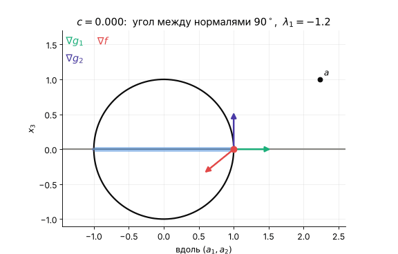

*Плоскость поднимается. Окружность сжимается в точку, угол между нормалями уходит в ноль, а $\lambda_1$ — в минус бесконечность.*

### 3.2. Условие LICQ и теорема

**Определение.** В точке $x$ выполнено **LICQ** (*linear independence constraint qualification*, условие линейной независимости), если градиенты ограничений линейно независимы: $\operatorname{rank}J(x)=m$. Для одного ограничения это $\nabla g(x)\neq0$.

**Теорема (необходимое условие первого порядка).** Пусть $f$ и $g$ непрерывно дифференцируемы, $x^\ast$ — локальный минимум $f$ при $g(x)=0$, и в $x^\ast$ выполнено LICQ. Тогда существует единственный $\lambda^\ast\in\mathbb R^m$, при котором $\nabla_xL(x^\ast,\lambda^\ast)=0$.

- *Почему:* при LICQ решения $Jp=0$ — ровно направления движения по поверхности, как в §2.2. Поэтому $\nabla f$ перпендикулярен им всем и равен $J^\top\lambda$.
- *Чего не обещает:* что решение системы — минимум. У окружности два решения, и одно из них — максимум.
- *Идея доказательства:* при LICQ теорема о неявной функции записывает поверхность как $x=\psi(u)$, $u\in\mathbb R^{n-m}$. Задача $\min\tilde f(u)$, $\tilde f(u)=f(\psi(u))$, — уже без ограничений. Полное доказательство — в разборе упражнения 8.6.

### 3.3. Что делать, если LICQ нарушено

**Чаще всего LICQ ломает запись ограничений.** Окружность задачи 1 можно задать по-разному:

| Запись ограничения | $\operatorname{rank}J$ | Итераций IPOPT | $\lambda$ из ответа IPOPT |
|---|---|---|---|
| $\tfrac12(x_1^2+x_2^2-1)=0$ | $1$ из $1$ | $3$ | $-1.236$ |
| то же дважды | $1$ из $2$ | $3$ | $-2$ и $0.764$ |
| $(x_1^2+x_2^2-1)^2=0$ | $0$ из $1$ | $33$ | $-6.7\cdot10^9$ |

Точка везде одна: $x^\ast=(0.894,\ 0.447)$. Во второй строке подходит любая пара с $\lambda_1+\lambda_2=-1.236$. В третьей $\nabla g=0$ на всей окружности, и множитель ничего не значит: из другого старта он равен $+4\cdot10^9$. В лекции 9 такие записи дадут вырожденную матрицу метода Ньютона.

**Правило: ограничения не повторяют, не возводят в квадрат и не выводят одно из другого.**

**Если особенность настоящая**, как касание плоскости и сферы, запись не исправить. Тогда кандидаты в минимум — решения системы §2.3 и точки, где градиенты ограничений зависимы. Особые точки проверяют отдельно и сравнивают значения $f$.

**Что делает солвер.** IPOPT находит и такую точку, но медленнее: при $c=1$ — 47 итераций вместо 5. Его множители $\pm2\cdot10^8$ использовать нельзя.

## 4. Условие второго порядка

**Главная мысль.** Минимум от максимума отличает кривизна $f$ вдоль ограничения. Её даёт функция Лагранжа: к кривизне $f$ добавляется кривизна ограничений.

### 4.1. Пример: две параболы

Задача:

$$
\min\ f(x)=x_2\qquad\text{при}\qquad g(x)=x_2-c\,x_1^2=0 .
$$

Функция $f$ линейна, $\nabla^2f=0$. Градиенты в нуле:

$$
\nabla f=(0,\ 1),\qquad\nabla g=(-2cx_1,\ 1)=(0,\ 1) .
$$

Значит, $\lambda=1$ при любом $c$. Условие первого порядка выполнено и при $c=1$, и при $c=-1$.

**Вопрос залу.** При $c=1$ ноль — минимум: парабола смотрит вверх. А что в нуле при $c=-1$?

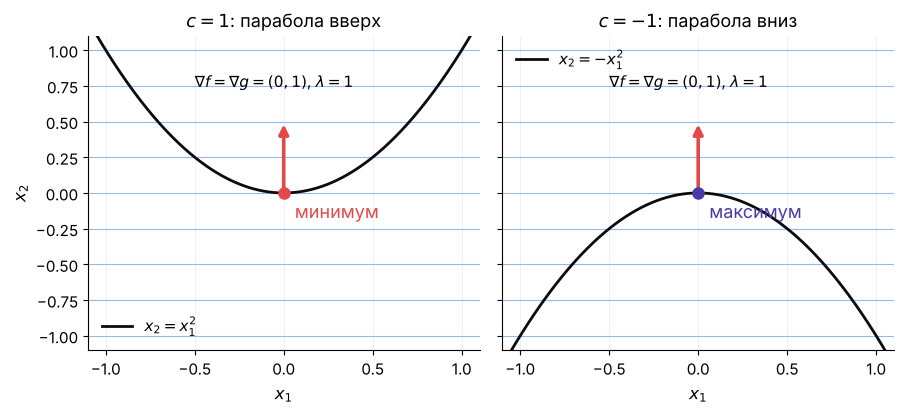

*При $c=-1$ парабола смотрит вниз, и ноль — максимум $x_2$ на ней. Первый порядок одинаков, а ответ разный.*

Посчитаем $f$ вдоль параболы. Точку параболы запишем как $x(t)=(t,\ ct^2)$. Тогда

$$
f\big(x(t)\big)=ct^2,\qquad\frac{d^2}{dt^2}f\big(x(t)\big)=2c .
$$

Знак $c$ и решает. Ту же величину даёт функция Лагранжа:

$$
\nabla^2_{xx}L=\nabla^2f-\lambda\nabla^2g=0-1\cdot\begin{pmatrix}-2c&0\\0&0\end{pmatrix}=\begin{pmatrix}2c&0\\0&0\end{pmatrix} .
$$

Вдоль касательного направления $p=(1,0)$:

$$
p^\top\nabla^2_{xx}L\,p=2c .
$$

**Вся кривизна пришла от ограничения** — через слагаемое $-\lambda\nabla^2g$.

### 4.2. Редуцированный гессиан и теорема

В общем случае считаем вторую производную $f$ вдоль кривой на поверхности. Пусть $x(0)=x^\ast$ и $x'(0)=p\in T$. Ответ тот же, что у параболы:

$$
\frac{d^2}{dt^2}f\big(x(t)\big)\Big|_{t=0}=p^\top\nabla^2_{xx}L(x^\ast,\lambda^\ast)\,p .
$$

Слагаемое с ускорением $x''(0)$ сокращается благодаря $\nabla f=J^\top\lambda$ (упражнение 8.6).

Пусть $Z$ — матрица, столбцы которой — базис $T$. При LICQ в $T$ ровно $n-m$ независимых направлений, поэтому размер $Z$ — $n\times(n-m)$. В SciPy её даёт `scipy.linalg.null_space(J)`. Любое $p\in T$ записывается как $p=Zw$, и все кривизны вдоль $T$ собирает матрица

$$
Z^\top\nabla^2_{xx}L\,Z\qquad\text{размера }(n-m)\times(n-m) .
$$

Это **редуцированный гессиан** (*reduced Hessian*).

**Что обещает теорема.** Если редуцированный гессиан положительно определён (все собственные числа больше нуля), точка — строгий минимум.

**Почему.** Вдоль каждой допустимой кривой $f$ растёт, как парабола с положительной кривизной.

**Чего не обещает.** Ничего о направлениях вне $T$: там $\nabla^2_{xx}L$ может быть любым (упражнение 8.3).

**Теорема (условия второго порядка).** Пусть $f$ и $g$ дважды непрерывно дифференцируемы, в $x^\ast$ выполнено LICQ, $\nabla_xL(x^\ast,\lambda^\ast)=0$ и $g(x^\ast)=0$.

- *Необходимо:* если $x^\ast$ — локальный минимум, то $Z^\top\nabla^2_{xx}L\,Z\succeq0$.
- *Достаточно:* если $Z^\top\nabla^2_{xx}L\,Z\succ0$, то $x^\ast$ — строгий локальный минимум.

**Идея доказательства.** В параметризации $x=\psi(u)$ из §3.2

$$
\nabla^2\tilde f(u^\ast)=Z^\top\nabla^2_{xx}L\,Z,\qquad Z=\psi'(u^\ast) .
$$

У функции $\tilde f$ ограничений нет. Поэтому работают условия лекции 4: $\nabla^2\tilde f\succeq0$ необходимо, $\nabla^2\tilde f\succ0$ достаточно.

### 4.3. Ответ для окружности

Вернёмся к задаче 1:

$$
\min\ f(x)=\tfrac12\lVert x-a\rVert^2\qquad\text{при}\qquad g(x)=\tfrac12\big(x_1^2+x_2^2-1\big)=0,\qquad a=(2,1) .
$$

Здесь $\nabla^2f=I$ и $\nabla^2g=I$, поэтому

$$
\nabla^2_{xx}L=(1-\lambda)\,I .
$$

Касательное пространство — прямая с базисом $Z=(-x_2,\ x_1)^\top$. Редуцированный гессиан — число $1-\lambda$:

| Точка | $\lambda$ | $Z^\top\nabla^2_{xx}L\,Z$ | Вывод |
|---|---|---|---|
| $(0.894,\ 0.447)$ | $-1.236$ | $+2.236$ | минимум |
| $(-0.894,\ -0.447)$ | $3.236$ | $-2.236$ | максимум |

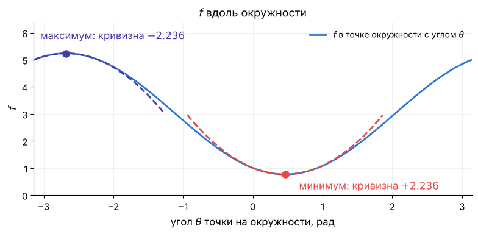

*$f$ вдоль окружности как функция угла. Вторая производная в ближней точке равна $+2.236$, в дальней $-2.236$. Это и есть редуцированный гессиан.*

Таблица из §1 заполнена:

| | Без ограничений (Л4) | С равенствами |
|---|---|---|
| Первый порядок | $\nabla f=0$ | $\nabla f=J^\top\lambda$ |
| Когда верно | всегда | при LICQ |
| Второй порядок | $\nabla^2f\succ0$ | $Z^\top\nabla^2_{xx}L\,Z\succ0$ |

## 5. Множители: силы и цены

**Главная мысль.** Множитель — сила, с которой ограничение держит решение. Он же — цена ограничения: насколько изменится оптимум, если ограничение сдвинуть.

### 5.1. Цепь на стержнях: множитель — натяжение

Вернёмся к задаче 2:

$$
\min\ f=w\,(z_1+z_2+z_3)\qquad\text{при}\qquad g_j=(y_{j+1}-y_j)^2+(z_{j+1}-z_j)^2-\ell^2=0,\quad j=0,1,2,3 .
$$

IPOPT решает систему из введения за 5 итераций. Цепь симметрична, поэтому разных множителей два:

| Стержни | $\lambda_j$ | $2\lvert\lambda_j\rvert\ell$ |
|---|---|---|
| $0$ и $3$, у опор | $-7.87$ | $19.7$ Н |
| $1$ и $2$, в середине | $-5.58$ | $14.0$ Н |

Во введении мы прочитали уравнения груза 1 как равновесие. Запишем их одним векторным уравнением, где $p_i=(y_i,z_i)$:

$$
\underbrace{(0,\ -w)}_{\text{вес}}+\underbrace{2\lambda_0\,(p_1-p_0)}_{\text{стержень 0}}+\underbrace{2\lambda_1\,(p_1-p_2)}_{\text{стержень 1}}=0 .
$$

- Вес $(0,-w)$ — это $-\nabla f$ по координатам груза: сила равна минус градиенту энергии.
- Сила стержня 0 направлена вдоль него. Множитель $\lambda_0<0$, поэтому сила смотрит к опоре: стержень тянет груз. Её величина — натяжение $2\lvert\lambda_0\rvert\ell=19.7$ Н.
- Сила стержня 1 тянет груз к грузу 2. Её величина $2\lvert\lambda_1\rvert\ell=14.0$ Н.

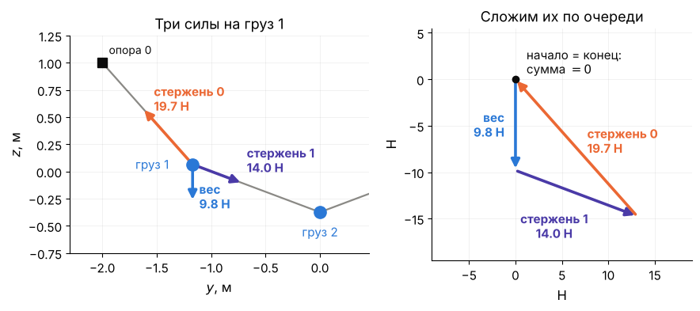

*Слева три силы на груз 1. Справа те же стрелки одна за другой: треугольник замкнулся, сумма — ноль.*

Вектор $2\lambda_j(\Delta y_j,\ \Delta z_j)$ — сила стержня $j$ на груз справа от него. Первое число — её горизонтальная составляющая, второе — вертикальная.

**Вопрос залу.** Что уравнения по $y$ из введения говорят о горизонтальных составляющих?

*Горизонтальная составляющая — 13.1 Н во всех четырёх стержнях. У опор стержни круче, поэтому вертикальная составляющая и натяжение там больше.*

Ответ: из уравнения груза $i$ по $y$ следует $2\lambda_{i-1}\Delta y_{i-1}=2\lambda_i\Delta y_i$. У соседних стержней горизонтальная составляющая одна и та же, значит, и у всех. Уравнения по $z$ — про вертикаль: два стержня вместе держат вес груза. Сложим их по трём грузам: опоры держат по 14.7 Н, вместе 29.4 Н. Это вес цепи $3w$.

Проверим ответ IPOPT по таблице §4 (демо (c)):

| Проверка | Число | Вывод |
|---|---|---|
| $\lVert\nabla f-J^\top\lambda\rVert$ | $5\cdot10^{-12}$ | первый порядок выполнен |
| $\operatorname{rank}J$ | $4$ | LICQ выполнено |
| собственные числа $Z^\top\nabla^2_{xx}L\,Z$ | $19.0$ и $35.2$ | строгий минимум |

Функция $f$ линейна, $\nabla^2f=0$. **Минимум держат стержни:** вся кривизна — от ограничений.

### 5.2. Портфель: множитель — цена

Портфель из лекции 3 (§2.2): четыре актива, $x$ — доли капитала. Минимизируем риск при заданной доходности $\rho$:

$$
\min\ \tfrac12x^\top\Sigma x\qquad\text{при}\qquad\mathbf 1^\top x=1,\quad r^\top x=\rho .
$$

Здесь $\Sigma$ — ковариационная матрица доходностей, $r$ — ожидаемые доходности активов. При $\rho=10\,\%$ ответ:

$$
x^\ast=(0.095,\ 0.382,\ 0.321,\ 0.202),\qquad\lambda_\rho=0.257 .
$$

Все доли положительны, поэтому запрет коротких позиций из лекции 3 здесь не нужен.

**Формула цены.** Сдвинем правую часть ограничения: $g(x)=b$. Оптимум $f^\ast$ становится функцией $b$, и

$$
\frac{df^\ast}{db}=\lambda^\ast .
$$

Лекция 3 обещала доказательство. Для равенств оно занимает три строки. На решении $g(x^\ast(b))=b$, поэтому

$$
f^\ast(b)=L\big(x^\ast(b),\lambda^\ast(b),b\big),\qquad L=f-\lambda^\top\big(g(x)-b\big) .
$$

Продифференцируем по $b$. Слагаемые с $dx^\ast/db$ умножаются на $\nabla_xL=0$. Слагаемые с $d\lambda^\ast/db$ умножаются на $g-b=0$. Остаётся

$$
\frac{df^\ast}{db}=\frac{\partial L}{\partial b}=\lambda^\ast .
$$

*Минимальный риск как функция цели $\rho$. Наклон в $\rho=10\,\%$ равен $\lambda_\rho=0.257$: лишний процентный пункт доходности стоит $0.0026$ риска.*

## 6. Что это даёт численно

**Главная мысль.** Солвер решает ту же систему $\nabla_xL=0$, $g=0$. Его лог — две невязки этой системы.

**Где множители.** У солверов функция Лагранжа $f+\lambda^\top g$, поэтому знак множителей противоположный нашему:

| Солвер | Где множители | Наш $\lambda$ |
|---|---|---|
| IPOPT через CasADi | `sol["lam_g"]` | $-$`lam_g` |
| SciPy, `method="trust-constr"` | `res.v` | $-$`v` |

**Как проверить ответ.** Подставьте $x^\ast$ и $\lambda^\ast$ в систему §2.3 и посчитайте обе невязки.

**Что в логе IPOPT.** Две колонки лога — невязки двух половин системы:

- `inf_pr` — нарушение ограничений $\lVert g(x_k)\rVert_\infty$;
- `inf_du` — невязка стационарности $\lVert\nabla_xL(x_k,\lambda_k)\rVert_\infty$.

Солвер останавливается, когда обе меньше допуска `tol`.

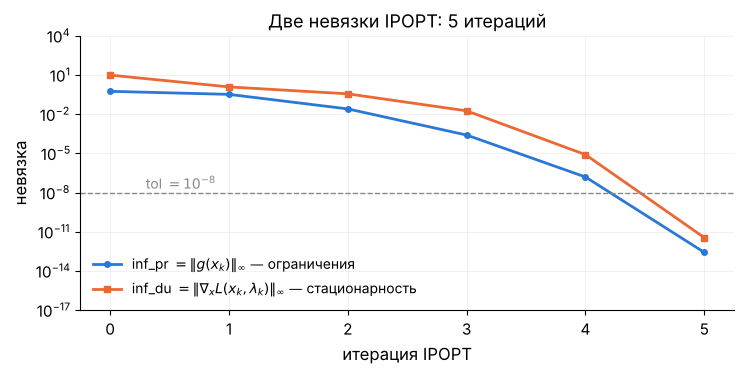

*Цепь на стержнях, 5 итераций. В конце число верных знаков примерно удваивается за итерацию: $2.5\cdot10^{-4}\to1.5\cdot10^{-7}\to3\cdot10^{-13}$.*

Так сходится метод Ньютона: IPOPT делает его шаги для этой системы. В лекции 9 мы напишем такой метод сами.

## 7. Итоги лекции

1. В минимуме на поверхности $g(x)=0$ у $\nabla f$ нет касательной части: $\nabla f=J^\top\lambda$ (§2).
2. Функция Лагранжа $L=f-\lambda^\top g$ даёт систему $\nabla_xL=0$, $g=0$: $n+m$ уравнений на $x$ и $\lambda$ (§2.3).
3. Условие касания верно при LICQ. Без LICQ формула $Jp=0$ может дать направления, которых нет (плоскость касается сферы), и в минимуме условие не выполняется. Чаще всего LICQ ломает запись ограничений — её исправляют (§3).
4. Минимум от максимума отличает редуцированный гессиан $Z^\top\nabla^2_{xx}L\,Z$. Кривизна ограничений входит в него через $-\lambda\nabla^2g$ (§4).
5. Множитель — сила ограничения и его цена: $df^\ast/db=\lambda^\ast$ (§5).

**Ответы на задачи введения.**

- **Задача 1.** Редуцированный гессиан равен $+2.236$ в ближней точке и $-2.236$ в дальней: это минимум и максимум.
- **Задача 2.** Четыре множителя — натяжения стержней: 19.7 Н у опор и 14.0 Н в середине. Горизонтальная составляющая — 13.1 Н во всех стержнях. Оба собственных числа редуцированного гессиана положительны, значит, это минимум.

## 8. Что дальше

**Лекция 9** — алгоритмы для равенств. Метод Ньютона для системы $\nabla_xL=0$, $g=0$ (Ньютон–Лагранж), обобщённый Гаусс–Ньютон и цепь на стержнях своим методом против IPOPT. **Лекция 10** — неравенства: условия ККТ и двойственность.

ДЗ 5 (Ньютон–Лагранж и обобщённый Гаусс–Ньютон) выдаётся после лекции 9.

**Литература к лекции.**
- Diehl, *Lecture Notes on Numerical Optimization*, часть III, глава *Equality Constrained Optimization*: касательное пространство, LICQ, условия первого и второго порядка.
- Nocedal & Wright, гл. 12: §12.1 — примеры, §12.2 — касательный конус и LICQ, §12.3 — теорема первого порядка, §12.5 — условия второго порядка.
- Boyd & Vandenberghe, §10.1 — задачи с равенствами и система ККТ; §5.6 — множители как чувствительность.

## 9. Упражнения

Разбор с проверкой кодом — [`exercises08.ipynb`](exercises08.ipynb), краткие ответы — [`exercises08.md`](exercises08.md). На семинаре — 8.0 и 8.3, остальные — домашние.

**8.0. Разминка — счёт руками.** *Суть: система $\nabla_xL=0$, $g=0$ на задачах с известным ответом.*

- (а) Ближайшая к $x_0$ точка плоскости $q^\top x=d$. Выпишите $L$ и решите систему. Сравните ответ с проекцией из лекции 2.
- (б) $\min\ x_1+x_2$ при $x_1^2+x_2^2=1$. Найдите оба решения системы и их $\lambda$. Какое из них минимум?
- (в) Ящик наибольшего объёма при площади поверхности $6$ (Л3, упражнение 13.10). Найдите $\lambda$ в решении $x=y=z=1$ и объясните его знак.

**8.1. Две точки на окружности** (с кодом). *Суть: редуцированный гессиан различает минимум и максимум.*

- (а) Решите систему из §2.1 функцией `fsolve` из двух стартов. Получите обе точки и оба $\lambda$.
- (б) Для каждой точки постройте $Z$ (`null_space`) и редуцированный гессиан. Повторите для $a=(0.3,\ 0.1)$. Что изменилось?

**8.2. Плоскость касается сферы** (с кодом). *Суть: у касания множители уходят в бесконечность, а солвер теряет точность.*

- (а) Решите задачу §3.1 при $c<1$ руками: найдите $x^\ast$ и покажите, что $\lambda_1=1-\sqrt5/\sqrt{1-c^2}$. Сравните с IPOPT при $c=0.9,\ 0.99,\ 0.999$.
- (б) Окружности радиуса 1 с центрами $(\pm1,\ 0)$ касаются в нуле. Найдите $\min x_2$ на их пересечении. Выполнено ли LICQ? Что вернёт IPOPT?

**8.3. Кривизна ограничения.** *Суть: решает $\nabla^2_{xx}L$ вдоль $T$, а не $\nabla^2f$.*

- (а) $f=x_2$ на параболе $x_2=cx_1^2$. При каких $c$ ноль — минимум, максимум, ни то ни другое?
- (б) $f=x_1^2-x_2^2$ на прямой $x_2=0$. Покажите, что ноль — строгий минимум, хотя $\nabla^2f$ индефинитен (собственные числа разных знаков).

**8.4. Цепь на стержнях: силы и цена длины** (с кодом). *Суть: условие первого порядка — баланс сил, а множитель — производная оптимума.*

- (а) Решите задачу 2 из введения в CasADi. Проверьте: горизонтальная составляющая $2\lambda_j\Delta y_j$ одинакова во всех стержнях, а вертикальные составляющие на опорах дают вес цепи.
- (б) Удлините стержни на $1\,\%$ и на $5\,\%$. Сравните изменение $f^\ast$ с предсказанием $\sum_j\lambda_j\,\Delta(\ell^2)$. Почему при $5\,\%$ расхождение больше?

**8.5. Цена доходности** (с кодом). *Суть: $df^\ast/d\rho=\lambda_\rho$.*

Решите систему для портфеля из §5.2 при $\rho$ от $6$ до $14\,\%$. Почему она линейная? Сравните численную производную $f^\ast(\rho)$ с $\lambda_\rho$. При какой $\rho$ доля первого актива становится отрицательной?

**8.6. Для желающих: доказательства.** *Суть: теорема о неявной функции превращает задачу с равенствами в задачу без них.*

Докажите теоремы §3.2 и §4.2 полностью. Докажите формулу цены из §5.2 и найдите условие, при котором $x^\ast(b)$ и $\lambda^\ast(b)$ дифференцируемы.

## Вопросы для самопроверки

1. Почему в минимуме у $\nabla f$ нет касательной части?
2. Сколько уравнений и неизвестных в системе первого порядка при $n$ переменных и $m$ ограничениях?
3. Что такое LICQ? Приведите пример минимума, в котором условие касания не выполняется.
4. Почему второй порядок проверяют по $\nabla^2_{xx}L$, а не по $\nabla^2f$?
5. Что такое редуцированный гессиан и какого он размера?
6. Почему натяжение стержня равно $2\lvert\lambda_j\rvert\ell$?
7. Что показывают колонки `inf_pr` и `inf_du` в логе IPOPT?
8. Окружность задачи 1 записали как $(x_1^2+x_2^2-1)^2=0$. Найдёт ли солвер минимум? Что будет с множителем?
