# Лекция 8. Ограничения-равенства: множители Лагранжа, LICQ и условия второго порядка

**Курс:** Вычислительная оптимизация · **Часть III. Ограничения-равенства** · Лекция 8 из 16 · 4 ноября 2026

**Материалы:** [конспект-ноутбук с кодом демонстраций](lecture08.ipynb) · [демо-ноутбук](demo08.ipynb) · [разбор упражнений](exercises08.ipynb)

В конспекте-ноутбуке текст идёт подряд, а все три демо собраны в конце: (a) к §2, (b) к §3, (c) к §5.

---

## Введение

### Задача 1. Ближайшая точка окружности

Найдём на единичной окружности точку, ближайшую к $a=(2,1)$:

$$
\min_{x\in\mathbb R^2}\ f(x)=\tfrac12\lVert x-a\rVert^2\qquad\text{при}\qquad g(x)=\tfrac12\big(x_1^2+x_2^2-1\big)=0 .
$$

Здесь $x=(x_1,x_2)\in\mathbb R^2$ — вектор из двух чисел, точка плоскости.

Ответ виден глазами: это точка на луче к $a$, то есть $x^\ast=a/\lVert a\rVert=(0.894,\ 0.447)$.

Получим его условием касания из лекции 3. Почему градиенты должны быть параллельны:

- в минимуме сдвиг вдоль окружности не уменьшает $f$, поэтому линия уровня $f$ касается окружности;
- у касающихся кривых в точке касания общая нормаль;
- нормаль к линии уровня $f$ — это $\nabla f$, нормаль к окружности $g=0$ — это $\nabla g$.

Значит, $\nabla f=\lambda\nabla g$ для некоторого числа $\lambda$. Строгий вывод — в §2.

Здесь $\nabla f=x-a=(x_1-2,\ x_2-1)$ и $\nabla g=x=(x_1,\ x_2)$. Запишем равенство $\nabla f=\lambda\nabla g$ по компонентам и добавим само ограничение:

$$
x_1-2=\lambda x_1,\qquad x_2-1=\lambda x_2,\qquad x_1^2+x_2^2=1 .
$$

Первые два уравнения — две компоненты равенства градиентов, третье — ограничение. Три уравнения, три неизвестных: $x_1$, $x_2$, $\lambda$. У системы **два** решения:

| Точка $x$ | $\lambda$ | $f(x)$ |
|---|---|---|
| $(0.894,\ 0.447)$ | $-1.236$ | $0.764$ |
| $(-0.894,\ -0.447)$ | $3.236$ | $5.236$ |

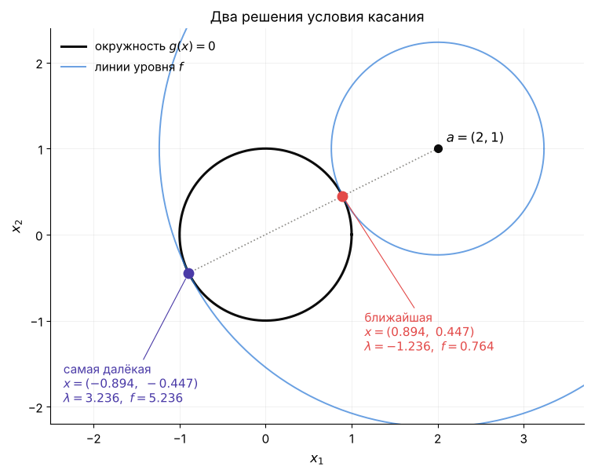

*Первое решение — ближайшая точка, второе — самая далёкая. Линия уровня $f$ касается окружности в обеих.*

**Условие касания находит кандидатов, но не говорит, где минимум.** Гессиан $\nabla^2f=I$ одинаков в обеих точках и тоже не помогает.

### Задача 2. Цепь на жёстких стержнях

Возьмём цепь из лекций 1 и 4–7, но короткую: три груза по 1 кг между двумя опорами. Пружины заменим жёсткими стержнями длины $\ell=1.25$ м. Цепь висит так, чтобы её потенциальная энергия была наименьшей:

$$
\min\ f=w\,(z_1+z_2+z_3)\qquad\text{при}\qquad g_j=(y_{j+1}-y_j)^2+(z_{j+1}-z_j)^2-\ell^2=0,\quad j=0,1,2,3 .
$$

Здесь $(y_i,z_i)$ — груз $i$, $w=9.81$ Н — его вес. Опоры — точки $(y_0,z_0)=(-2,1)$ и $(y_4,z_4)=(2,1)$. Стержень $j$ соединяет точки $j$ и $j+1$.

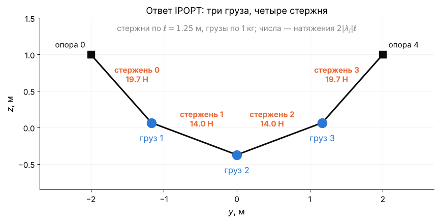

**Система.** Условие касания (выведем в §2): $\nabla f=\lambda_0\nabla g_0+\dots+\lambda_3\nabla g_3$. Его компоненты по $y_1,z_1,\dots,z_3$ — шесть уравнений, по два на груз:

$$
\begin{aligned}
\text{груз 1:}\quad 0&=2\lambda_0(y_1-y_0)-2\lambda_1(y_2-y_1), & w&=2\lambda_0(z_1-z_0)-2\lambda_1(z_2-z_1),\\
\text{груз 2:}\quad 0&=2\lambda_1(y_2-y_1)-2\lambda_2(y_3-y_2), & w&=2\lambda_1(z_2-z_1)-2\lambda_2(z_3-z_2),\\
\text{груз 3:}\quad 0&=2\lambda_2(y_3-y_2)-2\lambda_3(y_4-y_3), & w&=2\lambda_2(z_3-z_2)-2\lambda_3(z_4-z_3).
\end{aligned}
$$

Слева производные $f$: по $y_i$ ноль, по $z_i$ вес $w$. Справа производные двух стержней груза $i$, остальные $g_j$ от него не зависят.

Ещё четыре уравнения — длины стержней:

$$
\begin{aligned}
\text{стержень 0:}\quad (y_1-y_0)^2+(z_1-z_0)^2&=\ell^2,\\
\text{стержень 1:}\quad (y_2-y_1)^2+(z_2-z_1)^2&=\ell^2,\\
\text{стержень 2:}\quad (y_3-y_2)^2+(z_3-z_2)^2&=\ell^2,\\
\text{стержень 3:}\quad (y_4-y_3)^2+(z_4-z_3)^2&=\ell^2.
\end{aligned}
$$

**Всего 10 уравнений на 10 неизвестных: $y_1,z_1,y_2,z_2,y_3,z_3$ и $\lambda_0,\lambda_1,\lambda_2,\lambda_3$.**

В паре уравнений груза справа стоят векторы вдоль двух его стержней. Их сумма уравновешивает вес. Это равновесие груза: множители задают силы стержней. Решение — в §5.

### Зачем это вам

Почти все задачи частей III и IV — с ограничениями. Метод Ньютона–Лагранжа (лекция 9) и солвер IPOPT решают одну и ту же систему уравнений. Сегодня мы её выведем и научимся проверять её решение.

**Главная тема лекции — касательное пространство.** Это направления, вдоль которых можно двигаться, не нарушая ограничений.

**Три вопроса лекции:**

1. Как записать условие минимума, если есть ограничения-равенства?
2. Когда это условие не работает?
3. Как отличить минимум от максимума?

**План:**

- §1 — что мы уже знаем;
- §2 — условие первого порядка и функция Лагранжа;
- §3 — условие LICQ и что делать, если оно нарушено;
- §4 — условие второго порядка;
- §5 — множители как силы и цены;
- §6 — что возвращают солверы.

## 1. Повторение: что знаем и чего нет

**Главная мысль.** Без ограничений в минимуме $\nabla f=0$. С ограничением $\nabla f\neq0$, но в лекции 3 он оказался перпендикулярен кривой.

Вспомним лекцию 3 (§6): прямоугольник наибольшей площади, вписанный в единичный круг. Пусть его вершины — $(\pm x_1,\ \pm x_2)$, где $x_1,x_2>0$. Переменная — вектор $x=(x_1,x_2)\in\mathbb R^2$. Тогда:

- вершины лежат на окружности: $x_1^2+x_2^2=1$;
- стороны равны $2x_1$ и $2x_2$, площадь — $4x_1x_2$;
- наибольшая площадь — то же, что наименьшее значение $-4x_1x_2$.

$$
\min_{x\in\mathbb R^2}\ f(x)=-4x_1x_2\qquad\text{при}\qquad g(x)=x_1^2+x_2^2-1=0 .
$$

Градиенты:

$$
\nabla f=(-4x_2,\ -4x_1),\qquad\nabla g=(2x_1,\ 2x_2) .
$$

В решении $x^\ast=(0.707,\ 0.707)$ они равны $\nabla f=(-2.83,\ -2.83)$ и $\nabla g=(1.41,\ 1.41)$. Значит, $\nabla f=-2\,\nabla g$, то есть $\lambda=-2$.

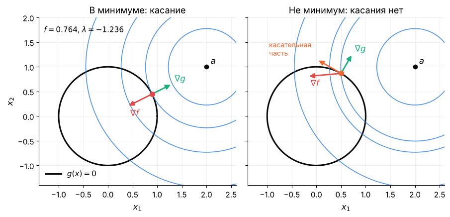

*Вписан квадрат. Линия уровня $f$ касается окружности, и $\nabla f$ направлен против $\nabla g$.*

Это правило мы видели на картинке, без вывода и для одного ограничения. Сравним с тем, что знаем о задачах без ограничений из лекции 4:

| | Без ограничений (Л4) | С равенствами (Л3) |
|---|---|---|
| Первый порядок | $\nabla f=0$ | $\nabla f=\lambda\nabla g$ |
| Когда верно | всегда | ? |
| Второй порядок | $\nabla^2f\succ0$ | ? |

В правом столбце два вопроса, и ещё один скрыт в первой строке: что делать, если ограничений несколько. Это три вопроса лекции.

## 2. Условие первого порядка

**Главная мысль.** С ограничением двигаться можно только вдоль него. В минимуме производная $f$ вдоль такого движения равна нулю. Поэтому у $\nabla f$ нет касательной части.

### 2.1. Одно ограничение: окружность

Вернёмся к задаче 1:

$$
\min_{x\in\mathbb R^2}\ f(x)=\tfrac12\lVert x-a\rVert^2\qquad\text{при}\qquad g(x)=\tfrac12\big(x_1^2+x_2^2-1\big)=0,\qquad a=(2,1) .
$$

Точку окружности запишем через угол: $x(t)=(\cos t,\ \sin t)$. Скорость точки при движении по окружности:

$$
x'(t)=(-\sin t,\ \cos t)=(-x_2,\ x_1)=p .
$$

Вектор $p$ — **касательное направление**. Он перпендикулярен радиусу: $x^\top p=0$.

Как меняется $f$ при движении по окружности? По правилу дифференцирования сложной функции

$$
\frac{d}{dt}f\big(x(t)\big)=\nabla f(x)^\top p .
$$

Если это число не ноль, $f$ меняется при движении по окружности: в одну сторону растёт, в обратную уменьшается. Значит, точка не минимум.

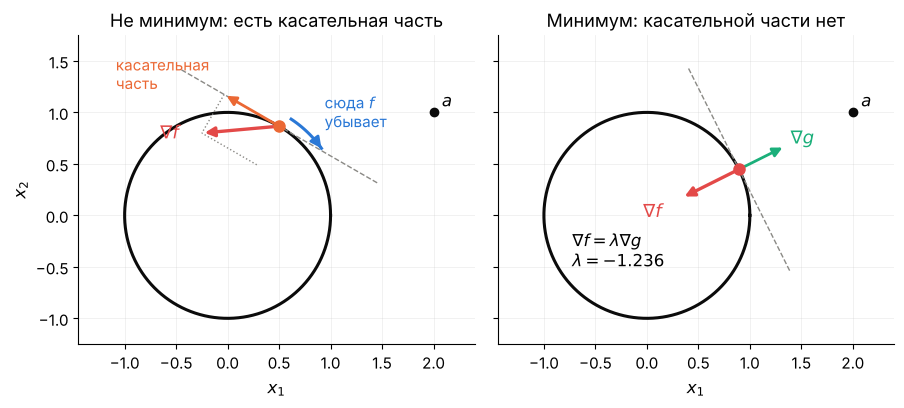

*Слева у $\nabla f$ есть касательная часть: двигаясь против неё по окружности, уменьшаем $f$. Справа касательной части нет — это минимум.*

В минимуме $\nabla f^\top p=0$. Значит, $\nabla f$ лежит на нормали к окружности, то есть параллелен $\nabla g=x$:

$$
\nabla f=\lambda\nabla g\quad\Longleftrightarrow\quad x-a=\lambda x .
$$

Это и есть система из введения.

### 2.2. Два ограничения: окружность в пространстве

Перейдём в пространство: теперь $x=(x_1,x_2,x_3)\in\mathbb R^3$ — вектор из трёх чисел. Поднимем точку $a$ над плоскостью: $a=(2,1,1)$. Ищем ближайшую к ней точку той же окружности. В пространстве окружность задают **два** равенства:

$$
g_1(x)=\tfrac12\big(x_1^2+x_2^2+x_3^2-1\big)=0\ \ \text{(сфера)},\qquad g_2(x)=x_3=0\ \ \text{(плоскость)} .
$$

Сфера и плоскость пересекаются по окружности. Двигаться можно только вдоль неё. Такое направление $p\in\mathbb R^3$ перпендикулярно **обоим** градиентам:

$$
\nabla g_1^\top p=0,\qquad\nabla g_2^\top p=0 .
$$

Запишем оба условия одной матрицей. **Якобиан** ограничений $J$ — матрица, строки которой — градиенты ограничений:

$$
J=\begin{pmatrix}\nabla g_1^\top\\ \nabla g_2^\top\end{pmatrix}=\begin{pmatrix}x_1&x_2&x_3\\ 0&0&1\end{pmatrix},\qquad Jp=0 .
$$

Все $p$ с $Jp=0$ образуют **касательное пространство** $T$. Здесь это прямая, касательная к окружности.

В минимуме $\nabla f$ перпендикулярен $T$. Векторы, перпендикулярные $T$, — это комбинации строк $J$. Поэтому

$$
\nabla f=\lambda_1\nabla g_1+\lambda_2\nabla g_2=J^\top\lambda .
$$

Проверим числами. Ответ — та же точка $x^\ast=(0.894,\ 0.447,\ 0)$. В ней

$$
\nabla f=x^\ast-a=(-1.106,\ -0.553,\ -1),\qquad\lambda_1=-1.236,\qquad\lambda_2=-1 .
$$

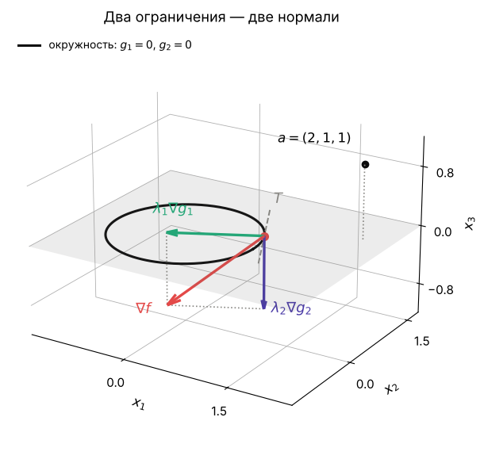

*Красный $\nabla f$ — сумма двух нормалей: зелёная $\lambda_1\nabla g_1$ лежит в плоскости, фиолетовая $\lambda_2\nabla g_2$ смотрит вниз.*

Множитель $\lambda_1$ тот же, что на плоскости. Новый множитель $\lambda_2=-1$ — вклад плоскости: третья компонента $\nabla f$ равна $-1$.

### 2.3. Общий случай: функция Лагранжа

Пусть переменных $n$, а ограничений $m$. Задача:

$$
\min_{x\in\mathbb R^n}\ f(x)\qquad\text{при}\qquad g(x)=0 .
$$

*Размеры:* $x\in\mathbb R^n$ — вектор из $n$ переменных, $f(x)$ — число, $g(x)\in\mathbb R^m$.

Как в §2.2, в минимуме $\nabla f$ — комбинация градиентов ограничений:

$$
\nabla f(x)=J(x)^\top\lambda .
$$

*Размеры:* $\nabla f\in\mathbb R^n$; якобиан $J$ — матрица $m\times n$, её строка $j$ — это $\nabla g_j^\top$; $\lambda\in\mathbb R^m$ — **множители Лагранжа** (*Lagrange multipliers*), по одному на ограничение.

Условие удобно записать через **функцию Лагранжа**:

$$
L(x,\lambda)=f(x)-\lambda^\top g(x),\qquad\nabla_xL=\nabla f-J^\top\lambda .
$$

*Размеры:* $L$ — число, $\nabla_xL\in\mathbb R^n$. Знак минус — как в лекции 3.

Условие первого порядка вместе с самими ограничениями:

$$
\boxed{\ \nabla_xL(x,\lambda)=0,\qquad g(x)=0\ }
$$

*Размеры:* $n$ уравнений и ещё $m$ уравнений. Неизвестных столько же: $n$ координат $x$ и $m$ множителей $\lambda$.

| Задача | $n$ | $m$ | Уравнений $n+m$ |
|---|---|---|---|
| задача 1: окружность | $2$ | $1$ | $3$ |
| §2.2: окружность в пространстве | $3$ | $2$ | $5$ |
| задача 2: цепь | $6$ | $4$ | $10$ |

У цепи вектор переменных — $x=(y_1,z_1,y_2,z_2,y_3,z_3)\in\mathbb R^6$.

В лекции 9 мы будем решать эту систему методом Ньютона.

## 3. LICQ

**Главная мысль.** Условие касания выполняется в минимуме, если градиенты ограничений линейно независимы. Это требование называется LICQ. Если градиенты параллельны, минимум может не удовлетворять условию касания — и система §2.3 его не найдёт.

### 3.1. Пример: плоскость касается сферы

Как в §2.2, $x=(x_1,x_2,x_3)\in\mathbb R^3$. Поднимем плоскость до высоты $x_3=1$:

$$
\min_{x\in\mathbb R^3}\ \tfrac12\lVert x-a\rVert^2\qquad\text{при}\qquad g_1(x)=\tfrac12\big(\lVert x\rVert^2-1\big)=0,\quad g_2(x)=x_3-1=0,\qquad a=(2,1,1) .
$$

Допустимая точка одна. Подставим $x_3=1$ в уравнение сферы:

$$
x_1^2+x_2^2+1=1\quad\Longrightarrow\quad x_1=x_2=0 .
$$

Плоскость касается сферы в точке $x^\ast=(0,0,1)$, она и минимум. В ней $\nabla f=x^\ast-a=(-2,\ -1,\ 0)$, а якобиан ограничений

$$
J=\begin{pmatrix}\nabla g_1^\top\\ \nabla g_2^\top\end{pmatrix}=\begin{pmatrix}x_1&x_2&x_3\\0&0&1\end{pmatrix}=\begin{pmatrix}0&0&1\\0&0&1\end{pmatrix} .
$$

Обе строки совпадают: нормали сферы и плоскости смотрят вверх. Запишем условие касания $\nabla f=J^\top\lambda$ покомпонентно:

$$
\begin{pmatrix}-2\\-1\\0\end{pmatrix}=\lambda_1\begin{pmatrix}0\\0\\1\end{pmatrix}+\lambda_2\begin{pmatrix}0\\0\\1\end{pmatrix}=\begin{pmatrix}0\\0\\\lambda_1+\lambda_2\end{pmatrix} .
$$

**Первые две компоненты дают $-2=0$ и $-1=0$: равенство не выполняется ни при каких $\lambda$.**

Почему так. Условие касания из §2 требует $\nabla f^\top p=0$ для всех направлений $p$ с $Jp=0$. Здесь

$$
Jp=\begin{pmatrix}0&0&1\\0&0&1\end{pmatrix}\begin{pmatrix}p_1\\p_2\\p_3\end{pmatrix}=\begin{pmatrix}p_3\\p_3\end{pmatrix}=0\quad\Longleftrightarrow\quad p_3=0 .
$$

Формула даёт целую плоскость направлений $p=(p_1,\ p_2,\ 0)$. Вдоль $p=(1,0,0)$ получается $\nabla f^\top p=-2\neq0$. Но допустимая точка одна, и сдвинуться по $p$ нельзя. Поэтому минимум есть, а условия касания в нём нет.

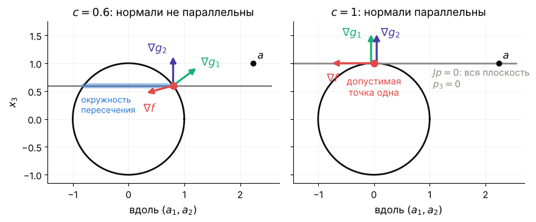

*Вид сбоку. Слева плоскость ниже, $c=0.6$: нормали не параллельны, всё как в §2.2. Справа $c=1$: нормали совпали.*

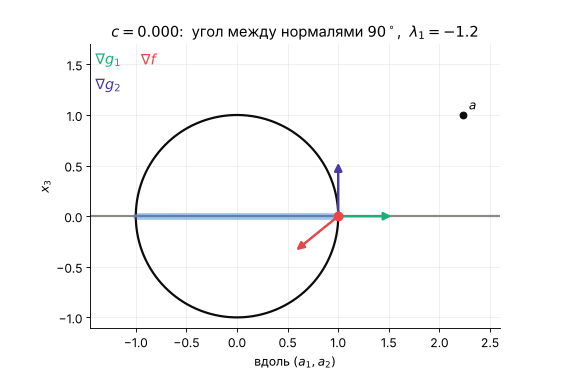

*Плоскость поднимается. Чем ближе касание, тем больше множитель: $\lambda_1=-4.1,\ -14.9,\ -49$ при $c=0.9,\ 0.99,\ 0.999$.*

### 3.2. Зачем LICQ и что делать

**Определение.** **LICQ** (*linear independence constraint qualification*) — градиенты ограничений в точке линейно независимы. Градиенты — строки якобиана $J$, поэтому LICQ означает $\operatorname{rank}J=m$. Сравним якобианы в ответе §2.2 и §3.1:

$$
\text{плоскость } x_3=0:\quad J=\begin{pmatrix}0.894&0.447&0\\0&0&1\end{pmatrix},\ \operatorname{rank}J=2;\qquad
\text{плоскость } x_3=1:\quad J=\begin{pmatrix}0&0&1\\0&0&1\end{pmatrix},\ \operatorname{rank}J=1 .
$$

В §2.2 LICQ выполнено, в §3.1 — нет.

**Теорема.** Если $x^\ast$ — локальный минимум и в нём выполнено LICQ, то существует единственный $\lambda^\ast$ с $\nabla_xL(x^\ast,\lambda^\ast)=0$.

**Доказательство.** Сначала на окружности задачи 1, потом в общем случае.

*Окружность.* Здесь $x\in\mathbb R^2$ и одно ограничение. Точку окружности задаёт один угол $u$:

$$
x=\psi(u)=(\cos u,\ \sin u) .
$$

Функция $\tilde f(u)=f(\psi(u))$ зависит от одного числа $u$, и ограничений у неё нет. В минимуме её производная равна нулю:

$$
\tilde f'(u^\ast)=\nabla f(x^\ast)^\top\psi'(u^\ast)=0,\qquad\psi'(u^\ast)=(-\sin u^\ast,\ \cos u^\ast) .
$$

Вектор $\psi'(u^\ast)$ касается окружности. Значит, $\nabla f$ перпендикулярен касательной и параллелен нормали $\nabla g=x^\ast$: $\nabla f=\lambda\nabla g$.

*Общий случай* — те же шаги, только параметров $n-m$.

**Шаг 1. Параметры.** Точку поверхности $g(x)=0$ около $x^\ast$ можно задать меньшим набором чисел — **параметрами**. Их столько, сколько независимых направлений движения по поверхности: $n$ переменных минус $m$ уравнений. Примеры из лекции:

- окружность задачи 1: $n=2$, $m=1$, параметр один — угол $u$, точка $x=(\cos u,\ \sin u)$;
- окружность §2.2 в пространстве: $n=3$, $m=2$, параметр тоже один — угол, точка $x=(\cos u,\ \sin u,\ 0)$;
- сфера без плоскости: $n=3$, $m=1$, параметров два — широта и долгота.

В общем случае точку поверхности записывают как функцию параметров:

$$
x=\psi(u),\qquad u\in\mathbb R^{n-m},\qquad\psi(u^\ast)=x^\ast .
$$

Почему так можно, говорит теорема о неявной функции. Из $m$ уравнений $g(x)=0$ можно выразить $m$ координат через остальные $n-m$. Для этого строки $J$ должны быть независимы — это и есть LICQ. Пример: около $x^\ast=(0.894,\ 0.447)$ из уравнения окружности выражаем $x_1=\sqrt{1-x_2^2}$. Точку задаёт одно число $x_2$.

В §3.1 LICQ нарушен, и параметров нет: допустимая точка одна.

**Шаг 2. Касательные направления.** Будем менять один параметр $u_k$, остальные держать. Точка $\psi(u)$ поедет по поверхности, её скорость — вектор $\partial\psi/\partial u_k\in\mathbb R^n$. Сложим эти скорости столбцами в матрицу:

$$
Z=\psi'(u^\ast)=\Big(\ \frac{\partial\psi}{\partial u_1}\ \ \cdots\ \ \frac{\partial\psi}{\partial u_{n-m}}\ \Big)\qquad\text{— матрица }n\times(n-m) .
$$

Точка $\psi(u)$ лежит на поверхности при любом $u$, то есть $g_j(\psi(u))=0$ тождественно. Значит, производная по каждому параметру равна нулю. По правилу сложной функции

$$
\frac{\partial}{\partial u_k}\,g_j\big(\psi(u)\big)=\nabla g_j^\top\,\frac{\partial\psi}{\partial u_k}=0\qquad\text{для всех }j\text{ и }k .
$$

Строки $J$ — это $\nabla g_j^\top$, столбцы $Z$ — это $\partial\psi/\partial u_k$. Поэтому все эти равенства вместе — одно матричное: $JZ=0$. Каждый столбец $Z$ лежит в $T$. Столбцов $n-m$, они независимы, а размерность $T$ тоже $n-m$. Поэтому любое касательное направление — их комбинация: $p=Zw$, $w\in\mathbb R^{n-m}$.

Проверим на окружности §2.2: $\psi(u)=(\cos u,\ \sin u,\ 0)$, в точке $x^\ast=(0.894,\ 0.447,\ 0)$

$$
Z=\begin{pmatrix}-\sin u^\ast\\ \cos u^\ast\\ 0\end{pmatrix}=\begin{pmatrix}-0.447\\ 0.894\\ 0\end{pmatrix},\qquad
JZ=\begin{pmatrix}0.894&0.447&0\\0&0&1\end{pmatrix}\begin{pmatrix}-0.447\\ 0.894\\ 0\end{pmatrix}=\begin{pmatrix}0\\0\end{pmatrix} .
$$

**Шаг 3. Минимум без ограничений.** Функция $\tilde f(u)=f(\psi(u))$ — это $f$, посчитанная на поверхности. Ограничений у неё нет, и $u^\ast$ — её минимум. По лекции 4 все её частные производные в минимуме равны нулю. По правилу сложной функции каждая из них — производная $f$ вдоль одного столбца $Z$:

$$
\frac{\partial\tilde f}{\partial u_k}(u^\ast)=\nabla f(x^\ast)^\top\frac{\partial\psi}{\partial u_k}=\Big(\frac{\partial\psi}{\partial u_k}\Big)^{\!\top}\nabla f(x^\ast)=0,\qquad k=1,\dots,n-m .
$$

Соберём эти $n-m$ чисел в столбец — это градиент $\nabla\tilde f$. Строки матрицы $Z^\top$ — столбцы $Z$. Поэтому столбец произведений «столбец $Z$ на $\nabla f$» и есть $Z^\top\nabla f$:

$$
\nabla\tilde f(u^\ast)=Z^\top\nabla f(x^\ast)=0 .
$$

Отсюда и транспонирование: $Z^\top\nabla f$ — все скалярные произведения столбцов $Z$ с $\nabla f$ сразу. На окружности §2.2 столбец один, $\nabla f(x^\ast)=x^\ast-a=(-1.106,\ -0.553,\ -1)$ и

$$
Z^\top\nabla f=(-0.447)\cdot(-1.106)+0.894\cdot(-0.553)+0\cdot(-1)=0.494-0.494+0=0 .
$$

**Шаг 4. Множители.** Соединим шаги 2 и 3. По шагу 2 любое касательное направление — $p=Zw$. По шагу 3 $Z^\top\nabla f=0$. Поэтому

$$
p^\top\nabla f=(Zw)^\top\nabla f=w^\top\big(Z^\top\nabla f\big)=0\qquad\text{для любого }p\in T .
$$

То есть $\nabla f$ перпендикулярен всем касательным направлениям. Осталось понять, какие векторы перпендикулярны всем $p$ с $Jp=0$.

- Комбинации строк $J$ подходят: $p^\top J^\top\lambda=(Jp)^\top\lambda=0$.
- Других нет. Перпендикулярные $T$ векторы образуют пространство размерности $n-(n-m)=m$. В нём лежат $m$ строк $J$, и при LICQ они независимы. Значит, они его целиком заполняют.

Поэтому

$$
\nabla f(x^\ast)=J^\top\lambda^\ast .
$$

Строки $J$ независимы, поэтому такой $\lambda^\ast$ один. На окружности §2.2 это знакомое разложение:

$$
\begin{pmatrix}-1.106\\-0.553\\-1\end{pmatrix}=-1.236\cdot\begin{pmatrix}0.894\\0.447\\0\end{pmatrix}-1\cdot\begin{pmatrix}0\\0\\1\end{pmatrix},\qquad\lambda=(-1.236,\ -1) .
$$

**Зачем это нужно.** LICQ гарантирует, что система §2.3 не потеряет минимум. На ней же держатся метод Ньютона из лекции 9 и IPOPT: без LICQ матрица их системы вырождена.

**Что делать, если LICQ нарушено.** Сначала проверить запись ограничений. Окружность §2.2 ($x\in\mathbb R^3$) можно задать и как пересечение сферы с цилиндром $x_1^2+x_2^2=1$:

$$
g_1=\tfrac12\big(\lVert x\rVert^2-1\big),\qquad g_2=\tfrac12\big(x_1^2+x_2^2-1\big),\qquad
J=\begin{pmatrix}x_1&x_2&x_3\\x_1&x_2&0\end{pmatrix}=\begin{pmatrix}0.894&0.447&0\\0.894&0.447&0\end{pmatrix} .
$$

На окружности $x_3=0$, поэтому строки $J$ совпадают: сфера и цилиндр касаются вдоль всей окружности. Обе нормали горизонтальны, а у $\nabla f=(-1.106,\ -0.553,\ -1)$ есть вертикальная часть. Подходящих $\lambda$ нет.

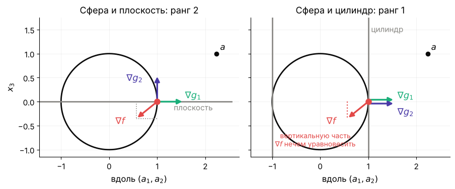

*Вид сбоку. Слева нормали сферы и плоскости разные, $\nabla f$ раскладывается по ним. Справа нормали сферы и цилиндра совпали.*

| Запись окружности | $\operatorname{rank}J$ | Итераций IPOPT | $\lambda$ из ответа IPOPT |
|---|---|---|---|
| сфера и плоскость $x_3=0$ | $2$ | $3$ | $-1.236$ и $-1$ |
| сфера и цилиндр | $1$ | $29$ | $-1.8\cdot10^8$ и $1.8\cdot10^8$ |

Точка одна и та же, но во второй записи множители огромны и ничего не значат. **Правило: если $\operatorname{rank}J<m$ во всех точках допустимого множества, виновата запись.** Её меняют: цилиндр заменяют плоскостью. Если ранг падает в отдельной точке, как в §3.1, это особая точка. Её проверяют отдельно — как ещё одного кандидата в минимум.

## 4. Условие второго порядка

**Главная мысль.** Минимум от максимума отличает вторая производная $f$ при движении по поверхности. Её считает гессиан функции Лагранжа: к кривизне $f$ добавляется кривизна ограничений.

### 4.1. Пример: две параболы

Задача:

$$
\min_{x\in\mathbb R^2}\ f(x)=x_2\qquad\text{при}\qquad g(x)=x_2-c\,x_1^2=0 .
$$

Здесь $x=(x_1,x_2)\in\mathbb R^2$ — вектор из двух чисел, а $c$ — число. Ограничение — парабола: при $c>0$ она смотрит вверх, при $c<0$ — вниз.

**Первый порядок.** Градиенты в точке $(0,0)$:

$$
\nabla f=(0,\ 1),\qquad\nabla g=(-2cx_1,\ 1)=(0,\ 1) .
$$

Значит, $\nabla f=\lambda\nabla g$ с $\lambda=1$ при любом $c$. Точка $(0,0)$ проходит проверку первого порядка и при $c=1$, и при $c=-1$.

**Вопрос залу.** При $c=1$ точка $(0,0)$ — минимум $f$ на параболе: парабола смотрит вверх, и на ней $x_2\ge0$. Чем будет точка $(0,0)$ при $c=-1$, когда парабола смотрит вниз?

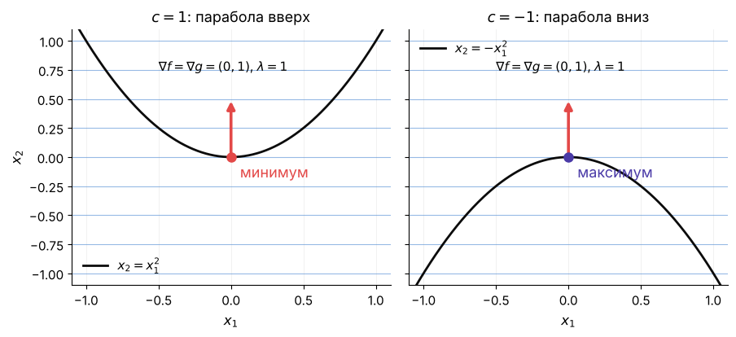

*При $c=-1$ парабола смотрит вниз, и точка $(0,0)$ — максимум $x_2$ на ней. Первый порядок одинаков, а ответ разный.*

**Кривизна вдоль параболы.** Пойдём по параболе: $x(t)=(t,\ ct^2)$, где $t$ — число. Тогда

$$
f\big(x(t)\big)=ct^2,\qquad\frac{d^2}{dt^2}f\big(x(t)\big)=2c .
$$

При $c=1$ вторая производная равна $+2$ — минимум. При $c=-1$ она равна $-2$ — максимум.

**То же через функцию Лагранжа.** Здесь $L(x,\lambda)=f-\lambda g=x_2-\lambda\,(x_2-cx_1^2)$. Вторые производные по $x$: у $f$ все нули, у $g$ ненулевая одна, $\partial^2g/\partial x_1^2=-2c$. При $\lambda=1$

$$
\nabla^2f=\begin{pmatrix}0&0\\0&0\end{pmatrix},\qquad
\nabla^2g=\begin{pmatrix}-2c&0\\0&0\end{pmatrix},\qquad
\nabla^2_{xx}L=\nabla^2f-\lambda\nabla^2g=\begin{pmatrix}2c&0\\0&0\end{pmatrix} .
$$

Касательные направления: $J=\nabla g^\top=(0,\ 1)$, и $Jp=p_2=0$. Значит, $p=(p_1,\ 0)$, а базис касательной прямой — $Z=(1,\ 0)^\top$. Вдоль касательной

$$
p^\top\nabla^2_{xx}L\,p=2c\,p_1^2,\qquad Z^\top\nabla^2_{xx}L\,Z=2c .
$$

Это та же вторая производная $2c$. **Вся кривизна пришла от ограничения** — через слагаемое $-\lambda\nabla^2g$: сама $f$ линейна.

### 4.2. Вторая производная вдоль поверхности

**Главная мысль.** Вдоль любой кривой на поверхности вторая производная $f$ равна $p^\top\nabla^2_{xx}L\,p$, где $p$ — скорость кривой.

Пусть $x(t)\in\mathbb R^n$ — кривая на поверхности: $g(x(t))=0$ при всех $t$ и $x(0)=x^\ast$. Её скорость $p=x'(0)\in T$, ускорение $x''(0)\in\mathbb R^n$.

**Шаг 1. Дважды дифференцируем $f$.** По правилу сложной функции первая производная — $\nabla f^\top x'(t)$. Продифференцируем её ещё раз и подставим $t=0$:

$$
\frac{d}{dt}f\big(x(t)\big)=\nabla f^\top x'(t),\qquad
\frac{d^2}{dt^2}f\big(x(t)\big)\Big|_{t=0}=p^\top\nabla^2f\,p+\nabla f^\top x''(0) .
$$

Первое слагаемое — кривизна самой $f$. Второе появляется, потому что кривая изгибается.

**Шаг 2. То же для ограничений.** Функция $g_k(x(t))$ равна нулю при всех $t$, поэтому и её вторая производная — ноль:

$$
0=p^\top\nabla^2g_k\,p+\nabla g_k^\top x''(0),\qquad k=1,\dots,m .
$$

**Шаг 3. Убираем ускорение.** Умножим равенство шага 2 на $\lambda_k^\ast$, сложим по $k$ и вычтем из шага 1:

$$
\frac{d^2}{dt^2}f\big(x(t)\big)\Big|_{t=0}=p^\top\Big(\nabla^2f-\sum_k\lambda_k^\ast\nabla^2g_k\Big)p+\Big(\nabla f-\sum_k\lambda_k^\ast\nabla g_k\Big)^{\!\top}x''(0) .
$$

Вторая скобка — это $\nabla_xL$. Она равна нулю по условию первого порядка, и ускорение пропадает. Первая скобка — $\nabla^2_{xx}L$. Итог:

$$
\frac{d^2}{dt^2}f\big(x(t)\big)\Big|_{t=0}=p^\top\nabla^2_{xx}L(x^\ast,\lambda^\ast)\,p .
$$

**Проверка на параболе.** Для $x(t)=(t,\ ct^2)$ скорость $p=(1,\ 0)$, ускорение $x''(0)=(0,\ 2c)$.

- Шаг 1: $p^\top\nabla^2f\,p=0$, а $\nabla f^\top x''(0)=2c$. Вся кривизна — от изгиба параболы.
- Шаг 2: $p^\top\nabla^2g\,p=-2c$ и $\nabla g^\top x''(0)=2c$, в сумме ноль.
- Итог: $p^\top\nabla^2_{xx}L\,p=2c$, как в §4.1.

### 4.3. Редуцированный гессиан и теорема

Проверим кривизну во всех касательных направлениях сразу. Как в §3.2, $Z$ — матрица $n\times(n-m)$, её столбцы — базис $T$. Любое $p\in T$ — это $p=Zw$, $w\in\mathbb R^{n-m}$. Подставим:

$$
p^\top\nabla^2_{xx}L\,p=(Zw)^\top\nabla^2_{xx}L\,(Zw)=w^\top\big(Z^\top\nabla^2_{xx}L\,Z\big)\,w .
$$

Транспонирование появляется так же, как в §3.2: $(Zw)^\top=w^\top Z^\top$. Матрица в скобках — **редуцированный гессиан** (*reduced Hessian*) размера $(n-m)\times(n-m)$. Матрицу $Z$ в SciPy даёт `scipy.linalg.null_space(J)`. У параболы $Z=(1,\ 0)^\top$, и редуцированный гессиан — число $2c$.

**Что обещает теорема.** Если все собственные числа редуцированного гессиана больше нуля, точка — строгий минимум.

**Почему.** Вдоль каждой кривой на поверхности $f$ растёт, как парабола с положительной кривизной.

**Чего не обещает.** Ничего о направлениях вне $T$. Там $\nabla^2_{xx}L$ может быть даже индефинитной (собственные числа разных знаков) — упражнение 8.3(б).

**Теорема (условия второго порядка).** Пусть $f$ и $g$ дважды непрерывно дифференцируемы, в $x^\ast$ выполнено LICQ, $\nabla_xL(x^\ast,\lambda^\ast)=0$ и $g(x^\ast)=0$.

- *Необходимо:* если $x^\ast$ — локальный минимум, то $Z^\top\nabla^2_{xx}L\,Z\succeq0$ (все собственные числа $\ge0$).
- *Достаточно:* если $Z^\top\nabla^2_{xx}L\,Z\succ0$ (все собственные числа $>0$), то $x^\ast$ — строгий локальный минимум.

**Доказательство.** Сначала на параболе, потом в общем случае.

*Парабола.* Параметр один: $x=\psi(u)=(u,\ cu^2)$. Функция без ограничений

$$
\tilde f(u)=f\big(\psi(u)\big)=cu^2,\qquad\tilde f''(u)=2c .
$$

Это и есть редуцированный гессиан $2c$. По лекции 4: при $2c>0$ точка $u=0$ — минимум $\tilde f$, при $2c<0$ — максимум.

*Общий случай.*

**Шаг 1. Параметры.** Как в §3.2, около $x^\ast$ поверхность — это $x=\psi(u)$, $u\in\mathbb R^{n-m}$, и $Z=\psi'(u^\ast)$. У функции $\tilde f(u)=f(\psi(u))$ ограничений нет.

**Шаг 2. Гессиан $\tilde f$.** Возьмём прямую $u^\ast+tw$ в пространстве параметров. Её образ $x(t)=\psi(u^\ast+tw)$ — кривая на поверхности со скоростью $x'(0)=Zw$. Вторая производная $\tilde f$ вдоль прямой равна $w^\top\nabla^2\tilde f\,w$. По §4.2 она же равна $(Zw)^\top\nabla^2_{xx}L\,(Zw)$:

$$
w^\top\nabla^2\tilde f(u^\ast)\,w=w^\top Z^\top\nabla^2_{xx}L\,Z\,w\quad\text{для всех }w,\qquad\text{то есть}\qquad\nabla^2\tilde f(u^\ast)=Z^\top\nabla^2_{xx}L\,Z .
$$

**Шаг 3. Условия лекции 4.** Точки $\psi(u)$ около $u^\ast$ — ровно точки поверхности около $x^\ast$. Поэтому минимум $f$ на поверхности — это минимум $\tilde f$ без ограничений. По лекции 4 для него $\nabla^2\tilde f\succeq0$ необходимо, а $\nabla^2\tilde f\succ0$ достаточно. По шагу 2 это и есть условия на $Z^\top\nabla^2_{xx}L\,Z$.

### 4.4. Ответ для окружности

Вернёмся к задаче 1:

$$
\min_{x\in\mathbb R^2}\ f(x)=\tfrac12\lVert x-a\rVert^2\qquad\text{при}\qquad g(x)=\tfrac12\big(x_1^2+x_2^2-1\big)=0,\qquad a=(2,1) .
$$

Вторые производные $\tfrac12\lVert x-a\rVert^2$ и $\tfrac12(x_1^2+x_2^2-1)$ одинаковы: $\nabla^2f=I$ и $\nabla^2g=I$. Поэтому $\nabla^2_{xx}L=(1-\lambda)\,I$. Касательное направление в точке $x$ — $Z=(-x_2,\ x_1)^\top$ из §2.1. Редуцированный гессиан — число:

$$
Z^\top\nabla^2_{xx}L\,Z=(1-\lambda)\,Z^\top Z=(1-\lambda)\,(x_2^2+x_1^2)=1-\lambda .
$$

| Точка | $\lambda$ | $Z^\top\nabla^2_{xx}L\,Z$ | Вывод |
|---|---|---|---|
| $(0.894,\ 0.447)$ | $-1.236$ | $+2.236$ | минимум |
| $(-0.894,\ -0.447)$ | $3.236$ | $-2.236$ | максимум |

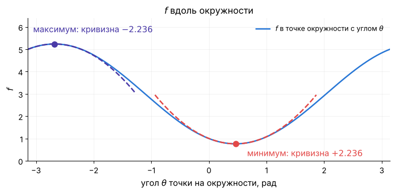

*$f$ вдоль окружности как функция угла. Вторая производная в ближней точке равна $+2.236$, в дальней $-2.236$. Это и есть редуцированный гессиан.*

Таблица из §1 заполнена:

| | Без ограничений (Л4) | С равенствами |
|---|---|---|
| Первый порядок | $\nabla f=0$ | $\nabla f=J^\top\lambda$ |
| Когда верно | всегда | при LICQ |
| Второй порядок | $\nabla^2f\succ0$ | $Z^\top\nabla^2_{xx}L\,Z\succ0$ |

## 5. Множители: силы и цены

**Главная мысль.** Множитель — сила, с которой ограничение держит решение. Он же — цена ограничения: насколько изменится оптимум, если ограничение сдвинуть.

### 5.1. Цепь на стержнях: множитель — натяжение

Вернёмся к задаче 2:

$$
\min\ f=w\,(z_1+z_2+z_3)\qquad\text{при}\qquad g_j=(y_{j+1}-y_j)^2+(z_{j+1}-z_j)^2-\ell^2=0,\quad j=0,1,2,3 .
$$

IPOPT решает систему из введения за 5 итераций. Цепь симметрична, поэтому разных множителей два:

| Стержни | $\lambda_j$ | $2\lvert\lambda_j\rvert\ell$ |
|---|---|---|
| $0$ и $3$, у опор | $-7.87$ | $19.7$ Н |
| $1$ и $2$, в середине | $-5.58$ | $14.0$ Н |

Во введении мы прочитали уравнения груза 1 как равновесие. Запишем их одним векторным уравнением, где $p_i=(y_i,z_i)$:

$$
\underbrace{(0,\ -w)}_{\text{вес}}+\underbrace{2\lambda_0\,(p_1-p_0)}_{\text{стержень 0}}+\underbrace{2\lambda_1\,(p_1-p_2)}_{\text{стержень 1}}=0 .
$$

- Вес $(0,-w)$ — это $-\nabla f$ по координатам груза: сила равна минус градиенту энергии.
- Сила стержня 0 направлена вдоль него. Множитель $\lambda_0<0$, поэтому сила смотрит к опоре: стержень тянет груз. Её величина — натяжение $2\lvert\lambda_0\rvert\ell=19.7$ Н.
- Сила стержня 1 тянет груз к грузу 2. Её величина $2\lvert\lambda_1\rvert\ell=14.0$ Н.

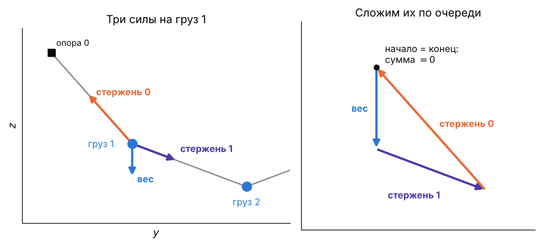

*Слева три силы на груз 1. Справа те же стрелки одна за другой: треугольник замкнулся, сумма — ноль.*

Обозначим проекции стержня $j$: $\Delta y_j=y_{j+1}-y_j$ и $\Delta z_j=z_{j+1}-z_j$. Вектор $2\lambda_j(\Delta y_j,\ \Delta z_j)$ — сила стержня $j$ на груз справа от него. Первое число — её горизонтальная составляющая, второе — вертикальная.

**Вопрос залу.** Что уравнения по $y$ из введения говорят о горизонтальных составляющих?

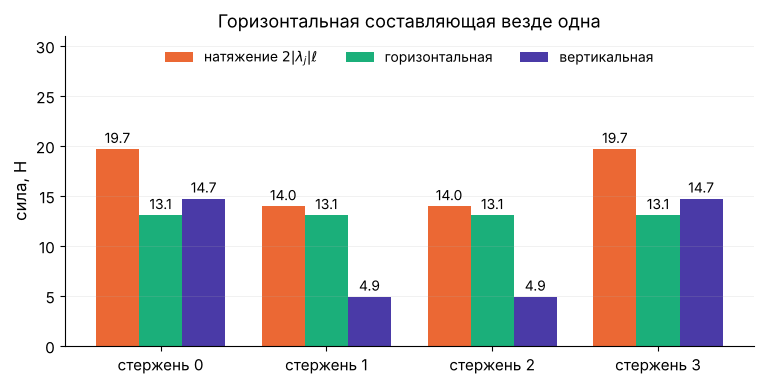

*Горизонтальная составляющая — 13.1 Н во всех четырёх стержнях. У опор стержни круче, поэтому вертикальная составляющая и натяжение там больше.*

Ответ: из уравнения груза $i$ по $y$ следует $2\lambda_{i-1}\Delta y_{i-1}=2\lambda_i\Delta y_i$. У соседних стержней горизонтальная составляющая одна и та же, значит, и у всех. Уравнения по $z$ — про вертикаль: два стержня вместе держат вес груза. Сложим их по трём грузам: опоры держат по 14.7 Н, вместе 29.4 Н. Это вес цепи $3w$.

Проверим ответ IPOPT по таблице §4 (демо (c)):

| Проверка | Число | Вывод |
|---|---|---|
| $\lVert\nabla f-J^\top\lambda\rVert$ | $5\cdot10^{-12}$ | первый порядок выполнен |
| $\operatorname{rank}J$ | $4$ | LICQ выполнено |
| собственные числа $Z^\top\nabla^2_{xx}L\,Z$ | $19.0$ и $35.2$ | строгий минимум |

Функция $f$ линейна, $\nabla^2f=0$. **Минимум держат стержни:** вся кривизна — от ограничений.

### 5.2. Портфель: множитель — цена

Портфель из лекции 3 (§2.2): четыре актива, $x\in\mathbb R^4$ — вектор долей капитала в них. Минимизируем риск при заданной доходности $\rho$:

$$
\min_{x\in\mathbb R^4}\ \tfrac12x^\top\Sigma x\qquad\text{при}\qquad\mathbf 1^\top x=1,\quad r^\top x=\rho .
$$

Здесь $\Sigma$ — ковариационная матрица доходностей, $r$ — ожидаемые доходности активов. При $\rho=10\,\%$ ответ:

$$
x^\ast=(0.095,\ 0.382,\ 0.321,\ 0.202),\qquad\lambda_\rho=0.257 .
$$

Все доли положительны, поэтому запрет коротких позиций из лекции 3 здесь не нужен.

**Формула цены.** Сдвинем правую часть ограничения: $g(x)=b$. Оптимум $f^\ast$ становится функцией $b$, и

$$
\frac{df^\ast}{db}=\lambda^\ast .
$$

Лекция 3 обещала доказательство. Для равенств оно занимает три строки. На решении $g(x^\ast(b))=b$, поэтому

$$
f^\ast(b)=L\big(x^\ast(b),\lambda^\ast(b),b\big),\qquad L=f-\lambda^\top\big(g(x)-b\big) .
$$

Продифференцируем по $b$. Слагаемые с $dx^\ast/db$ умножаются на $\nabla_xL=0$. Слагаемые с $d\lambda^\ast/db$ умножаются на $g-b=0$. Остаётся

$$
\frac{df^\ast}{db}=\frac{\partial L}{\partial b}=\lambda^\ast .
$$

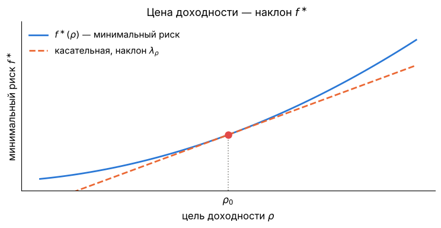

*Минимальный риск как функция цели $\rho$. Наклон в $\rho=10\,\%$ равен $\lambda_\rho=0.257$: лишний процентный пункт доходности стоит $0.0026$ риска.*

## 6. Что это даёт численно

**Главная мысль.** Солвер решает ту же систему $\nabla_xL=0$, $g=0$. Его лог — две невязки этой системы.

**Где множители.** У солверов функция Лагранжа $f+\lambda^\top g$, поэтому знак множителей противоположный нашему:

| Солвер | Где множители | Наш $\lambda$ |
|---|---|---|
| IPOPT через CasADi | `sol["lam_g"]` | $-$`lam_g` |
| SciPy, `method="trust-constr"` | `res.v` | $-$`v` |

**Как проверить ответ.** Подставьте $x^\ast$ и $\lambda^\ast$ в систему §2.3 и посчитайте обе невязки.

**Что в логе IPOPT.** Две колонки лога — невязки двух половин системы:

- `inf_pr` — нарушение ограничений $\lVert g(x_k)\rVert_\infty$;
- `inf_du` — невязка стационарности $\lVert\nabla_xL(x_k,\lambda_k)\rVert_\infty$.

Солвер останавливается, когда обе меньше допуска `tol`.

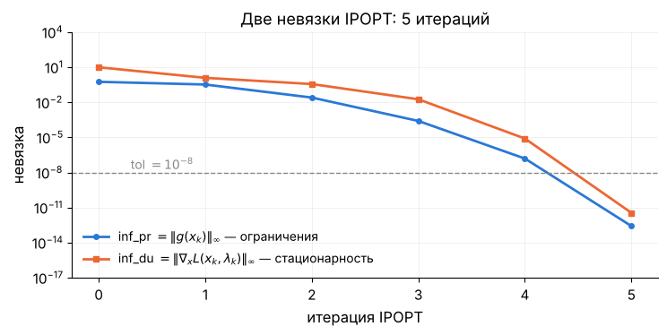

*Цепь на стержнях, 5 итераций. В конце число верных знаков примерно удваивается за итерацию: $2.5\cdot10^{-4}\to1.5\cdot10^{-7}\to3\cdot10^{-13}$.*

Так сходится метод Ньютона: IPOPT делает его шаги для этой системы. В лекции 9 мы напишем такой метод сами.

## 7. Итоги лекции

1. В минимуме на поверхности $g(x)=0$ у $\nabla f$ нет касательной части: $\nabla f=J^\top\lambda$ (§2).
2. Функция Лагранжа $L=f-\lambda^\top g$ даёт систему $\nabla_xL=0$, $g=0$: $n+m$ уравнений на $x$ и $\lambda$ (§2.3).
3. Условие касания верно при LICQ. Без LICQ формула $Jp=0$ может дать направления, которых нет (плоскость касается сферы), и в минимуме условие не выполняется. Чаще всего LICQ ломает запись ограничений — её исправляют (§3).
4. Минимум от максимума отличает редуцированный гессиан $Z^\top\nabla^2_{xx}L\,Z$. Кривизна ограничений входит в него через $-\lambda\nabla^2g$ (§4).
5. Множитель — сила ограничения и его цена: $df^\ast/db=\lambda^\ast$ (§5).

**Ответы на задачи введения.**

- **Задача 1.** Редуцированный гессиан равен $+2.236$ в ближней точке и $-2.236$ в дальней: это минимум и максимум.
- **Задача 2.** Четыре множителя — натяжения стержней: 19.7 Н у опор и 14.0 Н в середине. Горизонтальная составляющая — 13.1 Н во всех стержнях. Оба собственных числа редуцированного гессиана положительны, значит, это минимум.

## 8. Что дальше

**Лекция 9** — алгоритмы для равенств. Метод Ньютона для системы $\nabla_xL=0$, $g=0$ (Ньютон–Лагранж), обобщённый Гаусс–Ньютон и цепь на стержнях своим методом против IPOPT. **Лекция 10** — неравенства: условия ККТ и двойственность.

ДЗ 5 (Ньютон–Лагранж и обобщённый Гаусс–Ньютон) выдаётся после лекции 9.

**Литература к лекции.**
- Diehl, *Lecture Notes on Numerical Optimization*, часть III, глава *Equality Constrained Optimization*: касательное пространство, LICQ, условия первого и второго порядка.
- Nocedal & Wright, гл. 12: §12.1 — примеры, §12.2 — касательный конус и LICQ, §12.3 — теорема первого порядка, §12.5 — условия второго порядка.
- Boyd & Vandenberghe, §10.1 — задачи с равенствами и система ККТ; §5.6 — множители как чувствительность.

## 9. Упражнения

Разбор с проверкой кодом — [`exercises08.ipynb`](exercises08.ipynb), краткие ответы — [`exercises08.md`](exercises08.md). На семинаре — 8.0 и 8.3, остальные — домашние.

**8.0. Разминка — счёт руками.** *Суть: система $\nabla_xL=0$, $g=0$ на задачах с известным ответом.*

- (а) Ближайшая к $x_0$ точка плоскости $q^\top x=d$; здесь $x,\ x_0,\ q\in\mathbb R^n$, $d$ — число. Выпишите $L$ и решите систему. Сравните ответ с проекцией из лекции 2.
- (б) $\min\ x_1+x_2$ при $x_1^2+x_2^2=1$, $x\in\mathbb R^2$. Найдите оба решения системы и их $\lambda$. Какое из них минимум?
- (в) Ящик наибольшего объёма при площади поверхности $6$ (Л3, упражнение 13.10). Найдите $\lambda$ в решении $x=y=z=1$ и объясните его знак.

**8.1. Две точки на окружности** (с кодом). *Суть: редуцированный гессиан различает минимум и максимум.*

- (а) Решите систему из §2.1 функцией `fsolve` из двух стартов. Получите обе точки и оба $\lambda$.
- (б) Для каждой точки постройте $Z$ (`null_space`) и редуцированный гессиан. Повторите для $a=(0.3,\ 0.1)$. Что изменилось?

**8.2. Плоскость касается сферы** (с кодом). *Суть: у касания множители уходят в бесконечность, а солвер теряет точность.*

- (а) Опустите плоскость §3.1 на высоту $c<1$: $g_2=x_3-c$, $x\in\mathbb R^3$. Найдите $x^\ast$ руками и покажите, что $\lambda_1=1-\sqrt5/\sqrt{1-c^2}$. Сравните с IPOPT при $c=0.9,\ 0.99,\ 0.999$.
- (б) Окружности радиуса 1 с центрами $(\pm1,\ 0)$ касаются в точке $(0,0)$; $x\in\mathbb R^2$. Найдите $\min x_2$ на их пересечении. Выполнено ли LICQ? Что вернёт IPOPT?

**8.3. Кривизна ограничения.** *Суть: решает $\nabla^2_{xx}L$ вдоль $T$, а не $\nabla^2f$.*

- (а) $f=x_2$ на параболе $x_2=cx_1^2$, $x\in\mathbb R^2$. При каких $c$ точка $(0,0)$ — минимум, максимум, ни то ни другое?
- (б) $f=x_1^2-x_2^2$ на прямой $x_2=0$, $x\in\mathbb R^2$. Покажите, что точка $(0,0)$ — строгий минимум, хотя $\nabla^2f$ индефинитен (собственные числа разных знаков).

**8.4. Цепь на стержнях: силы и цена длины** (с кодом). *Суть: условие первого порядка — баланс сил, а множитель — производная оптимума.*

- (а) Решите задачу 2 из введения в CasADi. Проверьте: горизонтальная составляющая $2\lambda_j\Delta y_j$ одинакова во всех стержнях, а вертикальные составляющие на опорах дают вес цепи.
- (б) Удлините стержни на $1\,\%$ и на $5\,\%$. Сравните изменение $f^\ast$ с предсказанием $\sum_j\lambda_j\,\Delta(\ell^2)$. Почему при $5\,\%$ расхождение больше?

**8.5. Цена доходности** (с кодом). *Суть: $df^\ast/d\rho=\lambda_\rho$.*

Решите систему для портфеля из §5.2 при $\rho$ от $6$ до $14\,\%$. Почему она линейная? Сравните численную производную $f^\ast(\rho)$ с $\lambda_\rho$. При какой $\rho$ доля первого актива становится отрицательной?

**8.6. Для желающих: гладкость решения.** *Суть: при LICQ и достаточном условии второго порядка решение гладко зависит от правой части ограничений.*

В доказательстве формулы цены (§5.2) мы дифференцировали $x^\ast(b)\in\mathbb R^n$ и $\lambda^\ast(b)\in\mathbb R^m$ по $b$. Докажите, что это законно, если в $x^\ast$ выполнены LICQ и $Z^\top\nabla^2_{xx}L\,Z\succ0$. Подсказка: примените теорему о неявной функции к системе $\nabla f(x)-J(x)^\top\lambda=0$, $g(x)=b$ и докажите, что её матрица Якоби по $(x,\lambda)$ невырождена.

## Вопросы для самопроверки

1. Почему в минимуме у $\nabla f$ нет касательной части?
2. Сколько уравнений и неизвестных в системе первого порядка при $n$ переменных и $m$ ограничениях?
3. Что такое LICQ? Приведите пример минимума, в котором условие касания не выполняется.
4. Почему второй порядок проверяют по $\nabla^2_{xx}L$, а не по $\nabla^2f$?
5. Что такое редуцированный гессиан и какого он размера?
6. Почему натяжение стержня равно $2\lvert\lambda_j\rvert\ell$?
7. Что показывают колонки `inf_pr` и `inf_du` в логе IPOPT?
8. Окружность §2.2 записали как пересечение сферы и цилиндра $x_1^2+x_2^2=1$. Выполнено ли LICQ? Что будет с множителями?
