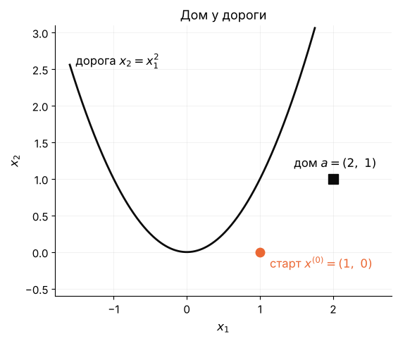
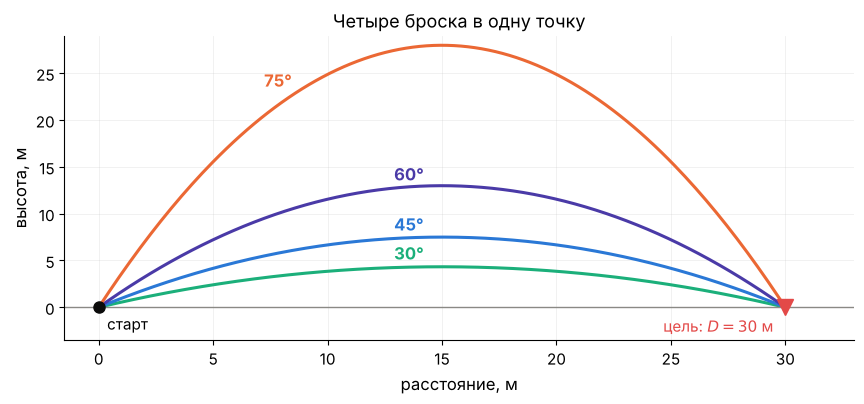
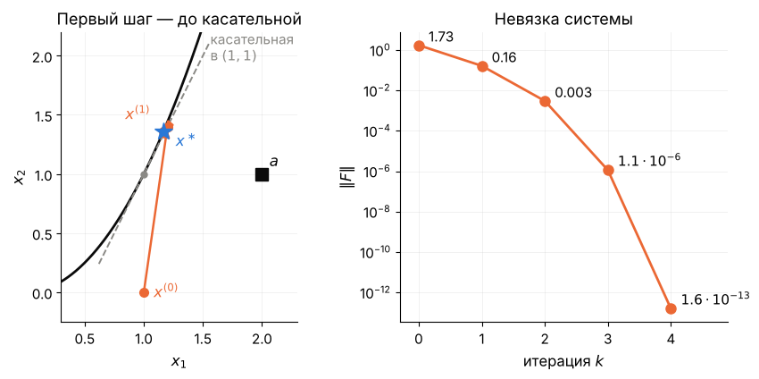
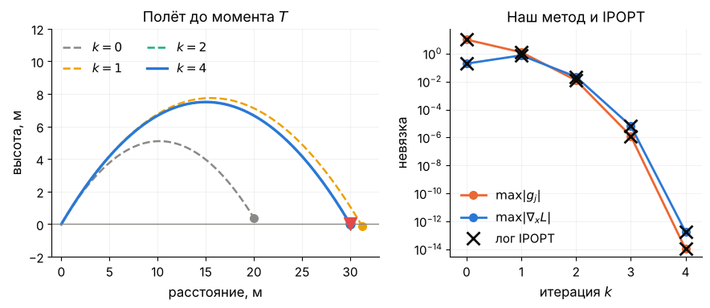
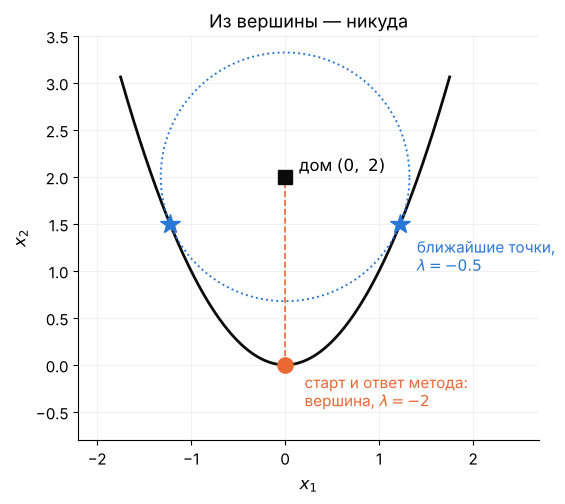
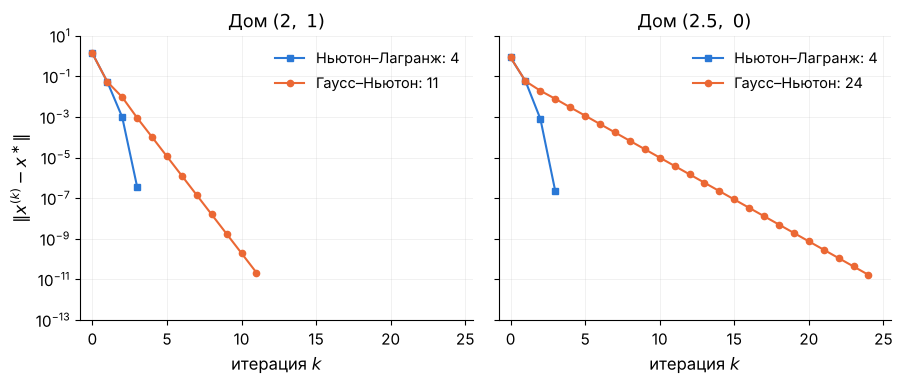
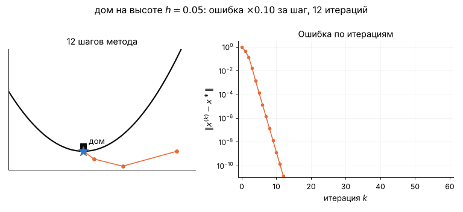

# Лекция 9. Алгоритмы для равенств: Ньютон–Лагранж и обобщённый Гаусс–Ньютон

**Курс:** Вычислительная оптимизация · **Часть III. Ограничения-равенства** · Лекция 9 из 16 · 19 ноября 2026

**Материалы:** [конспект-ноутбук с кодом демонстраций](lecture09.ipynb) · [демо-ноутбук](demo09.ipynb) · [семинар: бросок с сопротивлением воздуха](seminar09.ipynb) · [разбор упражнений](exercises09.ipynb)

В конспекте-ноутбуке текст идёт подряд, а три демо собраны в конце: (a) к §2, (b) к §3, (c) к §4.

---

## Введение

В лекции 8 условие решения задачи с равенствами записали системой уравнений. В простых задачах её решали руками. Сегодня — метод, которым такие системы решают солверы, и две задачи для него: «дорога» и «бросок».

### Задача 1. Дом у дороги

Дом стоит в точке $a=(2,1)$. Дорога идёт по параболе $x_2=x_1^2$. Где ближайшая к дому точка дороги?

$$
\min_{x\in\mathbb R^2}\ f(x)=\tfrac12\lVert x-a\rVert^2\qquad\text{при}\qquad g(x)=x_2-x_1^2=0 .
$$

Здесь $x=(x_1,x_2)\in\mathbb R^2$ — точка плоскости. Функция $f$ — половина квадрата расстояния от $x$ до дома.

*Дорога, дом и старт метода $x^{(0)}=(1,0)$. Старт лежит не на дороге.*

**Система.** Условие лекции 8: $\nabla f=\lambda\nabla g$ и $g=0$. Градиенты: $\nabla f=(x_1-2,\ x_2-1)$ и $\nabla g=(-2x_1,\ 1)$. Покомпонентно:

$$
\begin{aligned}
x_1-2&=-2\lambda x_1,\\
x_2-1&=\lambda,\\
x_2-x_1^2&=0 .
\end{aligned}
$$

Первые два уравнения — градиент $f$ параллелен градиенту $g$, третье — сама дорога.

**3 уравнения на 3 неизвестных: $x_1$, $x_2$ и $\lambda$.**

Подставим $\lambda=x_2-1=x_1^2-1$ в первое уравнение. Получится кубическое уравнение $2x_1^3-x_1-2=0$. Простой формулы для его корня нет — нужен численный метод.

### Задача 2. Бросок мяча

Мяч бросают с земли так, чтобы он упал на расстоянии $D=30$ м. С какой наименьшей скоростью это можно сделать?

$$
\min_{x\in\mathbb R^3}\ f(x)=\tfrac12\big(v_1^2+v_2^2\big)\qquad\text{при}\qquad g_1(x)=v_1T-D=0,\qquad g_2(x)=v_2T-4.905\,T^2=0 .
$$

Здесь $x=(v_1,v_2,T)\in\mathbb R^3$ — вектор из трёх чисел. Числа $v_1$ и $v_2$ — горизонтальная и вертикальная скорость в момент броска, м/с. Число $T$ — время полёта, с.

Ограничения — уравнения полёта без сопротивления воздуха:

- $g_1$: за время $T$ мяч пролетает $D$ по горизонтали;
- $g_2$: через время $T$ мяч снова на земле; $4.905=9.81/2$.

*Все четыре броска падают в цель, но начальные скорости у них разные.*

**Система.** Градиенты по $(v_1,v_2,T)$: $\nabla f=(v_1,\ v_2,\ 0)$, $\nabla g_1=(T,\ 0,\ v_1)$, $\nabla g_2=(0,\ T,\ v_2-9.81\,T)$. Условие $\nabla f=\lambda_1\nabla g_1+\lambda_2\nabla g_2$ покомпонентно и два ограничения:

$$
\begin{aligned}
\text{по } v_1:\quad v_1&=\lambda_1T,\\
\text{по } v_2:\quad v_2&=\lambda_2T,\\
\text{по } T:\quad 0&=\lambda_1v_1+\lambda_2\,(v_2-9.81\,T),\\
v_1T&=D,\\
v_2T&=4.905\,T^2 .
\end{aligned}
$$

**5 уравнений на 5 неизвестных: $v_1,v_2,T$ и $\lambda_1,\lambda_2$.**

**Зачем вторая задача.** Её ответ знаком из школьной физики — по нему проверим метод. Ограничений здесь два, и на этой задаче появится матрица $J$.

### Зачем это вам

Системы условий почти никогда не решают формулами. Солвер решает их итерациями, и каждая итерация — одна линейная система. Так устроены IPOPT, методы SQP (лекция 13) и солверы для управления MPC (лекция 15). Зная эту систему, вы поймёте, почему солвер сходится за 4 итерации — или не делает ни шага.

**Главная тема лекции — матрица ККТ** (матрица Каруша–Куна–Таккера). Это матрица той линейной системы, которую метод решает на каждом шаге.

**Три вопроса лекции:**

1. Как решить систему условий итерациями?
2. Когда шаг метода определён?
3. Как сделать шаг дешевле?

**План:**

- §1 — условия лекции 8 как одна система $F=0$;
- §2 — метод Ньютона–Лагранжа: задача «дорога» руками, «бросок» против IPOPT;
- §3 — когда матрица ККТ невырождена;
- §4 — обобщённый Гаусс–Ньютон: шаг без вторых производных;
- семинар — бросок с сопротивлением воздуха.

## 1. Система, которую решаем

**Главная мысль.** В условии лекции 8 неизвестны и точка $x$, и множители $\lambda$. Перенесём все слагаемые влево — получится одна система $F=0$ с равным числом уравнений и неизвестных.

**Дорога.** Задача 1 — ближайшая к дому $a=(2,1)$ точка дороги:

$$
\min_{x\in\mathbb R^2}\ \tfrac12\lVert x-a\rVert^2\qquad\text{при}\qquad x_2-x_1^2=0 .
$$

Её система из введения:

$$
\begin{aligned}
x_1-2&=-2\lambda x_1,\\
x_2-1&=\lambda,\\
x_2-x_1^2&=0 .
\end{aligned}
$$

Перенесём правые части влево. Неизвестных три — $x_1$, $x_2$ и $\lambda$, функций тоже три:

$$
F(x_1,x_2,\lambda)=\begin{pmatrix}x_1-2+2\lambda x_1\\ x_2-1-\lambda\\ x_2-x_1^2\end{pmatrix}=0 .
$$

Первые две строки — это $\nabla f-\lambda\nabla g$. Они требуют, чтобы отрезок от дома до точки $x$ был перпендикулярен дороге: $x-a$ параллелен нормали $\nabla g=(-2x_1,\ 1)$. Третья строка — сама дорога.

**Бросок.** Задача 2 — бросок на $D=30$ м с наименьшей скоростью, $x=(v_1,v_2,T)\in\mathbb R^3$:

$$
\min_{x\in\mathbb R^3}\ \tfrac12\big(v_1^2+v_2^2\big)\qquad\text{при}\qquad g_1=v_1T-D=0,\qquad g_2=v_2T-4.905\,T^2=0 .
$$

Её система из введения — три уравнения касания и два ограничения:

$$
\begin{aligned}
v_1&=\lambda_1T, & v_1T&=D,\\
v_2&=\lambda_2T, & v_2T&=4.905\,T^2,\\
0&=\lambda_1v_1+\lambda_2\,(v_2-9.81\,T) .
\end{aligned}
$$

Здесь два ограничения и два множителя. Градиенты: $\nabla f=(v_1,\ v_2,\ 0)$, $\nabla g_1=(T,\ 0,\ v_1)$ и $\nabla g_2=(0,\ T,\ v_2-9.81\,T)$. Три уравнения касания — это покомпонентно одно векторное равенство:

$$
\nabla f=\lambda_1\nabla g_1+\lambda_2\nabla g_2 .
$$

Сумму справа удобно записать матрицей. Соберём градиенты ограничений строками — получится **якобиан ограничений** $J$ размера $2\times3$. Тогда сумма справа — это $J^\top\lambda$:

$$
J=\begin{pmatrix}T&0&v_1\\0&T&v_2-9.81\,T\end{pmatrix},\qquad
J^\top\lambda=\lambda_1\begin{pmatrix}T\\0\\v_1\end{pmatrix}+\lambda_2\begin{pmatrix}0\\T\\v_2-9.81\,T\end{pmatrix}.
$$

Перенесём всё влево и добавим ограничения. Получится пять функций пяти неизвестных $v_1,v_2,T,\lambda_1,\lambda_2$:

$$
F=\begin{pmatrix}\nabla f-J^\top\lambda\\ g\end{pmatrix}=\begin{pmatrix}v_1-\lambda_1T\\ v_2-\lambda_2T\\ -\lambda_1v_1-\lambda_2\,(v_2-9.81\,T)\\ v_1T-D\\ v_2T-4.905\,T^2\end{pmatrix}=0 .
$$

**Общий случай.** Пусть $x\in\mathbb R^n$, а ограничений $m$. Строки якобиана $J$ — градиенты $\nabla g_1,\dots,\nabla g_m$. Условие лекции 8 — $\nabla f=J^\top\lambda$, и система такая:

$$
F(x,\lambda)=\begin{pmatrix}\nabla f(x)-J(x)^\top\lambda\\ g(x)\end{pmatrix}=0 .
$$

*Размеры:* $\lambda\in\mathbb R^m$; $J$ — $m\times n$; $F$ — вектор из $n+m$ чисел, неизвестных тоже $n+m$.

Верхняя половина $F$ — градиент функции Лагранжа $L=f-\lambda^\top g$ по $x$. Его пишут $\nabla_xL$.

## 2. Метод Ньютона–Лагранжа

**Главная мысль.** Это метод Ньютона для системы $F(x,\lambda)=0$: точку $x$ и множители $\lambda$ он ищет вместе. На каждом шаге решается одна линейная система. Её матрица — матрица Якоби системы $F$, её называют матрицей ККТ.

Вспомним лекцию 5, §2.1. Пусть $z$ — вектор всех неизвестных, а $F(z)=0$ — система, где уравнений столько же, сколько неизвестных. Метод Ньютона в текущей точке заменяет $F$ линейной моделью и приравнивает её к нулю:

$$
F\big(z^{(k)}\big)+J_F\big(z^{(k)}\big)\,\Delta z=0,\qquad z^{(k+1)}=z^{(k)}+\Delta z .
$$

*Размеры:* у нас $z=(x,\lambda)$, поэтому шаг $\Delta z=(p,\Delta\lambda)$ — вектор из $n+m$ чисел. Здесь $p\in\mathbb R^n$ — смещение по $x$, $\Delta\lambda\in\mathbb R^m$ — изменение множителей. Букву $p$ для смещения берём, как в лекции 5 и у Nocedal & Wright. $J_F$ — матрица Якоби системы $F$, размер $(n+m)\times(n+m)$. Верхний индекс $(k)$ — номер итерации, нижний — номер координаты.

Если $J_F$ в решении невырождена, а старт близок к решению, сходимость квадратичная (лекция 5, §3.1). Чтобы делать шаги, нужна матрица $J_F$ — выпишем её.

### 2.1. Матрица Якоби

**Определение.** Матрица Якоби $J_F$ — таблица частных производных системы $F$. В строке $i$ стоят производные функции $F_i$ по всем неизвестным по очереди:

$$
\big(J_F\big)_{ij}=\frac{\partial F_i}{\partial z_j}.
$$

**Дорога.** Неизвестные — $z=(x_1,x_2,\lambda)$, система

$$
F=\begin{pmatrix}x_1-2+2\lambda x_1\\ x_2-1-\lambda\\ x_2-x_1^2\end{pmatrix}.
$$

Продифференцируем каждую строку по $x_1$, $x_2$ и $\lambda$:

$$
J_F=\begin{pmatrix}1+2\lambda&0&2x_1\\0&1&-1\\-2x_1&1&0\end{pmatrix}.
$$

Например, первая строка $x_1-2+2\lambda x_1$ даёт $1+2\lambda$ по $x_1$, ноль по $x_2$ и $2x_1$ по $\lambda$.

**Бросок.** Неизвестные — $z=(v_1,v_2,T,\lambda_1,\lambda_2)$, система

$$
F=\begin{pmatrix}v_1-\lambda_1T\\ v_2-\lambda_2T\\ -\lambda_1v_1-\lambda_2\,(v_2-9.81\,T)\\ v_1T-D\\ v_2T-4.905\,T^2\end{pmatrix}.
$$

Продифференцируем каждую строку по $v_1$, $v_2$, $T$, $\lambda_1$ и $\lambda_2$:

$$
J_F=\begin{pmatrix}1&0&-\lambda_1&-T&0\\0&1&-\lambda_2&0&-T\\-\lambda_1&-\lambda_2&9.81\,\lambda_2&-v_1&-(v_2-9.81\,T)\\T&0&v_1&0&0\\0&T&v_2-9.81\,T&0&0\end{pmatrix}.
$$

Например, третья строка $-\lambda_1v_1-\lambda_2v_2+9.81\,\lambda_2T$ даёт $9.81\,\lambda_2$ по $T$ и $-(v_2-9.81\,T)$ по $\lambda_2$.

**Общий случай.** У обеих матриц одно устройство. Чтобы увидеть, откуда оно, продифференцируем систему в общем виде:

$$
F(x,\lambda)=\begin{pmatrix}\nabla f(x)-\lambda_1\nabla g_1(x)-\dots-\lambda_m\nabla g_m(x)\\ g(x)\end{pmatrix}.
$$

Верхняя половина — $n$ строк касания, нижняя — $m$ ограничений. Столбцов тоже две группы: производные по $x$ и по $\lambda$. Получается четыре блока:

- **верхняя половина по $x$.** Производная $\nabla f$ — гессиан $\nabla^2f$, производная $\lambda_j\nabla g_j$ — $\lambda_j\nabla^2g_j$. Блок — гессиан функции Лагранжа по $x$:

$$
H=\nabla^2f-\sum_{j=1}^m\lambda_j\nabla^2g_j ;
$$

- **верхняя половина по $\lambda_j$.** От $\lambda_j$ зависит только слагаемое $-\lambda_j\nabla g_j$, его производная — $-\nabla g_j$. Все $m$ таких столбцов вместе — $-J^\top$;
- **нижняя половина по $x$** — производные ограничений, то есть якобиан ограничений $J$;
- **нижняя половина по $\lambda$** — ноль: ограничения от $\lambda$ не зависят.

Итог — **матрица ККТ** (*KKT matrix*):

$$
K=J_F=\begin{pmatrix}H&-J^\top\\ J&0\end{pmatrix}.
$$

*Размеры:* $K$ — $(n+m)\times(n+m)$; $H$ — $n\times n$; $J$ — $m\times n$; нулевой блок — $m\times m$.

Проверим на примере задачи «дорога». Там $\nabla^2f=I$ и $\nabla^2g=\operatorname{diag}(-2,\ 0)$, поэтому $H=\operatorname{diag}(1+2\lambda,\ 1)$. Якобиан ограничения $J=(-2x_1,\ 1)$, столбец $-J^\top=(2x_1,\ -1)$. Это ровно блоки её матрицы Якоби выше. В задаче «бросок» $H$ — левый верхний угол $3\times3$, а $J$ — две нижние строки.

### 2.2. Алгоритм Ньютона–Лагранжа

**Алгоритм** (*Newton–Lagrange method*):

1. Выбрать старт: $x^{(0)}\in\mathbb R^n$ и $\lambda^{(0)}\in\mathbb R^m$.
2. Посчитать в текущей точке $\nabla f$ ($n$ чисел), $g$ ($m$ чисел), $J$ ($m\times n$) и $H$ ($n\times n$).
3. Решить систему $K\,(p,\Delta\lambda)=-F$, где $p\in\mathbb R^n$ и $\Delta\lambda\in\mathbb R^m$.
4. Сделать шаг: $x^{(k+1)}=x^{(k)}+p$ и $\lambda^{(k+1)}=\lambda^{(k)}+\Delta\lambda$.
5. Повторять пункты 2–4, пока $\lVert F\rVert$ больше допуска.

**Чем он отличается от метода Ньютона лекции 5:**

- неизвестных $n+m$: метод ищет точку и множители вместе;
- нужен старт и для множителей;
- промежуточные точки нарушают ограничения, $g=0$ выполняется только в пределе.

### 2.3. Дом у дороги руками

**Шаг из $x^{(0)}=(1,0)$ при $\lambda^{(0)}=0$.** Подставим $x_1=1$, $x_2=0$, $\lambda=0$ в систему задачи «дорога» и её матрицу Якоби:

$$
F=\begin{pmatrix}1-2+0\\ 0-1-0\\ 0-1\end{pmatrix}=\begin{pmatrix}-1\\-1\\-1\end{pmatrix},\qquad
K=\begin{pmatrix}1&0&2\\0&1&-1\\-2&1&0\end{pmatrix}.
$$

Неизвестные шага — $p=(p_1,p_2)$ и $\Delta\lambda$. Система $K\,(p,\Delta\lambda)=-F$:

$$
\begin{pmatrix}1&0&2\\0&1&-1\\-2&1&0\end{pmatrix}\begin{pmatrix}p_1\\p_2\\\Delta\lambda\end{pmatrix}=\begin{pmatrix}1\\1\\1\end{pmatrix}.
$$

Из первых двух строк $p_1=1-2\Delta\lambda$ и $p_2=1+\Delta\lambda$. Третья строка даёт $-2+5\Delta\lambda=0$. Отсюда $\Delta\lambda=0.4$ и $p=(0.2,\ 1.4)$.

**Итерации.**

$$
x^{(1)}=(1.2,\ 1.4),\qquad\lambda^{(1)}=0.4 .
$$

**Почему $x^{(1)}$ не на дороге.** Проверим: $1.2^2=1.44\ne1.4$. Третья строка системы шага — $-2p_1+p_2=1$. Это ограничение, линеаризованное в старте. Для точки $x=x^{(0)}+p$ оно задаёт прямую $x_2=2x_1-1$ — касательную к дороге в точке $(1,1)$. Шаг кончается на этой прямой, а дорога загибается вверх.

**Это не ошибка метода.** На каждой итерации ограничение линеаризуется заново, в новой точке. Поэтому точки подходят к дороге. Нарушение $x_2-x_1^2$ по итерациям: $-1$, $-0.04$, $-0.0011$, $-6\cdot10^{-7}$, $-10^{-13}$. Норма невязки $\lVert F\rVert$: $1.73$, $0.165$, $0.0030$, $1.1\cdot10^{-6}$, $1.6\cdot10^{-13}$.

За 4 итерации метод нашёл $x^\ast=(1.165,\ 1.358)$ и $\lambda^\ast=0.358$. Ответ лежит на дороге: нарушение в нём $10^{-13}$. Расстояние от дома до дороги — $0.908$.

*Слева: первый шаг кончается на касательной $x_2=2x_1-1$, рядом с дорогой. Следующие точки ложатся на дорогу. Справа: число верных цифр удваивается — сходимость квадратичная.*

### 2.4. Бросок и IPOPT

Решим задачу «бросок» тем же алгоритмом. Матрицу ККТ $5\times5$ в каждой точке даёт CasADi (лекция 7). Старт — $v=(10,\ 10)$ м/с и $T=2$ с: такой мяч пролетает лишь 20 м. Стартовые множители берём, как IPOPT, по методу наименьших квадратов: $\lambda^{(0)}=(4.903,\ 5.093)$. Формула — в демо (e).

Норма невязки по итерациям: $10.0\to1.47\to0.026\to6.9\cdot10^{-6}\to1.8\cdot10^{-13}$. Ответ — бросок под $45^\circ$ со скоростью $17.16$ м/с, $T=2.47$ с, $\lambda^\ast=(4.905,\ 4.905)$.

*Слева: к моменту $T$ мяч сначала не долетает, потом попадает в цель. Справа: нарушение ограничений (`inf_pr`) и $\nabla_xL$ (`inf_du`) по итерациям; крестики лога IPOPT лежат на линиях нашего метода.*

IPOPT из того же старта делает те же 4 итерации. Его лог совпадает с нашими числами до 8 значащих цифр. На этой задаче IPOPT делает ровно шаги Ньютона–Лагранжа. Код — демо (a).

## 3. Матрица ККТ

**Главная мысль.** Шаг определён, когда матрица ККТ невырождена. Для этого хватает двух условий лекции 8: LICQ и положительного редуцированного гессиана. Тогда метод сходится квадратично.

### 3.1. Три понятия лекции 8

Теорема этого раздела опирается на три понятия лекции 8. Вспомним каждое на примере задачи «дорога»:

$$
\min_{x\in\mathbb R^2}\ \tfrac12\lVert x-a\rVert^2\qquad\text{при}\qquad g(x)=x_2-x_1^2=0,\qquad a=(2,1).
$$

Здесь $n=2$ неизвестных и $m=1$ ограничение.

**1. Якобиан ограничений и LICQ.** Якобиан $J$ — матрица $m\times n$, её строка $j$ — градиент ограничения $g_j$. LICQ (*linear independence constraint qualification*) — условие, что строки $J$ линейно независимы. Зачем это условие: при LICQ у минимума есть множители $\lambda$, и система $F=0$ решения не теряет.

В задаче «дорога» строка одна — градиент ограничения: $J=\nabla g^\top=(-2x_1,\ 1)$. Один вектор линейно независим, если он ненулевой. Эта строка не равна нулю ни в одной точке: её вторая компонента всегда $1$. Значит, LICQ выполнено везде, и у дороги в каждой точке есть нормаль $\nabla g$. Пример, где LICQ нарушено, — ниже.

**2. Касательное пространство и матрица $Z$.** Касательное пространство — векторы $p\in\mathbb R^n$ с $Jp=0$: сдвиг вдоль них в первом порядке не меняет ограничений. Его размерность $n-m$. Столбцы матрицы $Z$ размера $n\times(n-m)$ — его базис. Значит, $JZ=0$, и любой касательный вектор равен $Zu$, где $u\in\mathbb R^{n-m}$. В задаче «дорога» $n-m=1$:

$$
-2x_1p_1+p_2=0\qquad\Longrightarrow\qquad p=p_1\,(1,\ 2x_1).
$$

$Z$ — один столбец вдоль касательной к параболе: её наклон в точке $x_1$ равен $2x_1$. В старте $(1,0)$ нормированный столбец — $Z=(1,\ 2)/\sqrt5$.

**3. Гессиан функции Лагранжа и редуцированный гессиан.** Гессиан функции Лагранжа $L=f-\lambda^\top g$ по $x$ — матрица $n\times n$ в левом верхнем блоке $K$:

$$
H=\nabla^2f-\sum_{j=1}^m\lambda_j\nabla^2g_j .
$$

Редуцированный гессиан $Z^\top HZ$ размера $(n-m)\times(n-m)$ — кривизна $H$ только вдоль касательного пространства: при $p=Zu$ выполнено $p^\top Hp=u^\top\big(Z^\top HZ\big)u$. В задаче «дорога» $\nabla^2f=I$ и $\nabla^2g=\operatorname{diag}(-2,\ 0)$, поэтому $H=\operatorname{diag}(1+2\lambda,\ 1)$. В старте при $\lambda=0$ получаем $H=I$ и $Z^\top HZ=1$. Двигаться можно только вдоль ограничения, поэтому важна только эта кривизна. Если в решении $Z^\top HZ\succ0$, это строгий локальный минимум (лекция 8).

### 3.2. Теорема

**Зачем теорема.** На каждой итерации метод решает линейную систему $K\,(p,\Delta\lambda)=-F$. Если $K$ вырождена, у этой системы нет единственного решения, и шага нет. Примеры — ниже.

**Теорема.** Пусть в точке $(x,\lambda)$ строки $J$ линейно независимы, а $Z^\top HZ\succ0$ (положительно определена). Тогда матрица ККТ $K$ невырождена.

**Что из неё следует.**

- **В решении** условия теоремы — это LICQ и достаточное условие второго порядка лекции 8, то есть условия строгого минимума. Значит, рядом с таким минимумом $K$ обратима. По теореме лекции 5 метод сходится квадратично — 4 итерации в обеих задачах лекции.
- **Если шага нет**, нарушено одно из двух условий. Нет LICQ — меняют старт или запись ограничений. Нет кривизны вдоль ограничения — IPOPT прибавляет к $H$ матрицу $\delta I$.

**Доказательство.** Пусть $K\,(p,\mu)=0$ для некоторых $p\in\mathbb R^n$ и $\mu\in\mathbb R^m$. Покомпонентно это два уравнения:

$$
Hp-J^\top\mu=0,\qquad Jp=0 .
$$

**Шаг 1. Вектор $p$ касательный.** Из второго уравнения $Jp=0$, поэтому $p=Zu$ для некоторого $u\in\mathbb R^{n-m}$.

**Шаг 2. $p=0$.** Умножим первое уравнение на $p^\top$ слева: $p^\top Hp=(Jp)^\top\mu=0$. Подставим $p=Zu$ и получим $u^\top\big(Z^\top HZ\big)u=0$. Матрица $Z^\top HZ$ положительно определена, поэтому $u=0$ и $p=0$.

**Шаг 3. $\mu=0$.** При $p=0$ первое уравнение даёт $J^\top\mu=0$ — нулевую комбинацию строк $J$. Строки независимы, поэтому $\mu=0$. $\blacksquare$

### 3.3. Бросок, который ещё не начался

**Если в старте нарушено LICQ, шаг не определён.** В задаче «бросок» так бывает при $T=0$ — мяч ещё в руке. Возьмём старт $v=(10,\ 10)$, $T=0$:

$$
J=\begin{pmatrix}T&0&v_1\\0&T&v_2-9.81\,T\end{pmatrix}=\begin{pmatrix}0&0&10\\0&0&10\end{pmatrix},\qquad g=\begin{pmatrix}-30\\0\end{pmatrix}.
$$

Строки $J$ совпадают — LICQ нарушено, и шаг 3 доказательства не проходит. Линеаризованные ограничения $g+Jp=0$ требуют $10\,p_T=30$ и $10\,p_T=0$, где $p_T$ — изменение времени полёта. Шага нет: NumPy сообщает, что $K$ вырождена (`Singular matrix`). При $T=0$ оба ограничения меняются только через $T$, и сдвинуть их независимо нельзя. Поэтому старт берут с $T>0$.

### 3.4. Вопрос залу

Пусть дом стоит над вершиной дороги, в точке $(0,\ 2)$. Метод стартует в самой вершине $(0,0)$ при $\lambda^{(0)}=0$. Куда он придёт?

*Метод остаётся в вершине за одну итерацию: меняется только $\lambda$, до $-2$. Ближайшие точки — $\pm(1.22,\ 1.5)$.*

Ответ: вершина — тоже решение системы. Для дома $a=(0,2)$ система такая:

$$
x_1=-2\lambda x_1,\qquad x_2-2=\lambda,\qquad x_2=x_1^2 .
$$

При $x=(0,0)$ и $\lambda=-2$ все три уравнения выполнены. Но в вершине $Z=(1,\ 0)$ и $Z^\top HZ=1+2\lambda=-3<0$: при сдвиге вдоль дороги расстояние уменьшается. До вершины $2$, до ближайших точек $1.32$.

**Чего теорема не обещает:** что метод придёт в минимум. В максимуме $Z^\top HZ\prec0$, и $K$ тоже невырождена — доказательство то же, со сменой знака. Метод ищет решение системы, а минимум проверяют условием второго порядка (лекция 8, §4).

## 4. Обобщённый Гаусс–Ньютон

**Главная мысль.** Если $f$ — сумма квадратов невязок, в матрицу ККТ вместо $H$ ставят $J_r^\top J_r$. Вторые производные и множители для матрицы не нужны. Плата — линейная сходимость: ошибка за шаг умножается на число $q$, и оно мало, когда мал $\lambda^\ast$.

Пусть $f(x)=\tfrac12\lVert r(x)\rVert^2$, где $r(x)$ — вектор невязок, а $J_r$ — его якобиан. Метод Гаусса–Ньютона лекции 5 заменяет $\nabla^2f$ на $J_r^\top J_r$. С ограничениями ту же замену делают в матрице ККТ:

$$
\begin{pmatrix}J_r^\top J_r&-J^\top\\ J&0\end{pmatrix}\begin{pmatrix}p\\ \Delta\lambda\end{pmatrix}=-F .
$$

Это **обобщённый метод Гаусса–Ньютона** (*constrained Gauss–Newton*). По сравнению с $H$ в матрице нет вторых производных невязок и кривизны ограничений $-\sum_j\lambda_j\nabla^2g_j$. Поэтому $\lambda$ в матрицу не входит.

**В задаче «дорога»** $r=x-a$ и $J_r=I$: в матрице стоит $I$ вместо $H=\operatorname{diag}(1+2\lambda,\ 1)$. Выброшена кривизна дороги, умноженная на $\lambda$. При $\lambda=0$ матрицы совпадают, поэтому первый шаг из $(1,0)$ у методов общий — в $(1.2,\ 1.4)$.

**Скорость.** Шаг вдоль дороги — шаг Ньютона по одной переменной $u$, и слева в нём стоит $Z^\top HZ$. Гаусс–Ньютон ставит туда $Z^\top Z$. Поэтому вблизи ответа ошибка вдоль дороги $e_k$ за шаг умножается на число $q$:

$$
e_{k+1}\approx e_k-\frac{Z^\top HZ}{Z^\top Z}\,e_k=q\,e_k,\qquad q=1-\frac{Z^\top HZ}{Z^\top Z}.
$$

Для столбца $(1,\ 2x_1)$ вдоль дороги $Z^\top HZ=1+2\lambda+4x_1^2$ и $Z^\top Z=1+4x_1^2$. Отсюда

$$
q=-\frac{2\lambda^\ast}{1+4x_1^{\ast2}} .
$$

Для дома $(2,1)$ это $q=-0.111$. По модулю $q$ равно расстоянию до дороги, делённому на радиус кривизны дороги в $x^\ast$. Чем дальше дом от дороги, тем медленнее метод.

Число итераций из $x^{(0)}=(1,0)$, пока $\lVert F\rVert$ не станет меньше $10^{-10}$:

| Дом | $q$ | Гаусс–Ньютон | Ньютон–Лагранж |
|---|---|---|---|
| $(1.5,\ 2)$ | $-0.006$ | $6$ | $4$ |
| $(2,\ 1)$ | $-0.111$ | $11$ | $4$ |
| $(0,\ 0.3)$ | $0.6$ | $43$ | $6$ |

*Слева: к вершине Гаусс–Ньютон подходит медленно. Справа: ошибка падает по прямой — сходимость линейная, наклон задаёт $q$.*

У дома $(0,\ h)$ над вершиной $q=2h$. Чем ближе $h$ к радиусу кривизны дороги в вершине, $0.5$, тем ближе $q$ к единице.

*Дом поднимается над вершиной. Множитель ошибки $2h$ растёт, и при $h=0.48$ нужно уже 439 итераций.*

**Где это используют.** В acados — солвере для управления MPC (лекция 15) — опция `hessian_approx='GAUSS_NEWTON'` включает именно этот метод. Он хорош, когда невязки в ответе малы: в MPC так и есть. В задаче «бросок» невязка — сама скорость, $17$ м/с, и метод не сходится (демо (c)).

## 5. Что это даёт численно

**Главная мысль.** IPOPT на задаче с равенствами делает шаги Ньютона–Лагранжа и добавляет к ним три вещи.

- Стартовые множители — по методу наименьших квадратов: такие $\lambda^{(0)}$, при которых $\nabla f=J^\top\lambda$ в старте выполнено точнее всего.
- Если $Z^\top HZ$ не положительно определена, IPOPT прибавляет к $H$ матрицу $\delta I$. Её размер виден в поле `regularization_size` статистики итераций (семинар лекции 6).
- Издалека полный шаг может увести в максимум, как в вершину дороги для дома над ней. IPOPT укорачивает шаг линейным поиском — лекция 13.

**В ДЗ 5** вы напишете метод Ньютона–Лагранжа и обобщённый Гаусс–Ньютон и проверите их на руке робота.

## 6. Итоги лекции

1. Условие лекции 8 — система $F(x,\lambda)=0$ из $n+m$ уравнений. Метод Ньютона–Лагранжа — метод Ньютона для неё; на шаге одна система с матрицей ККТ (§1–§2).
2. Матрица ККТ невырождена при LICQ и $Z^\top HZ\succ0$, и тогда сходимость квадратичная. Метод ищет решение системы и может прийти в максимум (§3).
3. Обобщённый Гаусс–Ньютон ставит $J_r^\top J_r$ вместо $H$. Он сходится линейно, ошибка за шаг умножается на $q$, пропорциональное $\lambda^\ast$ (§4).

**Ответы на задачи введения.**

- **Задача 1.** Ближайшая точка дороги — $(1.165,\ 1.358)$, расстояние $0.908$. Метод Ньютона–Лагранжа — 4 итерации, обобщённый Гаусс–Ньютон — 11.
- **Задача 2.** Бросок под $45^\circ$ со скоростью $17.16$ м/с. Метод Ньютона–Лагранжа — 4 итерации, ровно как IPOPT. Со старта $T=0$ шаг не определён.

## 7. Что дальше

**Лекция 10** — неравенства: условия ККТ и двойственность Лагранжа. **Лекция 13** — SQP: шаг Ньютона–Лагранжа как квадратичная задача (упражнение 9.1) и линейный поиск.

**ДЗ 5** (Ньютон–Лагранж и обобщённый Гаусс–Ньютон) выдаётся 19.11, срок — 03.12.

**Литература к лекции.**

- Diehl, *Lecture Notes on Numerical Optimization*, часть III — алгоритмы для задач с равенствами: метод Ньютона–Лагранжа, обобщённый Гаусс–Ньютон.
- Nocedal & Wright: §16.1 — система ККТ и теорема о её невырожденности (лемма 16.1); §18.1 — метод Ньютона для условий Лагранжа.
- Boyd & Vandenberghe: §10.2–10.3 — метод Ньютона с равенствами, в том числе из недопустимого старта; §10.4 — как решать систему ККТ.

## 8. Семинар: бросок с сопротивлением воздуха

Весь семинар — за ноутбуком [`seminar09.ipynb`](seminar09.ipynb), около 30 минут. Нужен пакет CasADi: `uv sync --group casadi`; в Colab первая ячейка ставит его сама.

Продолжаем задачу 2. С сопротивлением воздуха формул для $g_1$ и $g_2$ нет: положение мяча в момент $T$ считает программа. Метод Ньютона–Лагранжа решает и такую задачу — ему нужны только значения и производные.

| Мин | Шаг |
|---|---|
| 6 | **1. Без воздуха руками.** Пять уравнений системы, ответ — $45^\circ$ |
| 6 | **2. Полёт программой.** Метод Рунге–Кутты; без воздуха — формула $s_1=v_1T$, $s_2=v_2T-4.905\,T^2$ |
| 12 | **3. С сопротивлением воздуха.** Предскажите угол; свой метод и IPOPT |
| 6 | **4. Угол и скорость** при разном сопротивлении |

Дома: упражнения 9.0–9.4, затем демо (a)–(c) в конце конспекта-ноутбука.

## 9. Упражнения

Разбор с проверкой кодом — [`exercises09.ipynb`](exercises09.ipynb), краткие ответы — [`exercises09.md`](exercises09.md). Все упражнения — домашние.

**9.0. Разминка — счёт руками.** *Суть: на квадратичной задаче с линейным ограничением один шаг даёт ответ.*

Задача: $\min_{x\in\mathbb R^2}\ \tfrac12\big(x_1^2+x_2^2\big)$ при $x_1+x_2-1=0$.

- (а) Выпишите $F(x_1,x_2,\lambda)$ и матрицу ККТ $3\times3$.
- (б) Сделайте шаг метода Ньютона–Лагранжа из $x=(0,0)$ при $\lambda=0$. Почему после него $F=0$?

**9.1. Шаг как квадратичная задача.** *Суть: шаг Ньютона–Лагранжа решает задачу с квадратичной функцией и линейными ограничениями; на этом построен SQP.*

Пусть в текущей точке посчитаны $\nabla f\in\mathbb R^n$, $g\in\mathbb R^m$, $J$ ($m\times n$) и $H$ ($n\times n$). Перенесём в первой строке системы $K\,(p,\Delta\lambda)=-F$ слагаемое $J^\top\lambda$ влево и обозначим $\lambda^+=\lambda+\Delta\lambda$ — множители после шага. Получится система $Hp-J^\top\lambda^+=-\nabla f$, $Jp=-g$. Докажите: её решение $(p,\lambda^+)$ — это решение и множитель задачи

$$
\min_{p\in\mathbb R^n}\ \nabla f^\top p+\tfrac12\,p^\top Hp\qquad\text{при}\qquad g+Jp=0 .
$$

**9.2. Сломайте метод** (с кодом). *Суть: метод находит любое решение системы, в том числе максимум, а при вырожденной $K$ шага нет.*

Задача: $\min_{x\in\mathbb R^2}\ \tfrac12\lVert x-a\rVert^2$ при $x_2-x_1^2=0$ — ближайшая к дому $a$ точка дороги.

- (а) Дом $a=(0,2)$. Запустите метод Ньютона–Лагранжа при $\lambda^{(0)}=0$ из стартов $(0,0)$, $(0.3,\ 0.09)$, $(1,0)$ и $(-1,1)$. Куда он приходит? Где минимум расстояния, а где нет?
- (б) Дом $a=(2,1)$, старт $x^{(0)}=(0,0)$. При каком $\lambda^{(0)}$ шаг не определён? Выпишите матрицу ККТ в точке $(0,0)$, посчитайте её определитель раскрытием по первой строке и проверьте кодом.

**9.3. Прямая по точкам** (с кодом). *Суть: в задачах подгонки невязки малы, и обобщённый Гаусс–Ньютон сходится быстро.*

Прямую на плоскости зададим уравнением $n_1t+n_2s=d$ с нормалью $n_1^2+n_2^2=1$. Переменные — $x=(n_1,n_2,d)\in\mathbb R^3$. Невязка точки $(t_i,s_i)$ — расстояние до прямой: $r_i=n_1t_i+n_2s_i-d$. Задача: $\min\tfrac12\sum_ir_i^2$ при $\tfrac12\big(n_1^2+n_2^2-1\big)=0$.

- (а) Сгенерируйте 30 точек около прямой с шумом $\sigma=0.1$ и $\sigma=1$ (`default_rng(2026)`). Решите задачу обобщённым Гауссом–Ньютоном и сравните число итераций.
- (б) Сравните ответ с собственным вектором матрицы разброса точек. Чему равен $\lambda^\ast$?

**9.4. Для желающих: знаки собственных чисел матрицы ККТ.** *Суть: матрица ККТ знаконеопределена, поэтому солверы раскладывают её не методом Холецкого.*

Сменим знак у множителей, и матрица ККТ станет симметричной: $\begin{pmatrix}H&J^\top\\ J&0\end{pmatrix}$. Здесь $H$ — $n\times n$, $J$ — $m\times n$. Пусть строки $J$ линейно независимы и $Z^\top HZ\succ0$. Докажите, что у матрицы ровно $n$ положительных и $m$ отрицательных собственных чисел.

## Вопросы для самопроверки

1. Откуда в системе $F=0$ слагаемое $J^\top\lambda$ и сколько в ней уравнений?
2. Из каких блоков состоит матрица ККТ и какого они размера?
3. Почему точки метода лежат не на ограничении, пока он не сошёлся?
4. Почему бросок со старта $T=0$ не делает ни шага?
5. Почему из вершины дороги метод не уходит, хотя это не ближайшая точка?
6. Что выбрасывает обобщённый Гаусс–Ньютон и от чего зависит его скорость?
