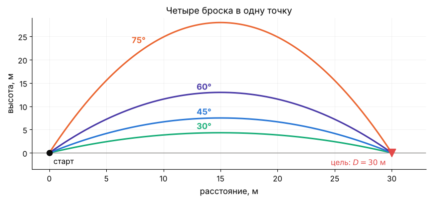
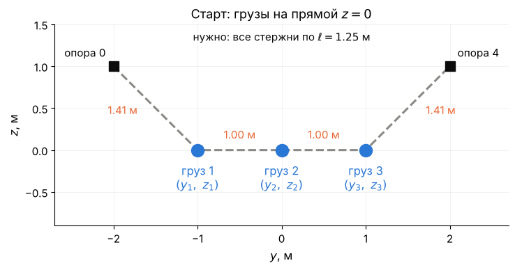
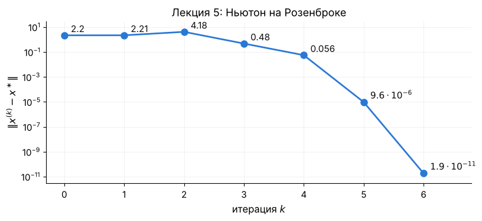
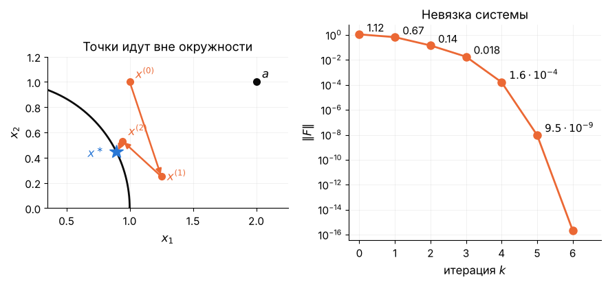
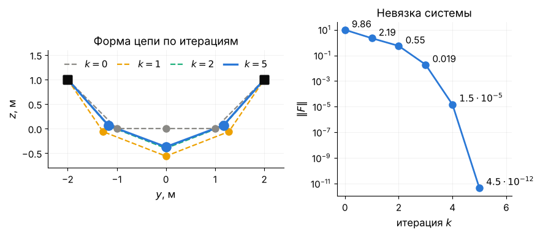
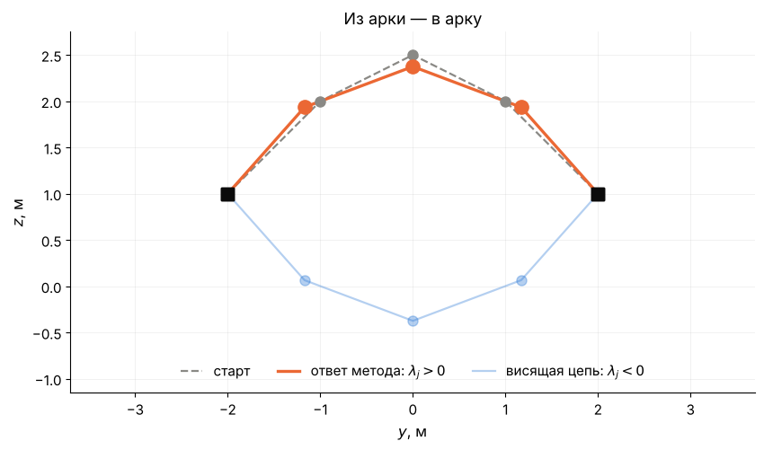
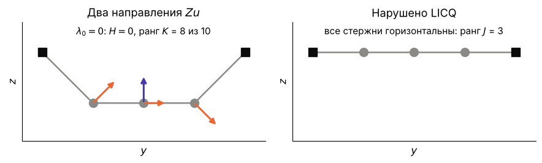
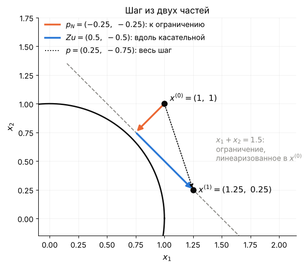
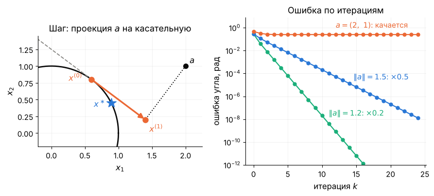
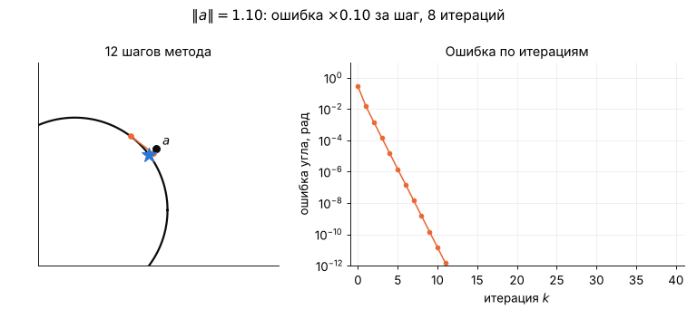

# Лекция 9. Алгоритмы для равенств: Ньютон–Лагранж, range-space и null-space, обобщённый Гаусс–Ньютон

**Курс:** Вычислительная оптимизация · **Часть III. Ограничения-равенства** · Лекция 9 из 16 · 11 ноября 2026

**Материалы:** [конспект-ноутбук с кодом демонстраций](lecture09.ipynb) · [демо-ноутбук](demo09.ipynb) · [семинар: бросок](seminar09.ipynb) · [разбор упражнений](exercises09.ipynb)

В конспекте-ноутбуке текст идёт подряд, а все три демо собраны в конце: (a) к §2, (b) к §3–§4, (c) к §5.

---

## Введение

### Задача 1. Бросок на заданную дальность

Мяч бросают с земли так, чтобы он упал на расстоянии $D=30$ м. С какой наименьшей скоростью это можно сделать?

$$
\min_{x\in\mathbb R^3}\ f(x)=\tfrac12\big(v_1^2+v_2^2\big)\qquad\text{при}\qquad g_1(x)=v_1T-D=0,\qquad g_2(x)=v_2T-4.905\,T^2=0 .
$$

Здесь $x=(v_1,v_2,T)\in\mathbb R^3$ — вектор из трёх чисел. Числа $v_1$ и $v_2$ — горизонтальная и вертикальная скорость в момент броска, м/с. Число $T$ — время полёта, с. Квадрат скорости равен $v_1^2+v_2^2$.

Ограничения — уравнения полёта без сопротивления воздуха:

- $g_1$: за время $T$ мяч пролетает $D$ по горизонтали;
- $g_2$: через время $T$ мяч снова на земле; $4.905=9.81/2$.

*Все четыре броска падают в цель, но начальные скорости у них разные.*

**Система.** Условие первого порядка из лекции 8: $\nabla f=\lambda_1\nabla g_1+\lambda_2\nabla g_2$. Градиенты по $(v_1,v_2,T)$:

$$
\nabla f=(v_1,\ v_2,\ 0),\qquad\nabla g_1=(T,\ 0,\ v_1),\qquad\nabla g_2=(0,\ T,\ v_2-9.81\,T).
$$

Покомпонентно это три уравнения:

$$
\begin{aligned}
\text{по } v_1:\quad v_1&=\lambda_1T,\\
\text{по } v_2:\quad v_2&=\lambda_2T,\\
\text{по } T:\quad 0&=\lambda_1v_1+\lambda_2\,(v_2-9.81\,T).
\end{aligned}
$$

Ещё два уравнения — сами ограничения:

$$
v_1T=D,\qquad v_2T=4.905\,T^2 .
$$

Слева в первом блоке — производные $f$, справа — производные двух ограничений с множителями.

**Всего 5 уравнений на 5 неизвестных: $v_1,v_2,T$ и $\lambda_1,\lambda_2$.**

Без сопротивления воздуха систему решают руками, ответ — бросок под $45^\circ$. С сопротивлением точку падения считает программа: она шаг за шагом интегрирует уравнения движения. Формул для $g_1$ и $g_2$ тогда нет, и руками систему не решить. Её решит метод этой лекции — на семинаре.

### Задача 2. Цепь на жёстких стержнях

Вернёмся к задаче 2 лекции 8. Три груза по 1 кг висят между опорами на четырёх стержнях длины $\ell=1.25$ м:

$$
\min_{x\in\mathbb R^6}\ f(x)=w\,(z_1+z_2+z_3)\qquad\text{при}\qquad g_j(x)=(y_{j+1}-y_j)^2+(z_{j+1}-z_j)^2-\ell^2=0,\quad j=0,1,2,3 .
$$

Здесь $(y_i,z_i)$ — груз $i$, а вектор переменных — $x=(y_1,z_1,y_2,z_2,y_3,z_3)\in\mathbb R^6$. Вес груза $w=9.81$ Н. Опоры — точки $(y_0,z_0)=(-2,1)$ и $(y_4,z_4)=(2,1)$.

**Система** (лекция 8, введение). Шесть уравнений касания, по два на груз:

$$
\begin{aligned}
\text{груз 1:}\quad 0&=2\lambda_0(y_1-y_0)-2\lambda_1(y_2-y_1), & w&=2\lambda_0(z_1-z_0)-2\lambda_1(z_2-z_1),\\
\text{груз 2:}\quad 0&=2\lambda_1(y_2-y_1)-2\lambda_2(y_3-y_2), & w&=2\lambda_1(z_2-z_1)-2\lambda_2(z_3-z_2),\\
\text{груз 3:}\quad 0&=2\lambda_2(y_3-y_2)-2\lambda_3(y_4-y_3), & w&=2\lambda_2(z_3-z_2)-2\lambda_3(z_4-z_3).
\end{aligned}
$$

Слева производные $f$: по $y_i$ ноль, по $z_i$ вес $w$. Справа производные двух стержней груза $i$.

Ещё четыре уравнения — длины стержней:

$$
\begin{aligned}
\text{стержень 0:}\quad (y_1-y_0)^2+(z_1-z_0)^2&=\ell^2,\\
\text{стержень 1:}\quad (y_2-y_1)^2+(z_2-z_1)^2&=\ell^2,\\
\text{стержень 2:}\quad (y_3-y_2)^2+(z_3-z_2)^2&=\ell^2,\\
\text{стержень 3:}\quad (y_4-y_3)^2+(z_4-z_3)^2&=\ell^2.
\end{aligned}
$$

**Всего 10 уравнений на 10 неизвестных: $y_1,z_1,y_2,z_2,y_3,z_3$ и $\lambda_0,\lambda_1,\lambda_2,\lambda_3$.**

Начнём с грузов на прямой $z=0$. Длины стержней там не те:

*Старт: грузы на прямой $z=0$. Стержни длины $1.41$ и $1.00$ м вместо $1.25$ м.*

В лекции 8 IPOPT решил эту систему из такого старта за 5 итераций. Сегодня мы напишем такой метод сами.

### Зачем это вам

Систему $\nabla_xL=0$, $g=0$ формулами решают редко. Её решают итерациями, и каждая итерация — одна линейная система. Так устроены IPOPT, методы SQP (лекция 13) и солверы для MPC (лекция 15).

**Главная тема лекции — матрица ККТ** (матрица Каруша–Куна–Таккера). Это матрица линейной системы, которую метод решает на каждом шаге.

**Три вопроса лекции:**

1. Как решать систему $\nabla_xL=0$, $g=0$ методом Ньютона и когда его шаг определён?
2. Как решать эту линейную систему по частям?
3. Что делать, если $f$ — сумма квадратов, а вторых производных считать не хочется?

**План:**

- §1 — что мы знаем;
- §2 — метод Ньютона–Лагранжа;
- §3 — когда матрица ККТ невырождена;
- §4 — шаг по частям: range-space и null-space;
- §5 — обобщённый метод Гаусса–Ньютона;
- §6 — что делают солверы;
- семинар — бросок с сопротивлением воздуха.

## 1. Повторение: что знаем и чего нет

**Главная мысль.** Метод Ньютона заменяет нелинейную систему линейной. Вблизи решения число верных цифр за шаг удваивается.

Вспомним лекцию 5 (§2.1). Пусть надо решить систему $F(x)=0$ из $n$ уравнений. Метод Ньютона заменяет $F$ в точке $x^{(k)}$ линейной моделью и приравнивает её к нулю:

$$
F\big(x^{(k)}\big)+J_F\big(x^{(k)}\big)\,p=0,\qquad x^{(k+1)}=x^{(k)}+p .
$$

*Размеры:* $x^{(k)},\ p\in\mathbb R^n$; $J_F$ — матрица Якоби $F$, размер $n\times n$. Верхний индекс $(k)$ — номер итерации, нижний — номер координаты.

Если $J_F(x^\ast)$ невырождена, а старт близок к решению, сходимость квадратичная (лекция 5, §2.1 и §3.1). Для минимума без ограничений $F=\nabla f$ и $J_F=\nabla^2f$. Вспомним Розенброк из $(-1.2,\ 1)$:

*Лекция 5: после разгона число верных цифр за шаг примерно удваивается: $0.056\to9.6\cdot10^{-6}\to1.9\cdot10^{-11}$.*

Лекция 8 дала систему для задач с равенствами:

$$
\nabla_xL(x,\lambda)=\nabla f(x)-J(x)^\top\lambda=0,\qquad g(x)=0 .
$$

*Размеры:* $x\in\mathbb R^n$, $\lambda\in\mathbb R^m$; якобиан ограничений $J$ — матрица $m\times n$. Уравнений $n+m$, неизвестных столько же.

| | Без ограничений (Л5) | С равенствами (Л8) |
|---|---|---|
| Система | $\nabla f=0$ | $\nabla_xL=0$, $g=0$ |
| Шаг Ньютона | $\nabla^2f\,p=-\nabla f$ | ? |
| Когда шаг определён | $\nabla^2f$ невырождена | ? |

Два знака вопроса — первые два вопроса лекции. Третий вопрос — про сумму квадратов: для неё в лекции 5 был метод Гаусса–Ньютона.

## 2. Метод Ньютона–Лагранжа

**Главная мысль.** Это метод Ньютона из лекции 5 для системы $\nabla_xL=0$, $g=0$. Неизвестные — $x$ и $\lambda$ вместе, на каждом шаге решается одна линейная система.

### 2.1. Пример: окружность

Возьмём задачу 1 лекции 8 — точку единичной окружности, ближайшую к $a=(2,1)$:

$$
\min_{x\in\mathbb R^2}\ f(x)=\tfrac12\lVert x-a\rVert^2\qquad\text{при}\qquad g(x)=\tfrac12\big(x_1^2+x_2^2-1\big)=0 .
$$

Здесь $x=(x_1,x_2)\in\mathbb R^2$ — точка плоскости. Ответ известен: $x^\ast=(0.894,\ 0.447)$ и $\lambda^\ast=-1.236$. Найдём его итерациями.

**Система.** Неизвестных три: $x_1$, $x_2$ и $\lambda$. Градиенты $\nabla f=x-a$ и $\nabla g=x$, поэтому система $F=0$ такая:

$$
F(x_1,x_2,\lambda)=\begin{pmatrix}x_1-2-\lambda x_1\\ x_2-1-\lambda x_2\\ \tfrac12\big(x_1^2+x_2^2-1\big)\end{pmatrix}=0 .
$$

Первые две строки — $\nabla_xL$, третья — $g$.

**Матрица Якоби.** Продифференцируем каждую строку $F$ по $x_1$, $x_2$ и $\lambda$:

$$
K=\begin{pmatrix}1-\lambda&0&-x_1\\0&1-\lambda&-x_2\\x_1&x_2&0\end{pmatrix}.
$$

Это и есть **матрица ККТ** (*KKT matrix*). Её левый верхний блок $2\times2$ — гессиан $\nabla^2_{xx}L=(1-\lambda)I$. Последняя строка — якобиан ограничения $J=(x_1,\ x_2)$, последний столбец — $-J^\top$.

**Шаг из точки $(1,1)$ при $\lambda=0$.** Там $F=(-1,\ 0,\ 0.5)$. Неизвестные шага — $p=(p_1,p_2)$ и $\Delta\lambda$. Система $K\,(p_1,p_2,\Delta\lambda)=-F$:

$$
\begin{pmatrix}1&0&-1\\0&1&-1\\1&1&0\end{pmatrix}\begin{pmatrix}p_1\\p_2\\\Delta\lambda\end{pmatrix}=\begin{pmatrix}1\\0\\-0.5\end{pmatrix}.
$$

Из первых двух строк $p_1=1+\Delta\lambda$ и $p_2=\Delta\lambda$. Третья строка даёт $1+2\Delta\lambda=-0.5$. Отсюда $\Delta\lambda=-0.75$ и $p=(0.25,\ -0.75)$.

**Две итерации.**

$$
x^{(1)}=(1.25,\ 0.25),\qquad\lambda^{(1)}=-0.75 ;
$$

$$
x^{(2)}=(0.944,\ 0.532),\qquad\lambda^{(2)}=-1.029 .
$$

Норма невязки $\lVert F\rVert$ по итерациям: $1.12$, $0.67$, $0.14$, $0.018$, $1.6\cdot10^{-4}$, $9.5\cdot10^{-9}$. На шестой итерации она меньше $10^{-10}$.

*Точки идут вне окружности: ограничение выполняется только в пределе. Невязка падает с обрывом, как у Ньютона в лекции 5.*

### 2.2. Общий случай

Неизвестные — $x\in\mathbb R^n$ и $\lambda\in\mathbb R^m$. Система:

$$
F(x,\lambda)=\begin{pmatrix}\nabla f(x)-J(x)^\top\lambda\\ g(x)\end{pmatrix}=0 .
$$

*Размеры:* $F$ — вектор из $n+m$ чисел.

Матрица Якоби $F$ по $(x,\lambda)$ — матрица ККТ:

$$
K=\begin{pmatrix}H&-J^\top\\ J&0\end{pmatrix},\qquad H=\nabla^2_{xx}L=\nabla^2f-\sum_{j=1}^m\lambda_j\nabla^2g_j .
$$

*Размеры:* $K$ — $(n+m)\times(n+m)$; $H$ — $n\times n$; $J$ — $m\times n$; нулевой блок — $m\times m$.

Блоки — производные двух половин $F$. Производная $\nabla_xL$ по $x$ равна $H$, по $\lambda$ равна $-J^\top$. Производная $g$ по $x$ равна $J$, а от $\lambda$ функция $g$ не зависит.

**Алгоритм Ньютона–Лагранжа** (*Newton–Lagrange method*):

1. Выбрать старт: $x^{(0)}\in\mathbb R^n$ и $\lambda^{(0)}\in\mathbb R^m$.
2. Посчитать в текущей точке $\nabla f$ ($n$ чисел), $g$ ($m$ чисел), $J$ ($m\times n$) и $H$ ($n\times n$).
3. Решить систему $K\,(p,\Delta\lambda)=-F$, где $p\in\mathbb R^n$ и $\Delta\lambda\in\mathbb R^m$.
4. Сделать шаг: $x^{(k+1)}=x^{(k)}+p$, $\lambda^{(k+1)}=\lambda^{(k)}+\Delta\lambda$.
5. Повторять пункты 2–4, пока $\lVert F\rVert$ больше допуска.

**Чем он отличается от Ньютона лекции 5:**

- неизвестных $n+m$: метод ищет точку и множители вместе;
- нужен старт и для множителей; обычно $\lambda^{(0)}$ берут по МНК из $J^\top\lambda\approx\nabla f$ в стартовой точке;
- промежуточные точки нарушают ограничения, $g=0$ выполняется только в пределе.

### 2.3. Цепь

Решим задачу 2 из введения. Старт — прямая $z=0$, $n=6$, $m=4$, матрица ККТ $10\times10$. Производные $\nabla f$, $g$, $J$ и $H$ даёт CasADi (лекция 7).

Стартовые множители по МНК: $\lambda^{(0)}=(-4.905,\ -4.905,\ -4.905,\ -4.905)$. Норма невязки по итерациям:

$$
9.86\ \to\ 2.19\ \to\ 0.55\ \to\ 0.019\ \to\ 1.5\cdot10^{-5}\ \to\ 4.5\cdot10^{-12}.
$$

*После второй итерации форма цепи на глаз не меняется. Последние шаги уточняют цифры: $10^{-5}\to10^{-12}$.*

Наш метод сделал 5 итераций, IPOPT в лекции 8 — тоже 5. Ответ тот же: $\lambda=(-7.87,\ -5.58,\ -5.58,\ -7.87)$. Больше того, невязки IPOPT по итерациям совпадают с нашими до ошибок округления (демо (e)). На этой задаче IPOPT делает ровно шаги Ньютона–Лагранжа. Код — демо (a).

**Вопрос залу.** Начнём из арки: грузы в точках $(-1,\ 2)$, $(0,\ 2.5)$ и $(1,\ 2)$. Куда придёт метод?

 0; для сравнения бледно — висящая цепь с λ_j < 0">

*Метод пришёл в арку за 4 итерации. У неё те же множители со знаком плюс: стержни сжаты.*

Ответ: арка — тоже решение системы. Её энергия $f=61.25$ — наибольшая, это максимум (лекция 8, §5). Метод Ньютона–Лагранжа ищет решение системы, а не минимум. Как в лекции 5 Ньютон приходил в седло, так здесь он приходит в максимум. Минимум проверяют условием второго порядка (лекция 8, §4). Как не уходить от минимума издалека, расскажет лекция 13.

## 3. Матрица ККТ

**Главная мысль.** Шаг определён, если матрица ККТ невырождена. Для этого нужны LICQ и положительный гессиан $H$ в касательном пространстве.

Напомним обозначения лекции 8. LICQ — строки $J$ линейно независимы. Касательное пространство — решения $Jp=0$. Столбцы матрицы $Z$ — базис этого пространства, их $n-m$. Редуцированный гессиан — матрица $Z^\top HZ$ размера $(n-m)\times(n-m)$.

### 3.1. Теорема и доказательство

**Теорема.** Пусть в точке $(x,\lambda)$ строки $J$ линейно независимы и $Z^\top HZ\succ0$. Тогда матрица ККТ $K$ невырождена.

В решении $(x^\ast,\lambda^\ast)$ это LICQ и достаточное условие второго порядка лекции 8. Тогда по теореме лекции 5 метод Ньютона–Лагранжа сходится квадратично из близкого старта. Так и было на картинках §2.

**Чего теорема не обещает.** Что ответ — минимум. В максимуме $Z^\top HZ\prec0$, и то же доказательство со сменой знака даёт невырожденную $K$. Поэтому из арки метод сошёлся так же быстро.

**Доказательство на окружности.** Посчитаем определитель матрицы $K$ из §2.1:

$$
\det K=(1-\lambda)\,\big(x_1^2+x_2^2\big).
$$

Он равен нулю в двух случаях. При $x=(0,0)$ строка $J=(x_1,\ x_2)$ нулевая — нарушено LICQ. При $\lambda=1$ гессиан $H=(1-\lambda)I$ нулевой — нарушено второе условие. В ответе $\det K=2.236\ne0$.

**Доказательство в общем случае.** Пусть $K\,(p,\mu)=0$ для некоторых $p\in\mathbb R^n$ и $\mu\in\mathbb R^m$. Докажем, что $p=0$ и $\mu=0$. Покомпонентно это два уравнения:

$$
Hp-J^\top\mu=0,\qquad Jp=0 .
$$

**Шаг 1. Вектор $p$ касательный.** Из второго уравнения $Jp=0$. Значит, $p=Zu$ для некоторого $u\in\mathbb R^{n-m}$.

**Шаг 2. Умножим первое уравнение на $p^\top$ слева.**

$$
p^\top Hp=p^\top J^\top\mu=(Jp)^\top\mu=0 .
$$

**Шаг 3. $p=0$.** Подставим $p=Zu$: получим $u^\top\big(Z^\top HZ\big)u=0$. Матрица $Z^\top HZ$ положительно определена, поэтому $u=0$ и $p=0$.

**Шаг 4. $\mu=0$.** Теперь первое уравнение даёт $J^\top\mu=0$. Это комбинация строк $J$ с коэффициентами $\mu$, равная нулю. Строки независимы, поэтому $\mu=0$.

Итак, у системы $K\,(p,\mu)=0$ только нулевое решение, и матрица $K$ невырождена. $\blacksquare$ Это же рассуждение было в упражнении 8.6 лекции 8.

### 3.2. Два нарушения на цепи

У цепи есть стартовые точки, где нарушено каждое из условий теоремы.

**Старт с $\lambda^{(0)}=0$.** Функция $f$ линейна, поэтому при $\lambda=0$ гессиан $H=0$. Тогда шаг 3 не работает: любой касательный $p=Zu$ вместе с $\mu=0$ решает $K\,(p,\mu)=0$. У цепи $n-m=2$, и ранг $K$ равен 8 из 10.

*Слева: два касательных направления, в которых при $H=0$ шаг не определён. Справа: все стержни горизонтальны, и LICQ нарушено.*

Поэтому $\lambda^{(0)}$ берут по МНК. Тогда $H=4.905\sum_j\nabla^2g_j$, и собственные числа $H$ положительны — от $5.7$ до $33.5$.

**Горизонтальный старт $z=1$.** Грузы в точках $(-1,1)$, $(0,1)$, $(1,1)$. Все стержни горизонтальны, и в строках $J$ нет производных по $z_i$. Столбцы — по $y_1,z_1,y_2,z_2,y_3,z_3$:

$$
J=\begin{pmatrix}2&0&0&0&0&0\\-2&0&2&0&0&0\\0&0&-2&0&2&0\\0&0&0&0&-2&0\end{pmatrix}.
$$

Сумма строк равна нулю, поэтому $\mu=(1,1,1,1)$ решает $J^\top\mu=0$. Строки зависимы, ранг $J$ равен 3: LICQ нарушено, шаг 4 не работает.

**Что делают на практике.**

- Множители $\lambda^{(0)}$ берут по МНК, а не нулями.
- Если $Z^\top HZ$ не положителен, IPOPT прибавляет к $H$ матрицу $\delta I$. Это `regularization_size` из семинара лекции 6.
- Матрицу $K$ раскладывают не Холецким: он только для положительно определённых матриц, а у $K$ есть и отрицательные собственные числа (упражнение 9.6). IPOPT использует разложение $LDL^\top$ из библиотек MUMPS или MA27.

## 4. Шаг по частям: range-space и null-space

**Главная мысль.** Шаг $p$ состоит из двух частей: одна ведёт к ограничению, другая идёт вдоль касательного пространства. Поэтому систему размера $n+m$ можно заменить меньшей.

Названия — от двух подпространств. *Range space* — комбинации строк $J$, это нормали к ограничениям. *Null space* — ядро $J$, это касательное пространство.

Запишем систему шага через новые множители $\lambda^+=\lambda+\Delta\lambda$. Слагаемое $J^\top\lambda$ сократится:

$$
Hp-J^\top\lambda^+=-\nabla f,\qquad Jp=-g .
$$

*Размеры:* $p\in\mathbb R^n$, $\lambda^+\in\mathbb R^m$. Возьмём первый шаг на окружности (§2.1): из $(1,1)$ при $\lambda=0$ там $H=I$, $\nabla f=(-1,\ 0)$, $J=(1,\ 1)$, $g=0.5$.

### 4.1. Null-space: сначала к ограничению, потом вдоль

**Часть к ограничению.** Возьмём самый короткий $p_N$ с $Jp_N=-g$. Он перпендикулярен касательному пространству, поэтому это комбинация строк $J$:

$$
p_N=-J^\top\big(JJ^\top\big)^{-1}g .
$$

*Размеры:* $JJ^\top$ — $m\times m$, $p_N\in\mathbb R^n$.

На окружности $JJ^\top=2$ и $p_N=-(1,1)\cdot0.5/2=(-0.25,\ -0.25)$. Точка $(0.75,\ 0.75)$ лежит на прямой $x_1+x_2=1.5$. Это ограничение, линеаризованное в $(1,1)$.

**Часть вдоль.** Ищем $p=p_N+Zu$, где $u\in\mathbb R^{n-m}$. Подставим в первое уравнение и умножим на $Z^\top$ слева. Слагаемое с $\lambda^+$ пропадёт, потому что $Z^\top J^\top=(JZ)^\top=0$:

$$
Z^\top HZ\,u=-Z^\top\big(\nabla f+Hp_N\big).
$$

*Размеры:* $Z$ — $n\times(n-m)$, $Z^\top HZ$ — $(n-m)\times(n-m)$, $u\in\mathbb R^{n-m}$.

На окружности $Z=(1,\ -1)/\sqrt2$ и $\nabla f+Hp_N=(-1.25,\ -0.25)$. Получаем $u=1/\sqrt2$ и $Zu=(0.5,\ -0.5)$. Сумма $p_N+Zu=(0.25,\ -0.75)$ — шаг §2.1.

*Оранжевая часть ведёт на линеаризованное ограничение, синяя идёт вдоль него. Вместе они дают шаг §2.1.*

Множители находят после шага из $J^\top\lambda^+=Hp+\nabla f$. На окружности $Hp+\nabla f=(-0.75,\ -0.75)$, и $\lambda^+=-0.75$.

### 4.2. Range-space: сначала множители

Если $H$ обратима, выразим $p$ из первого уравнения: $p=H^{-1}\big(J^\top\lambda^+-\nabla f\big)$. Подставим во второе:

$$
JH^{-1}J^\top\,\lambda^+=JH^{-1}\nabla f-g .
$$

*Размеры:* $JH^{-1}J^\top$ — $m\times m$; её называют дополнением Шура (*Schur complement*).

На окружности $JJ^\top=2$ и $J\nabla f=-1$, поэтому $2\lambda^+=-1.5$ и $\lambda^+=-0.75$. Затем $p=(-0.75,\ -0.75)-(-1,\ 0)=(0.25,\ -0.75)$. Шаг снова тот же.

### 4.3. Что выбрать

| Способ | Размер системы | Что нужно | Цепь |
|---|---|---|---|
| вся матрица $K$ | $(n+m)\times(n+m)$ | $K$ невырождена | $10\times10$ |
| range-space | $m\times m$ | $H$ обратима | $4\times4$ |
| null-space | $(n-m)\times(n-m)$ | базис $Z$ | $2\times2$ |

- **Null-space** выгоден, когда степеней свободы $n-m$ мало. Ему нужна положительность только $Z^\top HZ$ — ровно условие теоремы §3. Цена — базис $Z$ на каждой итерации, его считают по QR-разложению $J$.
- **Range-space** выгоден, когда $H$ легко обратить, например она блочно-диагональная. Так бывает в задачах управления (лекция 15). Ему нужна обратимость всей $H$, а не только $Z^\top HZ$.
- **Вся матрица** — выбор солверов общего назначения: $K$ разреженная, и её раскладывают целиком.

На цепи с $\lambda^{(0)}$ по МНК годятся все три способа, потому что $H\succ0$. В демо (b) все три дают один шаг.

## 5. Обобщённый Гаусс–Ньютон

**Главная мысль.** Если $f$ — сумма квадратов невязок, вместо $H$ в матрицу ККТ ставят $J_r^\top J_r$. Вторые производные и множители для матрицы не нужны. Метод сходится линейно, и тем быстрее, чем меньше невязки в ответе.

Вспомним лекцию 5 (§5.2). Пусть $f(x)=\tfrac12\lVert r(x)\rVert^2$, где $r(x)$ — вектор невязок. Его якобиан $J_r$ — матрица, в которой столько строк, сколько невязок, и $n$ столбцов. Метод Гаусса–Ньютона заменяет $\nabla^2f$ на $J_r^\top J_r$.

С ограничениями делают то же самое в матрице ККТ:

$$
\begin{pmatrix}J_r^\top J_r&-J^\top\\ J&0\end{pmatrix}\begin{pmatrix}p\\ \lambda^+\end{pmatrix}=\begin{pmatrix}-J_r^\top r\\ -g\end{pmatrix}.
$$

*Размеры:* $J_r^\top J_r$ — $n\times n$; остальные блоки — как в §2.2.

Это **обобщённый метод Гаусса–Ньютона** (*constrained Gauss–Newton*). Вместо $H$ стоит матрица без двух слагаемых. Первое — вторые производные невязок, как в лекции 5. Второе — кривизна ограничений $-\sum_j\lambda_j\nabla^2g_j$. Поэтому $\lambda$ в матрицу не входит.

Шаг — это линейная задача: $\min_p\ \tfrac12\lVert r+J_rp\rVert^2$ при $g+Jp=0$. Невязки и ограничения линеаризованы в текущей точке.

**Пример: окружность.** Функция $f=\tfrac12\lVert x-a\rVert^2$ — сумма квадратов с $r=x-a$ и $J_r=I$. Значит, вместо точного $H=(1-\lambda)I$ в матрице стоит $I$. Шаг — ближайшая к $a$ точка линеаризованного ограничения. На окружности это **проекция $a$ на касательную**.

*Слева: шаг — проекция $a$ на касательную, и метод перелетает через $x^\ast$. Справа: ошибка угла при трёх положениях $a$.*

**Скорость.** Повернём картинку так, чтобы $x^\ast=(1,0)$ и $a=(\lVert a\rVert,\ 0)$. Пусть $x^{(k)}\approx(1,\ e_k)$ — точка окружности под малым углом $e_k$. Касательная в ней идёт вдоль $(-e_k,\ 1)$. Проекция $a$ сдвигает точку вдоль касательной на

$$
\big(a-x^{(k)}\big)^\top(-e_k,\ 1)\approx-\lVert a\rVert\,e_k .
$$

Значит, новый угол

$$
e_{k+1}\approx e_k-\lVert a\rVert\,e_k=\big(1-\lVert a\rVert\big)\,e_k=\lambda^\ast e_k .
$$

Здесь $\lambda^\ast=1-\lVert a\rVert$ — множитель ближней точки (лекция 8, §2.1). По модулю это расстояние от $a$ до окружности, то есть невязка в ответе $\lVert r(x^\ast)\rVert$.

Число итераций из $x^{(0)}=(0.6,\ 0.8)$, пока ошибка угла не станет меньше $10^{-8}$:

| Точка $a$ | $\lVert a\rVert$ | $\lambda^\ast$ | Итераций |
|---|---|---|---|
| $(0.96,\ 0.72)$ | $1.2$ | $-0.2$ | $11$ |
| $(1.2,\ 0.9)$ | $1.5$ | $-0.5$ | $25$ |
| $(2,\ 1)$ | $2.236$ | $-1.236$ | не сходится |

При $a=(2,1)$ множитель ошибки по модулю больше единицы. Метод качается между двумя точками, ошибка угла остаётся около $0.25$.

*Точку $a$ отодвигают от окружности. Множитель ошибки $\lVert a\rVert-1$ растёт, и с $\lVert a\rVert=2$ метод перестаёт сходиться.*

**В общем случае** то же: $\nabla f=J_r^\top r$ мал, когда малы невязки. При LICQ из $\nabla f=J^\top\lambda$ тогда мал и $\lambda^\ast$. Выброшенная кривизна ограничений пропорциональна $\lambda$, и метод сходится почти как Ньютон.

**Реальный кейс.** В acados (MPC в реальном времени, лекция 15) опция `hessian_approx='GAUSS_NEWTON'` включает именно этот метод. Цель в MPC — сумма квадратов отклонений от заданной траектории, а невязки малы.

## 6. Что это даёт численно

**Главная мысль.** IPOPT на задаче с одними равенствами делает шаги Ньютона–Лагранжа. К ним он добавляет регуляризацию и линейный поиск, а стартовые множители берёт по МНК.

- **Лог.** Колонки `inf_pr` и `inf_du` — две половины $F$: $\lVert g\rVert_\infty$ и $\lVert\nabla_xL\rVert_\infty$ (лекция 8, §6). Наш $\lVert F\rVert$ — евклидова норма обеих половин сразу.
- **Гессиан.** Опция `hessian_approximation`: `"exact"` — точный $H$ от CasADi, `"limited-memory"` — квазиньютоновское приближение L-BFGS (лекция 5). На упругой цепи лекции 7 — 24 итерации против 232.
- **Линейная система.** Опция `linear_solver` выбирает библиотеку разложения $LDL^\top$: MUMPS или MA27.
- **Регуляризация.** Если $Z^\top HZ$ не положителен, IPOPT прибавляет к $H$ матрицу $\delta I$ (`regularization_size`).
- **Глобализация.** Издалека полный шаг может увести в максимум, как с аркой в §2.3. IPOPT укорачивает шаг линейным поиском — лекция 13.

**В ДЗ 5** вы напишете метод Ньютона–Лагранжа и обобщённый Гаусс–Ньютон и сравните их с IPOPT.

## 7. Итоги лекции

1. Метод Ньютона–Лагранжа — метод Ньютона для системы $\nabla_xL=0$, $g=0$. Неизвестные — $x$ и $\lambda$, на шаге — одна система с матрицей ККТ (§2).
2. Матрица ККТ невырождена при LICQ и $Z^\top HZ\succ0$, и тогда сходимость квадратичная. Метод ищет решение системы и может прийти в максимум (§2.3, §3).
3. Шаг состоит из части к ограничению и части вдоль касательного пространства. Range-space решает систему $m\times m$, null-space — $(n-m)\times(n-m)$ (§4).
4. Обобщённый Гаусс–Ньютон ставит $J_r^\top J_r$ вместо $H$. Он сходится линейно, множитель ошибки — порядка $\lambda^\ast$, то есть невязки в ответе (§5).

**Ответы на задачи введения.**

- **Задача 1.** Без воздуха — бросок под $45^\circ$ со скоростью $\sqrt{9.81\cdot30}=17.16$ м/с. С сопротивлением воздуха при $c=0.02$ 1/м — $40.9^\circ$ и $22.3$ м/с (семинар).
- **Задача 2.** Метод Ньютона–Лагранжа решает цепь из прямой $z=0$ за 5 итераций. Его невязки по итерациям совпали с логом IPOPT до ошибок округления, множители — $(-7.87,\ -5.58,\ -5.58,\ -7.87)$.

## 8. Что дальше

**Лекция 10** — неравенства: условия ККТ и двойственность Лагранжа. **Лекция 13** — SQP: шаг Ньютона–Лагранжа как квадратичная задача (упражнение 9.1) и глобализация.

**ДЗ 5** (Ньютон–Лагранж и обобщённый Гаусс–Ньютон) выдаётся 11.11, срок — 25.11.

**Литература к лекции.**

- Diehl, *Lecture Notes on Numerical Optimization*, часть III — алгоритмы для задач с равенствами: метод Ньютона–Лагранжа, обобщённый Гаусс–Ньютон, решение системы ККТ.
- Nocedal & Wright: §16.1 — система ККТ, лемма 16.1 — теорема §3; §16.2 — range-space и null-space; §18.1 — метод Ньютона для условий Лагранжа.
- Boyd & Vandenberghe: §10.2–10.3 — метод Ньютона с равенствами, в том числе из недопустимого старта; §10.4 — как решать систему ККТ.

## 9. Семинар: бросок

Весь семинар — за ноутбуком [`seminar09.ipynb`](seminar09.ipynb), около 30 минут. Нужен пакет CasADi: `uv sync --group casadi`; в Colab первая ячейка ставит его сама.

| Мин | Шаг |
|---|---|
| 6 | **1. Без воздуха руками.** Система введения: ответ $45^\circ$ и $\sqrt{9.81D}$ |
| 8 | **2. Свой метод Ньютона–Лагранжа** на той же системе |
| 10 | **3. С сопротивлением воздуха.** Полёт считает программа; предскажите угол; сверка с IPOPT |
| 6 | **4. Угол и скорость** при разном сопротивлении |

Дома: упражнения 9.0–9.6, затем демо (a)–(c) в конце конспекта-ноутбука.

## 10. Упражнения

Разбор с проверкой кодом — [`exercises09.ipynb`](exercises09.ipynb), краткие ответы — [`exercises09.md`](exercises09.md). Все упражнения — домашние.

**9.0. Разминка — счёт руками.** *Суть: на квадратичной задаче с линейным ограничением один шаг даёт ответ.*

- (а) $\min\ \tfrac12\big(x_1^2+x_2^2\big)$ при $x_1+x_2=1$, $x\in\mathbb R^2$. Выпишите $F$ и матрицу ККТ $3\times3$.
- (б) Сделайте шаг метода Ньютона–Лагранжа из $x=(0,0)$, $\lambda=0$. Почему после него $F=0$?
- (в) Посчитайте тот же шаг способами null-space и range-space (§4).

**9.1. Шаг как квадратичная задача.** *Суть: шаг Ньютона–Лагранжа решает задачу с квадратичной функцией и линейными ограничениями; на этом построен SQP.*

Докажите, что $p$ и $\lambda^+$ из §4 — решение и множитель задачи

$$
\min_{p\in\mathbb R^n}\ \nabla f^\top p+\tfrac12\,p^\top Hp\qquad\text{при}\qquad g+Jp=0 .
$$

**9.2. Сломайте метод** (с кодом). *Суть: метод находит любое решение системы, в том числе максимум, а при вырожденной $K$ шага нет.*

- (а) Запустите метод на окружности §2.1 из разных стартов при $\lambda^{(0)}=0$. Найдите старт, из которого он приходит в дальнюю точку $(-0.894,\ -0.447)$.
- (б) Что будет при $\lambda^{(0)}=1$? Объясните теоремой §3.

**9.3. Три способа на длинной цепи** (с кодом). *Суть: три способа дают один шаг, но решают системы разного размера.*

- (а) Цепь из $N$ грузов на $N+1$ стержнях: найдите $n$, $m$ и размеры трёх систем §4.3 при $N=3,\ 10,\ 40$.
- (б) При $N=40$ сделайте первый шаг из прямой $z=0$ тремя способами. Совпадают ли шаги?

**9.4. Скорость обобщённого Гаусса–Ньютона** (руками). *Суть: множитель ошибки равен $\lambda^\ast$.*

- (а) Повторите вывод §5 для точки $a$ внутри окружности, $0<\lVert a\rVert<1$. Чему равен множитель ошибки?
- (б) Почему метод тем медленнее, чем ближе $a$ к центру?

**9.5. Прямая по точкам** (с кодом). *Суть: в задачах подгонки невязки малы, и обобщённый Гаусс–Ньютон сходится быстро.*

Прямую на плоскости зададим уравнением $n_1t+n_2s=d$ с нормалью $n_1^2+n_2^2=1$. Переменные — $x=(n_1,n_2,d)\in\mathbb R^3$. Невязка точки $(t_i,s_i)$ — расстояние до прямой: $r_i=n_1t_i+n_2s_i-d$.

- (а) Сгенерируйте 30 точек около прямой с шумом $\sigma=0.1$ и $\sigma=1$ (`default_rng(2026)`). Решите задачу обобщённым Гауссом–Ньютоном и сравните число итераций.
- (б) Сравните ответ с собственным вектором матрицы разброса точек. Чему равен $\lambda^\ast$?

**9.6. Для желающих: знаки собственных чисел матрицы ККТ.** *Суть: матрица ККТ знаконеопределена, поэтому солверы раскладывают её как $LDL^\top$.*

Сменим знак у $\lambda^+$, и матрица станет симметричной: $\begin{pmatrix}H&J^\top\\ J&0\end{pmatrix}$. Пусть выполнены LICQ и $Z^\top HZ\succ0$. Докажите, что у неё ровно $n$ положительных и $m$ отрицательных собственных чисел.

## Вопросы для самопроверки

1. Какие неизвестные у метода Ньютона–Лагранжа и сколько их?
2. Из каких блоков состоит матрица ККТ и какого они размера?
3. Почему у цепи при $\lambda=0$ матрица ККТ вырождена?
4. Почему из арки метод приходит в арку? Как это заметить?
5. Чем range-space отличается от null-space и когда какой выгоднее?
6. Что выбрасывает обобщённый Гаусс–Ньютон по сравнению с методом Ньютона–Лагранжа?
7. Почему обобщённый Гаусс–Ньютон быстр при малых невязках?
8. Какие опции IPOPT отвечают за гессиан и за линейную систему?
