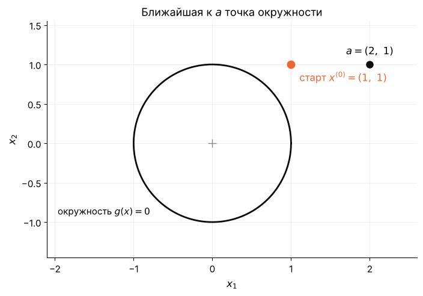
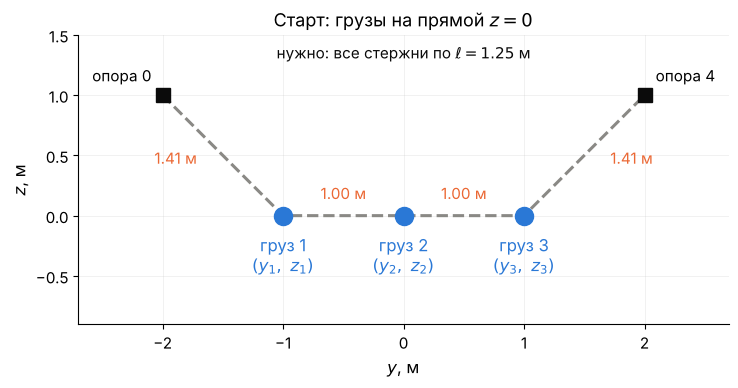
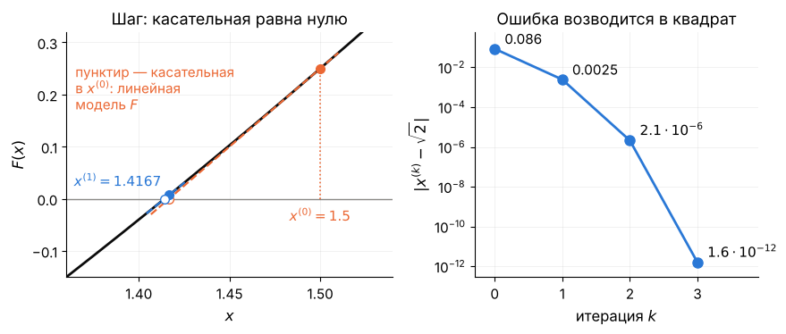
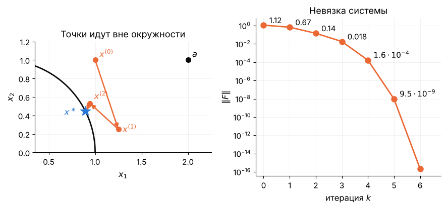
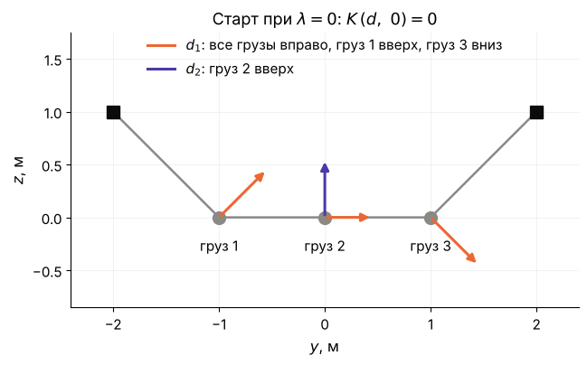
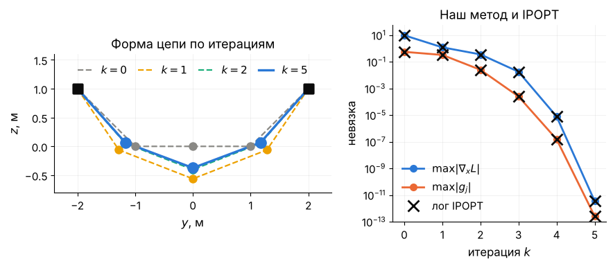
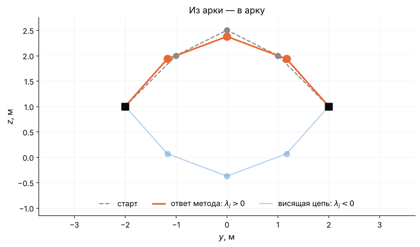
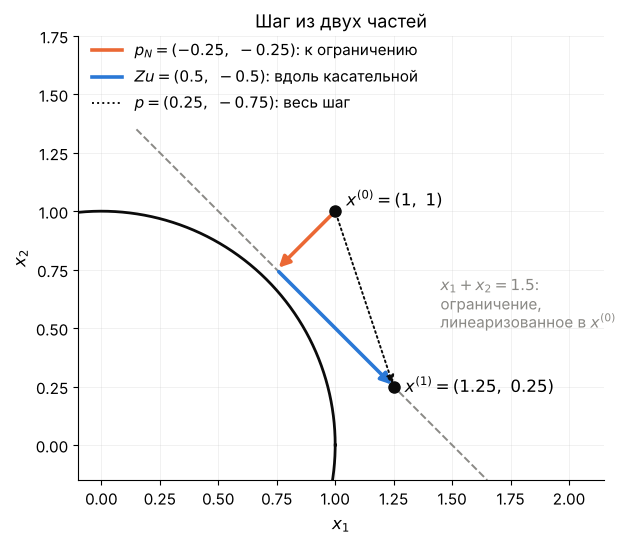
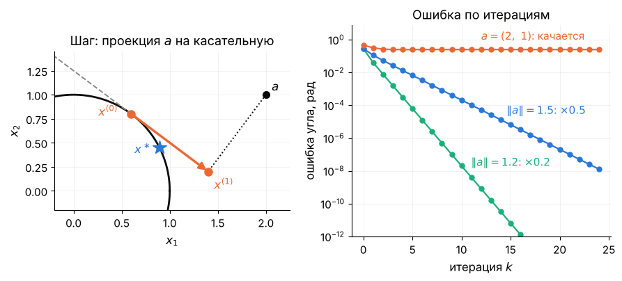
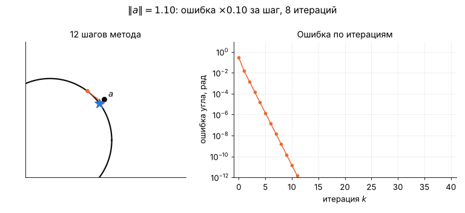

# Лекция 9. Алгоритмы для равенств: Ньютон–Лагранж, range-space и null-space, обобщённый Гаусс–Ньютон

**Курс:** Вычислительная оптимизация · **Часть III. Ограничения-равенства** · Лекция 9 из 16 · 19 ноября 2026

**Материалы:** [конспект-ноутбук с кодом демонстраций](lecture09.ipynb) · [демо-ноутбук](demo09.ipynb) · [семинар: бросок мяча](seminar09.ipynb) · [разбор упражнений](exercises09.ipynb)

В конспекте-ноутбуке текст идёт подряд, а три демо собраны в конце: (a) к §2, (b) к §3–§4, (c) к §5.

---

## Введение

В лекции 8 мы выписали систему, которой удовлетворяет решение задачи с равенствами. Сегодня мы решим её сами — итерациями, как это делает солвер. Две задачи лекции 8 пройдут через всю лекцию.

### Задача 1. Ближайшая точка окружности

Найдём точку единичной окружности, ближайшую к точке $a=(2,1)$:

$$
\min_{x\in\mathbb R^2}\ f(x)=\tfrac12\lVert x-a\rVert^2\qquad\text{при}\qquad g(x)=\tfrac12\big(x_1^2+x_2^2-1\big)=0 .
$$

Здесь $x=(x_1,x_2)\in\mathbb R^2$ — точка плоскости. Функция $f$ — половина квадрата расстояния от $x$ до $a$.

*Окружность, точка $a$ и старт метода $x^{(0)}=(1,1)$. Старт лежит вне окружности.*

**Система.** Условие лекции 8: $\nabla f=\lambda\nabla g$ и $g=0$. Градиенты: $\nabla f=x-a$, $\nabla g=x$. Покомпонентно:

$$
\begin{aligned}
x_1-2&=\lambda x_1,\\
x_2-1&=\lambda x_2,\\
\tfrac12\big(x_1^2+x_2^2-1\big)&=0 .
\end{aligned}
$$

Первые два уравнения — градиент $f$ параллелен градиенту $g$, третье — само ограничение.

**3 уравнения на 3 неизвестных: $x_1$, $x_2$ и $\lambda$.**

В лекции 8 эту систему решили руками. Поэтому на ней каждый шаг метода можно проверить.

### Задача 2. Цепь на жёстких стержнях

Три груза по 1 кг висят между опорами на четырёх стержнях длины $\ell=1.25$ м. Цепь висит так, чтобы энергия была наименьшей:

$$
\min_{x\in\mathbb R^6}\ f(x)=w\,(z_1+z_2+z_3)\qquad\text{при}\qquad g_j(x)=(y_{j+1}-y_j)^2+(z_{j+1}-z_j)^2-\ell^2=0,\quad j=0,1,2,3 .
$$

Здесь $(y_i,z_i)$ — груз $i$, а вектор переменных — $x=(y_1,z_1,y_2,z_2,y_3,z_3)\in\mathbb R^6$. Вес груза $w=9.81$ Н. Опоры — точки $(y_0,z_0)=(-2,1)$ и $(y_4,z_4)=(2,1)$.

**Система** (лекция 8, введение). Шесть уравнений касания, по два на груз:

$$
\begin{aligned}
\text{груз 1:}\quad 0&=2\lambda_0(y_1-y_0)-2\lambda_1(y_2-y_1), & w&=2\lambda_0(z_1-z_0)-2\lambda_1(z_2-z_1),\\
\text{груз 2:}\quad 0&=2\lambda_1(y_2-y_1)-2\lambda_2(y_3-y_2), & w&=2\lambda_1(z_2-z_1)-2\lambda_2(z_3-z_2),\\
\text{груз 3:}\quad 0&=2\lambda_2(y_3-y_2)-2\lambda_3(y_4-y_3), & w&=2\lambda_2(z_3-z_2)-2\lambda_3(z_4-z_3).
\end{aligned}
$$

Слева — производные $f$: по $y_i$ ноль, по $z_i$ вес $w$. Справа — производные двух стержней груза $i$ с множителями.

Ещё четыре уравнения — длины стержней:

$$
\begin{aligned}
\text{стержень 0:}\quad (y_1-y_0)^2+(z_1-z_0)^2&=\ell^2,\\
\text{стержень 1:}\quad (y_2-y_1)^2+(z_2-z_1)^2&=\ell^2,\\
\text{стержень 2:}\quad (y_3-y_2)^2+(z_3-z_2)^2&=\ell^2,\\
\text{стержень 3:}\quad (y_4-y_3)^2+(z_4-z_3)^2&=\ell^2.
\end{aligned}
$$

**10 уравнений на 10 неизвестных: $y_1,z_1,y_2,z_2,y_3,z_3$ и $\lambda_0,\lambda_1,\lambda_2,\lambda_3$.**

Начнём с грузов на прямой $z=0$. Длины стержней там не те:

*Старт: грузы на прямой $z=0$. Стержни длины $1.41$ и $1.00$ м вместо $1.25$ м.*

В лекции 8 IPOPT решил эту систему из такого старта за 5 итераций. Сегодня мы напишем такой метод сами.

### Зачем это вам

Такие системы формулами почти не решают. Солвер решает их итерациями, и каждая итерация — одна линейная система. Так устроены IPOPT, методы SQP (лекция 13) и солверы для управления MPC (лекция 15). Зная эту систему, вы поймёте, почему солвер сходится за 5 итераций — или не делает ни шага.

**Главная тема лекции — матрица ККТ** (матрица Каруша–Куна–Таккера). Это матрица той линейной системы, которую метод решает на каждом шаге.

**Три вопроса лекции:**

1. Как решить систему лекции 8 итерациями?
2. Когда шаг метода определён?
3. Как сделать шаг дешевле?

**План:**

- §1 — метод Ньютона лекции 5 и система лекции 8;
- §2 — метод Ньютона–Лагранжа: окружность руками и первая попытка на цепи;
- §3 — когда матрица ККТ невырождена; цепь за 5 итераций;
- §4 — шаг по частям: к ограничению и вдоль него;
- §5 — обобщённый Гаусс–Ньютон: шаг без вторых производных;
- семинар — бросок мяча с сопротивлением воздуха.

## 1. Повторение

**Главная мысль.** Метод Ньютона заменяет нелинейную систему линейной. Вблизи решения ошибка возводится в квадрат.

Вспомним лекцию 5, §2.1. Надо решить уравнение $F(x)=0$. В текущей точке $x^{(k)}$ заменим $F$ касательной и приравняем её к нулю:

$$
F\big(x^{(k)}\big)+F'\big(x^{(k)}\big)\,p=0,\qquad x^{(k+1)}=x^{(k)}+p .
$$

Здесь $p$ — шаг. Верхний индекс $(k)$ — номер итерации, нижний — номер координаты.

Пример лекции 5: $F(x)=x^2-2$, корень $\sqrt2$, старт $x^{(0)}=1.5$. Там $F=0.25$ и $F'=3$, поэтому $p=-0.0833$ и $x^{(1)}=1.4167$.

*Слева: шаг ведёт туда, где касательная равна нулю. Справа: ошибки $0.086\to0.0025\to2.1\cdot10^{-6}$ — число верных цифр удваивается.*

Для системы из $n$ уравнений шаг тот же, только вместо $F'$ стоит матрица Якоби:

$$
F\big(x^{(k)}\big)+J_F\big(x^{(k)}\big)\,p=0 .
$$

*Размеры:* $x,\ p\in\mathbb R^n$; $F$ — вектор из $n$ чисел; $J_F$ — матрица $n\times n$ с элементами $\partial F_i/\partial x_j$.

Если $J_F$ в решении невырождена, а старт близок к решению, сходимость квадратичная (лекция 5, §3.1).

Вспомним лекцию 8. Для задачи $\min f(x)$ при $g(x)=0$ решение удовлетворяет системе

$$
\nabla f(x)-J(x)^\top\lambda=0,\qquad g(x)=0 .
$$

*Размеры:* $x\in\mathbb R^n$; ограничений $m$, поэтому $g(x),\ \lambda\in\mathbb R^m$; якобиан ограничений $J$ — матрица $m\times n$.

Левая часть первого уравнения — градиент функции Лагранжа $L=f-\lambda^\top g$ по $x$. Его пишут $\nabla_xL$. У задачи 1 $n=2$, $m=1$; у задачи 2 $n=6$, $m=4$.

| | Лекция 5 | Лекция 8 |
|---|---|---|
| Система | $F(x)=0$ | $\nabla_xL=0$, $g=0$ |
| Шаг Ньютона | $J_Fp=-F$ | ? |
| Когда шаг определён | $J_F$ невырождена | ? |

Первый знак вопроса закроет §2, второй — §3.

## 2. Метод Ньютона–Лагранжа

**Главная мысль.** Это метод Ньютона лекции 5 для системы лекции 8. Неизвестные — $x$ и $\lambda$ вместе. На каждом шаге решается одна линейная система, её матрица — матрица ККТ.

### 2.1. Окружность руками

Вернёмся к задаче 1: $\min\tfrac12\lVert x-a\rVert^2$ при $\tfrac12(x_1^2+x_2^2-1)=0$, $a=(2,1)$. Перенесём всё в системе введения влево. Получим $F(x_1,x_2,\lambda)=0$:

$$
F=\begin{pmatrix}x_1-2-\lambda x_1\\ x_2-1-\lambda x_2\\ \tfrac12\big(x_1^2+x_2^2-1\big)\end{pmatrix}.
$$

Неизвестных три, и в $F$ три числа.

**Матрица Якоби.** Продифференцируем каждую строку $F$ по $x_1$, $x_2$ и $\lambda$:

$$
K=\begin{pmatrix}1-\lambda&0&-x_1\\0&1-\lambda&-x_2\\x_1&x_2&0\end{pmatrix}.
$$

Например, первая строка $x_1-2-\lambda x_1$ даёт $1-\lambda$ по $x_1$, ноль по $x_2$ и $-x_1$ по $\lambda$.

Это и есть **матрица ККТ** (*KKT matrix*). Её блоки:

- левый верхний $2\times2$ — $(1-\lambda)I$, гессиан функции Лагранжа по $x$;
- нижняя строка — якобиан ограничения $J=(x_1,\ x_2)$;
- правый столбец — $-J^\top$.

**Шаг из $x^{(0)}=(1,1)$ при $\lambda^{(0)}=0$.** В старте $F=(-1,\ 0,\ 0.5)$. Неизвестные шага — $p=(p_1,p_2)$ и $\Delta\lambda$. Система $K\,(p,\Delta\lambda)=-F$:

$$
\begin{pmatrix}1&0&-1\\0&1&-1\\1&1&0\end{pmatrix}\begin{pmatrix}p_1\\p_2\\\Delta\lambda\end{pmatrix}=\begin{pmatrix}1\\0\\-0.5\end{pmatrix}.
$$

Из первых двух строк $p_1=1+\Delta\lambda$ и $p_2=\Delta\lambda$. Третья строка даёт $1+2\Delta\lambda=-0.5$. Отсюда $\Delta\lambda=-0.75$ и $p=(0.25,\ -0.75)$.

**Две итерации.**

$$
x^{(1)}=(1.25,\ 0.25),\qquad\lambda^{(1)}=-0.75 ;
$$

$$
x^{(2)}=(0.944,\ 0.532),\qquad\lambda^{(2)}=-1.029 .
$$

Норма невязки $\lVert F\rVert$ по итерациям: $1.12$, $0.67$, $0.14$, $0.018$, $1.6\cdot10^{-4}$, $9.5\cdot10^{-9}$. На шестой итерации она меньше $10^{-10}$. Ответ — $x^\ast=(0.894,\ 0.447)$ и $\lambda^\ast=-1.236$, как в лекции 8.

*Слева: точки $x^{(1)}$ и $x^{(2)}$ лежат вне окружности. Справа: невязка падает с обрывом, как ошибка на $\sqrt2$ в §1.*

Почему точки идут вне окружности, покажет §4.

### 2.2. Общий случай

Неизвестные — $x\in\mathbb R^n$ и $\lambda\in\mathbb R^m$. Система лекции 8 в виде $F=0$:

$$
F(x,\lambda)=\begin{pmatrix}\nabla f(x)-J(x)^\top\lambda\\ g(x)\end{pmatrix}.
$$

*Размеры:* $F$ — вектор из $n+m$ чисел.

Матрица Якоби $F$ по $(x,\lambda)$ — матрица ККТ:

$$
K=\begin{pmatrix}H&-J^\top\\ J&0\end{pmatrix},\qquad H=\nabla^2f-\sum_{j=1}^m\lambda_j\nabla^2g_j .
$$

*Размеры:* $K$ — $(n+m)\times(n+m)$; $H$ — $n\times n$; $J$ — $m\times n$; нулевой блок — $m\times m$.

Блоки получаются, как в §2.1. Верхняя половина $F$ даёт $H$ по $x$ и $-J^\top$ по $\lambda$. Нижняя половина $g$ даёт $J$ по $x$ и ноль по $\lambda$.

**Алгоритм Ньютона–Лагранжа** (*Newton–Lagrange method*):

1. Выбрать старт: $x^{(0)}\in\mathbb R^n$ и $\lambda^{(0)}\in\mathbb R^m$.
2. Посчитать в текущей точке $\nabla f$ ($n$ чисел), $g$ ($m$ чисел), $J$ ($m\times n$) и $H$ ($n\times n$).
3. Решить систему $K\,(p,\Delta\lambda)=-F$, где $p\in\mathbb R^n$ и $\Delta\lambda\in\mathbb R^m$.
4. Сделать шаг: $x^{(k+1)}=x^{(k)}+p$ и $\lambda^{(k+1)}=\lambda^{(k)}+\Delta\lambda$.
5. Повторять пункты 2–4, пока $\lVert F\rVert$ больше допуска.

**Чем он отличается от метода Ньютона лекции 5:**

- неизвестных $n+m$: метод ищет точку и множители вместе;
- нужен старт и для множителей;
- промежуточные точки нарушают ограничения, $g=0$ выполняется только в пределе.

### 2.3. Цепь: первый шаг не делается

Решим задачу 2 тем же способом. Здесь $n=6$, $m=4$, матрица ККТ — $10\times10$. Производные $\nabla f$, $g$, $J$ и $H$ даёт CasADi (лекция 7).

Старт — грузы на прямой $z=0$ и, как на окружности, $\lambda^{(0)}=0$. Первый же шаг не делается. NumPy сообщает: матрица $K$ вырождена (`LinAlgError: Singular matrix`). Код — демо (a).

На окружности старт с $\lambda=0$ работал, на цепи — нет. Чтобы понять разницу, нужен ответ на второй вопрос лекции.

## 3. Матрица ККТ

**Главная мысль.** Шаг определён, когда матрица ККТ невырождена. Для этого хватает двух условий лекции 8: LICQ и положительного редуцированного гессиана. Тогда метод сходится квадратично.

Напомним термины лекции 8:

- **LICQ** — строки якобиана $J$ линейно независимы;
- **касательное пространство** — векторы $p$ с $Jp=0$; столбцы матрицы $Z$ размера $n\times(n-m)$ — его базис;
- **редуцированный гессиан** — матрица $Z^\top HZ$ размера $(n-m)\times(n-m)$.

### 3.1. Теорема

**Теорема.** Пусть в точке $(x,\lambda)$ строки $J$ линейно независимы, а $Z^\top HZ\succ0$ (положительно определена). Тогда матрица ККТ $K$ невырождена.

**Что это даёт.** В решении $(x^\ast,\lambda^\ast)$ это LICQ и достаточное условие второго порядка лекции 8. По теореме лекции 5 метод Ньютона–Лагранжа тогда сходится квадратично из близкого старта.

**Чего теорема не обещает.** Что метод придёт в минимум. В максимуме $Z^\top HZ\prec0$, и $K$ тоже невырождена: доказательство то же, со сменой знака. Метод ищет решение системы, а не минимум.

**Доказательство на окружности.** Раскроем определитель $K$ из §2.1 по последней строке:

$$
\det K=(1-\lambda)\,\big(x_1^2+x_2^2\big).
$$

Он равен нулю в двух случаях:

- $x=(0,0)$: строка $J=(0,\ 0)$, нарушено LICQ;
- $\lambda=1$: гессиан $H=(1-\lambda)I$ нулевой, и $Z^\top HZ=0$.

В ответе задачи 1 $\det K=2.236\ne0$.

**Доказательство в общем случае.** Пусть $K\,(p,\mu)=0$ для некоторых $p\in\mathbb R^n$ и $\mu\in\mathbb R^m$. Докажем, что $p=0$ и $\mu=0$. Покомпонентно это два уравнения:

$$
Hp-J^\top\mu=0,\qquad Jp=0 .
$$

Каждый шаг проверим на окружности в старте $(1,1)$ при $\lambda=0$. Там $H=I$, $J=(1,\ 1)$ и $Z=(1,\ -1)/\sqrt2$.

**Шаг 1. Вектор $p$ касательный.** Из второго уравнения $Jp=0$, поэтому $p=Zu$ для некоторого $u\in\mathbb R^{n-m}$. На окружности $p_1+p_2=0$, то есть $p=u\,(1,\ -1)/\sqrt2$.

**Шаг 2. Умножим первое уравнение на $p^\top$ слева.**

$$
p^\top Hp=p^\top J^\top\mu=(Jp)^\top\mu=0 .
$$

На окружности $H=I$, и это $p_1^2+p_2^2=0$.

**Шаг 3. $p=0$.** Подставим $p=Zu$: получим $u^\top\big(Z^\top HZ\big)u=0$. Матрица $Z^\top HZ$ положительно определена, поэтому $u=0$ и $p=0$. На окружности $Z^\top HZ=1$, и равенство читается как $u^2=0$.

**Шаг 4. $\mu=0$.** При $p=0$ первое уравнение даёт $J^\top\mu=0$. Это комбинация строк $J$ с коэффициентами $\mu$, равная нулю. Строки независимы, поэтому $\mu=0$. На окружности $J^\top\mu=(\mu,\ \mu)=0$.

Итак, $K\,(p,\mu)=0$ только при $p=0$ и $\mu=0$: матрица $K$ невырождена. $\blacksquare$

### 3.2. Почему цепь не стартует

**При $\lambda=0$ гессиан $H$ цепи нулевой, и шаг 3 доказательства не проходит.**

Функция $f=w(z_1+z_2+z_3)$ линейна, поэтому $\nabla^2f=0$. Тогда при $\lambda=0$

$$
H=\nabla^2f-\sum_{j=0}^3\lambda_j\nabla^2g_j=0 .
$$

Выпишем якобиан в старте. Строка $j$ — производные $g_j$, столбцы — по $y_1,z_1,y_2,z_2,y_3,z_3$:

$$
J=\begin{pmatrix}2&-2&0&0&0&0\\-2&0&2&0&0&0\\0&0&-2&0&2&0\\0&0&0&0&-2&-2\end{pmatrix}.
$$

Например, строка 0: $\partial g_0/\partial y_1=2(y_1-y_0)=2$ и $\partial g_0/\partial z_1=2(z_1-z_0)=-2$. Строки независимы, LICQ выполнено.

Касательное пространство — решения $Jd=0$: 4 уравнения на 6 чисел. Его базис — два вектора:

$$
d_1=(1,\ 1,\ 1,\ 0,\ 1,\ -1),\qquad d_2=(0,\ 0,\ 0,\ 1,\ 0,\ 0).
$$

Проверка для $d_1$: строка 0 даёт $2-2=0$, строка 3 даёт $-2+2=0$. У $d_2$ ненулевая только координата $z_2$, а столбец $z_2$ в $J$ нулевой.

Для обоих векторов $Hd=0$ и $Jd=0$. Значит, $K\,(d,0)=0$ при $d\ne0$, и $K$ вырождена. Её ранг — 8 из 10.

*Два касательных направления $d_1$ и $d_2$. Для каждого $K\,(d,0)=0$, поэтому шаг не определён.*

На окружности при $\lambda=0$ было $H=I$: вторые производные давала сама $f$. У цепи $f$ линейна, и $H$ появляется только из ограничений — через $\lambda$.

### 3.3. Цепь за 5 итераций

**Стартовые множители.** Возьмём $\lambda^{(0)}$, при котором первое уравнение системы выполнено как можно точнее. Это задача наименьших квадратов (МНК) $J^\top\lambda\approx\nabla f$ в стартовой точке:

$$
\lambda^{(0)}=\big(JJ^\top\big)^{-1}J\,\nabla f .
$$

*Размеры:* $JJ^\top$ — $m\times m$, $\lambda^{(0)}\in\mathbb R^m$. В старте цепи $\lambda^{(0)}=(-4.905,\ -4.905,\ -4.905,\ -4.905)$.

**Теперь условие теоремы выполнено.** При этих множителях $H=4.905\sum_j\nabla^2g_j$. Обозначим через $\delta y_i$, $\delta z_i$ компоненты $p$ у груза $i$; у опор они нулевые. Тогда

$$
p^\top Hp=9.81\sum_{j=0}^{3}\Big[(\delta y_{j+1}-\delta y_j)^2+(\delta z_{j+1}-\delta z_j)^2\Big].
$$

Сумма равна нулю, только если все грузы сдвинуты как опоры, то есть $p=0$. Значит, $H\succ0$, и тем более $Z^\top HZ\succ0$. По теореме §3.1 матрица $K$ невырождена.

**Итерации.** Норма невязки по итерациям:

$$
9.86\ \to\ 2.19\ \to\ 0.55\ \to\ 0.019\ \to\ 1.5\cdot10^{-5}\ \to\ 4.5\cdot10^{-12}.
$$

Метод сделал 5 итераций, как IPOPT в лекции 8. Ответ тот же: $\lambda=(-7.87,\ -5.58,\ -5.58,\ -7.87)$.

**Сверка с логом IPOPT.** IPOPT печатает две половины невязки отдельно. Колонка `inf_pr` — наибольшее $\lvert g_j\rvert$, колонка `inf_du` — наибольшая по модулю компонента $\nabla_xL$. Посчитаем их и для наших итераций.

*Слева: после второй итерации форма цепи на глаз не меняется. Справа: крестики лога IPOPT лежат на линиях нашего метода.*

Числа совпали до 8 значащих цифр. На этой задаче IPOPT делает ровно шаги Ньютона–Лагранжа и тоже берёт стартовые множители по МНК. Это ответ на задачу 2. Код — демо (b).

**Вопрос залу.** Начнём из арки: грузы в точках $(-1,\ 2)$, $(0,\ 2.5)$ и $(1,\ 2)$. Куда придёт метод?

 0; для сравнения бледно — висящая цепь с λ_j < 0">

*Метод пришёл в арку за 4 итерации. Множители те же, но со знаком плюс: стержни сжаты.*

Ответ: арка — тоже решение системы. Её энергия $f=61.25$ — наибольшая, это максимум. Теорема §3.1 его не исключает: метод ищет решение системы. Минимум проверяют условием второго порядка (лекция 8, §4). Как не уходить в максимум издалека, расскажет лекция 13.

## 4. Шаг по частям

**Главная мысль.** Шаг Ньютона–Лагранжа состоит из двух частей. Первая ведёт на линеаризованное ограничение, вторая идёт вдоль него. Вторая часть решает систему размера $n-m$ с матрицей $Z^\top HZ$.

Перепишем систему шага через новые множители $\lambda^+=\lambda+\Delta\lambda$. Слагаемое $J^\top\lambda$ из $F$ сократится:

$$
Hp-J^\top\lambda^+=-\nabla f,\qquad Jp=-g .
$$

*Размеры:* $p\in\mathbb R^n$, $\lambda^+\in\mathbb R^m$.

Второе уравнение — это ограничение, линеаризованное в текущей точке: $g+Jp=0$. Шаг кончается на нём, а не на поверхности $g=0$. Поэтому в §2.1 точки шли вне окружности.

Пример — первый шаг на окружности из §2.1. В $x^{(0)}=(1,1)$ при $\lambda=0$: $H=I$, $\nabla f=(-1,\ 0)$, $J=(1,\ 1)$, $g=0.5$. Линеаризованное ограничение $0.5+p_1+p_2=0$ — это прямая $x_1+x_2=1.5$.

**Часть к ограничению.** Самый короткий вектор $p_N$ с $Jp_N=-g$ перпендикулярен прямой, то есть идёт вдоль строки $J$:

$$
p_N=-J^\top\big(JJ^\top\big)^{-1}g .
$$

*Размеры:* $JJ^\top$ — $m\times m$, $p_N\in\mathbb R^n$. На окружности $JJ^\top=2$, и $p_N=-(1,\ 1)\cdot0.5/2=(-0.25,\ -0.25)$.

**Часть вдоль ограничения.** Ищем шаг в виде $p=p_N+Zu$, где $u\in\mathbb R^{n-m}$. Подставим его в первое уравнение и умножим слева на $Z^\top$. Слагаемое с $\lambda^+$ пропадёт, потому что $Z^\top J^\top=(JZ)^\top=0$:

$$
Z^\top HZ\,u=-Z^\top\big(\nabla f+Hp_N\big).
$$

*Размеры:* $Z^\top HZ$ — $(n-m)\times(n-m)$, $u\in\mathbb R^{n-m}$.

На окружности $Z=(1,\ -1)/\sqrt2$ и $\nabla f+Hp_N=(-1.25,\ -0.25)$. Отсюда $u=1/\sqrt2$ и $Zu=(0.5,\ -0.5)$. Сумма $p_N+Zu=(0.25,\ -0.75)$ — шаг §2.1.

*Оранжевая часть ведёт на прямую $x_1+x_2=1.5$, синяя идёт вдоль неё. Вместе они дают шаг §2.1.*

Вот почему в теореме §3.1 нужен только $Z^\top HZ$: остальная часть $H$ на шаг вдоль ограничения не влияет.

**Множители** находят после шага из первого уравнения: $J^\top\lambda^+=Hp+\nabla f$. На окружности $Hp+\nabla f=(-0.75,\ -0.75)$, поэтому $\lambda^+=-0.75$ — как в §2.1.

**Range-space — тот же шаг в другом порядке.** Если $H$ обратима, выразим $p=H^{-1}\big(J^\top\lambda^+-\nabla f\big)$ из первого уравнения. Подставим во второе и получим систему $m\times m$ на множители:

$$
JH^{-1}J^\top\lambda^+=JH^{-1}\nabla f-g .
$$

На окружности это $2\lambda^+=-1-0.5$, и снова $\lambda^+=-0.75$.

Названия методов — от двух подпространств. *Null space* — ядро $J$, там лежит $Zu$. *Range space* — комбинации строк $J$, там лежит $p_N$.

| Способ | Размер системы | Что нужно | Цепь |
|---|---|---|---|
| вся матрица $K$ | $(n+m)\times(n+m)$ | $K$ невырождена | $10\times10$ |
| null-space | $(n-m)\times(n-m)$ | базис $Z$ | $2\times2$ |
| range-space | $m\times m$ | $H$ обратима | $4\times4$ |

IPOPT и другие солверы общего назначения раскладывают всю $K$: она большая, но почти вся из нулей. Null-space выгоден, когда $n-m$ мало. Range-space — когда $H$ легко обратить, как в задачах управления (лекция 15). На цепи все три способа дают один и тот же шаг — демо (b).

## 5. Обобщённый Гаусс–Ньютон

**Главная мысль.** Если $f$ — сумма квадратов невязок, в матрицу ККТ вместо $H$ ставят $J_r^\top J_r$. Вторые производные и множители для матрицы не нужны. Плата — линейная сходимость: ошибка за шаг умножается примерно на $\lambda^\ast$.

Вспомним лекцию 5, §5.2. Пусть $f(x)=\tfrac12\lVert r(x)\rVert^2$, где $r(x)$ — вектор невязок. Его якобиан $J_r$ — матрица, у которой строк столько, сколько невязок, и $n$ столбцов. Метод Гаусса–Ньютона заменяет $\nabla^2f$ на $J_r^\top J_r$.

С ограничениями то же самое делают в системе шага §4:

$$
\begin{pmatrix}J_r^\top J_r&-J^\top\\ J&0\end{pmatrix}\begin{pmatrix}p\\ \lambda^+\end{pmatrix}=\begin{pmatrix}-J_r^\top r\\ -g\end{pmatrix}.
$$

*Размеры:* $J_r^\top J_r$ — $n\times n$; остальные блоки — как в §4. Справа стоит $\nabla f=J_r^\top r$.

Эта система — условие лекции 8 для задачи шага $\min_p\tfrac12\lVert r+J_rp\rVert^2$ при $g+Jp=0$. В ней невязки и ограничения линеаризованы в текущей точке.

Это **обобщённый метод Гаусса–Ньютона** (*constrained Gauss–Newton*). По сравнению с $H$ в матрице нет двух слагаемых:

- вторых производных невязок — как в лекции 5;
- кривизны ограничений $-\sum_j\lambda_j\nabla^2g_j$.

Поэтому $\lambda$ в матрицу не входит.

**Окружность.** Здесь $r=x-a$ и $J_r=I$. В матрице стоит $I$ вместо точного $H=(1-\lambda)I$. Задача шага — $\min_p\tfrac12\lVert x^{(k)}+p-a\rVert^2$ на линеаризованном ограничении. Для точки окружности это касательная, и **шаг ведёт в проекцию $a$ на касательную**.

Пример: из $x^{(0)}=(0.6,\ 0.8)$ при $a=(2,1)$ первый шаг приходит в $x^{(1)}=(1.4,\ 0.2)$. Это по другую сторону от $x^\ast=(0.894,\ 0.447)$: метод перелетел через ответ.

*Слева: шаг — проекция $a$ на касательную, метод перелетает через $x^\ast$. Справа: ошибка угла при трёх положениях $a$.*

**Скорость.** Повернём картинку так, чтобы $x^\ast=(1,0)$ и $a=(\lVert a\rVert,\ 0)$.

Пусть $x^{(k)}\approx(1,\ e_k)$ — точка окружности под малым углом $e_k$ к $x^\ast$. Касательная в ней направлена вдоль $t=(-e_k,\ 1)$.

Проекция $a$ сдвигает точку вдоль касательной на

$$
\big(a-x^{(k)}\big)^\top t\approx\big(\lVert a\rVert-1\big)(-e_k)+(-e_k)\cdot1=-\lVert a\rVert\,e_k .
$$

Новый угол поэтому

$$
e_{k+1}\approx e_k-\lVert a\rVert\,e_k=\big(1-\lVert a\rVert\big)\,e_k=\lambda^\ast e_k .
$$

Здесь $\lambda^\ast=1-\lVert a\rVert$: это первое уравнение системы введения $x-a=\lambda x$ в точке $x^\ast=a/\lVert a\rVert$. По модулю $\lambda^\ast$ — расстояние от $a$ до окружности, то есть невязка в ответе $\lVert r(x^\ast)\rVert$.

Число итераций из $x^{(0)}=(0.6,\ 0.8)$, пока ошибка угла не станет меньше $10^{-8}$:

| Точка $a$ | $\lVert a\rVert$ | $\lambda^\ast$ | Итераций |
|---|---|---|---|
| $(0.96,\ 0.72)$ | $1.2$ | $-0.2$ | $11$ |
| $(1.2,\ 0.9)$ | $1.5$ | $-0.5$ | $25$ |
| $(2,\ 1)$ | $2.236$ | $-1.236$ | не сходится |

Последняя строка — задача 1. Там $\lvert\lambda^\ast\rvert=1.236>1$, и ошибка не уменьшается. Метод качается между двумя точками с ошибкой угла $\pm0.25$ рад. Метод Ньютона–Лагранжа на той же задаче сходится за 6 итераций (§2.1).

*Точку $a$ отодвигают от окружности. Множитель ошибки $\lVert a\rVert-1$ растёт, и с $\lVert a\rVert=2$ метод перестаёт сходиться.*

**В общем случае** то же. В ответе $\nabla f=J_r^\top r$ и $\nabla f=J^\top\lambda^\ast$. Малые невязки дают малый $\nabla f$, а при LICQ — малые множители. Тогда выброшенная кривизна $\sum_j\lambda_j\nabla^2g_j$ мала, и метод сходится почти как Ньютон–Лагранж.

**Где это используют.** В acados — солвере для управления MPC (лекция 15) — опция `hessian_approx='GAUSS_NEWTON'` включает именно этот метод. Цель в MPC — сумма квадратов отклонений от заданной траектории, и невязки в ответе малы.

## 6. Что это даёт численно

**Главная мысль.** IPOPT на задаче с равенствами делает шаги Ньютона–Лагранжа и добавляет к ним три вещи.

- Стартовые множители по МНК — как в §3.3.
- Если $Z^\top HZ$ не положительно определена, IPOPT прибавляет к $H$ матрицу $\delta I$. Её размер виден в поле `regularization_size` статистики итераций (семинар лекции 6).
- Издалека полный шаг может увести в максимум, как с аркой в §3.3. IPOPT укорачивает шаг линейным поиском — лекция 13.

**В ДЗ 5** вы напишете метод Ньютона–Лагранжа и обобщённый Гаусс–Ньютон и проверите их на руке робота.

## 7. Итоги лекции

1. Метод Ньютона–Лагранжа — метод Ньютона для системы лекции 8. На каждом шаге — одна система с матрицей ККТ (§2).
2. Матрица ККТ невырождена при LICQ и $Z^\top HZ\succ0$, и тогда сходимость квадратичная. Метод ищет решение системы и может прийти в максимум (§3).
3. Шаг состоит из части к линеаризованному ограничению и части вдоль него. Вторая часть решает систему $(n-m)\times(n-m)$ с $Z^\top HZ$ (§4).
4. Обобщённый Гаусс–Ньютон ставит $J_r^\top J_r$ вместо $H$. Он сходится линейно, ошибка за шаг умножается примерно на $\lambda^\ast$ (§5).

**Ответы на задачи введения.**

- **Задача 1.** Метод Ньютона–Лагранжа из $(1,1)$ — 6 итераций до $x^\ast=(0.894,\ 0.447)$ и $\lambda^\ast=-1.236$. Обобщённый Гаусс–Ньютон на ней не сходится: $\lvert\lambda^\ast\rvert>1$.
- **Задача 2.** При $\lambda^{(0)}=0$ шаг не определён: $H=0$. Со стартовыми множителями по МНК — 5 итераций, и невязки совпали с логом IPOPT.

## 8. Что дальше

**Лекция 10** — неравенства: условия ККТ и двойственность Лагранжа. **Лекция 13** — SQP: шаг Ньютона–Лагранжа как квадратичная задача (упражнение 9.1) и линейный поиск.

**ДЗ 5** (Ньютон–Лагранж и обобщённый Гаусс–Ньютон) выдаётся 19.11, срок — 03.12.

**Литература к лекции.**

- Diehl, *Lecture Notes on Numerical Optimization*, часть III — алгоритмы для задач с равенствами: метод Ньютона–Лагранжа, обобщённый Гаусс–Ньютон.
- Nocedal & Wright: §16.1 — система ККТ и теорема §3 (лемма 16.1); §16.2 — range-space и null-space; §18.1 — метод Ньютона для условий Лагранжа.
- Boyd & Vandenberghe: §10.2–10.3 — метод Ньютона с равенствами, в том числе из недопустимого старта; §10.4 — как решать систему ККТ.

## 9. Семинар: бросок мяча

Весь семинар — за ноутбуком [`seminar09.ipynb`](seminar09.ipynb), около 30 минут. Нужен пакет CasADi: `uv sync --group casadi`; в Colab первая ячейка ставит его сама.

Мяч бросают с земли так, чтобы он упал на расстоянии $D=30$ м. Ищем наименьшую скорость броска:

$$
\min_{x\in\mathbb R^3}\ \tfrac12\big(v_1^2+v_2^2\big)\qquad\text{при}\qquad v_1T-D=0,\qquad v_2T-4.905\,T^2=0 .
$$

Здесь $x=(v_1,v_2,T)\in\mathbb R^3$: скорости по горизонтали и по вертикали (м/с) и время полёта (с). Ограничения: за время $T$ мяч пролетает $D$ и снова оказывается на земле; $4.905=9.81/2$.

С сопротивлением воздуха формул для ограничений нет: точку падения считает программа. Метод этой лекции решает и такую задачу.

| Мин | Шаг |
|---|---|
| 6 | **1. Без воздуха руками.** Пять уравнений системы, ответ — $45^\circ$ |
| 8 | **2. Свой метод Ньютона–Лагранжа** на той же системе |
| 10 | **3. С сопротивлением воздуха.** Полёт считает программа; предскажите угол; сверка с IPOPT |
| 6 | **4. Угол и скорость** при разном сопротивлении |

Дома: упражнения 9.0–9.6, затем демо (a)–(c) в конце конспекта-ноутбука.

## 10. Упражнения

Разбор с проверкой кодом — [`exercises09.ipynb`](exercises09.ipynb), краткие ответы — [`exercises09.md`](exercises09.md). Все упражнения — домашние.

**9.0. Разминка — счёт руками.** *Суть: на квадратичной задаче с линейным ограничением один шаг даёт ответ.*

Задача: $\min_{x\in\mathbb R^2}\ \tfrac12\big(x_1^2+x_2^2\big)$ при $x_1+x_2-1=0$.

- (а) Выпишите $F(x_1,x_2,\lambda)$ и матрицу ККТ $3\times3$.
- (б) Сделайте шаг метода Ньютона–Лагранжа из $x=(0,0)$ при $\lambda=0$. Почему после него $F=0$?
- (в) Посчитайте тот же шаг по частям: $p_N$ и $Zu$ (null-space), затем через систему на $\lambda^+$ (range-space).

**9.1. Шаг как квадратичная задача.** *Суть: шаг Ньютона–Лагранжа решает задачу с квадратичной функцией и линейными ограничениями; на этом построен SQP.*

Пусть в текущей точке посчитаны $\nabla f\in\mathbb R^n$, $g\in\mathbb R^m$, $J$ ($m\times n$) и $H$ ($n\times n$). Докажите: шаг $p$ и множители $\lambda^+$ из системы $Hp-J^\top\lambda^+=-\nabla f$, $Jp=-g$ — это решение и множитель задачи

$$
\min_{p\in\mathbb R^n}\ \nabla f^\top p+\tfrac12\,p^\top Hp\qquad\text{при}\qquad g+Jp=0 .
$$

**9.2. Сломайте метод** (с кодом). *Суть: метод находит любое решение системы, в том числе максимум, а при вырожденной $K$ шага нет.*

Задача: $\min_{x\in\mathbb R^2}\ \tfrac12\lVert x-a\rVert^2$ при $\tfrac12\big(x_1^2+x_2^2-1\big)=0$, $a=(2,1)$. У системы условий два решения: $x=\pm(0.894,\ 0.447)$.

- (а) Запустите метод Ньютона–Лагранжа из разных $x^{(0)}$ при $\lambda^{(0)}=0$. Найдите старт, из которого он приходит в дальнюю точку $(-0.894,\ -0.447)$. Чему там равен $\lambda$? Это минимум или максимум?
- (б) Начните из $x^{(0)}=(1,1)$ при $\lambda^{(0)}=1$. Что происходит? Объясните формулой $\det K=(1-\lambda)\big(x_1^2+x_2^2\big)$.

**9.3. Три способа на длинной цепи** (с кодом). *Суть: три способа дают один шаг, но решают системы разного размера.*

Цепь из $N$ грузов по 1 кг висит между опорами $(-2,1)$ и $(2,1)$ на $N+1$ стержнях длины $\ell=5/(N+1)$ м. Задача: $\min\ w\sum_i z_i$ при $(y_{j+1}-y_j)^2+(z_{j+1}-z_j)^2=\ell^2$, $j=0,\dots,N$. Переменные — $x=(y_1,z_1,\dots,y_N,z_N)\in\mathbb R^{2N}$.

- (а) Найдите $n$, $m$ и размеры трёх систем: всей матрицы ККТ, null-space и range-space — при $N=3,\ 10,\ 40$.
- (б) При $N=40$ возьмите старт на прямой $z=0$ с равными промежутками и $\lambda^{(0)}$ по МНК. Сделайте первый шаг тремя способами. Совпадают ли шаги?

**9.4. Скорость обобщённого Гаусса–Ньютона** (руками). *Суть: множитель ошибки равен $\lambda^\ast$.*

Задача: $\min_{x\in\mathbb R^2}\ \tfrac12\lVert x-a\rVert^2$ при $\tfrac12\big(x_1^2+x_2^2-1\big)=0$, где $a=(\lVert a\rVert,\ 0)$ внутри окружности: $0<\lVert a\rVert<1$. Шаг обобщённого Гаусса–Ньютона из точки окружности — проекция $a$ на касательную.

- (а) Пусть $x^{(k)}\approx(1,\ e_k)$ — точка окружности под малым углом $e_k$. Найдите $e_{k+1}$ через $e_k$ и сравните множитель ошибки с $\lambda^\ast$.
- (б) Почему метод тем медленнее, чем ближе $a$ к центру окружности?

**9.5. Прямая по точкам** (с кодом). *Суть: в задачах подгонки невязки малы, и обобщённый Гаусс–Ньютон сходится быстро.*

Прямую на плоскости зададим уравнением $n_1t+n_2s=d$ с нормалью $n_1^2+n_2^2=1$. Переменные — $x=(n_1,n_2,d)\in\mathbb R^3$. Невязка точки $(t_i,s_i)$ — расстояние до прямой: $r_i=n_1t_i+n_2s_i-d$. Задача: $\min\tfrac12\sum_ir_i^2$ при $\tfrac12\big(n_1^2+n_2^2-1\big)=0$.

- (а) Сгенерируйте 30 точек около прямой с шумом $\sigma=0.1$ и $\sigma=1$ (`default_rng(2026)`). Решите задачу обобщённым Гауссом–Ньютоном и сравните число итераций.
- (б) Сравните ответ с собственным вектором матрицы разброса точек. Чему равен $\lambda^\ast$?

**9.6. Для желающих: знаки собственных чисел матрицы ККТ.** *Суть: матрица ККТ знаконеопределена, поэтому солверы раскладывают её не методом Холецкого.*

Сменим знак у множителей, и матрица ККТ станет симметричной: $\begin{pmatrix}H&J^\top\\ J&0\end{pmatrix}$. Здесь $H$ — $n\times n$, $J$ — $m\times n$. Пусть строки $J$ линейно независимы и $Z^\top HZ\succ0$. Докажите, что у матрицы ровно $n$ положительных и $m$ отрицательных собственных чисел.

## Вопросы для самопроверки

1. Какие неизвестные у метода Ньютона–Лагранжа и сколько их?
2. Из каких блоков состоит матрица ККТ и какого они размера?
3. Почему точки метода лежат вне ограничения, пока он не сошёлся?
4. Почему у цепи при $\lambda=0$ матрица ККТ вырождена, а у окружности — нет?
5. Почему из арки метод приходит в арку и как это заметить?
6. Чем null-space отличается от range-space и когда какой выгоднее?
7. Что выбрасывает обобщённый Гаусс–Ньютон и почему он быстр при малых невязках?
