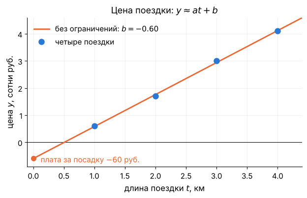
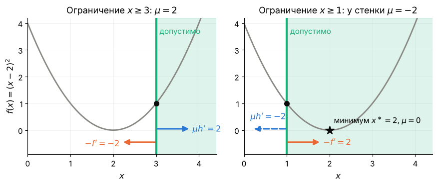
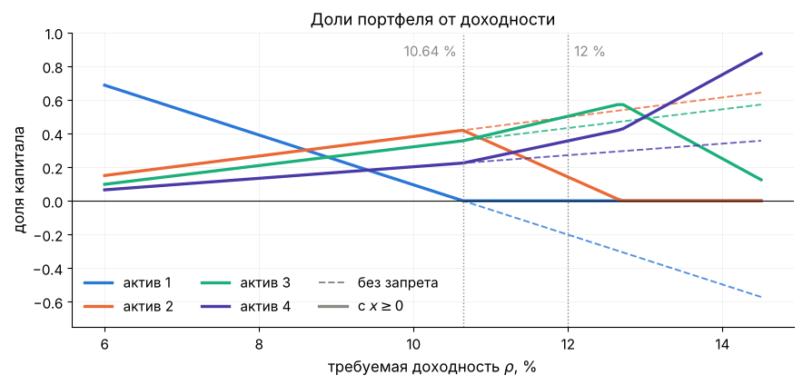

# Лекция 10. Неравенства: условия ККТ

**Курс:** Вычислительная оптимизация · **Часть IV. Неравенства** · Лекция 10 из 16 · 3 декабря 2026

**Материалы:** [конспект-ноутбук с кодом демонстраций](lecture10.ipynb) · [демо-ноутбук](demo10.ipynb) · [разбор упражнений](exercises10.ipynb)

В конспекте-ноутбуке текст идёт подряд, а три демо собраны в конце: (a) к §2, (b) к §3, (c) к §4. Семинар — у доски, задачи в §8.

---

## Введение

На практике ограничения чаще всего — неравенства: доля актива не меньше нуля, скорость не больше предельной. Сегодня — условия минимума для таких задач. Две задачи: «такси» и «портфель».

### Задача 1. Цена поездки на такси

Четыре поездки на такси длиной 1, 2, 3 и 4 км стоили 60, 170, 300 и 410 рублей. Модель цены — «посадка плюс километры»:

$$
y\approx at+b .
$$

Здесь $t$ — длина поездки в км, $y$ — цена в сотнях рублей. Число $b$ — плата за посадку, $a$ — цена километра. Оба числа не отрицательны. Подберём их методом наименьших квадратов:

$$
\min_{x\in\mathbb R^2}\ f(x)=\tfrac12\sum_{i=1}^{4}\big(at_i+b-y_i\big)^2\qquad\text{при}\qquad a\ge0,\quad b\ge0 .
$$

Здесь $x=(a,b)\in\mathbb R^2$ — вектор из двух неизвестных. Данные: $t=(1,\ 2,\ 3,\ 4)$ и $y=(0.6,\ 1.7,\ 3.0,\ 4.1)$.

**Без ограничений** производные $f$ по $a$ и по $b$ равны нулю:

$$
\begin{aligned}
\frac{\partial f}{\partial a}&=\sum_i t_i\,(at_i+b-y_i)=30a+10b-29.4=0,\\
\frac{\partial f}{\partial b}&=\sum_i (at_i+b-y_i)=10a+4b-9.4=0 .
\end{aligned}
$$

Числа — суммы по данным: $\sum t_i^2=30$, $\sum t_i=10$, $\sum t_iy_i=29.4$, $\sum y_i=9.4$.

Решение: $a=1.18$, $b=-0.60$. Посадка за $-60$ рублей — такси приплачивает пассажиру. Так не бывает.

*Прямая без ограничений. При $t=0$ она проходит через $-0.60$.*

**Вопрос.** Можно «обрезать»: положить $b=0$ и оставить $a=1.18$. Можно считать оба ограничения равенствами: $a=b=0$. Верно ли хоть одно?

### Задача 2. Портфель без коротких продаж

Инвестор делит капитал между четырьмя активами. Он хочет получать в среднем $\rho=12\,\%$ годовых и рисковать как можно меньше. Данные учебные:

| Актив | Средняя доходность $r_i$ | Волатильность $\sigma_i$ |
|---|---:|---:|
| 1 | 4 % | 5 % |
| 2 | 8 % | 12 % |
| 3 | 11 % | 18 % |
| 4 | 15 % | 30 % |

Доходность актива за год — случайная величина. Число $r_i$ — её среднее, $\sigma_i$ — насколько она колеблется вокруг среднего.

**Задача.** Неизвестные $x=(x_1,\dots,x_4)\in\mathbb R^4$ — доли капитала в активах.

$$
\min_{x\in\mathbb R^4}\ \tfrac12x^\top\Sigma x\qquad\text{при}\qquad \mathbf 1^\top x=1,\quad r^\top x=\rho,\quad x\ge0 .
$$

- $\mathbf 1^\top x=x_1+x_2+x_3+x_4=1$ — вложен весь капитал;
- $r^\top x=0.04x_1+0.08x_2+0.11x_3+0.15x_4=0.12$ — средняя доходность портфеля 12 %;
- $x\ge0$ — запрет коротких продаж (что это — ниже);
- $\tfrac12x^\top\Sigma x$ — риск: половина дисперсии доходности портфеля.

**Матрица $\Sigma$** — ковариации доходностей: $\Sigma_{ij}=\sigma_i\,\sigma_j\,c_{ij}$. Число $c_{ij}$ — корреляция активов $i$ и $j$, насколько согласованно они колеблются; $c_{ii}=1$. Поэтому на диагонали — квадраты волатильностей, $\Sigma_{11}=0.05^2$:

$$
\Sigma=\begin{pmatrix}
0.0025&0.0012&0.0009&0\\
0.0012&0.0144&0.0108&0.0108\\
0.0009&0.0108&0.0324&0.0216\\
0&0.0108&0.0216&0.09
\end{pmatrix}.
$$

**Без запрета** доля актива 1 отрицательна. Как найти эти доли — в §3.2.

*Ответ без условия $x\ge0$: $x_1=-0.20$.*

Доля $-0.20$ — короткая продажа (*short sale*). Инвестор занимает актив 1 на 20 % капитала и продаёт его. На эти деньги и свой капитал он покупает активы 2–4 — на 120 % капитала. Сумма долей та же: $-0.20+1.20=1$.

Выгода понятна: актив 1 приносит мало и почти не колеблется. Но многим инвесторам короткие продажи запрещены — отсюда $x\ge0$.

**Вопрос.** С запретом каждая доля в ответе либо положительна, либо равна нулю. Это $2^4=16$ вариантов. Какой верный?

**Зачем это вам.** IPOPT, OSQP и `scipy.optimize.minimize` с границами решают ту систему, которую мы сегодня выпишем.

**Главная тема лекции — условия ККТ:** система условий минимума для задач с неравенствами.

Три вопроса:

1. Какая система описывает ответ задачи с неравенствами?
2. Как найти, какие ограничения в ответе работают как равенства?
3. Почему метод Ньютона не решает эту систему напрямую?

План:

- §1 — равенства и одно неравенство;
- §2 — условия ККТ: задача «такси», общий вид, теорема;
- §3 — активное множество: портфель руками;
- §4 — почему Ньютону трудно;
- §5 — что это даёт численно; семинар у доски — §8.

## 1. Равенства и одно неравенство

**Главная мысль.** В минимуме с равенствами градиент $f$ — комбинация градиентов ограничений. У неравенства к этому добавляется знак множителя: $\mu\ge0$.

**Равенства.** Задача $\min f(x)$ при $g(x)=0$, где $x\in\mathbb R^n$ и $g=(g_1,\dots,g_m)$. Сдвиг $p$ вдоль ограничений — это $\nabla g_j^\top p=0$ для всех $j$. В минимуме такой малый сдвиг не меняет $f$: $\nabla f^\top p=0$. Значит, $\nabla f$ перпендикулярен всем таким $p$ и потому — комбинация векторов $\nabla g_j$:

$$
\nabla f(x)=J(x)^\top\lambda,\qquad g(x)=0 .
$$

Здесь $J$ — якобиан $g$: матрица $m\times n$ со строками $\nabla g_j^\top$. Вектор $\lambda\in\mathbb R^m$ — множители Лагранжа. Получилось $n+m$ уравнений на $n+m$ неизвестных. Назовём их **системой Лагранжа**.

**Одно неравенство.** Пример: $\min_{x\in\mathbb R}(x-2)^2$ при $x\ge3$, то есть $h(x)=x-3\ge0$. Минимум без ограничения, $x=2$, запрещён. Поэтому ответ — на границе допустимой области, «у стенки»: $x^\ast=3$. В нём

$$
f'(3)=2=\mu\,h'(3)=\mu,\qquad \mu=2 .
$$

**Знак $\mu$.** Число $-f'$ показывает, куда $f$ уменьшается. Число $h'$ показывает, где допустимая область.

- В $x=3$: $-f'=-2$, то есть $f$ уменьшается влево, за стенку. А $h'=1$: допустимо вправо.
- Множитель $\mu=2>0$: стенка толкает точку внутрь и держит её на месте.

Теперь ограничение $x\ge1$ и точка у стенки, $x=1$. Там $f'(1)=-2$, поэтому $\mu=-2<0$. Функция $f$ уменьшается вправо, внутрь допустимой области. Точку ничто не держит у стенки: она уходит внутрь, к минимуму $x=2$, где $\mu=0$. Отрицательный $\mu$ значил бы, что стенка тянет точку наружу. А стенка умеет только не пускать.

*Слева $x\ge3$: $f$ уменьшается за стенку, $\mu=2$. Справа $x\ge1$: $f$ уменьшается внутрь, у стенки $\mu=-2$; минимум — в $x=2$.*

**Правило.** У минимума на стенке $\mu\ge0$. Формулой: сдвиг внутрь на малое $d$, то есть $h'd>0$, меняет $f$ на $f'd=\mu\,h'd$. При $\mu<0$ это уменьшение, и точка у стенки — не минимум.

## 2. Условия ККТ

**Главная мысль.** В ответе одни неравенства работают как равенства, другие не работают вовсе. Условия ККТ — система Лагранжа и три добавки, у каждой своя причина:

- $h\ge0$ — точка должна быть допустимой;
- $\mu\ge0$ — стенка только толкает внутрь, иначе точка у стенки не минимум;
- $\mu h=0$ — неработающее ограничение ($h>0$) не толкает, и его $\mu=0$; работающее стоит на стенке, $h=0$.

Ниже это видно на задаче «такси».

### 2.1. Задача «такси»: четыре догадки

Ограничения $h_1=a\ge0$ и $h_2=b\ge0$, их градиенты $(1,\ 0)$ и $(0,\ 1)$. Работающее ограничение ведёт себя как равенство: его градиент входит в комбинацию для $\nabla f$ с множителем $\mu_i$. Неработающее не мешает малым сдвигам, и его $\mu_i=0$. Вместе:

$$
\nabla f=\mu_1\nabla h_1+\mu_2\nabla h_2,\qquad\text{то есть}\qquad
\begin{pmatrix}30a+10b-29.4\\ 10a+4b-9.4\end{pmatrix}=\begin{pmatrix}\mu_1\\ \mu_2\end{pmatrix}.
$$

Ограничений два — вариантов, какие из них работают, четыре:

| Работают | Точка $(a,\ b)$ | Множители | Вывод |
|---|---|---|---|
| ни одно | $(1.18,\ -0.60)$ | $\mu_1=\mu_2=0$ | $b<0$ — недопустима |
| оба | $(0,\ 0)$ | $(-29.4,\ -9.4)$ | $\mu<0$ — не минимум |
| только $a\ge0$ | $(0,\ 2.35)$ | $\mu_1=-5.9$ | $\mu<0$ — не минимум |
| только $b\ge0$ | $(0.98,\ 0)$ | $\mu_2=0.4$ | **ответ** |

Как считается строка: в последней $b=0$ и $\mu_1=0$. Первое уравнение даёт $30a=29.4$, $a=0.98$. Второе даёт $\mu_2=10\cdot0.98-9.4=0.4\ge0$.

**Ответ:** 98 рублей за километр, посадка бесплатна. Оба ограничения как равенства дали бы другое — бесплатное такси $(0,\ 0)$.

*Линии уровня $f$ — эллипсы. Ответ $(0.98,\ 0)$ — там, где эллипс касается оси $b=0$. «Обрезка» $(1.18,\ 0)$ правее, на большем эллипсе.*

**Почему «обрезка» — не ответ.** В точке $(1.18,\ 0)$ ограничение $a\ge0$ не работает, значит, $\mu_1=0$. Но первая компонента $\nabla f$ там равна $6$, а не нулю. Сумма квадратов у «обрезки» $0.724$, у ответа $0.124$.

**Что общего.** В ответе у каждого ограничения из пары $(h_i,\ \mu_i)$ одно число равно нулю: $(0.98,\ 0)$ и $(0,\ 0.4)$. Значит, $\mu_ih_i=0$. Это условие называют дополняющей нежёсткостью (*complementarity*).

Все условия задачи «такси» вместе:

$$
\begin{aligned}
30a+10b-29.4=\mu_1,\quad 10a+4b-9.4&=\mu_2 &&\text{стационарность},\\
a\ge0,\quad b&\ge0 &&\text{допустимость},\\
\mu_1\ge0,\quad \mu_2&\ge0 &&\text{знак множителей},\\
\mu_1a=0,\quad \mu_2b&=0 &&\text{дополняющая нежёсткость}.
\end{aligned}
$$

### 2.2. Общий вид

Задача с равенствами и неравенствами:

$$
\min_{x\in\mathbb R^n}\ f(x)\qquad\text{при}\qquad g(x)=0,\quad h(x)\ge0 .
$$

*Размеры:* $g$ — $m$ равенств, $h=(h_1,\dots,h_p)$ — $p$ неравенств; множители $\lambda\in\mathbb R^m$ и $\mu\in\mathbb R^p$.

**Условия ККТ** (Каруша–Куна–Таккера, *KKT conditions*):

$$
\begin{aligned}
\nabla f(x)-J_g(x)^\top\lambda-J_h(x)^\top\mu&=0 &&\text{стационарность},\\
g(x)=0,\quad h(x)&\ge0 &&\text{допустимость},\\
\mu&\ge0 &&\text{знак множителей},\\
\mu_i\,h_i(x)&=0,\quad i=1,\dots,p &&\text{дополняющая нежёсткость}.
\end{aligned}
$$

*Размеры:* $J_g$ — матрица $m\times n$, $J_h$ — матрица $p\times n$. Уравнений $n+m+p$, неизвестных столько же: $x$, $\lambda$, $\mu$.

**Активное множество** (*active set*) — номера неравенств, выполненных как равенства:

$$
\mathcal A(x)=\{\,i:\ h_i(x)=0\,\}.
$$

В ответе задачи «такси» $\mathcal A=\{2\}$. Если $\mathcal A$ известно, неравенства из него становятся равенствами, остальные выбрасываются. Остаётся система Лагранжа.

### 2.3. Теорема ККТ

**Зачем теорема.** Солверы ищут точку, где выполнены условия ККТ. Теорема говорит, когда в минимуме такие множители есть.

**Условие LICQ** (*linear independence constraint qualification*): градиенты всех $g_j$ и всех активных $h_i$ линейно независимы. В ответе задачи «такси» активный градиент один, $(0,\ 1)$. Один вектор линейно независим, если он ненулевой, — LICQ выполнено.

**Теорема (условия ККТ).** Пусть $x^\ast$ — локальный минимум, $f$, $g$, $h$ гладкие и в $x^\ast$ выполнено LICQ. Тогда найдутся $\lambda^\ast\in\mathbb R^m$ и $\mu^\ast\in\mathbb R^p$, с которыми в $x^\ast$ выполнены условия ККТ.

**Доказательство.**

**Шаг 1. Множители есть.** Если $h_i(x^\ast)>0$, то $h_i>0$ и рядом с $x^\ast$: на малые сдвиги ограничение не влияет. Положим у него $\mu_i=0$. Активные ограничения сделаем равенствами. Точка $x^\ast$ — минимум и этой задачи с равенствами. Значит, $\nabla f$ — комбинация градиентов её ограничений:

$$
\nabla f(x^\ast)=J_g(x^\ast)^\top\lambda+\sum_{i\in\mathcal A}\mu_i\nabla h_i(x^\ast).
$$

Условие $\mu_ih_i=0$ выполнено: у активных $h_i=0$, у остальных $\mu_i=0$.

**Шаг 2. Знак.** Пусть у работающего ограничения $h_k$ получилось $\mu_k<0$. Покажем, что от стенки $k$ тогда выгодно отойти.

*Направление.* Возьмём вектор $d\in\mathbb R^n$ с условиями

$$
\nabla h_k^\top d=1,\qquad \nabla h_i^\top d=0\ \ (i\in\mathcal A,\ i\ne k),\qquad \nabla g_j^\top d=0 .
$$

Вдоль $d$ функция $h_k$ растёт — уходим от стенки $k$ внутрь. Остальные работающие ограничения и равенства не меняются. Неработающие ($h_i>0$) малый сдвиг не нарушит. Строки этой системы — градиенты работающих ограничений. По LICQ они линейно независимы, поэтому $d$ существует.

*Как меняется $f$.* Умножим равенство шага 1 скалярно на $d$. По выбору $d$ остаётся одно слагаемое:

$$
\nabla f^\top d=\sum_j\lambda_j\,\nabla g_j^\top d+\sum_{i\in\mathcal A}\mu_i\,\nabla h_i^\top d=\mu_k<0 .
$$

Поэтому $f(x^\ast+td)\approx f(x^\ast)+t\mu_k<f(x^\ast)$ при малом $t>0$ — противоречие с минимумом. Значит, $\mu_k\ge0$. Если ограничения кривые, сдвигаются по кривой на них с касательной $d$, вывод тот же.

*В задаче «такси»:* догадка «только $a\ge0$», точка $(0,\ 2.35)$, $\mu_1=-5.9$. Здесь $d=(1,\ 0)$, $\nabla f=(-5.9,\ 0)$ и $\nabla f^\top d=-5.9$. Рост $a$ уменьшает сумму квадратов.

**Что из неё следует.**

- При LICQ каждый локальный минимум — точка ККТ. Поэтому солверы решают систему ККТ.
- Условие только необходимое. В выпуклой задаче точка ККТ — глобальный минимум. Выпуклость: $f$ выпукла, $g$ линейны, $h_i$ вогнуты. «Такси» и портфель выпуклые.
- Без LICQ множителей в минимуме может не быть — упражнение 10.4.

## 3. Активное множество

**Главная мысль.** Угадали активное множество — условия ККТ стали системой Лагранжа. Догадку проверяют двумя знаками: $h_i\ge0$ у неактивных и $\mu_i\ge0$ у активных.

### 3.1. Схема «угадай и проверь»

1. Выбрать $\mathcal A$ — неравенства, которые считаем равенствами.
2. Решить систему Лагранжа с равенствами $g=0$ и $h_i=0$, $i\in\mathcal A$. У остальных $\mu_i=0$.
3. Если $h_i<0$ при каком-то $i\notin\mathcal A$, добавить $i$ в $\mathcal A$ и вернуться к шагу 2.
4. Если $\mu_i<0$ при каком-то $i\in\mathcal A$, убрать $i$ из $\mathcal A$ и вернуться к шагу 2.
5. Обе проверки прошли — найдена точка ККТ. В выпуклой задаче это глобальный минимум.

Это учебная схема: гарантии, что догадки не пойдут по кругу, у неё нет.

### 3.2. Портфель руками

Неравенства $h_i=x_i\ge0$. Их градиенты — базисные векторы $e_i$: единица на месте $i$, остальные нули.

**Догадка 1: $\mathcal A=\varnothing$.** Остаются два равенства. Стационарность: $\Sigma x=\lambda_1\mathbf 1+\lambda_\rho r$ — градиент риска есть комбинация градиентов равенств. Вместе с равенствами это линейная система $6\times6$:

$$
\begin{pmatrix}\Sigma&-\mathbf 1&-r\\ \mathbf 1^\top&0&0\\ r^\top&0&0\end{pmatrix}
\begin{pmatrix}x\\ \lambda_1\\ \lambda_\rho\end{pmatrix}
=\begin{pmatrix}0\\ 1\\ 0.12\end{pmatrix}.
$$

Решение $x=(-0.2015,\ 0.4981,\ 0.4324,\ 0.2710)$ — ответ без запрета. Доля $x_1<0$, поэтому берём $\mathcal A=\{1\}$.

**Догадка 2: $\mathcal A=\{1\}$.** Добавляются уравнение $x_1=0$ и неизвестное $\mu_1$. Система $7\times7$:

$$
\begin{pmatrix}\Sigma&-\mathbf 1&-r&-e_1\\ \mathbf 1^\top&0&0&0\\ r^\top&0&0&0\\ e_1^\top&0&0&0\end{pmatrix}
\begin{pmatrix}x\\ \lambda_1\\ \lambda_\rho\\ \mu_1\end{pmatrix}
=\begin{pmatrix}0\\ 1\\ 0.12\\ 0\end{pmatrix}.
$$

Решение $x=(0,\ 0.1414,\ 0.5026,\ 0.3560)$ и $\mu_1=0.0082$. Доли не отрицательны, $\mu_1\ge0$ — это ответ. Хватило двух догадок из 16.

*Доли от требуемой доходности. Пунктир — без запрета: $x_1<0$ при $\rho>10.64\,\%$. Сплошные линии — с $x\ge0$: $x_1=0$, а при $\rho>12.69\,\%$ и $x_2=0$.*

**Цена запрета.** Среднеквадратичное отклонение доходности портфеля растёт с $16.9\,\%$ до $17.4\,\%$. Множитель $\lambda_\rho$ — производная минимального риска по требуемой доходности $\rho$. Без запрета $\lambda_\rho=0.351$, с запретом $0.473$: каждый процент доходности стоит больше риска.

**Вопрос залу.** При какой доходности активное множество станет $\{1,\ 2\}$?

Ответ

При $\rho>12.69\,\%$: на картинке там обнуляется доля актива 2. Проверка схемой — упражнение 10.3.

Перебрать 16 вариантов можно, а у 1000 активов их $2^{1000}$. Метод активного множества проходит лишь несколько догадок — это лекция 11.

## 4. Почему Ньютону трудно

**Главная мысль.** Метод Ньютона решает уравнения, а в условиях ККТ есть неравенства и «уголок» $\mu h=0$. Выходов два: угадать активное множество или сгладить уголок.

Метод Ньютона решает систему $F(z)=0$: на каждом шаге заменяет уравнения их линейной частью. Неравенств $\mu\ge0$ и $h\ge0$ он не знает. Его шаг может увести в $\mu<0$ или $h<0$.

Допустимые пары $(h,\ \mu)$ одного ограничения — две полуоси: $\mu=0$ при $h\ge0$ и $h=0$ при $\mu\ge0$. Это уголок с вершиной $(0,\ 0)$. Производные $\mu h$ по $h$ и по $\mu$ — это $(\mu,\ h)$. В вершине обе равны нулю, и матрица шага Ньютона вырождена.

 0 и точки при tau = 1, 0.1, 0.01, приближающиеся к ответу">

*Слева: уголок и гиперболы $\mu h=\tau$; два ограничения «такси» в ответе лежат на разных сторонах уголка. Справа: точки «такси» при $\mu_ih_i=\tau$ приближаются к ответу при уменьшении $\tau$.*

**Выход 1: угадать сторону.** На стороне $\mu_i=0$ ограничение выбрасываем, на стороне $h_i=0$ оно становится равенством. Это и есть выбор активного множества. Дальше — система Лагранжа и метод Ньютона. Так устроен метод активного множества — лекция 11.

**Выход 2: сгладить уголок.** Заменим $\mu h=0$ на $\mu h=\tau$ с малым $\tau>0$ и возьмём ветвь $h>0$, $\mu>0$. Вершины на ней нет, и метод Ньютона работает. Шаг укорачивают, чтобы точка не ушла из положительной четверти. Потом $\tau$ уменьшают. В задаче «такси» при $\tau=0.1$ точка $(0.924,\ 0.180)$ отстоит от ответа на $0.19$, при $\tau=0.01$ — на $0.025$. Так работают метод внутренней точки и IPOPT — лекция 12.

## 5. Что это даёт численно

**Главная мысль.** Солверы возвращают множители неравенств, но знак у каждого свой. Сверяйте его по задаче с известным ответом.

- **IPOPT через CasADi.** Границы $x\ge0$ — аргументы `lbx` и `ubx`, их множители — поле `lam_x`. Портфель при $\rho=12\,\%$: 9 итераций, `lam_x` $=(-0.0082,\ 0,\ 0,\ 0)$, `lam_g` $=(0.0265,\ -0.4731)$. В `lam_g` — наши $\lambda$ со знаком минус. `lam_x` у активной нижней границы отрицателен, его модуль — наш $\mu$ (демо (b), упражнение 10.2).
- **SciPy.** `minimize(method="SLSQP")` с аргументом `bounds` решает подзадачи методом активного множества. `linprog` возвращает множители неравенств в `res.ineqlin.marginals`.

**ДЗ 5** (Ньютон–Лагранж и обобщённый Гаусс–Ньютон) сдаётся 05.12.

## 6. Итоги лекции

1. Условия ККТ — стационарность, допустимость, $\mu\ge0$ и $\mu_ih_i=0$: из пары $\mu_i$, $h_i$ одно число равно нулю (§2).
2. При LICQ каждый локальный минимум — точка ККТ. В выпуклой задаче точка ККТ — глобальный минимум (§2.3).
3. Зная активное множество, решаем систему Лагранжа. Догадку проверяют знаками $h_i\ge0$ и $\mu_i\ge0$ (§3).
4. Метод Ньютона не знает неравенств, а в вершине уголка $\mu h=0$ его матрица вырождена. Выходы — активное множество (лекция 11) и ветвь $\mu h=\tau$ (лекция 12) (§4).

**Ответы на задачи введения.**

- **Задача 1.** $a=0.98$, $b=0$: 98 рублей за километр, посадка бесплатна. Работает только $b\ge0$, $\mu_2=0.4$. «Обрезка» $(1.18,\ 0)$ — не ответ: сумма квадратов $0.724$ против $0.124$.
- **Задача 2.** При $\rho=12\,\%$ активна одна граница, $x_1=0$. Доли $(0,\ 0.141,\ 0.503,\ 0.356)$, $\mu_1=0.0082$. Хватило двух догадок.

## 7. Что дальше

**Лекция 11** — линейное и квадратичное программирование: метод активного множества. **Лекция 12** — методы внутренней точки: гипербола $\mu h=\tau$ вместо уголка.

**ДЗ 5** — срок 05.12.

**Литература к лекции.**

- Diehl, *Lecture Notes on Numerical Optimization*, часть IV — условия оптимальности для задач с неравенствами.
- Nocedal & Wright: §12.1–12.3 — примеры, условия регулярности и теорема 12.1 (условия ККТ); §16.5 — метод активного множества для выпуклой квадратичной задачи, к лекции 11.
- Boyd & Vandenberghe: §5.5.3 — условия ККТ и их достаточность для выпуклых задач.

## 8. Семинар у доски

Около 30 минут, три задачи руками. Ответы спрятаны — сначала решите сами.

| Мин | Задача |
|---|---|
| 8 | **С1. Одна стенка, два случая** |
| 10 | **С2. Проекция на четверть плоскости** |
| 12 | **С3. Треугольник: неверная догадка** |

**С1.** Выпишите условия ККТ и решите задачу $\min_{x\in\mathbb R}\ (x+1)^2$ (а) при $x\ge0$; (б) при $x\ge-2$.

Ответ

Стационарность: $2(x+1)=\mu$, ограничение $h=x-c\ge0$.

- (а) Безусловный минимум $x=-1$ нарушает $x\ge0$. Ограничение активно: $x^\ast=0$, $\mu=2(0+1)=2\ge0$.
- (б) Безусловный минимум $x=-1$ допустим: $h=-1+2=1>0$. Ограничение неактивно, $\mu=0$.

**С2.** Найдите ближайшую к точке $a=(-1,\ 2)$ точку четверти плоскости:

$$
\min_{x\in\mathbb R^2}\ \tfrac12\lVert x-a\rVert^2\qquad\text{при}\qquad x_1\ge0,\quad x_2\ge0 .
$$

Ответ

Стационарность: $x-a=\mu_1e_1+\mu_2e_2$, то есть $x_1+1=\mu_1$ и $x_2-2=\mu_2$. Догадка $\mathcal A=\{1\}$: $x_1=0$, $\mu_2=0$. Тогда $x_2=2$ и $\mu_1=1\ge0$. Проверка: $x_2=2\ge0$. Ответ $x^\ast=(0,\ 2)$, $\mu=(1,\ 0)$.

**С3.** Ближайшая к точке $a=(0.2,\ -1)$ точка треугольника:

$$
\min_{x\in\mathbb R^2}\ \tfrac12\lVert x-a\rVert^2\qquad\text{при}\qquad x_1\ge0,\quad x_2\ge0,\quad 1-x_1-x_2\ge0 .
$$

Начните с догадки «вершина $(1,\ 0)$»: активны $x_2\ge0$ и $1-x_1-x_2\ge0$.

Ответ

В вершине $(1,\ 0)$: $x-a=(0.8,\ 1)=\mu_2(0,\ 1)+\mu_3(-1,\ -1)$. Первая компонента даёт $\mu_3=-0.8<0$ — третье ограничение из догадки убираем. Догадка $\mathcal A=\{2\}$: $x_2=0$, $x_1=a_1=0.2$, $\mu_2=x_2-a_2=1\ge0$. Проверка: $x_1=0.2\ge0$ и $1-0.2-0=0.8\ge0$. Ответ $x^\ast=(0.2,\ 0)$.

Дома: упражнения 10.0–10.4, затем демо (a)–(c) в конце конспекта-ноутбука.

## 9. Упражнения

Разбор с проверкой кодом — [`exercises10.ipynb`](exercises10.ipynb), краткие ответы — [`exercises10.md`](exercises10.md). Все упражнения — домашние.

**10.0. Разминка — счёт руками.** *Суть: одно ограничение в двух случаях — активно и неактивно.*

Задача: $\min_{x\in\mathbb R^2}\ x_1^2+x_2^2$ при $x_1+x_2-c\ge0$.

- (а) Выпишите условия ККТ.
- (б) Решите при $c=2$ и при $c=-2$. Активно ли ограничение и чему равен $\mu$?

**10.1. Ближайшая точка круга.** *Суть: при одном ограничении ответ — либо без ограничения, либо с равенством; на границе может быть и $\mu=0$.*

Задача: найти ближайшую к точке $a$ точку круга радиуса 1,

$$
\min_{x\in\mathbb R^2}\ \tfrac12\lVert x-a\rVert^2\qquad\text{при}\qquad h(x)=1-x_1^2-x_2^2\ge0 .
$$

- (а) Найдите $x^\ast$ и $\mu$ для $a=(0.5,\ 0.3)$ и для $a=(2,\ 1)$. Работает ли ограничение?
- (б) Точка на границе, $a=(0.6,\ 0.8)$. Чему равны $\mu$ и $h$ в ответе? Почему $\mu h=0$ выполнено и здесь?

**10.2. Квадрат: два активных ограничения** (с кодом). *Суть: в углу у ответа два множителя, и оба неотрицательны.*

Задача: $\min_{x\in\mathbb R^2}\ \tfrac12\lVert x-a\rVert^2$ при $0\le x_1\le1$ и $0\le x_2\le1$ — четыре неравенства.

- (а) Для $a=(2,\ 2)$ и $a=(2,\ 0.5)$ найдите руками ответ, активное множество и множители.
- (б) Проверьте IPOPT: границы в `lbx` и `ubx`, множители в `lam_x`. Какой у них знак при активной верхней границе?

**10.3. Портфель при других доходностях** (с кодом). *Суть: активное множество меняется с требуемой доходностью.*

Задача портфеля из введения при $\rho=8\,\%$ и $\rho=14\,\%$. Функция `portfolio_active(rho, A)` из `l10helpers.py` решает систему для заданного активного множества `A`.

- (а) Найдите активное множество по схеме «угадай и проверь», начав с $\mathcal A=\varnothing$. Сколько догадок понадобилось?
- (б) Сравните цену доходности $\lambda_\rho$ с запретом коротких продаж и без него.

**10.4. Для желающих: когда множителей нет.** *Суть: без LICQ в минимуме условия ККТ могут не выполняться.*

Задача:

$$
\min_{x\in\mathbb R^2}\ -x_1\qquad\text{при}\qquad h_1(x)=(1-x_1)^3-x_2\ge0,\quad h_2(x)=x_2\ge0 .
$$

- (а) Докажите, что решение — точка $(1,\ 0)$.
- (б) Покажите, что в ней нет $\mu_1$, $\mu_2$ с $\nabla f=\mu_1\nabla h_1+\mu_2\nabla h_2$. Какое условие теоремы ККТ нарушено?

## Вопросы для самопроверки

1. Что значит условие $\mu_ih_i=0$ и как оно выполнено для двух ограничений задачи «такси»?
2. Почему у множителя неравенства в минимуме не бывает отрицательного знака?
3. Что такое активное множество и как по нему получить задачу только с равенствами?
4. Какие две проверки делает схема «угадай и проверь» и что делать, если не прошла каждая из них?
5. Почему метод Ньютона не решает условия ККТ напрямую?
6. Что меняется, если заменить $\mu h=0$ на $\mu h=\tau$, и что происходит при уменьшении $\tau$?
7. Какой знак у `lam_x` в IPOPT при активной нижней границе?
