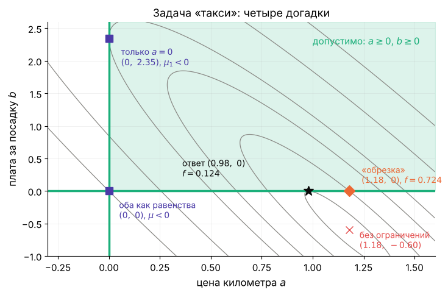
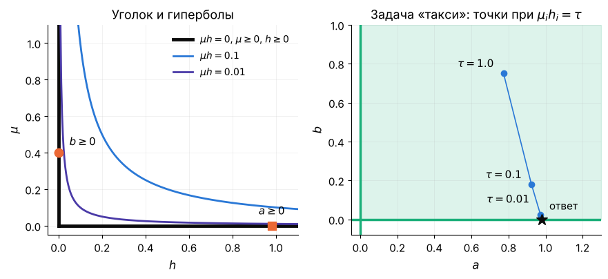

# Лекция 10. Неравенства: условия ККТ

**Курс:** Вычислительная оптимизация · **Часть IV. Неравенства** · Лекция 10 из 16 · 3 декабря 2026

**Материалы:** [конспект-ноутбук с кодом демонстраций](lecture10.ipynb) · [демо-ноутбук](demo10.ipynb) · [разбор упражнений](exercises10.ipynb)

В конспекте-ноутбуке текст идёт подряд, а три демо собраны в конце: (a) к §2, (b) к §3, (c) к §4. Семинар — у доски, задачи в §8.

---

## Введение

В лекциях 8–9 ограничения были равенствами. На практике чаще встречаются неравенства: доля актива не меньше нуля, груз не ниже пола, скорость не больше предельной. Сегодня — система условий для таких задач и главная трудность её решения. Две задачи: «такси» и «портфель».

### Задача 1. Цена поездки на такси

Четыре поездки на такси длиной 1, 2, 3 и 4 км стоили 60, 170, 300 и 410 рублей. Цену описывают моделью «посадка плюс километры»:

$$
y\approx at+b .
$$

Здесь $t$ — длина поездки в километрах, $y$ — цена в сотнях рублей. Число $b$ — плата за посадку, $a$ — цена километра. По смыслу оба числа не отрицательны. Подберём их методом наименьших квадратов:

$$
\min_{x\in\mathbb R^2}\ f(x)=\tfrac12\sum_{i=1}^{4}\big(at_i+b-y_i\big)^2\qquad\text{при}\qquad a\ge0,\quad b\ge0 .
$$

Здесь $x=(a,b)\in\mathbb R^2$ — вектор из двух неизвестных. Функция $f$ — половина суммы квадратов отклонений модели от данных. Данные: $t=(1,\ 2,\ 3,\ 4)$ и $y=(0.6,\ 1.7,\ 3.0,\ 4.1)$.

**Без ограничений** это метод наименьших квадратов из лекции 1: производные $f$ по $a$ и по $b$ равны нулю. Покомпонентно:

$$
\begin{aligned}
\frac{\partial f}{\partial a}&=\sum_i t_i\,(at_i+b-y_i)=30a+10b-29.4=0,\\
\frac{\partial f}{\partial b}&=\sum_i (at_i+b-y_i)=10a+4b-9.4=0 .
\end{aligned}
$$

Числа — суммы по данным: $\sum t_i^2=30$, $\sum t_i=10$, $\sum t_iy_i=29.4$, $\sum y_i=9.4$, слагаемых четыре.

**2 уравнения на 2 неизвестных: $a$ и $b$.**

Решение: $a=1.18$ и $b=-0.60$. Плата за посадку $-60$ рублей — такси приплачивает пассажиру. Так не бывает.

*Четыре поездки и прямая без ограничений. При $t=0$ она проходит через $-0.60$: плата за посадку отрицательна.*

**Что делать.** Можно «обрезать»: положить $b=0$ и оставить $a=1.18$. Можно считать оба ограничения равенствами: $a=b=0$. Верно ли хоть одно из этого? Ответ дадут условия, которые учитывают неравенства.

### Задача 2. Портфель без коротких продаж

Инвестор вкладывает капитал в четыре актива — например, в четыре фонда. Он хочет получать в среднем $\rho=12\,\%$ годовых и рисковать как можно меньше.

**Данные.** Это учебные данные лекции 3, не рыночные.

| Актив | Средняя доходность $r_i$ | Волатильность $\sigma_i$ |
|---|---:|---:|
| 1 | 4 % | 5 % |
| 2 | 8 % | 12 % |
| 3 | 11 % | 18 % |
| 4 | 15 % | 30 % |

Доходность актива за год заранее неизвестна — это случайная величина. Число $r_i$ — её среднее. Волатильность $\sigma_i$ — её среднеквадратичное отклонение: насколько доходность колеблется вокруг среднего. Чем выше средняя доходность актива, тем сильнее он колеблется.

**Переменные.** $x=(x_1,\dots,x_4)\in\mathbb R^4$ — доли капитала в четырёх активах. Например, $x=(0.25,\ 0.25,\ 0.25,\ 0.25)$ — капитал разделён поровну.

**Задача:**

$$
\min_{x\in\mathbb R^4}\ \tfrac12x^\top\Sigma x\qquad\text{при}\qquad \mathbf 1^\top x=1,\quad r^\top x=\rho,\quad x\ge0 .
$$

Что значит каждая часть:

- $\mathbf 1^\top x=x_1+x_2+x_3+x_4=1$ — весь капитал вложен;
- $r^\top x=0.04x_1+0.08x_2+0.11x_3+0.15x_4=0.12$ — средняя доходность портфеля равна 12 %; это среднее доходностей активов с весами $x_i$;
- $x\ge0$, то есть $x_i\ge0$ для каждого актива, — запрет коротких продаж (что это — ниже);
- $\tfrac12x^\top\Sigma x$ — риск портфеля.

**Риск и матрица $\Sigma$.** Доходность портфеля — это сумма $x_1R_1+x_2R_2+x_3R_3+x_4R_4$, где $R_i$ — доходность актива $i$. Её дисперсия равна $x^\top\Sigma x$. Здесь $\Sigma$ — ковариационная матрица доходностей размера $4\times4$:

$$
\Sigma_{ij}=\sigma_i\,\sigma_j\,c_{ij} .
$$

Число $c_{ij}$ — корреляция доходностей активов $i$ и $j$ из лекции 3: от $0$ у пары 1–4 до $0.5$ у пары 2–3. На диагонали $c_{ii}=1$, и там стоят квадраты волатильностей: $\Sigma_{11}=0.05^2=0.0025$. Вне диагонали, например, $\Sigma_{34}=0.18\cdot0.30\cdot0.4=0.0216$. Целиком:

$$
\Sigma=\begin{pmatrix}
0.0025&0.0012&0.0009&0\\
0.0012&0.0144&0.0108&0.0108\\
0.0009&0.0108&0.0324&0.0216\\
0&0.0108&0.0216&0.09
\end{pmatrix}.
$$

Множитель $\tfrac12$ стоит для удобства: градиент риска тогда равен $\Sigma x$.

**Что значит отрицательная доля.** Без условия $x\ge0$ это задача семинара лекции 8. Её ответ:

*Ответ лекции 8, без неравенств $x\ge0$: доля актива 1 равна $-0.20$.*

Доля $x_1=-0.20$ — это короткая продажа (*short sale*):

1. взять у брокера в долг актив 1 на 20 % капитала и сразу его продать;
2. на вырученные деньги вместе со своим капиталом купить активы 2–4 — на $0.50+0.43+0.27=1.20$ капитала.

Сумма долей по-прежнему $-0.20+1.20=1$. Средняя доходность $-0.2\cdot4+0.5\cdot8+0.43\cdot11+0.27\cdot15\approx12\,\%$.

Почему так выгодно: актив 1 приносит всего 4 %, меньше цели. Колеблется он мало, поэтому его заём почти не добавляет риска. А вырученные деньги идут в доходные активы. Но для короткой продажи нужен заём, и многим инвесторам она недоступна или запрещена. Отсюда условие $x\ge0$.

**Система.** Без неравенств это система лекции 8: градиент риска $\Sigma x$ — комбинация градиентов двух равенств.

$$
\begin{aligned}
\Sigma x-\lambda_1\mathbf 1-\lambda_\rho r&=0 &&\text{(4 уравнения)},\\
\mathbf 1^\top x&=1,\\
r^\top x&=\rho .
\end{aligned}
$$

**6 уравнений на 6 неизвестных: $x_1,\dots,x_4$, $\lambda_1$ и $\lambda_\rho$.**

Её решение нарушает $x_1\ge0$. В ответе с запретом каждая доля либо положительна, либо равна нулю. Получается $2^4=16$ вариантов, и у каждого своя система. Какой вариант верный?

**Зачем это вам.** IPOPT, OSQP и `scipy.optimize.minimize` с границами решают ту систему, которую мы сегодня выпишем. Понимать её — значит понимать, какие числа возвращает солвер и что они значат.

**Главная тема лекции — условия ККТ:** одна система для задач с неравенствами.

Три вопроса:

1. Какая система описывает ответ задачи с неравенствами — например, задачи «такси»?
2. Как найти, какие ограничения работают как равенства, — в портфеле из 16 вариантов?
3. Почему метод Ньютона–Лагранжа из лекции 9 не решает эту систему напрямую?

План:

- §1 — что уже знаем: условие лекции 8 и «стенка» лекции 3;
- §2 — условия ККТ: задача «такси», общий вид, теорема;
- §3 — активное множество: портфель руками;
- §4 — почему Ньютону трудно и что делают солверы;
- §5 — что это даёт численно; семинар у доски — §8.

## 1. Что уже знаем

**Главная мысль.** Для равенств есть система лекции 8. Для одного неравенства, на границе которого стоит решение, есть условие лекции 3 со знаком множителя.

**Равенства (лекция 8).** Задача $\min f(x)$ при $g(x)=0$, где $x\in\mathbb R^n$ и $g$ — это $m$ функций. Условие решения:

$$
\nabla f(x)=J(x)^\top\lambda,\qquad g(x)=0 .
$$

Здесь $J$ — якобиан $g$, матрица $m\times n$, а $\lambda\in\mathbb R^m$ — множители. Всего $n+m$ уравнений на $n+m$ неизвестных. Функция Лагранжа $L=f-\lambda^\top g$.

**Одна стенка (лекция 3).** Вспомним завод с контрактом. Себестоимость выпуска $x$ единиц — $f(x)=(x-2)^2$: дешевле всего делать две единицы. Контракт требует делать не меньше трёх: $h(x)=x-3\ge0$. Безусловный минимум $x=2$ нарушает контракт, поэтому решение у стенки: $x^\ast=3$. В нём

$$
f'(3)=2=\mu\,h'(3)=\mu\cdot1,\qquad\text{то есть}\qquad \mu=2 .
$$

**Почему важен знак: $\mu\ge0$.** Прочитаем равенство $f'=\mu h'$ как баланс двух сил.

- Число $-f'(x)$ показывает, в какую сторону $f$ уменьшается, — куда «тянет» точку. В $x=3$ оно равно $-2$: себестоимость уменьшается влево, за стенку, к $x=2$.
- Число $h'(x)$ показывает, в какую сторону $h$ растёт, — внутрь допустимой области. Здесь $h'=1$: внутрь — это вправо.
- Равенство $f'(3)=\mu h'(3)$ с $\mu=2>0$ значит: тяга $-f'$ смотрит наружу, а стенка отвечает силой $\mu h'$ внутрь. Силы уравновешены, и точка стоит у стенки.

Теперь контракт мягче: не меньше одной единицы, $h(x)=x-1\ge0$. Встанем у стенки, в $x=1$. Там $f'(1)=-2$, и из $f'=\mu h'$ получаем $\mu=-2<0$. Это значит, что себестоимость уменьшается вправо, внутрь допустимой области. Сдвиг внутрь выгоден, и контракт его разрешает. Чтобы удержать точку у стенки, стенке пришлось бы тянуть её наружу — а стенка только не пускает за себя. Значит, $x=1$ — не минимум. Минимум — внутри, в $x^\ast=2$, где ограничение не работает и $\mu=0$.

*Слева контракт $x\ge3$: тяга $-f'$ смотрит за стенку, стенка отвечает внутрь, $\mu=2$. Справа контракт $x\ge1$ и точка у стенки: тяга смотрит внутрь, и $\mu=-2$ — стенке пришлось бы тянуть наружу. Минимум здесь — внутри, в $x=2$.*

То же формулой. Сдвиг на малое $d$ внутрь, то есть с $h'd>0$, меняет $f$ примерно на $f'd=\mu\,h'd$. При $\mu\ge0$ это изменение не отрицательно — сдвиг внутрь не помогает. При $\mu<0$ оно отрицательно — $f$ уменьшается, и точка у стенки не минимум. Поэтому у минимума на стенке $\mu\ge0$.

| Случай | Что знаем | Чего не знаем |
|---|---|---|
| Равенства | систему лекции 8 и метод Ньютона–Лагранжа | — |
| Одно неравенство | $\nabla f=\mu\nabla h$ и $\mu\ge0$ у стенки | как узнать, что решение у стенки |
| Много неравенств | — | какие из них работают |

## 2. Условия ККТ

**Главная мысль.** В ответе одни ограничения работают как равенства, другие не работают вовсе. Условия ККТ описывают это одной системой: к условию лекции 8 добавляются $h\ge0$, $\mu\ge0$ и $\mu h=0$.

### 2.1. Задача «такси»: четыре догадки

Задача:

$$
\min_{x\in\mathbb R^2}\ \tfrac12\sum_{i=1}^{4}\big(at_i+b-y_i\big)^2\qquad\text{при}\qquad h_1(x)=a\ge0,\quad h_2(x)=b\ge0 .
$$

Градиенты ограничений: $\nabla h_1=(1,\ 0)$ и $\nabla h_2=(0,\ 1)$. Градиент $f$ — из введения:

$$
\nabla f(x)=\begin{pmatrix}30a+10b-29.4\\ 10a+4b-9.4\end{pmatrix}.
$$

В ответе каждое ограничение либо работает — выполнено как равенство, — либо нет. Для работающих годится условие стенки: $\nabla f$ равен сумме $\mu_i\nabla h_i$. У неработающих $\mu_i=0$. Здесь $\mu_1\nabla h_1+\mu_2\nabla h_2=(\mu_1,\ \mu_2)$, поэтому условие простое:

$$
\nabla f(x)=(\mu_1,\ \mu_2).
$$

Ограничений два — вариантов четыре. Проверим каждый.

**Догадка 1: не работает ни одно.** Тогда $\mu_1=\mu_2=0$ и $\nabla f=0$ — это система введения. Её решение $(1.18,\ -0.60)$ нарушает $b\ge0$.

**Догадка 2: работают оба** — оба ограничения как равенства. Тогда $a=b=0$, и множители равны градиенту в точке $(0,0)$:

$$
(\mu_1,\ \mu_2)=\nabla f(0,0)=(-29.4,\ -9.4).
$$

Оба отрицательны — как у завода с контрактом $x\ge1$: стенкам пришлось бы тянуть наружу. Увеличение $a$ или $b$ уменьшает $f$, так что это не минимум.

**Догадка 3: работает только $a\ge0$.** Тогда $a=0$ и $\mu_2=0$. Вторая строка: $4b-9.4=0$, $b=2.35$. Первая строка даёт множитель:

$$
\mu_1=10\cdot2.35-29.4=-5.9<0 .
$$

Не минимум: увеличение $a$ от нуля уменьшает $f$.

**Догадка 4: работает только $b\ge0$.** Тогда $b=0$ и $\mu_1=0$. Первая строка: $30a-29.4=0$, $a=0.98$. Вторая строка даёт множитель:

$$
\mu_2=10\cdot0.98-9.4=0.4\ge0 .
$$

Обе проверки проходят: $a=0.98\ge0$ и $\mu_2\ge0$. Это ответ: 98 рублей за километр, посадка бесплатна.

*Линии уровня $f$ — наклонные эллипсы. Ответ $(0.98,\ 0)$ — точка, где эллипс касается оси $b=0$. «Обрезка» $(1.18,\ 0)$ лежит на той же оси правее: её эллипс больше.*

**Почему «обрезать» нельзя.** В точке $(1.18,\ 0)$ градиент $\nabla f=(6,\ 2.4)$. Ограничение $a\ge0$ там не работает, $a=1.18>0$, поэтому должно быть $\mu_1=0$. А первая компонента градиента равна $6$, а не нулю. После $b=0$ цену километра надо подобрать заново: эллипсы наклонены, $a$ и $b$ связаны. Сумма квадратов у «обрезки» $f=0.724$, у ответа — $0.124$.

**Ответ с неравенствами — не ответ с равенствами.** Оба ограничения как равенства дают $(0,\ 0)$ — бесплатное такси. Ответ с неравенствами — $(0.98,\ 0)$: одно ограничение работает, другое нет. Какие работают, заранее неизвестно — в этом и трудность.

**Что общего у пар чисел.** В ответе у каждого ограничения из двух чисел — множителя и значения $h_i$ — одно равно нулю:

$$
a\ge0:\ \ h_1=0.98,\ \ \mu_1=0;\qquad b\ge0:\ \ h_2=0,\ \ \mu_2=0.4 .
$$

Значит, $\mu_1h_1=0$ и $\mu_2h_2=0$. А догадки 2 и 3 отброшены из-за знака: $\mu<0$.

Соберём всё вместе. Точка $x^\ast=(a,b)$ — решение, если для неё найдутся $\mu_1$ и $\mu_2$ со всеми условиями:

$$
\begin{aligned}
30a+10b-29.4=\mu_1,\quad 10a+4b-9.4&=\mu_2 &&\text{стационарность},\\
a\ge0,\quad b&\ge0 &&\text{допустимость},\\
\mu_1\ge0,\quad \mu_2&\ge0 &&\text{знак множителей},\\
\mu_1a=0,\quad \mu_2b&=0 &&\text{дополняющая нежёсткость}.
\end{aligned}
$$

Последнее условие по-английски называют *complementarity*. Оно значит: у каждого ограничения из двух чисел $\mu_i$ и $h_i$ хотя бы одно равно нулю.

**4 уравнения на 4 неизвестных** — две строки стационарности и два условия $\mu_ih_i=0$ — плюс четыре неравенства. Неизвестные: $a$, $b$, $\mu_1$ и $\mu_2$.

### 2.2. Общий вид

Задача с равенствами и неравенствами:

$$
\min_{x\in\mathbb R^n}\ f(x)\qquad\text{при}\qquad g(x)=0,\quad h(x)\ge0 .
$$

*Размеры:* $g$ — это $m$ равенств, $h=(h_1,\dots,h_p)$ — это $p$ неравенств. Множители: $\lambda\in\mathbb R^m$ у равенств и $\mu\in\mathbb R^p$ у неравенств. Функция Лагранжа $L=f-\lambda^\top g-\mu^\top h$, знак как в лекции 8.

**Условия ККТ** (Каруша–Куна–Таккера, *KKT conditions*):

$$
\begin{aligned}
\nabla f(x)-J_g(x)^\top\lambda-J_h(x)^\top\mu&=0,\\
g(x)&=0,\\
h(x)&\ge0,\\
\mu&\ge0,\\
\mu_i\,h_i(x)&=0,\qquad i=1,\dots,p .
\end{aligned}
$$

*Размеры:* $J_g$ — якобиан $g$, матрица $m\times n$; $J_h$ — якобиан $h$, матрица $p\times n$. Уравнений $n+m+p$, неизвестных столько же: $x$, $\lambda$ и $\mu$. К ним добавляются $2p$ неравенств.

| Условие | Смысл |
|---|---|
| $\nabla_xL=0$ | сила $-\nabla f$ уравновешена реакциями ограничений |
| $g=0$, $h\ge0$ | точка допустима |
| $\mu\ge0$ | стенка толкает только внутрь |
| $\mu_ih_i=0$ | у неработающего ограничения множитель равен нулю |

**Активное множество** (*active set*) — номера неравенств, которые в точке выполнены как равенства:

$$
\mathcal A(x)=\{\,i:\ h_i(x)=0\,\}.
$$

В ответе задачи «такси» $\mathcal A=\{2\}$: работает только $b\ge0$. Пусть активное множество известно. Тогда неравенства из него — равенства, а остальные можно выбросить. Остаётся задача лекции 8.

### 2.3. Теорема ККТ

**Зачем теорема.** Солверы ищут точку, где выполнены условия ККТ. Это имеет смысл, только если в решении такие множители всегда есть. Теорема говорит, когда это так.

Нужно условие LICQ из лекции 8, но только для активных ограничений. Градиенты всех $g_j$ и всех активных $h_i$ в точке $x^\ast$ должны быть линейно независимы. В ответе задачи «такси» активно одно ограничение, его градиент $\nabla h_2=(0,\ 1)$. Один вектор линейно независим, если он ненулевой, — LICQ выполнено.

**Теорема (условия ККТ).** Пусть $x^\ast$ — локальный минимум, функции $f$, $g$, $h$ гладкие и в $x^\ast$ выполнено LICQ. Тогда найдутся $\lambda^\ast\in\mathbb R^m$ и $\mu^\ast\in\mathbb R^p$, с которыми в $x^\ast$ выполнены все условия ККТ.

**Доказательство.**

**Шаг 1. Неактивные ограничения не мешают.** Если $h_i(x^\ast)>0$, то по непрерывности $h_i>0$ и рядом с $x^\ast$. На малые сдвиги такое ограничение не влияет; положим $\mu_i=0$. Активные ограничения $h_i=0$ станут равенствами. Точка $x^\ast$ — минимум и для задачи с равенствами $g=0$ и $h_i=0$, $i\in\mathcal A$: её допустимые точки рядом с $x^\ast$ допустимы и для исходной задачи. По теореме лекции 8 при LICQ найдутся множители, для которых

$$
\nabla f(x^\ast)=J_g(x^\ast)^\top\lambda+\sum_{i\in\mathcal A}\mu_i\nabla h_i(x^\ast).
$$

Условие $\mu_ih_i=0$ тоже выполнено: у активных ограничений $h_i=0$, у неактивных $\mu_i=0$.

**Шаг 2. Знак множителя.** Пусть у активного ограничения $h_k$ получилось $\mu_k<0$. По LICQ строки $\nabla g_j^\top$ и $\nabla h_i^\top$, $i\in\mathcal A$, линейно независимы. Поэтому найдётся направление $d$, для которого $\nabla h_k^\top d=1$, а все остальные эти строки дают $0$. Сдвиг вдоль $d$ уводит от стенки $k$ внутрь и не нарушает остальных ограничений. Строго — вдоль кривой с касательной $d$, как в лекции 8. Производная $f$ вдоль $d$:

$$
\nabla f(x^\ast)^\top d=\mu_k\,\nabla h_k(x^\ast)^\top d=\mu_k<0 .
$$

Значит, $f$ уменьшается, и $x^\ast$ не минимум. Противоречие — поэтому $\mu_k\ge0$. В задаче «такси» это видно на догадке 3: там $\mu_1=-5.9<0$, и рост $a$ от нуля уменьшает $f$.

**Что из неё следует.**

- При LICQ в каждом локальном минимуме выполнены условия ККТ. Поэтому солверы ищут решение системы ККТ.
- Как и в лекции 8, условие только необходимое: ему могут удовлетворять и не минимумы. Для выпуклых задач оно и достаточное. Выпуклость здесь значит: $f$ выпукла, $g$ линейны, все $h_i$ вогнуты. Задача «такси» и портфель выпуклые, поэтому точка ККТ в них — глобальный минимум.
- Если LICQ нарушено, множителей в минимуме может не быть. Пример — в упражнении 10.4.

## 3. Активное множество

**Главная мысль.** Если угадать активное множество, условия ККТ становятся системой лекции 8. Догадку проверяют по двум знакам: $h_i\ge0$ у неактивных ограничений и $\mu_i\ge0$ у активных.

### 3.1. Схема «угадай и проверь»

В задаче «такси» мы проверили все четыре варианта. У портфеля их 16, и перебирать все не хочется. Схема проверяет догадки по очереди:

1. Выбрать активное множество $\mathcal A$ — номера неравенств, которые считаем равенствами.
2. Решить систему лекции 8 с ограничениями $g=0$ и $h_i=0$, $i\in\mathcal A$. Остальные неравенства выбросить, их $\mu_i=0$. Неизвестных $n+m+\lvert\mathcal A\rvert$.
3. Проверить допустимость: $h_i(x)\ge0$ для всех $i\notin\mathcal A$. Если какое-то нарушено — добавить его в $\mathcal A$ и вернуться к шагу 2.
4. Проверить знаки: $\mu_i\ge0$ для всех $i\in\mathcal A$. Если какой-то $\mu_i<0$ — убрать $i$ из $\mathcal A$ и вернуться к шагу 2.
5. Обе проверки прошли — найдена точка ККТ. В выпуклой задаче, как «такси» и «портфель», это глобальный минимум.

Внутри схемы та же система, что в методе Ньютона–Лагранжа. Новое — внешний перебор активных множеств. Это учебная схема, а не готовый метод: гарантии, что догадки не пойдут по кругу, у неё нет. В невыпуклой задаче точка ККТ может и не быть минимумом. Настоящий метод активного множества — тема лекции 11.

### 3.2. Портфель руками

Задача:

$$
\min_{x\in\mathbb R^4}\ \tfrac12x^\top\Sigma x\qquad\text{при}\qquad \mathbf 1^\top x=1,\quad r^\top x=0.12,\quad x\ge0 .
$$

Неравенств четыре: $h_i(x)=x_i\ge0$. Их градиенты — базисные векторы: $\nabla h_i=e_i$, где у $e_i$ единица на месте $i$, остальные нули.

**Догадка 1, $\mathcal A=\varnothing$.** Все неравенства выброшены — это задача лекции 8. Система $6\times6$:

$$
\begin{pmatrix}\Sigma&-\mathbf 1&-r\\ \mathbf 1^\top&0&0\\ r^\top&0&0\end{pmatrix}
\begin{pmatrix}x\\ \lambda_1\\ \lambda_\rho\end{pmatrix}
=\begin{pmatrix}0\\ 1\\ 0.12\end{pmatrix}.
$$

Решение: $x=(-0.2015,\ 0.4981,\ 0.4324,\ 0.2710)$. Проверка допустимости не прошла: $x_1<0$. Добавляем первое ограничение: $\mathcal A=\{1\}$.

**Догадка 2, $\mathcal A=\{1\}$.** Добавляются уравнение $x_1=0$ и неизвестное $\mu_1$. Стационарность теперь такая:

$$
\Sigma x-\lambda_1\mathbf 1-\lambda_\rho r-\mu_1e_1=0 .
$$

Система $7\times7$:

$$
\begin{pmatrix}\Sigma&-\mathbf 1&-r&-e_1\\ \mathbf 1^\top&0&0&0\\ r^\top&0&0&0\\ e_1^\top&0&0&0\end{pmatrix}
\begin{pmatrix}x\\ \lambda_1\\ \lambda_\rho\\ \mu_1\end{pmatrix}
=\begin{pmatrix}0\\ 1\\ 0.12\\ 0\end{pmatrix}.
$$

Решение: $x=(0,\ 0.1414,\ 0.5026,\ 0.3560)$ и $\mu_1=0.0082$. Остальные доли положительны, и $\mu_1\ge0$. Обе проверки прошли — это точка ККТ. Задача выпуклая, поэтому это ответ. Из 16 вариантов понадобилось две догадки.

*Доли от требуемой доходности. Пунктир — без запрета: доля актива 1 отрицательна при $\rho>10.64\,\%$. Сплошные линии — с $x\ge0$: доля актива 1 остаётся нулём, а при $\rho>12.69\,\%$ обнуляется и доля актива 2.*

**Цена запрета.** Запрет виден в риске: среднеквадратичное отклонение доходности портфеля $\sqrt{x^\top\Sigma x}$ растёт с $16.9\,\%$ до $17.4\,\%$.

**Множитель — цена.** Как в лекции 8, множитель показывает, как меняется минимальный риск при сдвиге ограничения. Цена доходности $\lambda_\rho$ без запрета равна $0.351$, с запретом — $0.473$. С запретом каждый процент доходности обходится дороже по риску. Множитель $\mu_1=0.0082$ — это выигрыш в риске, если разрешить немного занять актив 1.

**Вопрос залу.** При какой доходности активное множество станет $\{1,\ 2\}$?

Ответ

При $\rho>12.69\,\%$: там на картинке обнуляется доля актива 2. При $\rho=13\,\%$ и $14\,\%$ схема приходит к $\mathcal A=\{1,\ 2\}$ — упражнение 10.3.

**Что это значит для методов.** Перебор 16 вариантов терпим. Но у портфеля из 1000 активов вариантов $2^{1000}$. Хороший метод проходит лишь несколько активных множеств, как здесь — два. Об этом лекция 11.

## 4. Почему Ньютону трудно

**Главная мысль.** Метод Ньютона решает систему равенств и не учитывает условий $\mu\ge0$ и $h\ge0$. А около вершины «уголка» $\mu h=0$ матрица его шага вырождается. Выходов два: угадать активное множество или перейти к гладкой кривой $\mu h=\tau$.

Метод Ньютона–Лагранжа лекции 9 решает систему уравнений $F(z)=0$: на шаге он заменяет каждое уравнение его касательной. В условиях ККТ есть неравенства $\mu\ge0$ и $h\ge0$, а их метод Ньютона не знает: его шаг может увести в $\mu<0$ или $h<0$.

Нарисуем допустимые пары $(h,\mu)$ одного ограничения. Это две полуоси: $\mu=0$ при $h\ge0$ и $h=0$ при $\mu\ge0$. Вместе они образуют уголок с вершиной в точке $(0,0)$.

 0 и точки при tau = 1, 0.1, 0.01, приближающиеся к ответу">

*Слева: уголок $\mu h=0$, $\mu\ge0$, $h\ge0$ и гиперболы $\mu h=\tau$. Два ограничения задачи «такси» в ответе лежат на разных сторонах уголка. Справа: точки задачи «такси» с $\mu_ih_i=\tau$ лежат внутри четверти $a>0$, $b>0$ и приближаются к ответу при уменьшении $\tau$.*

На какой стороне уголка ответ, заранее неизвестно. В ответе задачи «такси» ограничение $a\ge0$ лежит на горизонтальной стороне ($h_1=0.98$, $\mu_1=0$), а $b\ge0$ — на вертикальной ($h_2=0$, $\mu_2=0.4$). Выбрать сторону для каждого ограничения — это и значит выбрать активное множество.

Само уравнение $\mu h=0$ гладкое: его производные по $h$ и по $\mu$ — это $(\mu,\ h)$. Но в вершине $(0,0)$ обе равны нулю. Строка матрицы шага для этого уравнения нулевая, и матрица вырождена. Рядом с вершиной она почти вырождена.

**Выход 1: угадать сторону.** На стороне $\mu_i=0$ ограничение выбрасываем, на стороне $h_i=0$ оно становится равенством. Остаётся система лекций 8–9. Так устроен метод активного множества — лекция 11.

**Выход 2: сгладить уголок.** Заменим $\mu h=0$ на $\mu h=\tau$ с малым $\tau>0$. У этой гиперболы две ветви, и берём ветвь в положительной четверти: $h>0$, $\mu>0$. Само равенство $\mu h=\tau$ этого не гарантирует — оба числа могут быть и отрицательными. Поэтому метод внутренней точки укорачивает шаг Ньютона, чтобы $\mu$ и $h$ оставались положительными (лекция 12). На этой ветви вершины нет, и система из одних уравнений решается методом Ньютона. Потом $\tau$ уменьшают, и точка приближается к условию $\mu h=0$.

В задаче «такси» при $\tau=0.1$ точка $(0.924,\ 0.180)$ лежит на расстоянии $0.19$ от ответа. При $\tau=0.01$ — на расстоянии $0.025$. Все эти точки внутри: $a>0$ и $b>0$. Так работает метод внутренней точки — лекция 12. Так устроен и IPOPT. Как считаются эти точки — в демо (c).

## 5. Что это даёт численно

**Главная мысль.** Солверы возвращают множители неравенств. Знак у каждого солвера свой — сверяйте его по задаче с известным ответом.

- **IPOPT через CasADi.** Границы $x\ge0$ задаются аргументами `lbx` и `ubx`, множители границ — в поле `lam_x`. Для портфеля при $\rho=12\,\%$ IPOPT делает 9 итераций. Он возвращает `lam_x` $=(-0.0082,\ 0,\ 0,\ 0)$ и `lam_g` $=(0.0265,\ -0.4731)$. В `lam_g` — наши $\lambda$ со знаком минус, как в лекции 8 (демо (b)). `lam_x` отрицателен у активной нижней границы и положителен у верхней, его модуль — наш $\mu$ (упражнение 10.2).
- **SciPy.** `minimize(method="SLSQP")` с аргументом `bounds` решает подзадачи методом активного множества. `linprog` возвращает множители неравенств в `res.ineqlin.marginals` (лекция 3).

**ДЗ 5** (Ньютон–Лагранж и обобщённый Гаусс–Ньютон) сдаётся 05.12.

## 6. Итоги лекции

1. Условия ККТ — это стационарность, допустимость, $\mu\ge0$ и $\mu_ih_i=0$. Из двух чисел $\mu_i$ и $h_i$ хотя бы одно равно нулю (§2).
2. При LICQ на активных ограничениях условия ККТ выполнены в каждом локальном минимуме. В выпуклой задаче точка ККТ — глобальный минимум (§2.3).
3. Если знать активное множество, остаётся система лекции 8. Догадку проверяют знаками $h_i\ge0$ и $\mu_i\ge0$ (§3).
4. Метод Ньютона не учитывает $\mu\ge0$ и $h\ge0$, а у вершины уголка $\mu h=0$ его матрица вырождается. Выходы — угадать активное множество (лекция 11) или ветвь $\mu h=\tau$ в положительной четверти (лекция 12) (§4).

**Ответы на задачи введения.**

- **Задача 1.** Ответ $a=0.98$, $b=0$: 98 рублей за километр, посадка бесплатна. Работает только $b\ge0$, его множитель $\mu_2=0.4$. «Обрезка» $(1.18,\ 0)$ — не ответ: сумма квадратов $0.724$ против $0.124$.
- **Задача 2.** При $\rho=12\,\%$ активна одна граница, $x_1=0$. Доли $(0,\ 0.141,\ 0.503,\ 0.356)$, $\mu_1=0.0082$. Хватило двух догадок.

## 7. Что дальше

**Лекция 11** — линейное и квадратичное программирование: метод активного множества. **Лекция 12** — методы внутренней точки: гипербола $\mu h=\tau$ вместо уголка.

**ДЗ 5** — срок 05.12.

**Литература к лекции.**

- Diehl, *Lecture Notes on Numerical Optimization*, часть IV — условия оптимальности для задач с неравенствами.
- Nocedal & Wright: §12.1–12.3 — примеры, условия регулярности и теорема 12.1 (условия ККТ); §16.5 — метод активного множества для выпуклой квадратичной задачи, к лекции 11.
- Boyd & Vandenberghe: §5.5.3 — условия ККТ и их достаточность для выпуклых задач.

## 8. Семинар у доски

Около 30 минут, три задачи руками. Ответы спрятаны — сначала решите сами.

| Мин | Задача |
|---|---|
| 8 | **С1. Одна стенка, два случая** |
| 10 | **С2. Проекция на четверть плоскости** |
| 12 | **С3. Треугольник: неверная догадка** |

**С1.** Выпишите условия ККТ и решите задачу $\min_{x\in\mathbb R}\ (x+1)^2$ (а) при $x\ge0$; (б) при $x\ge-2$.

Ответ

Стационарность: $2(x+1)=\mu$, ограничение $h=x-c\ge0$.

- (а) Безусловный минимум $x=-1$ нарушает $x\ge0$. Ограничение активно: $x^\ast=0$, $\mu=2(0+1)=2\ge0$.
- (б) Безусловный минимум $x=-1$ допустим: $h=-1+2=1>0$. Ограничение неактивно, $\mu=0$.

**С2.** Найдите ближайшую к точке $a=(-1,\ 2)$ точку четверти плоскости:

$$
\min_{x\in\mathbb R^2}\ \tfrac12\lVert x-a\rVert^2\qquad\text{при}\qquad x_1\ge0,\quad x_2\ge0 .
$$

Ответ

Стационарность: $x-a=\mu_1e_1+\mu_2e_2$, то есть $x_1+1=\mu_1$ и $x_2-2=\mu_2$. Догадка $\mathcal A=\{1\}$: $x_1=0$, $\mu_2=0$. Тогда $x_2=2$ и $\mu_1=1\ge0$. Проверка: $x_2=2\ge0$. Ответ $x^\ast=(0,\ 2)$, $\mu=(1,\ 0)$.

**С3.** Ближайшая к точке $a=(0.2,\ -1)$ точка треугольника:

$$
\min_{x\in\mathbb R^2}\ \tfrac12\lVert x-a\rVert^2\qquad\text{при}\qquad x_1\ge0,\quad x_2\ge0,\quad 1-x_1-x_2\ge0 .
$$

Начните с догадки «вершина $(1,\ 0)$»: активны $x_2\ge0$ и $1-x_1-x_2\ge0$.

Ответ

В вершине $(1,\ 0)$: $x-a=(0.8,\ 1)=\mu_2(0,\ 1)+\mu_3(-1,\ -1)$. Первая компонента даёт $\mu_3=-0.8<0$ — третье ограничение из догадки убираем. Догадка $\mathcal A=\{2\}$: $x_2=0$, $x_1=a_1=0.2$, $\mu_2=x_2-a_2=1\ge0$. Проверка: $x_1=0.2\ge0$ и $1-0.2-0=0.8\ge0$. Ответ $x^\ast=(0.2,\ 0)$.

Дома: упражнения 10.0–10.4, затем демо (a)–(c) в конце конспекта-ноутбука.

## 9. Упражнения

Разбор с проверкой кодом — [`exercises10.ipynb`](exercises10.ipynb), краткие ответы — [`exercises10.md`](exercises10.md). Все упражнения — домашние.

**10.0. Разминка — счёт руками.** *Суть: одно ограничение в двух случаях — активно и неактивно.*

Задача: $\min_{x\in\mathbb R^2}\ x_1^2+x_2^2$ при $x_1+x_2-c\ge0$.

- (а) Выпишите условия ККТ.
- (б) Решите при $c=2$ и при $c=-2$. Активно ли ограничение и чему равен $\mu$?

**10.1. Ближайшая точка круга.** *Суть: при одном ограничении ответ — либо без ограничения, либо с равенством; на границе может быть и $\mu=0$.*

Задача: найти ближайшую к точке $a$ точку круга радиуса 1,

$$
\min_{x\in\mathbb R^2}\ \tfrac12\lVert x-a\rVert^2\qquad\text{при}\qquad h(x)=1-x_1^2-x_2^2\ge0 .
$$

- (а) Найдите $x^\ast$ и $\mu$ для $a=(0.5,\ 0.3)$ и для $a=(2,\ 1)$. Работает ли ограничение?
- (б) Точка на границе, $a=(0.6,\ 0.8)$. Чему равны $\mu$ и $h$ в ответе? Почему $\mu h=0$ выполнено и здесь?

**10.2. Квадрат: два активных ограничения** (с кодом). *Суть: в углу у ответа два множителя, и оба неотрицательны.*

Задача: $\min_{x\in\mathbb R^2}\ \tfrac12\lVert x-a\rVert^2$ при $0\le x_1\le1$ и $0\le x_2\le1$ — четыре неравенства.

- (а) Для $a=(2,\ 2)$ и $a=(2,\ 0.5)$ найдите руками ответ, активное множество и множители.
- (б) Проверьте IPOPT: границы в `lbx` и `ubx`, множители в `lam_x`. Какой у них знак при активной верхней границе?

**10.3. Портфель при других доходностях** (с кодом). *Суть: активное множество меняется с требуемой доходностью.*

Задача портфеля из введения при $\rho=8\,\%$ и $\rho=14\,\%$. Функция `portfolio_active(rho, A)` из `l10helpers.py` решает систему для заданного активного множества `A`.

- (а) Найдите активное множество по схеме «угадай и проверь», начав с $\mathcal A=\varnothing$. Сколько догадок понадобилось?
- (б) Сравните цену доходности $\lambda_\rho$ с запретом коротких продаж и без него.

**10.4. Для желающих: когда множителей нет.** *Суть: без LICQ в минимуме условия ККТ могут не выполняться.*

Задача:

$$
\min_{x\in\mathbb R^2}\ -x_1\qquad\text{при}\qquad h_1(x)=(1-x_1)^3-x_2\ge0,\quad h_2(x)=x_2\ge0 .
$$

- (а) Докажите, что решение — точка $(1,\ 0)$.
- (б) Покажите, что в ней нет $\mu_1$, $\mu_2$ с $\nabla f=\mu_1\nabla h_1+\mu_2\nabla h_2$. Какое условие теоремы ККТ нарушено?

## Вопросы для самопроверки

1. Что значит условие $\mu_ih_i=0$ и как оно выполнено для двух ограничений задачи «такси»?
2. Почему у множителя неравенства в минимуме не бывает отрицательного знака?
3. Что такое активное множество и как по нему получить задачу лекции 8?
4. Какие две проверки делает схема «угадай и проверь» и что делать, если не прошла каждая из них?
5. Почему метод Ньютона не решает условия ККТ напрямую?
6. Что меняется, если заменить $\mu h=0$ на $\mu h=\tau$, и что происходит при уменьшении $\tau$?
7. Какой знак у `lam_x` в IPOPT при активной нижней границе?
